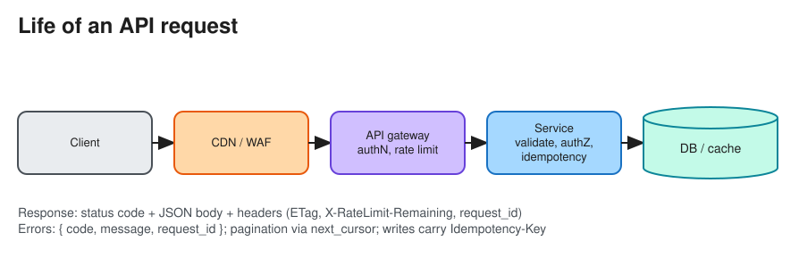

# API Design (for System Design Interviews)

> **TL;DR** — In the interview, define the API right after the requirements: **resources, endpoints/methods,
> request and response fields, and status codes** for each core use case. Show production thinking:
> **auth, pagination (cursor), idempotency keys for writes, rate limits, versioning, and consistent errors**.
> Choose the style (REST, GraphQL, gRPC, WebSocket) per client. See [REST vs GraphQL vs gRPC](api_styles.md).

## Interview template
```http
POST /v1/tweets                         # create
Authorization: Bearer <token>
Idempotency-Key: 7c1e...                 # safe retries
{ "text": "hello", "media_ids": ["m1"] }
-> 201 Created  { "id": "t_123", "created_at": "...", "author_id": "u_9" }

GET  /v1/users/{user_id}/timeline?cursor=abc&limit=20
-> 200 OK { "items": [ ... ], "next_cursor": "def" }

DELETE /v1/tweets/{id}  -> 204 No Content
```
State: *who* calls it, *what* it reads or writes, and *which* component serves it. Keep it to the 3–5 calls
that matter for the functional requirements.



## Resource modelling
* Plural nouns, hierarchical where ownership is natural: `/users/{id}/orders`, `/orders/{id}/items`.
* Actions that aren't CRUD: either a sub-resource (`POST /orders/{id}/cancellation`) or a custom verb
  (`POST /orders/{id}:cancel`, Google AIP style).
* Use **opaque, non-sequential IDs** (UUID, Snowflake, prefixed `ord_...`) so IDs can't be enumerated and don't
  leak business volume. See [Unique ID Generator](../problems/unique_id_generator.md).
* Timestamps in ISO-8601 UTC; money as integer minor units + currency (`{"amount": 1999, "currency": "USD"}`),
  **never floats**.

## Pagination
| | Offset (`?page=3&size=20`) | Cursor / keyset (`?cursor=<opaque>&limit=20`) |
|---|---|---|
| Implementation | `LIMIT 20 OFFSET 40` | `WHERE (created_at, id) < (?, ?) ORDER BY created_at DESC, id DESC LIMIT 20` |
| Deep pages | Slow (scans skipped rows) | Constant time with an index |
| Concurrent inserts | Duplicates or skipped items | Stable |
| Jump to page N | Yes | No |

Use cursor pagination for feeds, timelines and large tables. The cursor encodes the last sort key, base64'd.

## Writes, retries and concurrency
* **Idempotency-Key** header on POSTs that create things or move money. See [Idempotency](idempotency.md).
* **Optimistic concurrency**: return an `ETag`/`version`; the client sends `If-Match`; the server returns `412`
  on mismatch.
* **Long-running work**: `202 Accepted` + `Location: /v1/jobs/{id}`; poll it, or receive a webhook or WebSocket
  push.
* **Bulk endpoints** for chatty clients (`POST /v1/messages:batchGet`).

## Errors
```json
{ "error": { "code": "INSUFFICIENT_FUNDS", "message": "Balance too low", "request_id": "req_8f..", "details": {...} } }
```
* Correct status codes (`400` validation, `401`, `403`, `404`, `409` conflict, `422`, `429` with `Retry-After`,
  `500`, `503`). Use a stable machine-readable `code`, and include a `request_id` for support and tracing.

## Versioning and evolution
* Versioning schemes: URI (`/v1`, the most common and visible), header (`Accept: application/vnd.x.v2+json`),
  or date-based (Stripe `Stripe-Version: 2024-06-20`).
* **Additive changes are backward compatible** (new optional fields and endpoints). Removing or renaming fields
  needs a new version plus a deprecation window (`Deprecation` / `Sunset` headers).
* Clients must ignore unknown fields.

## Security and limits
* AuthN through OAuth2 or JWT bearer tokens, and **object-level authZ on every request**. See
  [AuthN & AuthZ](authn_authz.md).
* Rate limit per API key or user and return `X-RateLimit-*` headers. See [Rate Limiter](../problems/rate_limiter.md).
* Validate input sizes, enforce HTTPS, and never put secrets or PII in URLs (they end up in logs).

## Real-time and push APIs
* **WebSocket** for bidirectional chat or games, **SSE** for server→client streams (live scores, LLM token
  streaming), **webhooks** for server→server events (sign them with HMAC, retry with backoff, let receivers
  dedupe by event ID). See [Long Polling, WebSockets, SSE, Webhooks](lp_ws_sse_wh.md).

# References
* https://blog.bytebytego.com/p/the-art-of-rest-api-design-idempotency
* https://google.aip.dev/general
* https://github.com/microsoft/api-guidelines
* https://docs.stripe.com/api
* https://swagger.io/specification/
