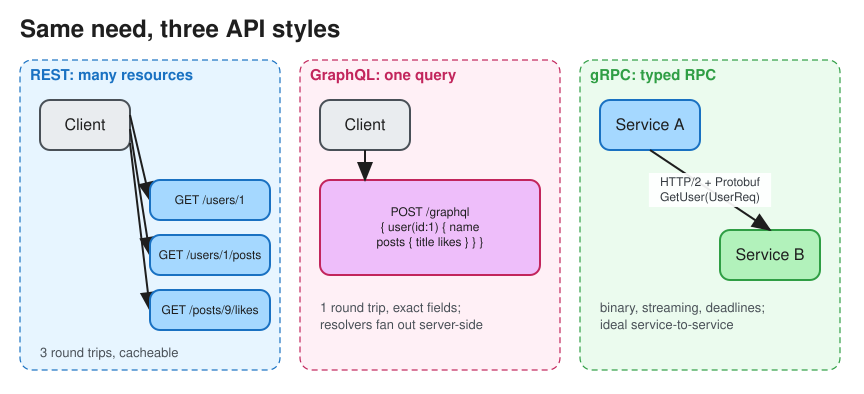

# REST vs GraphQL vs gRPC

> **TL;DR** — **REST**: resources plus HTTP verbs, cacheable and universal; the default for public APIs.
> **GraphQL**: a single endpoint where the client asks for exactly the fields it needs; good for many clients
> and aggregation of nested data. **gRPC**: contract-first RPC over HTTP/2 with Protobuf; fast, typed,
> streaming; the default for internal service-to-service calls. Real systems mix them: REST or GraphQL at the
> edge, gRPC inside.

## Comparison
| | REST | GraphQL | gRPC |
|---|---|---|---|
| Model | Resources (`/users/42/orders`) + verbs | Typed schema; queries, mutations, subscriptions | Services + methods (`OrderService.Get`) |
| Transport | HTTP/1.1 or 2 | HTTP (usually POST `/graphql`); WebSocket for subscriptions | HTTP/2 (multiplexed streams) |
| Payload | JSON (text) | JSON | Protobuf (binary, ~3–10x smaller, faster to parse) |
| Contract | OpenAPI (optional) | Schema (required, introspectable) | `.proto` (required), code-gen clients |
| Fetching | Over-/under-fetching; many round trips for nested data | Exactly the fields needed, one round trip | Exactly the defined message |
| Caching | HTTP caching built in (ETag, Cache-Control, CDN) | Hard at the HTTP layer (POST, one URL); needs persisted queries or client caches (Apollo) | No HTTP caching; cache at the application layer |
| Streaming | No (use SSE or WebSocket) | Subscriptions | Unary, server-, client-, and bidirectional streaming |
| Browser support | Native | Native | Needs gRPC-Web + a proxy (Envoy) |
| Errors | HTTP status codes | Always `200` with an `errors[]` array | Status codes (`NOT_FOUND`, `DEADLINE_EXCEEDED`, ...) |
| Versioning | URL (`/v2`) or header | Evolve the schema; deprecate fields | Protobuf field numbers: add fields, never reuse them |
| Best for | Public APIs, CRUD, cacheable reads | Mobile/web BFF, many clients with different needs | Low-latency internal microservices, polyglot, streaming |

## REST essentials
* Use nouns for resources and HTTP verbs for actions: `GET /orders/1`, `POST /orders`, `PATCH /orders/1`,
  `DELETE /orders/1`.
* **Idempotent** verbs: GET, PUT, DELETE (and HEAD, OPTIONS). POST is not idempotent, so add an
  `Idempotency-Key` header. See [Idempotency](idempotency.md).
* Status codes: `200/201/204`, `400` bad input, `401` unauthenticated, `403` forbidden, `404`, `409` conflict,
  `429` rate-limited, `5xx` server errors.
* Pagination: **cursor-based** (`?cursor=abc&limit=50`) beats offset for large or changing datasets.
* HATEOAS (links in responses) is often skipped in practice.

## GraphQL essentials
* The schema defines types; **resolvers** fetch each field. The **N+1 problem** (a resolver per item) is solved
  with **DataLoader** batching.
* Protect the server with query depth and complexity limits, persisted queries, and timeouts.
* **Federation** (Apollo) composes one graph from many services' subgraphs.

## gRPC essentials
* Define the service in `.proto`, then generate client and server stubs in each language.
* **Deadlines** propagate across hops; set them on every call.
* Load balancing: HTTP/2 keeps long-lived connections, so L4 load balancers pin all traffic to one backend. Use
  L7 or client-side load balancing (Envoy, xDS, service mesh).

## Picking in an interview
* Public, third-party developer API: **REST** (familiar, cacheable, easy to debug with curl).
* Mobile app with screens that need data from many entities: **GraphQL** BFF.
* Internal high-QPS service mesh, streaming between services: **gRPC**.
* Real-time push to browsers: WebSockets or SSE. See [Long polling / WebSockets / SSE](lp_ws_sse_wh.md).

# References
* https://blog.bytebytego.com/p/the-foundation-of-rest-api-http
* https://graphql.org/learn/
* https://grpc.io/docs/what-is-grpc/core-concepts/
* https://github.com/donnemartin/system-design-primer#remote-procedure-call-rpc
