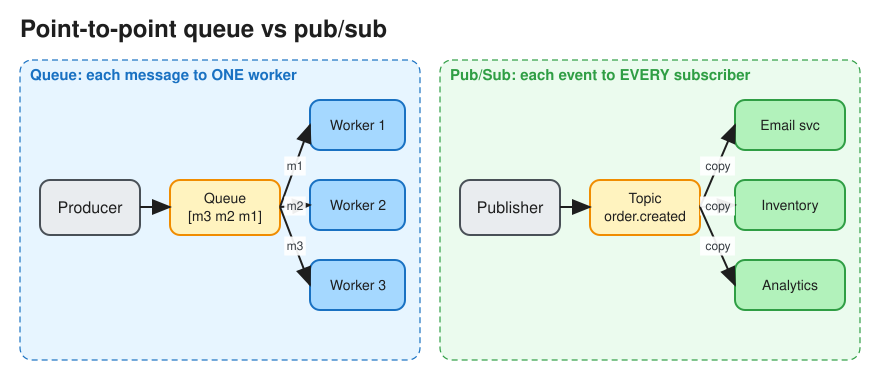

# Synchronous vs Asynchronous Communication (Queues & Pub/Sub)

> **TL;DR** — **Synchronous** (request/response over HTTP or gRPC): the caller waits, so it is simple and
> immediately consistent, but it couples availability and latency across services. **Asynchronous** (via a
> message queue or event log): the caller hands off work and moves on, which **decouples** services, absorbs
> spikes, and enables retries, at the cost of eventual consistency and operational complexity. Use **queues**
> for work distribution (one consumer per message) and **pub/sub** for event fan-out (every subscriber gets
> every event).

## Sync vs async
| | Synchronous | Asynchronous |
|---|---|---|
| Coupling | Temporal: both sides must be up | Producer and consumer evolve and fail independently |
| Latency seen by user | Sum of the call chain | Only the enqueue step; work happens later |
| Load spikes | Propagate downstream and can cause cascading failure | Buffered in the queue (load levelling) |
| Consistency | Immediate | Eventual; the user may need a "processing..." state |
| Error handling | Caller retries or fails | Broker redelivers; dead-letter queue (DLQ) |
| Debugging | Straightforward stack traces | Needs tracing across hops, correlation IDs |
| Use when | The user needs the answer *now* (login, read a page, check price) | Side effects, slow work, fan-out (emails, thumbnails, notifications, analytics, order fulfilment) |

## Message queue vs pub/sub vs log

| | Point-to-point queue | Pub/Sub (topics) | Distributed log |
|---|---|---|---|
| Delivery | Each message to **one** consumer in the pool | Each message to **every** subscription | Consumers read by **offset**; each consumer group gets every message |
| After consumption | Deleted (acked) | Deleted per subscription | **Retained** (time or size); replayable |
| Ordering | Best effort (FIFO queues available) | Usually none | Per partition |
| Examples | SQS, RabbitMQ queues, Celery | SNS, Google Pub/Sub, RabbitMQ fanout exchange | Kafka, Kinesis, Pulsar, Redpanda |
| Good for | Task/job distribution, worker pools | Notifications, fan-out to many services | Event sourcing, CDC, stream processing, replay |

## Key concepts
* **Delivery semantics**: at-most-once, at-least-once (the common default, so **consumers must be
  idempotent**; see [Idempotency](idempotency.md)), and exactly-once (only *within* a system such as Kafka
  transactions; end-to-end you get "effectively once" through idempotency).
* **Acknowledgement and visibility timeout**: the message is hidden while a worker processes it; if there is no
  ack before the timeout, it is redelivered.
* **Dead-letter queue (DLQ)**: after N failed attempts, park the message for inspection instead of blocking the
  queue.
* **Ordering**: global ordering doesn't scale. Order per key by partitioning on `user_id` / `order_id` (Kafka
  partition key, SQS FIFO message group ID).
* **Backpressure**: bounded queues, consumer lag alerts, autoscaling consumers on queue depth, and rejecting or
  shedding load at the edge when the backlog is too large.
* **Task queue**: a queue plus a worker framework that adds scheduling, retries and results (Celery, Sidekiq,
  Temporal for durable workflows).

## Patterns that come up in interviews
* **Transactional outbox**: write the business row *and* an `outbox` row in the same DB transaction; a relay
  (or CDC with Debezium) publishes the outbox to Kafka. This avoids the "dual write" problem (DB commit
  succeeds but the publish fails, or the reverse).
* **Saga**: a long-running business transaction made of local steps plus compensations, coordinated by events
  (choreography) or by an orchestrator. See [Distributed Transactions](distributed_transactions.md).
* **CQRS**: write model → events → denormalized read models (cache, search index).
* **Async request-reply**: return `202 Accepted` + a job ID; the client polls `GET /jobs/{id}` or receives a
  webhook or WebSocket push. See [Long Polling, WebSockets, SSE](lp_ws_sse_wh.md).
* **Fan-out on write**: a new post goes to a queue, and workers push it into followers' feed caches.

## Interview follow-ups
* *"Kafka vs SQS?"* Kafka: high-throughput retained log, replay, multiple consumer groups, per-partition
  ordering; you manage partitions. SQS: fully managed queue, per-message ack, auto-scaling, no replay, 14-day
  max retention.
* *"The consumer crashed after doing the work but before acking."* The message is redelivered, so the handler
  must be idempotent (dedupe table keyed on message ID, or conditional writes).

# References
* https://newsletter.ashishps.com/p/aec1cebf-6060-45a7-8e00-47364ca70761
* https://github.com/donnemartin/system-design-primer#asynchronism
* https://microservices.io/patterns/data/transactional-outbox.html
* https://docs.aws.amazon.com/sns/latest/dg/sns-sqs-as-subscriber.html
* https://docs.aws.amazon.com/AWSSimpleQueueService/latest/SQSDeveloperGuide/sqs-visibility-timeout.html
* [Kafka: a Distributed Messaging System for Log Processing](https://notes.stephenholiday.com/Kafka.pdf)
