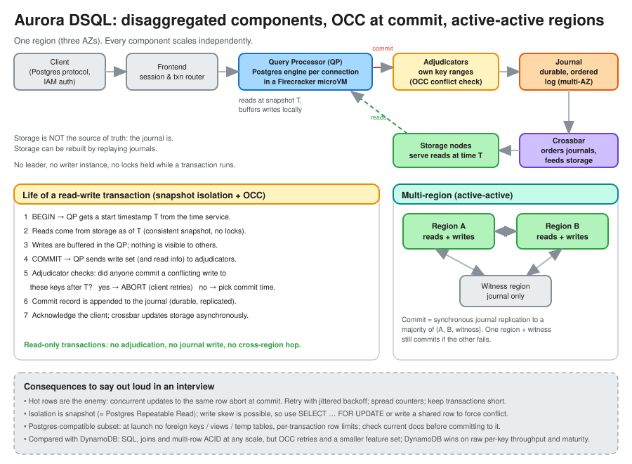

# Distributed SQL deep dive: Amazon Aurora DSQL

> **TL;DR** — Aurora DSQL (GA May 2025) is AWS's **serverless, Postgres-compatible distributed SQL database** with
> **active-active multi-Region** reads and writes and **strong consistency**. It deliberately *disaggregates* the database
> into independently scaled services: **Query Processors** (a Postgres engine per connection), **Adjudicators** (conflict
> detection per key range), a **Journal** (the durable, ordered transaction log), a **Crossbar** and **Storage** nodes.
> Concurrency control is **optimistic (OCC) with snapshot isolation**: no locks while a transaction runs, conflicts are
> detected at `COMMIT`, and the application **must retry** aborted transactions. Use it as the worked example of "NewSQL"
> for an AWS-flavored interview: SQL + ACID + horizontal scale + multi-Region without a failover step, at the price of
> **OCC retries**, a **Postgres-compatible subset**, and commit latency that includes a cross-AZ or cross-Region quorum.
> For the general idea see [SQL vs NoSQL: NewSQL / distributed SQL](database_sql_vs_nosql.md#newsql--distributed-sql).



## Why it exists
* **DynamoDB** scales writes and spans Regions but isn't relational (no joins, ad-hoc SQL, or rich transactions).
* **Aurora PostgreSQL/MySQL** is relational and fast but has a **single writer**; multi-Region Global Database is active-passive.
* **Spanner / CockroachDB** offer distributed SQL but weren't an AWS-native, serverless, scale-to-zero option.
* DSQL targets the gap: *relational + horizontally scalable writes + active-active Regions + no instances to manage.*
  It is a **different architecture** from classic Aurora (not "Aurora with a new storage layer").

## Components (single Region)
| Component | Role | Notes |
|---|---|---|
| **Frontend** | Session and transaction router | Sends each connection to its own QP |
| **Query Processor (QP)** | Runs the Postgres engine for that connection in a **Firecracker microVM**; executes SQL, reads from storage, **buffers writes locally**, drives the commit protocol | Stateless, scales per active connection; also holds the shard map and the time source for transaction timestamps |
| **Adjudicator** | Implements **OCC**: at commit, checks whether any key in the transaction's write set was changed after the transaction's start time; if so it aborts | Distributed: each adjudicator **owns key ranges**, so conflict checking scales out |
| **Journal** | **Durable, ordered log** of committed transactions, replicated across AZs (and Regions) | **The source of truth.** Durability lives here, not in storage |
| **Crossbar** | Merges the journals into a total order and lets storage nodes **subscribe by key range** | Decouples write scaling (journals) from read scaling (storage) |
| **Storage nodes** | Serve table data and indexes **as of a timestamp** | Not authoritative: they can be rebuilt by replaying the journal |

Each tier scales independently: more connections → more QPs; more write volume → more journals/adjudicators; more
data/reads → more storage nodes. Because durability is delegated to the journal, the storage layer stays simple, and there
is **no writer instance, no leader election for the whole database, and no failover step** visible to clients.

## Life of a transaction
1. `BEGIN`: the QP reads the clock to get a **start timestamp T** and uses it as the transaction's snapshot.
2. **Reads** are issued to storage "as of T" (a consistent snapshot; no read locks), so reads never block writers.
3. **Writes** are buffered in the QP; nobody else can see them. Interactive, multi-statement transactions work.
4. `COMMIT`: the QP sends the **write set** (and what it needs for validation) to the adjudicators that own those key ranges.
5. Each adjudicator checks for a **conflicting commit to the same keys after T**. Any conflict → the transaction **aborts** with a
   serialization/concurrency error (SQLSTATE `40001`-class); otherwise it gets a **commit timestamp**.
6. The commit record is **appended to the journal** (durable, replicated). In a multi-Region cluster this is **synchronous to a majority**.
7. The client gets the ack; the crossbar then feeds the committed changes to storage asynchronously (later reads at newer timestamps see them).

**Read-only transactions** need no adjudication, no journal write and no cross-Region traffic.

## Multi-Region (active-active)
* A cluster is formed by peering **two active Regions plus a witness Region** (the witness stores journal data and takes part in
  the quorum but serves no queries). **Both active Regions accept reads and writes** with strong consistency.
* A commit is acknowledged when the journal record is durable on a **majority of {Region A, Region B, witness}**. So if one active
  Region (or the witness) fails, the remaining two still form a majority and commits continue, giving a **zero RPO** and no promotion step.
* **Latency**: reads are served locally; **write commits pay at least one cross-Region round trip** (e.g. tens of ms between nearby
  Regions, more for distant ones). Pick the Region pair accordingly.
* AWS advertises **99.99%** availability single-Region and **99.999%** multi-Region.

## Consistency and isolation
* **Snapshot isolation** (comparable to Postgres Repeatable Read), **not serializable**. Write skew is possible: two transactions
  that read overlapping data but write *different* rows can both commit. Fix by making them write a **shared row** (to force a conflict)
  or by using `SELECT … FOR UPDATE` patterns supported by the engine.
* Global **strong consistency** (reads see the latest committed state in any Region). Compare with
  [Spanner](database_sql_vs_nosql.md#newsql--distributed-sql) (TrueTime, external consistency, locking + 2PC) and CockroachDB
  (Raft per range, serializable): DSQL gets there with timestamps, OCC and a journal-first design instead.
* See [Transactions](transactions.md) for write skew and isolation levels, and [Consistency](consistency.md) for the models.

## Programming model: retries are not optional
OCC means contention shows up as **aborts**, not waits. Your code must wrap transactions in a retry loop with jittered backoff:

```python
for attempt in range(MAX_RETRIES):
    try:
        with conn.transaction():          # BEGIN ... COMMIT
            row = conn.execute("SELECT stock FROM item WHERE id=%s", (item_id,)).fetchone()
            if row.stock < qty: raise OutOfStock()
            conn.execute("UPDATE item SET stock = stock - %s WHERE id=%s", (qty, item_id))
        break                              # committed
    except SerializationConflict:          # SQLSTATE 40001 / OC000-style error from the adjudicator
        sleep(random.uniform(0, base * 2 ** attempt))
else:
    raise TooMuchContention()
```

Design guidance:
* Keep transactions **short** and small (there are per-transaction row/time limits; check the current quotas).
* **Avoid hot rows** (a global counter, one "inventory" row): every concurrent update to the same row conflicts. Shard counters
  across rows, queue updates, or aggregate asynchronously.
* **Make writes idempotent** so a retry after an unknown commit result is safe ([Idempotency](idempotency.md)).
* Prefer **UUID / random keys** over monotonically increasing sequences to avoid hot key ranges.
* Connection auth is **IAM-based tokens** (short-lived), not static passwords; connect through the cluster endpoint of your local Region.

## Compatibility and limits (verify the current docs)
DSQL speaks the Postgres wire protocol and supports a **subset** of PostgreSQL. At and shortly after GA, notable gaps included
no foreign-key enforcement, limited or no views/temporary tables/triggers/extensions, and a per-transaction row-modification
cap (on the order of 10,000 rows), with AWS continuing to expand support. Treat compatibility as the deciding factor: test your
ORM, migrations, DDL patterns and extensions before committing. Enforce referential integrity in the application or via
constraints you can rely on.

## When to use it in an interview
**Good fit**
* Multi-Region SaaS/user/account/entitlement data that must be **strongly consistent** and **always writable** in two Regions.
* Financial/inventory/booking workloads that need **SQL + ACID** and Region-level resilience with **zero RPO**.
* Spiky or unknown workloads where **serverless scale-to-zero** and no capacity planning are attractive.

**Poor fit**
* **Hot-row** workloads (global counters, one inventory row hit by thousands of writers): OCC abort storms.
* Apps needing **full Postgres** (extensions, triggers, FKs, long transactions) or sub-ms in-Region commits.
* Simple key-value access at huge scale (DynamoDB is cheaper/simpler) or analytics (use a warehouse).

### AWS data-store chooser
| Need | Pick |
|---|---|
| Key-value / simple access patterns, massive scale, serverless | **DynamoDB** (global tables MREC/MRSC for multi-Region) |
| Full-featured Postgres/MySQL, one Region, single writer, replicas | **Aurora (classic) / RDS** |
| Relational + multi-Region active-active + strong consistency, accept OCC and a subset of Postgres | **Aurora DSQL** |
| Search / analytics / graph / vector | OpenSearch / Redshift, Athena / Neptune / pgvector or OpenSearch |

DynamoDB's **MRSC** global tables (GA June 2025) also give multi-Region strong consistency, so if your access patterns are
key-value, DynamoDB MRSC may be simpler than DSQL; if you need joins and relational constraints, choose DSQL. See [DynamoDB](dynamodb.md).

## DSQL vs other distributed SQL systems
| | Aurora DSQL | Spanner | CockroachDB | TiDB |
|---|---|---|---|---|
| Concurrency | **OCC**, snapshot isolation | Locking + 2PC, external consistency | MVCC, serializable by default | Optimistic/pessimistic txns |
| Replication | Journal (multi-AZ / multi-Region quorum) | Paxos group per split | Raft per range | Raft per region (TiKV) |
| Clocks | Time service for timestamps | **TrueTime** (GPS/atomic) | Hybrid logical clocks | TSO (timestamp oracle) |
| Compatibility | Postgres subset | Spanner SQL (+ PG dialect) | Postgres wire/SQL | MySQL |
| Ops model | Serverless, AWS only | Managed (GCP) | Self-hosted or cloud | Self-hosted or cloud |

## Pitfalls checklist
* No retry logic (first contention = user-visible errors); retries without jitter; non-idempotent side effects inside the retried block.
* Hot rows and monotonic keys; giant transactions; long read-modify-write sequences.
* Assuming serializable behavior (write skew), or full Postgres features and 100% ORM compatibility.
* Ignoring cross-Region commit latency; choosing a far-apart Region pair for latency-sensitive writes.
* Treating a Region-local endpoint as global (connect to the nearest Region; understand witness placement).

## Interview follow-ups
* *"How does Aurora DSQL avoid a single writer?"* Any QP serves any connection; writes are validated by distributed adjudicators
  per key range and made durable in a journal, so there is no instance that owns the database.
* *"What does 'optimistic' mean and what do I do about it?"* No locks while running; conflicts detected at commit; retry aborted transactions with backoff and keep them small.
* *"Where is data durable?"* In the **journal**, replicated across AZs (and across Regions via the quorum); storage is derived and rebuildable.
* *"What happens if a Region fails?"* The surviving active Region plus the witness form a majority; commits continue, no promotion, no data loss.
* *"Compared with Aurora PostgreSQL?"* Aurora is single-writer, richer Postgres support, lower in-Region commit latency; DSQL is multi-writer, multi-Region active-active, with OCC and a subset of features.
* *"Compared with Spanner?"* Same goal; different mechanism (TrueTime + locks + Paxos vs timestamps + OCC + journal) and a different vendor/cloud.
* *"How would you design a global inventory with it?"* Shard stock per SKU-location rows to avoid one hot row, conditional decrements with retries, idempotency keys per order, and keep the long-tail analytics in a warehouse.

# References
* [Amazon Aurora DSQL is now generally available (AWS, May 2025)](https://aws.amazon.com/about-aws/whats-new/2025/05/amazon-aurora-dsql-generally-available)
* [Everything you don't need to know about Aurora DSQL, Part 2: shallow view (AWS Database Blog)](https://aws.amazon.com/blogs/database/everything-you-dont-need-to-know-about-amazon-aurora-dsql-part-2-shallow-view)
* [Part 3: transaction processing](https://aws.amazon.com/jp/blogs/database/everything-you-dont-need-to-know-about-amazon-aurora-dsql-part-3-transaction-processing/) and [Part 4: DSQL components](https://aws.amazon.com/blogs/database/everything-you-dont-need-to-know-about-amazon-aurora-dsql-part-4-dsql-components)
* [Concurrency control in Amazon Aurora DSQL (AWS Database Blog)](https://aws.amazon.com/blogs/database/concurrency-control-in-amazon-aurora-dsql)
* [Amazon Aurora DSQL for global-scale financial transactions (AWS Database Blog)](https://aws.amazon.com/blogs/database/amazon-aurora-dsql-for-global-scale-financial-transactions/)
* [Just make it scale: An Aurora DSQL story (Werner Vogels)](https://www.allthingsdistributed.com/2025/05/just-make-it-scale-an-aurora-dsql-story.html)
* [Aurora DSQL: Scalable, Multi-Region OLTP (paper)](https://arxiv.org/pdf/2607.13276)
* [Spanner: Google's Globally-Distributed Database](https://static.googleusercontent.com/media/research.google.com/en//archive/spanner-osdi2012.pdf)
