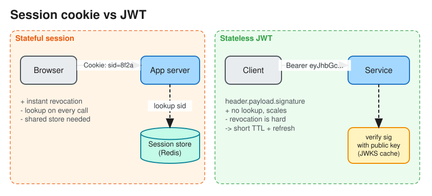
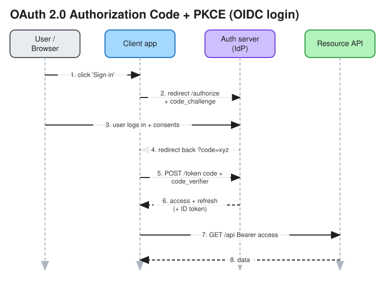

# Authentication (AuthN) & Authorization (AuthZ)

> **TL;DR** — **AuthN** answers *who are you?* (password, passkey, OTP, SSO). **AuthZ** answers *what may you
> do?* (RBAC, ABAC, ReBAC). For web and mobile, the common designs are server-side **sessions** (an opaque
> cookie with state in Redis) or **tokens** (a short-lived JWT access token plus a long-lived, rotating refresh
> token). Use **OAuth 2.0** to *delegate access* and **OpenID Connect (OIDC)** to *log users in* through an
> identity provider.

## Authentication factors
* Something you **know** (password, PIN), **have** (phone OTP, hardware key), **are** (biometrics).
* **MFA** combines two or more. **Passkeys / WebAuthn**: public-key credentials bound to the device and the
  origin, so they resist phishing.
* Password storage: never encrypt passwords. **Hash** them with a slow, salted algorithm (argon2id, bcrypt,
  scrypt). Add rate limiting and lockout to stop credential stuffing.

## Sessions vs tokens

| | Server session (cookie) | JWT (self-contained token) |
|---|---|---|
| What the client holds | Opaque random session ID | Signed token containing claims (`sub`, `exp`, `scope`, ...) |
| Validation | Look up the session store on each request (Redis) | Verify the signature locally, no lookup needed |
| Revocation | Easy: delete the session | Hard: wait for expiry, or keep a denylist, or use short TTL + refresh token |
| Scaling | Needs a shared session store | Stateless; good across many services |
| Size | Small cookie | Larger (it carries claims), sent on every request |
| Best for | Monolith web apps | Microservices, mobile, third-party APIs |

**JWT structure**: `base64url(header).base64url(payload).signature`. The payload is *encoded, not encrypted*;
never put secrets in it. Use asymmetric signing (RS256/ES256) so services verify with a public key (JWKS)
without being able to mint tokens.

**Refresh tokens**: the access token is short-lived (5–15 min); the refresh token is long-lived, stored securely,
**rotated on every use**, and reuse of an old refresh token revokes the whole token family (theft detection).

**Cookie hygiene**: `HttpOnly` (no JS access, which limits XSS theft), `Secure`, `SameSite=Lax/Strict` (CSRF
protection), plus CSRF tokens for state-changing requests if `SameSite=None` is needed.

## OAuth 2.0 and OpenID Connect

* **OAuth 2.0** = *authorization delegation*: "let app X read my Google Calendar" without sharing the password.
  Roles: resource owner (user), client (app), authorization server, resource server (API).
* **Authorization Code + PKCE**: the recommended flow for web, mobile and SPA apps. PKCE (`code_verifier` /
  `code_challenge`) stops an intercepted code from being exchanged by an attacker.
* **Client Credentials**: machine-to-machine, no user involved.
* **Device Code**: TVs and CLIs.
* Implicit and Resource Owner Password flows are **deprecated**.
* **OIDC** adds an **ID token** (a JWT about the *user*) plus a `/userinfo` endpoint on top of OAuth, which turns
  it into an *authentication* protocol. "Sign in with Google" is OIDC.
* **SAML**: older XML-based SSO, still common in enterprise.

## Authorization models
| Model | Idea | Example | Notes |
|---|---|---|---|
| **ACL** | Per-resource list of who can do what | File permissions | Hard to manage at scale |
| **RBAC** | Users → roles → permissions | `admin`, `editor`, `viewer` | Simple; role explosion over time |
| **ABAC** | Policy over attributes of user, resource, environment | "managers can approve expenses < $5k in their dept during business hours" | Flexible; policy engines (OPA/Rego, AWS Cedar) |
| **ReBAC** | Permission derived from relationships in a graph | "can view doc if member of a group that owns the folder" | Google **Zanzibar** (SpiceDB, OpenFGA); great for sharing models |

## Where it lives in an architecture
* **API Gateway / edge**: validates tokens (signature, expiry, audience) and rate-limits per client.
  See [API Gateway](api_gateway.md).
* **Services**: enforce *fine-grained* authZ (does user U own order O?). Never trust the gateway alone for
  object-level checks; missing object-level checks (BOLA/IDOR) are the #1 API security risk.
* **Service-to-service**: mTLS (service mesh identity, SPIFFE) plus scoped tokens.
* **Central identity provider**: Auth0, Okta, Cognito, Keycloak.

## Interview follow-ups
* *"How do you log a user out everywhere with JWTs?"* Short access TTL; revoke the refresh token family; keep
  a per-user `token_version` (or `iat` cutoff) that services check from a cache.
* *"Where do you store tokens in a browser?"* Prefer an `HttpOnly` cookie (BFF pattern) over `localStorage`,
  which any XSS can read.
* *"Design authZ for Google Drive-style sharing."* ReBAC (Zanzibar): tuples `doc:1#viewer@group:eng#member`,
  checks answered by graph traversal, caching, and consistency tokens ("zookies") to avoid the
  new-enemy problem.

# References
* https://blog.bytebytego.com/p/password-session-cookie-token-jwt
* https://blog.bytebytego.com/p/password-session-cookie-token-jwt-ec1
* https://oauth.net/2/
* https://openid.net/developers/how-connect-works/
* https://research.google/pubs/zanzibar-googles-consistent-global-authorization-system/
* https://owasp.org/API-Security/
