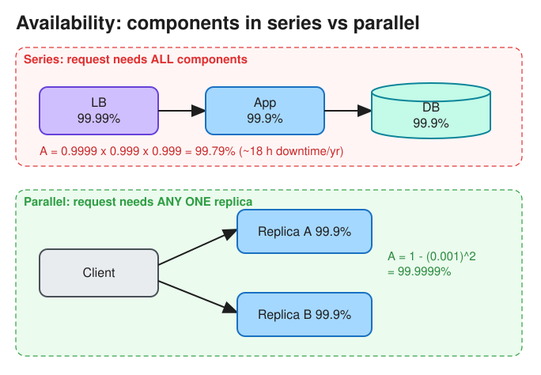
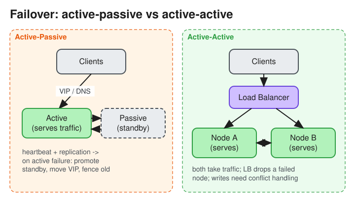

# Availability

> **TL;DR** — Availability is the fraction of time a system answers requests successfully. Reach it by removing
> single points of failure (SPOFs), adding redundancy, and detecting and failing over quickly. Components in
> **series** multiply their availabilities (the total goes down); redundant components in **parallel** multiply
> their *unavailabilities* (the total goes up).

## Definition
```
Availability = Uptime / (Uptime + Downtime)        = MTBF / (MTBF + MTTR)
```
* **MTBF**: mean time between failures. **MTTR**: mean time to repair or recover.
* You can raise availability by failing less often (higher MTBF) **or by recovering faster (lower MTTR)**. In
  practice, lowering MTTR (auto-failover, fast rollback, good alerting) is usually cheaper.

## The "nines"

| Availability | Downtime / year | Downtime / month | Downtime / day |
|---|---|---|---|
| 99% (two 9s) | 3.65 days | 7.3 h | 14.4 min |
| 99.9% (three 9s) | 8.77 h | 43.8 min | 1.44 min |
| 99.95% | 4.38 h | 21.9 min | 43.2 s |
| 99.99% (four 9s) | 52.6 min | 4.38 min | 8.64 s |
| 99.999% (five 9s) | 5.26 min | 26.3 s | 0.86 s |

Rule of thumb: each extra nine costs roughly 10x more engineering effort and money.

## Availability in series vs parallel


* **Series** (a request needs A *and* B): `A_total = A1 × A2 × ... × An`. Every new hop in the critical path
  *lowers* availability.
* **Parallel** (a request needs A *or* B): `A_total = 1 − (1 − A1)(1 − A2)...`. Two 99.9% replicas give 99.9999%,
  *assuming failures are independent*. Correlated failures (same rack, same AZ, same bad deploy, same config push)
  break this assumption, which is why real systems spread replicas across failure domains.

## Patterns for high availability
### Eliminate SPOFs
* Run every tier redundantly: multiple LB nodes (with a floating VIP or DNS), stateless app servers behind the LB,
  replicated databases, multi-AZ deployments.
* Hidden SPOFs to call out in interviews: DNS provider, a single primary DB, a config service, a single region,
  certificates, a shared cache cluster, a single Kafka controller, the deploy pipeline itself.

### Failover


| | Active-Passive (master-standby) | Active-Active |
|---|---|---|
| How | Standby takes over when a heartbeat from the active is lost | All nodes serve traffic; LB removes the failed one |
| Capacity | Standby capacity is idle (hot, warm or cold standby) | All capacity is used, but each node must absorb the failed node's load |
| Data | Simple: one writer | Harder: concurrent writes need conflict resolution or partitioning |
| Failover time | Seconds to minutes (detect, promote, repoint) | Near-instant |
| Risks | Split-brain if both think they are active (use fencing or quorum) | Hot spots and cascading overload |

* **Hot standby**: running and replicating continuously, so takeover is fast. **Warm standby**: running but
  needs to catch up. **Cold standby**: has to be started, so takeover is slow.
* Failover always loses some unreplicated data if replication is asynchronous. State the RPO (below) explicitly.

### Other techniques
* **Health checks + automatic removal** from the load balancer.
* **Graceful degradation**: serve stale cache or a reduced feature set instead of failing (for example, show the
  feed without recommendations).
* **Load shedding and rate limiting** to protect the core path during overload.
* **Multi-region**: active-passive (DR region) or active-active (geo-routing; needs a data replication strategy).
* **Deployment safety**: canary releases, blue/green, feature flags, fast rollback. Most outages are caused by
  changes, not hardware.

## Related terms
* **SLI** (indicator): a measured value, e.g. % of requests with a 2xx response in < 300 ms.
* **SLO** (objective): an internal target, e.g. 99.9% of requests over 30 days. `1 − SLO` = **error budget**.
* **SLA** (agreement): a contractual promise with penalties. It is usually looser than the SLO.
* **RTO** (recovery time objective): how long recovery may take. **RPO** (recovery point objective): how much data
  (in time) you can lose.
* **High availability vs fault tolerance**: HA minimizes downtime (a brief blip during failover is fine). Fault
  tolerance means *zero* interruption (for example, lock-step replicas). It is far more expensive.
* **Availability vs reliability**: see [Reliability](reliability.md). A system can be available (it answers) but
  unreliable (it answers wrongly).

## Interview follow-ups
* *"Your service calls 5 dependencies, each 99.9%. What's your availability?"* At most 0.999^5 ≈ 99.5% if all
  calls are on the critical path. Reduce it with caching, async calls, timeouts plus fallbacks, and by making
  non-critical calls optional.
* *"How do you avoid split-brain in active-passive?"* Use a quorum or leader election (ZooKeeper, etcd, Raft), and
  fencing tokens or STONITH so the old primary cannot keep writing. See
  [Distributed Locking](distributed_locking.md).
* *"How is availability measured?"* By request success rate (preferred for services) or by time-based uptime from
  synthetic probes. Measure from the client's point of view when possible.

## Real-world examples
* AWS S3 is designed for 99.99% availability (S3 Standard) and 11 nines of durability. Durability and
  availability are different properties.
* DynamoDB global tables: multi-region active-active with last-writer-wins conflict resolution.

# References
* https://blog.bytebytego.com/p/how-do-we-design-for-high-availability
* https://github.com/donnemartin/system-design-primer#availability-patterns
* https://github.com/karanpratapsingh/system-design#availability
* https://sre.google/sre-book/availability-table/
