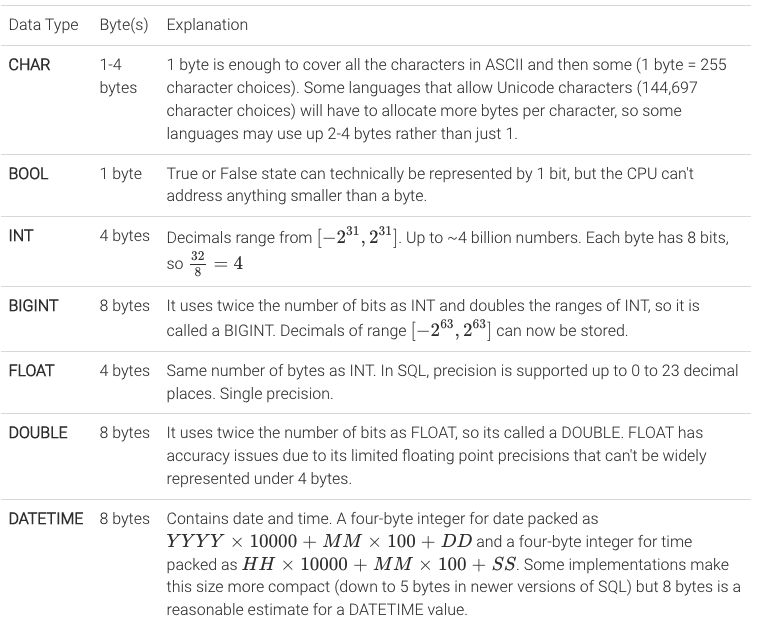
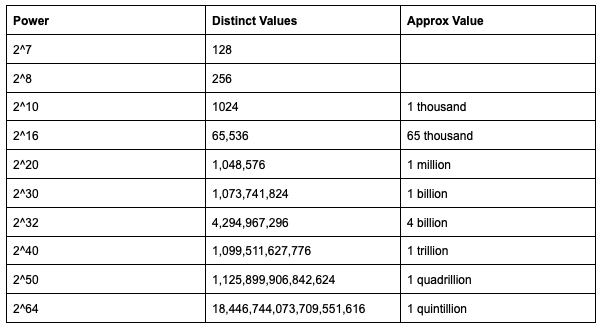
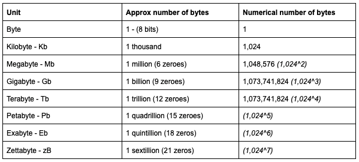
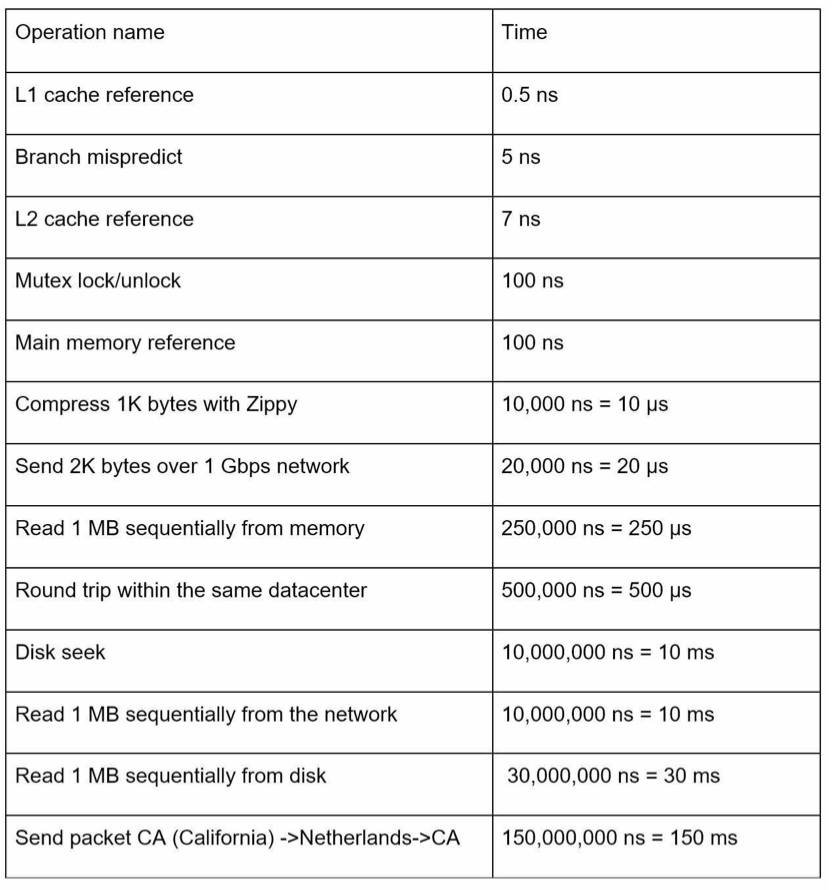
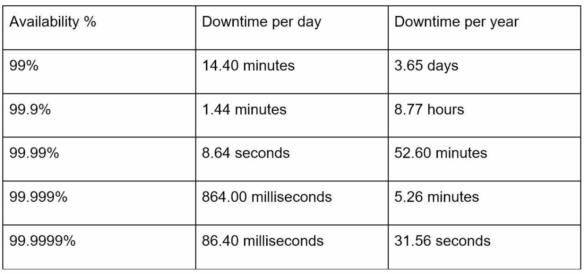

# Introduction
Back-of-the-envelope calculations (ballpark estimations) are rough estimates built from a few well-known
numbers and simple arithmetic. In an interview they are used to:
* Size the system: QPS, storage, bandwidth, memory/cache, number of servers.
* Justify design choices (e.g. "the working set fits in memory, so a cache tier is enough", "writes are 10x reads, so use an LSM-tree store").
* Show structured thinking. The interviewer cares about the **process and the assumptions**, not the exact digits.

**Golden rules**
* Round aggressively: 86,400 s/day becomes **~100K** (10^5), and 2.6M s/month becomes **~2.5M**.
* Write every assumption down (DAU, read:write ratio, object size, retention).
* Use powers of 10 and unit suffixes (K, M, B, T) and avoid long multiplication.
* Label units at every step (req/s, bytes/req, bytes/day).
* Spend 3–5 minutes on this, then move on. Only estimate what affects the design.

---

# Numbers Crunching

## Data Types to Bytes
General estimates. Actual in-memory size depends on the language and runtime (object headers, padding, pointers).



| Type                          | Size                     |
|-------------------------------|--------------------------|
| bool / char (ASCII)           | 1 byte                   |
| char (UTF-8)                  | 1–4 bytes                |
| short / int16                 | 2 bytes                  |
| int / int32 / float           | 4 bytes                  |
| long / int64 / double         | 8 bytes                  |
| Unix timestamp                | 4 bytes (32-bit) / 8 bytes (64-bit) |
| UUID                          | 16 bytes (36 as string)  |
| IPv4 / IPv6                   | 4 / 16 bytes             |
| Pointer (64-bit)              | 8 bytes                  |

## Typical Object Sizes (assume these unless told otherwise)
| Object                                   | Approx size            |
|------------------------------------------|------------------------|
| Short ID / key                           | 8–16 B                 |
| Tweet / chat message (text only)         | ~100–300 B (round to 1 KB with metadata) |
| User profile / metadata row              | ~1 KB                  |
| Web page (HTML)                          | ~100 KB                |
| Thumbnail                                | ~10–50 KB              |
| Photo (compressed, mobile)               | ~200 KB – 2 MB (use 1 MB) |
| Audio (MP3, 128 kbps)                    | ~1 MB / minute         |
| Video 720p / 1080p / 4K                  | ~25 / ~50–100 / ~300+ MB per minute (store multiple bitrates) |
| Log line / event                         | ~100 B – 1 KB          |

## Handling Bytes
### Powers of Two


```
Power           Exact Value         Approx Value        Bytes
---------------------------------------------------------------
7                             128
8                             256
10                          1,024   1 thousand           1 KB
16                         65,536                       64 KB
20                      1,048,576   1 million            1 MB
30                  1,073,741,824   1 billion            1 GB
32                  4,294,967,296                        4 GB
40              1,099,511,627,776   1 trillion           1 TB
50                                  1 quadrillion        1 PB
```

Useful facts:
* 2^10 ≈ 10^3, so each step of 10 powers of two is one step of 3 powers of ten.
* A 32-bit int holds ~4 billion values (2^31 ≈ 2.1B signed). If IDs could pass 2B, use 64-bit.
* Base62 with 7 chars gives 62^7 ≈ **3.5 trillion** values (a common URL-shortener question). 6 chars gives ~57B.

### Byte Conversions


| Unit | Bytes  | Name               | Mental shortcut                  |
|------|--------|--------------------|----------------------------------|
| KB   | 10^3   | Thousand           | 1K × 1 KB = 1 MB                 |
| MB   | 10^6   | Million            | 1M × 1 KB = 1 GB                 |
| GB   | 10^9   | Billion            | 1B × 1 KB = 1 TB                 |
| TB   | 10^12  | Trillion           | 1B × 1 MB = 1 PB                 |
| PB   | 10^15  | Quadrillion        | 1M users × 1 GB = 1 PB           |
| EB   | 10^18  | Quintillion        |                                  |

**Rule:** `(count with suffix) × (size with suffix)`. Add the exponents.
For example, 500M × 2 KB = 1,000 × 10^(6+3) B = 1 TB.

## Time to Seconds
| Hour       | Day               | Month (30 d)              | Year (365 d)              |
|------------|-------------------|---------------------------|---------------------------|
| 60×60=3,600 | 3,600×24=86,400  | 86,400×30=2,592,000       | 86,400×365=31,536,000     |
| ~3.6K secs | **~100K secs** (10^5) | **~2.5 million secs** | **~30 million secs** (π × 10^7) |

## Requests Calculations
**Average QPS = total requests per day / 86,400 ≈ requests per day / 10^5**

| Per day          | ≈ Per second |
|------------------|--------------|
| 1 million/day    | ~12 req/s    |
| 10 million/day   | ~120 req/s   |
| 100 million/day  | ~1,200 req/s |
| 1 billion/day    | ~12,000 req/s|

| Per month              | Requests per second |
|------------------------|---------------------|
| 1 million reqs/month   | ~0.4 reqs/sec       |
| 2.5 million reqs/month | ~1 reqs/sec         |
| 5 million reqs/month   | ~2 reqs/sec         |
| 10 million reqs/month  | ~4 reqs/sec         |
| 100 million reqs/month | ~40 reqs/sec        |
| 1 billion reqs/month   | ~400 reqs/sec       |

* **Peak QPS ≈ 2–3× average** (use up to 10× for spiky events such as flash sales or live sports).
* Read-heavy systems are often **10:1 to 100:1 read:write** (social feeds, URL shortener). Chat and logging are write-heavy.

## Latency numbers every programmer should know


| Operation                                   | Latency        | Rounded         |
|---------------------------------------------|----------------|-----------------|
| L1 cache reference                          | 0.5 ns         | ~1 ns           |
| Branch mispredict                           | 5 ns           |                 |
| L2 cache reference                          | 7 ns           | ~10 ns          |
| Mutex lock/unlock                           | 25 ns          |                 |
| Main memory reference                       | 100 ns         | ~100 ns         |
| Compress 1 KB with Snappy/Zippy             | 3–10 µs        |                 |
| Send 1 KB over 1 Gbps network               | 10 µs          |                 |
| Read 4 KB randomly from SSD                 | ~16–150 µs     | ~100 µs         |
| Read 1 MB sequentially from memory          | ~3–250 µs      | ~10s of µs      |
| Round trip within same datacenter           | 500 µs         | ~0.5 ms         |
| Read 1 MB sequentially from SSD             | ~50 µs – 1 ms  | ~1 ms           |
| HDD disk seek                               | 10 ms          | ~10 ms          |
| Read 1 MB sequentially from HDD             | ~5–20 ms       | ~10 ms          |
| Round trip CA → Netherlands → CA            | 150 ms         | ~150 ms         |

Takeaways to memorize:
* **Memory is fast, disk is slow.** Memory ≈ 100 ns, SSD ≈ 100 µs (1,000× slower), HDD seek ≈ 10 ms (100,000× slower).
* **Avoid disk seeks.** Prefer sequential I/O, which is why LSM trees, append-only logs and Kafka are fast.
* **Compress before sending** over the network. CPU is cheap compared with bytes on the wire.
* **Cross-region round trips cost ~100–150 ms.** Minimize them on the request path (CDNs, regional replicas).
* User-perceived budget: **<100 ms feels instant**, ~1 s is acceptable, and more than 10 s loses the user.

### Time Conversions
* 1 ns (nanosecond) = 10^-9 seconds
* 1 µs (microsecond) = 10^-6 seconds = 1,000 ns
* 1 ms (millisecond) = 10^-3 seconds = 1,000 µs = 1,000,000 ns
* 1 s (second) = 10^0 = 1,000 ms

**Based on the metrics above you can:**
* Read sequentially from HDD at ~30–200 MB/s
* Read sequentially from 1 Gbps Ethernet at ~100 MB/s (1 Gbps ÷ 8 ≈ 125 MB/s)
* Read sequentially from SSD at ~1 GB/s (NVMe: 3–7 GB/s)
* Read sequentially from main memory at ~4–10+ GB/s
* Make 6–7 world-wide round trips per second
* Make ~2,000 round trips per second within a datacenter

## Throughput / Capacity of a Single Machine (rules of thumb)
These are order-of-magnitude numbers for planning. Real numbers depend on hardware, payload and query shape.

| Component                                   | Ballpark capacity                       |
|---------------------------------------------|-----------------------------------------|
| Web/app server (stateless, simple API)      | ~1K–10K req/s                           |
| Concurrent connections per server           | ~10K–100K (C10K is easy with epoll/async); assume ~1K for heavyweight per-request threads |
| SQL DB (MySQL/Postgres) on one node         | ~1K–10K writes/s, ~10K–50K simple reads/s |
| NoSQL node (Cassandra/DynamoDB partition)   | ~10K writes/s per node (DynamoDB: 1K WCU / 3K RCU per partition) |
| Redis / Memcached (in-memory)               | ~100K+ ops/s per node, sub-ms latency   |
| Kafka broker                                | ~100s MB/s, ~100K–1M msgs/s             |
| Server RAM                                  | 64–512 GB typical, up to TBs            |
| Server disk                                 | SSD 1–10s of TB per node                |
| Network NIC                                 | 1–25 Gbps typical, 100 Gbps high-end    |
| CPU                                         | 8–128 cores, ~2.5–3.5 GHz (1 Hz = 1 cycle/sec) |

**Servers needed ≈ Peak QPS / QPS per server**, rounded up, plus headroom (target ~50–70% utilization) and N+1 or N+2 redundancy.

## Availability Numbers
* High availability is measured as a percentage. Most services fall between 99% and 100%.
* A service level agreement (SLA) is the provider's commitment. SLO is the internal target and SLI is the measured value.
* Uptime is traditionally measured in nines. The more nines, the better (and the more expensive).
  

| Availability       | Downtime / year | Downtime / month | Downtime / day |
|--------------------|-----------------|------------------|----------------|
| 99% (two 9s)       | 3.65 days       | 7.2 hours        | 14.4 min       |
| 99.9% (three 9s)   | 8.76 hours      | 43.8 min         | 1.44 min       |
| 99.99% (four 9s)   | 52.6 min        | 4.38 min         | 8.6 s          |
| 99.999% (five 9s)  | 5.26 min        | 26.3 s           | 0.86 s         |

Shortcut: **three nines ≈ 9 hours/year, four nines ≈ 1 hour/year, five nines ≈ 5 minutes/year.**

Composing availability:
* **In series** (A depends on B): `A_total = A1 × A2`. For example, 99.9% × 99.9% ≈ 99.8%. More dependencies mean lower availability.
* **In parallel** (redundant replicas): `A_total = 1 − (1 − A)^n`. For example, two 99% replicas give 1 − 0.01² = 99.99%.

---

# Estimation Formulas (cheat sheet)
```
DAU                 = MAU × (0.2 – 0.5)               # if only MAU is given
Write QPS           = DAU × writes_per_user_per_day / 10^5
Read QPS            = Write QPS × read:write ratio
Peak QPS            = Avg QPS × 2 (to 3, or 10 for spikes)

Storage / day       = writes_per_day × object_size
Total storage       = Storage/day × 365 × years × replication_factor (usually 3)

Ingress bandwidth   = Write QPS × object_size
Egress bandwidth    = Read QPS × object_size          # multiply by 8 for bits/s

Cache memory        = 20% × (read QPS × object_size × 86,400)   # 80/20 rule: 20% of objects get 80% of traffic
Servers             = Peak QPS / per_server_QPS
Shards              = Total storage / per_node_storage  (or Write QPS / per_node write QPS, whichever is larger)
```

Sanity anchors:
* 1 KB × 1M/day ≈ 1 GB/day ≈ **365 GB/year**
* 1 MB × 1M/day ≈ 1 TB/day ≈ **365 TB/year**
* 1 MB/s sustained ≈ 86 GB/day ≈ **~30 TB/year**
* 1 Gbps ≈ 125 MB/s ≈ **~10 TB/day**

---

# Worked Example: Twitter-like Service
**Assumptions**
* 300M MAU, 50% use it daily, so **150M DAU**
* Each user posts 2 tweets/day; 10% of tweets have media
* Users read 100 tweets/day (read-heavy)
* Tweet text + metadata ≈ 1 KB; media ≈ 1 MB
* Retain 5 years, replication ×3

**QPS**
* Writes: 150M × 2 / 10^5 = **3,000 tweets/s** (peak ~6,000/s)
* Reads: 150M × 100 / 10^5 = **150,000 tweet reads/s** (peak ~300K/s)

**Storage per day**
* Text: 300M tweets × 1 KB = **300 GB/day**
* Media: 30M × 1 MB = **30 TB/day**

**5-year storage**
* Media: 30 TB × 365 × 5 ≈ **55 PB**. ×3 replication ≈ **~165 PB**. Put this in object storage (S3) behind a CDN.
* Text: 300 GB × 365 × 5 ≈ 550 TB. ×3 ≈ **~1.6 PB**. This needs a sharded DB: at ~10 TB/node, about 160 shards.

**Bandwidth**
* Ingress media: 30 TB / 10^5 s ≈ **300 MB/s**
* Egress: dominated by media reads. Most of it is served by the CDN.

**Cache**
* Hot timelines: 20% of the day's text reads ≈ 0.2 × 150K × 1 KB × 10^5 ≈ **3 TB**. That is roughly 30 Redis nodes with 100 GB each.

**Servers**
* 300K peak read QPS / ~10K QPS per server ≈ **30 app servers**, plus headroom, so about 50.

---

# Worked Example: URL Shortener (quick)
* 100M new URLs/day gives 100M / 10^5 = **~1,200 writes/s**. At 10:1 reads, that is **~12K reads/s**.
* 10 years: 100M × 365 × 10 ≈ **365B URLs**. Base62 with 7 chars (3.5T values) is enough.
* Storage: 365B × 500 B ≈ **~180 TB**.
* Cache 20% of daily reads: 0.2 × 1B × 500 B ≈ **100 GB**. That fits in a few cache nodes.

---

# Interview Tips
* State the **scale first**: DAU, read:write ratio, object size, retention. Confirm them with the interviewer.
* Do the math out loud and **round to 1 significant figure**.
* Translate numbers into **design decisions**:
  * Under about 1K QPS, a single DB with a replica is fine. At 10K+ QPS, add caching and read replicas. At 100K+ QPS, shard and use multiple cache tiers.
  * Under about 1 TB, it fits on one machine. At 10s of TB, shard. At PB scale, use object storage or a distributed FS.
  * If the working set fits in RAM (100s of GB), cache it.
* Don't forget **replication (×3)**, **peak vs. average**, **metadata overhead**, and **growth (e.g. 20–50%/year)**.
* Know which numbers dominate. Media storage and egress bandwidth almost always dwarf text.

---

# Typical Modern Resource Sizes
### General Purpose Amazon EC2 Instances
* m6g.medium: 4 GiB of memory, 1 vCPU, EBS only, 64-bit Arm platform
* m6g.16xlarge: 256 GiB of memory, 64 vCPUs, EBS only, 64-bit Arm platform
* Custom-built AWS Graviton2 processor with 64-bit Arm Neoverse cores
  * 1 hertz = 1 cycle per second
  * 2.5 GHz (gigahertz) = 2.5 billion cycles per second
* Support for Enhanced Networking with up to 25 Gbps of network bandwidth
### Compute Optimised Amazon EC2 Instances
* c5a.24xlarge: 192 GiB of memory, 96 vCPUs, EBS only, 64-bit platform
### Memory Optimised Amazon EC2 Instances
* r6g.16xlarge: 512 GiB of memory, 64 vCPUs, EBS only, 64-bit Arm platform
* x1.32xlarge: 1,952 GiB of memory, 128 vCPUs, 2 × 1,920 GB of SSD-based instance storage, 64-bit platform, 20
  Gigabit Ethernet
### Storage Optimised Amazon EC2 Instances
* i3en.large: 16 GiB of memory, 2 vCPUs, 1 × 1.25 TB NVMe SSD, 64-bit platform
* i3en.24xlarge: 768 GiB of memory, 96 vCPUs, 8 × 7.5 TB NVMe SSD, 64-bit platform

**Interview default:** assume a commodity server has **~64–128 GB RAM, ~16–32 cores, ~1–10 TB SSD, and 10 Gbps NIC**.

# References
* https://stormanning.medium.com/the-system-design-interview-part-3-back-of-the-envelope-calculations-8e40793f48a2
* https://www.rkenmi.com/posts/back-of-the-envelope
* [J. Dean. Google Pro Tip - Use Back-Of-The-Envelope-Calculations To Choose The Best Design](http://highscalability.com/blog/2011/1/26/google-pro-tip-use-back-of-the-envelope-calculations-to-choo.html)
* [system-design-primer - Powers of two table](https://github.com/donnemartin/system-design-primer/blob/master/README.md#powers-of-two-table)
* [system-design-primer - Latency numbers every programmer should know](https://github.com/donnemartin/system-design-primer/blob/master/README.md#latency-numbers-every-programmer-should-know)
* https://colin-scott.github.io/personal_website/research/interactive_latency.html
* https://matthewdbill.medium.com/back-of-envelope-calculations-cheat-sheet-d6758d276b05
