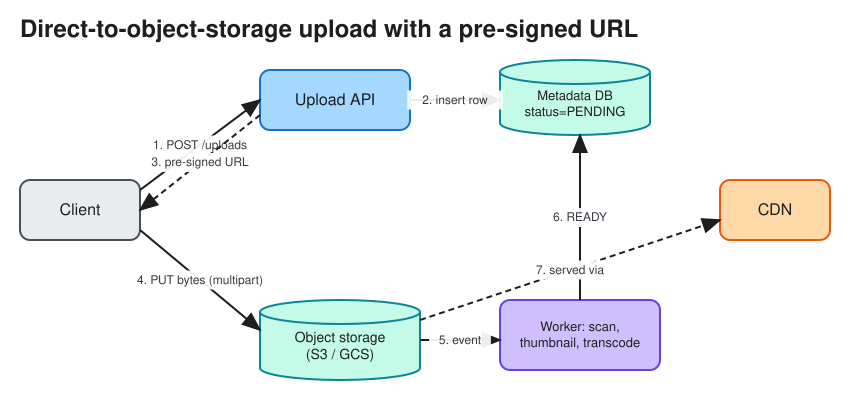
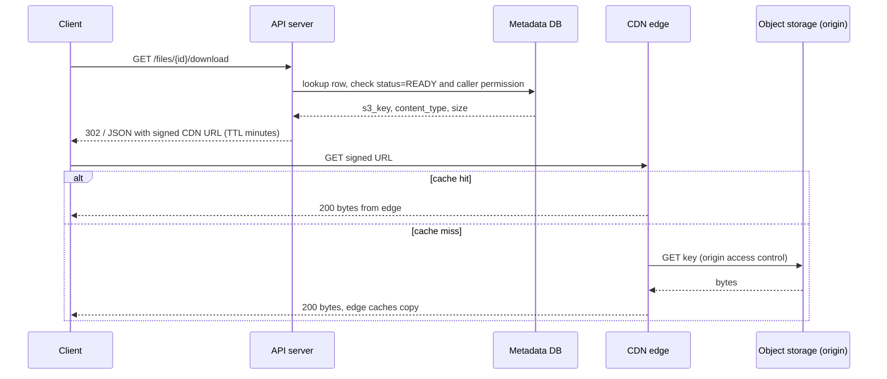
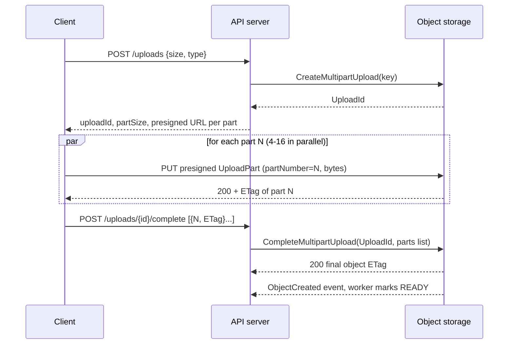

# Blob / Object Storage

> **TL;DR** — Object storage (S3, GCS, Azure Blob) stores **immutable objects** (bytes + metadata) under a key
> in a flat namespace, behind an HTTP API. It is cheap, effectively unlimited, and extremely durable
> (S3: 11 nines) but has higher latency than block storage and no in-place edits. Standard interview pattern:
> **keep metadata in a DB, bytes in object storage, serve through a CDN, and upload directly from the client
> with pre-signed URLs** (multipart for large files). In the interview, treat blob-store scalability and
> durability as a **given**; spend your time on the surrounding flow (upload, download, metadata, security).
> If you have no strong preference, say **S3**: it is the most widely understood, and most other stores expose an
> S3-compatible API.

**Where it shows up:** YouTube (videos in blob, metadata in DB), Instagram (images and videos), Dropbox (file
blocks), WhatsApp or Slack attachments, backups, logs, data lakes, ML datasets.

## Block vs file vs object
| | Block (EBS, SAN) | File (EFS, NFS) | Object (S3, GCS) |
|---|---|---|---|
| Abstraction | Raw disk volumes | Hierarchical files, POSIX | Key → object + metadata, flat namespace |
| Access | Mounted by one host (usually) | Mounted by many hosts | HTTP REST API |
| Latency | Sub-millisecond | Milliseconds | Tens of milliseconds (first byte) |
| Updates | In place, random writes | In place | Whole-object replace (or multipart compose) |
| Scale / cost | Limited size, $$ | Medium, $$ | Unlimited, $ |
| Use | Databases, VM disks | Shared config, legacy apps, ML training | Media, backups, logs, data lakes, static sites |

### How each one works inside
* **Block**: the device exposes a numbered array of fixed-size blocks (LBA 0..N). It knows nothing about files.
  A filesystem (ext4, XFS) or a database engine is layered on top and decides what each block means. This is why
  it gives the lowest latency and in-place random writes (a DB can update one 8 KB page), and why it is attached
  to a single VM at a time. Network block stores (EBS) replicate blocks to a second storage server in the same AZ.
* **File**: adds a **hierarchical namespace** (directories, inodes, permissions) and **POSIX semantics**
  (open/seek/lock, append, atomic rename). A metadata server tracks the tree, data servers hold the bytes, and
  clients mount it (NFS/SMB). Many hosts can share it, but the shared namespace and locking make it hard to scale
  horizontally.
* **Object**: a **flat** map of `(bucket, key) → bytes + metadata`. There are no directories: `photos/2024/a.jpg`
  is just a string, and a "folder" is a **key prefix** used for listing. Objects are **immutable**: an overwrite
  writes a new object and atomically swaps the key's pointer, and rename is **copy + delete** (not atomic).
  Dropping POSIX is what lets it scale to trillions of objects over plain HTTP.
* **Rule of thumb**: need a disk for a database or VM → block. Need a shared mount for legacy or ML workloads →
  file. Everything else that is large, write-once and read-many → object.

## Standard upload / download architecture


Typical metadata row (the DB holds **pointers**, never the bytes):
```
Entity(id, owner_id, name, content_type, size, checksum, s3_key, status[PENDING|READY|FAILED|DELETED], created_at)
```

### Upload
1. The client asks the API for an upload: `POST /uploads {filename, size, type}`.
2. The API checks auth and quota, creates a metadata row (`status=PENDING`), and returns a **pre-signed URL**
   (time-limited, scoped to one key).
3. The client `PUT`s the bytes **directly** to object storage, so app servers never proxy large payloads.
   For large files, use **multipart upload** (parallel parts of 5 MB+, resumable, each part retried
   independently). See [Multipart upload](#multipart-upload-in-detail).
4. Object storage emits an event (S3 Event to SQS/Lambda), and a worker validates, scans, transcodes or makes
   thumbnails, then marks the row `READY`.

### Download
The mirror image of upload: the app server **authorizes**, then hands the client a short-lived URL so the bytes
flow **CDN → client**, never through your app servers.



**Choose the delivery path by content type:**
| Content | Path | Notes |
|---|---|---|
| Public, static (avatars, product images) | Bucket stays **private**; CDN reads it via origin access control. Keys are content-hashed (`sha256.jpg`) so `Cache-Control: immutable, max-age=1y` works. | Never make the bucket public. Block direct S3 access so nobody bypasses the CDN. |
| Private, per-user (documents, receipts) | API authorizes → **CDN signed URL or signed cookies** (short TTL). Without a CDN, use an S3 **pre-signed GET**. | Auth is checked **once, at URL issue time**, not per byte. Revocation is limited by the TTL. |
| Very large files, video | **Range requests** (`Range: bytes=0-8388607` → `206 Partial Content`). Clients fetch several ranges in parallel and resume after failure with `Range` + `If-Range: <etag>`. Video is pre-segmented (HLS/DASH chunks + manifest) for adaptive bitrate and fast seek. | S3 allows byte-range GETs, and the CDN can cache ranges or segments. |
| Needs per-request logic (watermark, resize, redaction, audit) | Proxy through a service, or an edge function / Lambda, then cache the result. | Costs compute and bandwidth. Avoid for plain large files. |
| Archived (Glacier / cold tier) | **Async restore**: request restore, wait minutes to hours, notify the user, then serve the temporary copy. | Surface a `RESTORING` state in the API. |

**Download design details worth saying out loud:**
* **Signed-URL TTL** is a trade-off: short = safer and no revocation story, long = fewer re-signs. Keep signature
  query params **out of the CDN cache key**, or every user's URL becomes a unique miss.
* **Response headers** control behavior: `Content-Type`, `Content-Disposition: attachment; filename=...`
  (S3 pre-signed URLs can override it with `response-content-disposition`), `Cache-Control`, `ETag` for
  conditional GETs (`If-None-Match` → `304`).
* **Hot objects / thundering herd**: the CDN collapses concurrent misses for the same key. A regional "origin
  shield" tier adds one more cache layer in front of S3. See [CDN](cdn.md).
* **Cost**: egress is usually the largest bill. CDN hit ratio directly cuts S3 data-transfer-out and request cost.
* **Consistency**: only issue URLs for rows in `READY`. After a delete, outstanding signed URLs and CDN copies live
  until TTL or invalidation, so use a short TTL for sensitive content.
* **Integrity**: store a checksum in the metadata row and let clients verify it after download (large files,
  sync clients). See [Checksums](checksums.md).

## Multipart upload in detail
**Why chunk:** one huge `PUT` that fails at 95% restarts from zero, cannot use more than one TCP connection's
worth of bandwidth, and times out. Splitting into **parts** gives **resumability**, **parallelism**, **per-part
retry**, and the ability to **start uploading before the whole file exists** (streaming sources).

### The API flow (S3 names; GCS and Azure are analogous)

1. **`CreateMultipartUpload`** returns an `UploadId` that ties all parts together. Store it in your DB row.
2. **`UploadPart`** is called once per part with `(UploadId, PartNumber, bytes)` and returns the part's **ETag**.
   Part numbers define order, so parts can arrive **out of order and in parallel**. **Re-uploading the same part
   number overwrites it**, which makes per-part retries safe.
3. **`CompleteMultipartUpload`** takes the ordered list of `(PartNumber, ETag)`. S3 stitches the parts into one
   object. Until this call succeeds, **the object does not exist** (no partial reads).
4. **`AbortMultipartUpload`** discards the parts. **`ListParts`** (what is uploaded for this `UploadId`) and
   **`ListMultipartUploads`** (all in-flight uploads) support resume and cleanup.

### S3 limits to memorize
| Limit | Value |
|---|---|
| Single `PUT` max | 5 GB |
| Part size | 5 MiB to 5 GiB (the **last** part can be smaller) |
| Parts per upload | 10,000 (numbers 1 to 10,000) |
| Max object size | ~50 TB (48.8 TiB; older material says 5 TB) |

**Choosing a part size:** `part_size ≥ file_size / 10,000` and `≥ 5 MiB`. Typical: 8 to 16 MB for files up to a few
GB, 64 to 128 MB for 100 GB+ files. Too small = request overhead and the 10,000-part cap. Too large = more bytes
retransmitted on a failed part and more client memory (`part_size × concurrency`). Use multipart above roughly
100 MB, and a plain `PUT` below that.

### Resumable upload
* **Where progress lives:** either the server tracks `{uploadId, completed parts}` in the DB, or the client asks
  `ListParts` (paginated, 1,000 per page) when it comes back.
* **Resume = list what is done, upload only the missing parts, then `Complete`.**
* **With pre-signed URLs:** the *server* calls `CreateMultipartUpload` and signs one `UploadPart` URL per part
  (or signs lazily via `POST /uploads/{id}/parts/{n}/url`). The client never holds AWS credentials.
* **Browser gotcha:** the bucket CORS config must **expose the `ETag` response header**, or the client cannot read
  part ETags and cannot complete the upload.

### Integrity and ETags
* A multipart object's **ETag is not the MD5 of the file**. It is the MD5 of the concatenated per-part MD5s, plus
  `-<partCount>`. Do not use it to verify content against a local hash.
* Use S3's **additional checksums** instead: `CRC64NVME`, `CRC32`/`CRC32C`, `SHA-1`, `SHA-256`. For multipart you
  choose **full-object** (CRC family only, so it matches a checksum of the whole file) or **composite**
  (a checksum of the part checksums, any algorithm). Per-part checksums are verified on `UploadPart`.
  See [Checksums](checksums.md).

### Operational traps
* **Orphaned parts cost money.** Uploaded parts are billed until you `Complete` or `Abort`. Add a bucket lifecycle
  rule **`AbortIncompleteMultipartUpload` (for example after 7 days)**.
* **Idempotent complete:** make your `/complete` endpoint idempotent (see [Idempotency](idempotency.md)), because
  clients retry it after timeouts.
* **Server-side validation:** `Complete` proves parts were stitched, not that the file is what the user claimed.
  Still scan, sniff content type, and check the size before marking `READY`.

### Other providers and app-level chunking
* **GCS**: *resumable upload* with a session URI (`PUT` with `Content-Range`, chunks in 256 KiB multiples) and
  `compose` to join up to 32 objects. **Azure Blob**: `Put Block` + `Put Block List` (up to 50,000 blocks).
  **tus** is an open resumable-upload protocol.
* **Transport chunking ≠ application chunking.** Dropbox-style sync splits files into ~4 MB blocks, hashes each
  one, and uploads **only blocks the server does not already have**. That gives deduplication and delta sync on top
  of whatever multipart does underneath. Use content-defined chunking if edits shift bytes.

## Security
### Encryption in transit
* Use **HTTPS/TLS** for every client, CDN and service call. Enforce it with a bucket policy that **denies requests
  where `aws:SecureTransport` is false**. Pre-signed URLs should always be `https://`.
* Data is also encrypted between the CDN, the service, and internal replication hops. TLS also protects the
  pre-signed URL's signature in transit.

### Encryption at rest
| Mode | Who holds the key | Notes |
|---|---|---|
| **SSE-S3** | S3-managed keys, AES-256 | **Default for every new object since Jan 2023**, no cost, no perf impact. |
| **SSE-KMS** | Keys in AWS KMS, you control the key policy | Key access is auditable (CloudTrail), supports rotation and per-tenant keys. Each object operation calls KMS, so enable **S3 Bucket Keys** to cut KMS request volume and cost. **DSSE-KMS** applies two layers. |
| **SSE-C** | You supply the key on every request | S3 never stores the key. Disabled by default for new buckets since April 2026. Rare in practice. |
| **Client-side** | You encrypt before upload | The provider only sees ciphertext (E2E). You own key management and lose server-side features like content scanning. |

**Envelope encryption** is the mechanism: each object gets its own random **data key** (DEK). The DEK encrypts
the bytes, then the DEK itself is encrypted by a **master key** (KEK) that lives in KMS/HSM, and only the wrapped
DEK is stored beside the object. Rotating or revoking the KEK does not require re-encrypting petabytes, and a
stolen disk is useless without KMS access.

### Access control
* **IAM policies + bucket policies** (least privilege, deny by default). **Block Public Access** on. **ACLs are
  disabled** on new buckets (bucket-owner-enforced ownership).
* **VPC endpoints / access points** keep traffic off the public internet and give each app its own policy.
* **Pre-signed URLs** are bearer tokens: anyone holding the URL has the access until it expires. Keep TTLs short,
  scope to **one key and one method**, serve over HTTPS, and do not log them. A URL is only as valid as the
  credentials that signed it, and individual URLs **cannot be revoked** (hence short TTLs).
* **Limit what uploads can do:** a pre-signed `PUT` can pin exact `Content-Type` and `Content-Length`, while a
  pre-signed **`POST` policy** supports `content-length-range` (max size) and key-prefix conditions.
* **Untrusted user content:** scan for malware, validate type by content (not just extension), set
  `X-Content-Type-Options: nosniff`, and serve user uploads from a **separate cookieless domain** (or force
  `Content-Disposition: attachment`) so uploaded HTML/SVG cannot run script on your origin.

### Protection and audit
* **Versioning + Object Lock (WORM)** protect against accidental deletes and ransomware. **MFA delete** guards
  version removal. **Cross-region replication** covers regional loss.
* **CloudTrail data events / access logs** for who read what. **Macie**-style scanners find PII in buckets.
* More on the general model: [Security](security.md), [AuthN / AuthZ](authn_authz.md).

## How object stores work internally (S3 as the example)
**Core idea: separate the *metadata* path from the *data* path**, and make stored data immutable.

```
Client ──HTTPS──▶ Front-end / API fleet (auth, throttling, routing, request parsing)
                       │                              │
                       ▼                              ▼
              Metadata / index layer          Data layer (storage nodes)
        bucket + key → version, size,       hold *shards* of object data on
        checksum, shard locations           HDDs, spread across AZs
        (sharded KV, strongly consistent)              ▲
                       ▲                               │
                       └────── Placement + repair + garbage-collection services
```
* **Front end**: stateless fleet that authenticates (SigV4), authorizes against IAM/bucket policy, throttles, and
  routes. Pre-signed URLs are validated here (signature + expiry), which is why no app server is involved.
* **Metadata layer**: a **partitioned key-value index** from `(bucket, key)` to the object's version and its shard
  locations. Keys are ordered lexicographically so `ListObjects` with a `prefix` and `delimiter` can emulate
  folders. Partitions split automatically when a **prefix** gets hot (the origin of the ~3,500 writes and ~5,500
  reads per second *per prefix* guideline). See [Data Partitioning](data_partitioning.md).
* **Data layer**: **storage nodes** are simple key-value stores that persist object **shards** on disk (S3's newer
  node software, ShardStore, is written in Rust on a log-structured design with shard data kept outside the LSM
  tree to limit write amplification). The control plane decides which nodes get which shards.
* **Write path**: front end receives bytes → splits and **erasure-codes** into data + parity shards → writes them
  to nodes in different AZs → once enough shards are durable, writes the metadata entry (the **commit point**) →
  returns `200`. Because data is immutable, an overwrite is just a new version plus a pointer swap.
* **Read path**: look up metadata → fetch **any k of the k+m shards** (pick the fastest or least loaded, which
  helps tail latency) → decode → stream back. Range GETs read only the needed shards.
* **Durability machinery**: checksums on every shard, **background scrubbing** to find bit rot, and a **repair
  service** that re-creates lost shards when a disk or node dies. Repair speed matters, because durability is a
  race between failure rate and re-replication rate.
* **Garbage collection**: deletes and overwrites leave unreferenced shards. A background process reclaims them
  after metadata no longer points at them (and after versioning or retention rules allow).

### Erasure coding vs replication
| | 3× replication | Erasure coding (k data + m parity) |
|---|---|---|
| Storage overhead | 3.0× | (k+m)/k, e.g. **10+4 = 1.4×**, 6+3 = 1.5× |
| Failures tolerated | 2 copies lost | Any **m** shards lost |
| Read | Any one copy, simple and fast | Needs k shards, plus decode CPU |
| Repair | Copy one replica | Read k shards to rebuild one (more network/IO) |
| Best for | Hot, small data, metadata | Large, cold-ish bulk data (the bytes in S3) |

Spreading shards over many disks and AZs also means one large GET is served by **many disks in parallel**, which
is how HDD-based S3 delivers high throughput and how it avoids hot spots.

### Durability, availability, consistency (numbers to quote)
* **Durability: 11 nines** (99.999999999%): store 10 million objects and expect to lose about one every 10,000
  years. It comes from erasure coding across AZs + checksums + scrubbing + fast repair. **Availability** is a
  separate, lower target (Standard is designed for 99.99%).
* **Consistency: strong read-after-write** for PUT, DELETE, GET and LIST since **Dec 2020**. Before that, S3 had
  caches in the metadata layer, so a read could hit a stale cache. AWS fixed it with a cache-coherence design
  (a replicated journal, plus a "witness" that knows whether a cache entry is still valid) without hurting
  availability. See [Consistency](consistency.md).
* **Immutability** is what makes caching, replication and erasure coding simple.

### "Design S3" checklist (interview)
1. **API + front end**: `PUT/GET/DELETE/LIST` on `bucket/key`, SigV4 auth, multipart, pre-signed URLs.
2. **Metadata store**: sharded KV (range-partitioned by key for prefix listing), strongly consistent, versioned.
3. **Data store**: immutable, append-only storage nodes holding erasure-coded shards across AZs.
4. **Placement service**: pick nodes by free space and failure domain. See [Consistent Hashing](consistent_hashing.md).
5. **Repair + scrubber** for durability, **GC** for deleted and overwritten data.
6. **Extras**: versioning (delete marker), lifecycle/tiering, replication, events, access logs.
7. **Scale/availability**: shard metadata by key range and split hot prefixes, make stateless layers autoscale, keep
   each AZ failure-independent. Call out the trade-offs: listing is expensive, small objects waste metadata, and
   cross-AZ writes cost latency.

## Other design concerns that come with blob storage
| Concern | What to say |
|---|---|
| **DB ↔ blob consistency** | No distributed transaction across both. Pattern: write `PENDING` row → upload → event → `READY`. A **reaper** deletes stale `PENDING` rows and aborts their multipart uploads. A periodic **reconciliation** (S3 Inventory vs DB) finds orphan blobs and dangling rows. |
| **Storage classes / lifecycle** | Standard → Infrequent Access → Archive by age. Trade-offs: lower storage price vs retrieval fees, minimum storage duration, and restore latency. |
| **Versioning & deletion** | Versioning keeps old versions (a delete adds a delete marker). Prefer **soft delete** in the DB and hard delete via lifecycle or a GC job (also needed for GDPR erasure, including old versions and backups). |
| **Deduplication** | Content-addressed keys (`sha256(content)`) give dedup and immutable caching. Needs ref-counting before deleting shared blobs. See Dropbox-style block dedup above. |
| **Replication / DR** | Same-region or cross-region replication (async, so RPO > 0). Multi-region active-active reads via replicated buckets and geo routing. See [Data Replication](data_replication.md). |
| **Event-driven processing** | Object events → queue → workers (virus scan, thumbnails, transcoding, indexing). Make workers idempotent and handle at-least-once delivery. See [Asynchronism](asynchronism.md). |
| **Hot prefixes / key design** | Avoid one hot key prefix (for example a timestamp prefix). Add a hash or random prefix to spread load. Remember per-prefix request limits. |
| **Small files** | Millions of tiny objects cost more in requests and metadata than in bytes. Batch/pack them (tar, Parquet, SSTables) for analytics. |
| **Multi-tenancy & quotas** | Per-tenant key prefix and IAM/KMS key, quota check at the "start upload" API, rate limits on URL issuance. |
| **Cost model** | Four meters: **storage GB-month, requests, egress, retrieval**. Cheap to store, expensive to move out. CDN and same-region compute reduce egress. S3 Standard is about $0.023/GB-month, roughly an order of magnitude below database storage. |
| **Latency-sensitive workloads** | Single-AZ, low-latency tiers (S3 Express One Zone) trade durability scope for speed. Otherwise cache hot bytes in the CDN or in memory. |
| **Observability** | Track upload success rate, abandoned multipart uploads, `PENDING` age, CDN hit ratio, 4xx/5xx and throttling (503 SlowDown) per prefix, egress cost. |

## Features to mention
* **Storage classes / lifecycle**: hot (Standard), then infrequent access, then archive (Glacier), with
  lifecycle rules that move objects by age.
* **Versioning + object lock** (WORM) protect against deletes and ransomware.
* **Content-addressed keys** (`sha256(content)`) give deduplication and immutable caching (Dropbox, Git LFS).
* **Key design**: modern S3 auto-partitions by prefix and supports ~3,500 PUT and 5,500 GET requests/sec *per
  prefix*. Spread hot workloads across prefixes.
* **Range GETs** for video seeking and parallel downloads.
* Data lakes: Parquet files on S3 queried by Athena, Spark or Trino. See [File Formats](file_formats.md).

## Interview follow-ups
* *"Why not store images in the database?"* DB storage is expensive, bloats backups and replication, and can't
  be served by a CDN directly. Store the URL or key and the metadata only.
* *"How do you resume a 5 GB upload after the network drops?"* Multipart upload: track uploaded part ETags
  (or call `ListParts`), retry missing parts, then `CompleteMultipartUpload`.
* *"How do you stop users from uploading 50 GB when the limit is 10 MB?"* Check the declared size at "start upload",
  and use a pre-signed `POST` policy with `content-length-range` so storage rejects oversize bodies. Re-check the
  stored size in the worker.
* *"How do you serve a private file securely and cheaply?"* Authorize in the API, return a short-lived CDN signed
  URL, lock the bucket to the CDN (origin access control), and cache at the edge.
* *"How do you revoke access to a file already shared?"* Signed URLs can't be revoked individually. Use short TTLs,
  rotate the signing key to kill everything, or put an authorizing proxy in front for high-sensitivity content.
* *"What happens if the client uploads but never calls complete?"* Parts are billed until aborted, so use the
  reaper and the `AbortIncompleteMultipartUpload` lifecycle rule. The object never becomes visible.
* *"Is S3 consistent?"* Yes, strongly (read-after-write for PUT, DELETE and LIST since Dec 2020). Metadata in your
  own DB can still lag the blob, so use the status field.
* *"Design S3."* Front-end API servers, a metadata store (sharded, strongly consistent), data nodes with
  erasure-coded placement across AZs, a placement and repair service, garbage collection for deleted or
  overwritten objects. See the checklist above.

# References
* https://aws.amazon.com/s3/storage-classes/
* https://docs.aws.amazon.com/AmazonS3/latest/userguide/optimizing-performance.html
* https://docs.aws.amazon.com/AmazonS3/latest/userguide/mpuoverview.html
* https://docs.aws.amazon.com/AmazonS3/latest/userguide/qfacts.html (multipart limits)
* https://docs.aws.amazon.com/AmazonS3/latest/userguide/checking-object-integrity-upload.html (checksums, multipart ETag)
* https://docs.aws.amazon.com/AmazonS3/latest/userguide/serv-side-encryption.html (SSE-S3, SSE-KMS, DSSE-KMS, SSE-C)
* https://docs.aws.amazon.com/AmazonCloudFront/latest/DeveloperGuide/private-content-overview.html (signed URLs, cookies, origin access control)
* https://allthingsdistributed.com/2021/04/s3-strong-consistency.html (Diving Deep on S3 Consistency)
* https://www.cs.utexas.edu/~bornholt/papers/shardstore-sosp21.pdf (ShardStore, S3's storage node, SOSP '21)
* System Design Interview Vol. 2 (Alex Xu), Chapter: S3-like Object Storage
