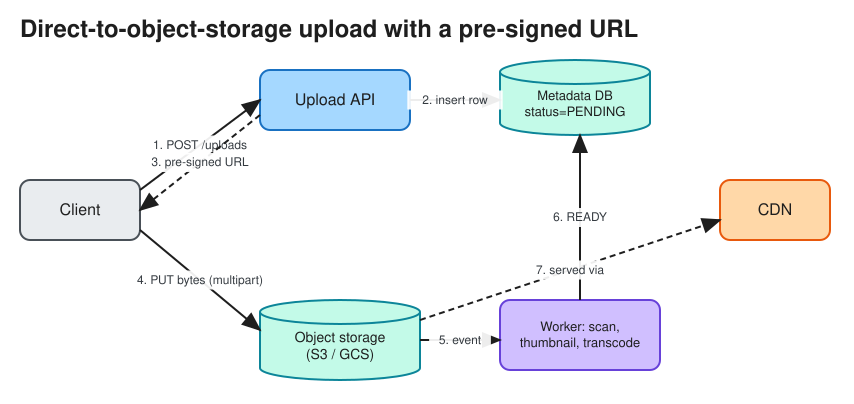

# Blob / Object Storage

> **TL;DR** — Object storage (S3, GCS, Azure Blob) stores **immutable objects** (bytes + metadata) under a key
> in a flat namespace, behind an HTTP API. It is cheap, effectively unlimited, and extremely durable
> (S3: 11 nines) but has higher latency than block storage and no in-place edits. Standard interview pattern:
> **keep metadata in a DB, bytes in object storage, serve through a CDN, and upload directly from the client
> with pre-signed URLs** (multipart for large files).

## Block vs file vs object
| | Block (EBS, SAN) | File (EFS, NFS) | Object (S3, GCS) |
|---|---|---|---|
| Abstraction | Raw disk volumes | Hierarchical files, POSIX | Key → object + metadata, flat namespace |
| Access | Mounted by one host (usually) | Mounted by many hosts | HTTP REST API |
| Latency | Sub-millisecond | Milliseconds | Tens of milliseconds (first byte) |
| Updates | In place, random writes | In place | Whole-object replace (or multipart compose) |
| Scale / cost | Limited size, $$ | Medium, $$ | Unlimited, $ |
| Use | Databases, VM disks | Shared config, legacy apps, ML training | Media, backups, logs, data lakes, static sites |

## Standard upload / download architecture

1. The client asks the API for an upload: `POST /uploads {filename, size, type}`.
2. The API checks auth and quota, creates a metadata row (`status=PENDING`), and returns a **pre-signed URL**
   (time-limited, scoped to one key).
3. The client `PUT`s the bytes **directly** to object storage, so app servers never proxy large payloads.
   For large files, use **multipart upload** (parallel parts of 5 MB+, resumable, each part retried
   independently).
4. Object storage emits an event (S3 Event to SQS/Lambda), and a worker validates, scans, transcodes or makes
   thumbnails, then marks the row `READY`.
5. Downloads go through a **CDN** with signed URLs or cookies for private content.

## How object stores achieve durability
* Each object is split and stored with **replication** (3 copies across AZs) or **erasure coding** (e.g. 10
  data + 4 parity fragments spread across failure domains).
* Checksums on every fragment, background scrubbing, and automatic repair. See [Checksums](checksums.md).
* A metadata service (a partitioned KV store) maps `bucket/key → fragment locations`.
* S3 has offered strong read-after-write consistency for all operations since December 2020.

## Features to mention
* **Storage classes / lifecycle**: hot (Standard), then infrequent access, then archive (Glacier), with
  lifecycle rules that move objects by age.
* **Versioning + object lock** (WORM) protect against deletes and ransomware.
* **Content-addressed keys** (`sha256(content)`) give deduplication and immutable caching (Dropbox, Git LFS).
* **Key design**: modern S3 auto-partitions by prefix and supports ~3,500 PUT and 5,500 GET requests/sec *per
  prefix*. Spread hot workloads across prefixes.
* **Range GETs** for video seeking and parallel downloads.
* Data lakes: Parquet files on S3 queried by Athena, Spark or Trino. See [File Formats](file_formats.md).

## Interview follow-ups
* *"Why not store images in the database?"* DB storage is expensive, bloats backups and replication, and can't
  be served by a CDN directly. Store the URL or key and the metadata only.
* *"How do you resume a 5 GB upload after the network drops?"* Multipart upload: track uploaded part ETags,
  retry missing parts, then `CompleteMultipartUpload`.
* *"Design S3."* Front-end API servers, a metadata store (sharded, strongly consistent), data nodes with
  erasure-coded placement across AZs, a placement and repair service, garbage collection for deleted or
  overwritten objects.

# References
* https://aws.amazon.com/s3/storage-classes/
* https://docs.aws.amazon.com/AmazonS3/latest/userguide/optimizing-performance.html
* https://docs.aws.amazon.com/AmazonS3/latest/userguide/mpuoverview.html
* System Design Interview Vol. 2 (Alex Xu), Chapter: S3-like Object Storage
