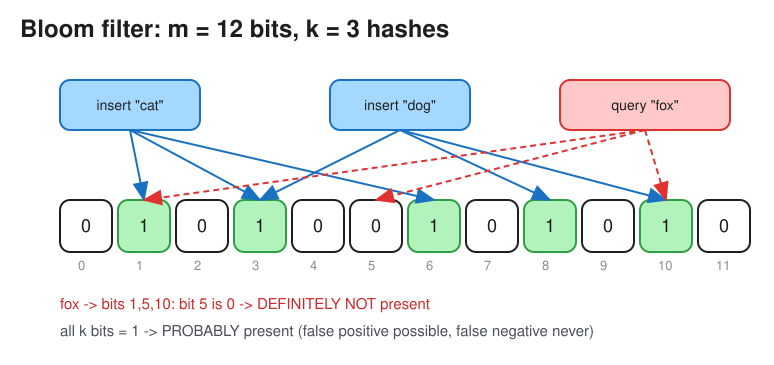

# Bloom Filters (and other probabilistic data structures)

> **TL;DR** — A Bloom filter is a compact bit array + **k** hash functions that answers *"is X in the set?"*
> with **"definitely not"** or **"probably yes"**: **no false negatives**, a tunable false-positive rate, and no
> deletes (use a counting or cuckoo filter for that). About **10 bits per element gives ~1% false positives**.
> Used to skip expensive lookups: LSM-tree SSTables, cache-miss shields, "has the crawler seen this URL?",
> "is this username taken?" pre-checks.

## How it works
* **Insert(x)**: compute `h1(x) ... hk(x) mod m` and set those k bits to 1.
* **Query(x)**: if *any* of the k bits is 0, x is **definitely not** in the set. If all are 1, x is **probably**
  in the set (the bits may have been set by other elements).
* **Sizing**, for n elements and false-positive rate p:
  * bits `m = −n · ln(p) / (ln 2)²`
  * optimal hash count `k = (m / n) · ln 2`
  * p = 1% gives ≈ 9.6 bits/element and k ≈ 7. p = 0.1% gives ≈ 14.4 bits/element.
  * 1 billion URLs at 1% FP ≈ 1.2 GB, versus tens of GB for a hash set of the URLs.
* In practice, two hashes simulate k of them (`h1 + i·h2`, Kirsch–Mitzenmacher); use murmur3 or xxHash.

## Variants
| Structure | Adds | Cost |
|---|---|---|
| **Counting Bloom filter** | Delete (each slot is a counter, not a bit) | 3–4x memory |
| **Cuckoo filter** | Delete, better space efficiency at low FP rates | Insert can fail when nearly full |
| **Scalable Bloom filter** | Grows by chaining filters as n increases | Slightly higher FP rate |
| **Partitioned / blocked** | Cache-friendly (one cache line per lookup) | Slightly higher FP rate |

## Where it's used
* **LSM-tree databases** (Cassandra, RocksDB, HBase, Bigtable): one filter per SSTable, so reads skip files that
  can't contain the key. See [Database Indexing](database_indexing.md).
* **Web crawler**: the URL-seen test before enqueueing. See [Web Crawler](../problems/web_crawler.md).
* **Cache penetration shield**: reject lookups for keys that don't exist before they hit the DB.
* **CDNs** (Akamai): only cache an object on its *second* request ("one-hit wonders" are filtered out).
* **Chrome Safe Browsing** (historically), Medium "already read" recommendations, Bitcoin SPV clients.
* **Distributed joins**: send a Bloom filter of join keys to prune the other side (Spark runtime filters).

## Related probabilistic structures (good to name in interviews)
| Structure | Answers | Typical use |
|---|---|---|
| **Count-Min Sketch** | Approximate frequency of an item (overestimates only) | Heavy hitters / top-K, rate limiting. See [Count-Min Sketch](count_min_sketch.md) |
| **HyperLogLog** | Approximate **distinct count** (~0.8% error with 12 KB in Redis) | Unique visitors, distinct search queries (`PFADD`, `PFCOUNT`) |
| **t-digest / KLL** | Approximate quantiles | p99 latency across a fleet |
| **MinHash / LSH** | Set similarity | Near-duplicate detection |

## Interview follow-ups
* *"Username availability check at 1B users?"* A Bloom filter in memory for the fast "definitely available"
  answer; on "probably taken", confirm with the DB, which has the unique constraint as the source of truth.
* *"Why can't you delete from a Bloom filter?"* Clearing a bit may remove other elements that share it, which
  would create false negatives.

# References
* https://www.enjoyalgorithms.com/blog/bloom-filter
* https://llimllib.github.io/bloomfilter-tutorial/
* https://redis.io/docs/latest/develop/data-types/probabilistic/
* https://en.wikipedia.org/wiki/Bloom_filter
