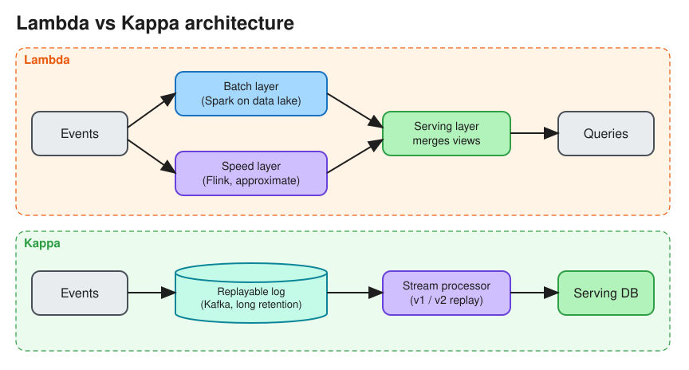

# Batch Processing vs Stream Processing

> **TL;DR** — **Batch** processes a bounded dataset on a schedule (hourly or nightly): high throughput, simple
> to reprocess, but results are minutes to hours old. **Stream** processes an unbounded flow of events as they
> arrive: second-level latency, but you must handle state, windows, late and out-of-order events, and
> exactly-once. **Lambda** architecture runs both; **Kappa** architecture uses only a replayable stream.

## Comparison
| | Batch | Stream |
|---|---|---|
| Input | Bounded (files, tables, a day's partition) | Unbounded (events from Kafka, Kinesis, Pub/Sub) |
| Latency | Minutes to hours | Milliseconds to seconds |
| Throughput / cost | Very high, cheap (spot instances, off-peak) | Always-on resources |
| Correctness | Easy: complete data, deterministic reruns | Hard: late data, watermarks, state, duplicates |
| Failure handling | Rerun the job or partition | Checkpoints + replay from offsets |
| Tools | Hadoop MapReduce, Spark, Hive, dbt, Airflow (orchestrator) | Flink, Kafka Streams, Spark Structured Streaming, Beam/Dataflow, ksqlDB |
| Use cases | Billing, reporting, ML training, backfills, search index rebuilds | Fraud detection, real-time dashboards, ad-click aggregation, alerting, top-K trending |

## Batch fundamentals
* **MapReduce**: map (emit key/value pairs), shuffle (group by key), reduce (aggregate). Spark keeps
  intermediate data in memory as RDDs/DataFrames (a DAG of stages), which makes it much faster for iterative
  jobs.
* Store input and output in a data lake (S3 + Parquet), partitioned by date. See [File Formats](file_formats.md).
* Make jobs **idempotent**: overwrite the output partition, never append blindly. That makes reruns safe.

## Stream fundamentals
* **Event time vs processing time**: aggregate by when the event *happened*, not when it arrived.
* **Windows**:
  * *Tumbling*: fixed, non-overlapping (per minute).
  * *Hopping/sliding*: overlapping (a 5-minute window every 1 minute).
  * *Session*: ends after a gap of inactivity.
* **Watermarks**: "I believe all events up to time T have arrived." Events after the watermark are *late*: drop
  them, send them to a side output, or update the result (allowed lateness).
* **State**: per-key aggregates held in local state (RocksDB in Flink) and checkpointed to durable storage.
* **Delivery semantics**:
  * *At-most-once*: may lose events.
  * *At-least-once*: may duplicate events. This is the common default.
  * *Exactly-once* effect: checkpointing plus transactional or idempotent sinks (Flink two-phase-commit sinks,
    Kafka transactions).
* **Backpressure**: slow operators push back on upstream ones instead of buffering without limit.
* See [Apache Flink](flink.md).

## Lambda vs Kappa
| | Lambda | Kappa |
|---|---|---|
| Layers | Batch layer (accurate, slow) + speed layer (approximate, fast) → serving layer merges them | Single streaming pipeline; reprocess by **replaying the log** with new code |
| Pros | Batch corrects streaming errors; mature | One codebase, simpler ops |
| Cons | Two codebases computing the same logic, and they drift | Needs long log retention (Kafka tiered storage) and a powerful stream engine |

## Interview follow-ups
* *"Ad-click aggregation: batch or stream?"* Stream (Flink) for real-time per-minute counts, plus a periodic
  batch **reconciliation** job over raw events in S3 to correct billing-grade totals. See
  [Ad Click Aggregation](../problems/ad_click_aggregration.md).
* *"How do you handle duplicate events in a stream?"* Idempotent producers, dedupe by event ID within a window
  (state with TTL), and idempotent or upserting sinks.
* *"Micro-batch vs true streaming?"* Spark Structured Streaming micro-batches (~100 ms+ latency, simpler).
  Flink is record-at-a-time (lower latency, richer event-time support).

# References
* https://newsletter.ashishps.com/p/d9442268-03d8-4f55-a103-7a3d4fb54661
* https://www.oreilly.com/radar/the-world-beyond-batch-streaming-101/
* https://www.oreilly.com/radar/questioning-the-lambda-architecture/
* Designing Data-Intensive Applications, Chapters 10 and 11
* [MapReduce: Simplified Data Processing on Large Clusters](https://research.google.com/archive/mapreduce-osdi04.pdf)
