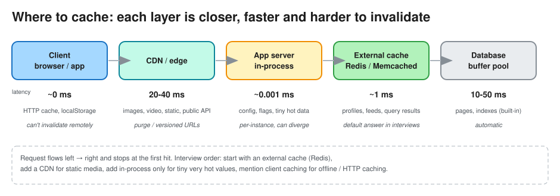
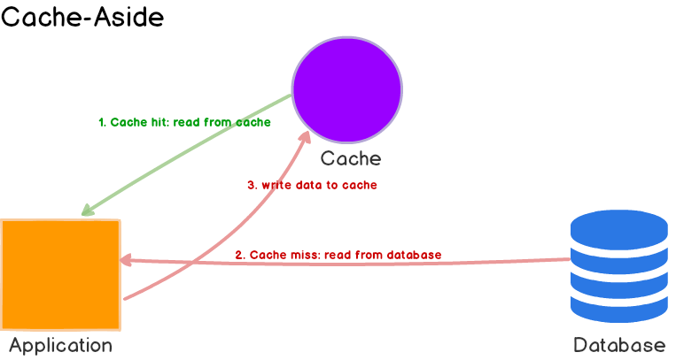
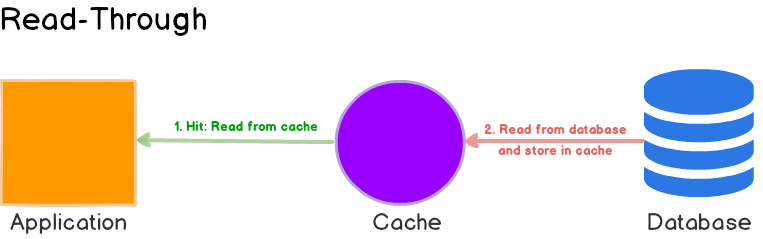
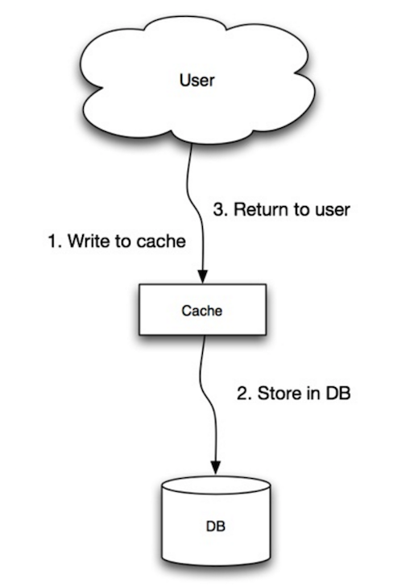
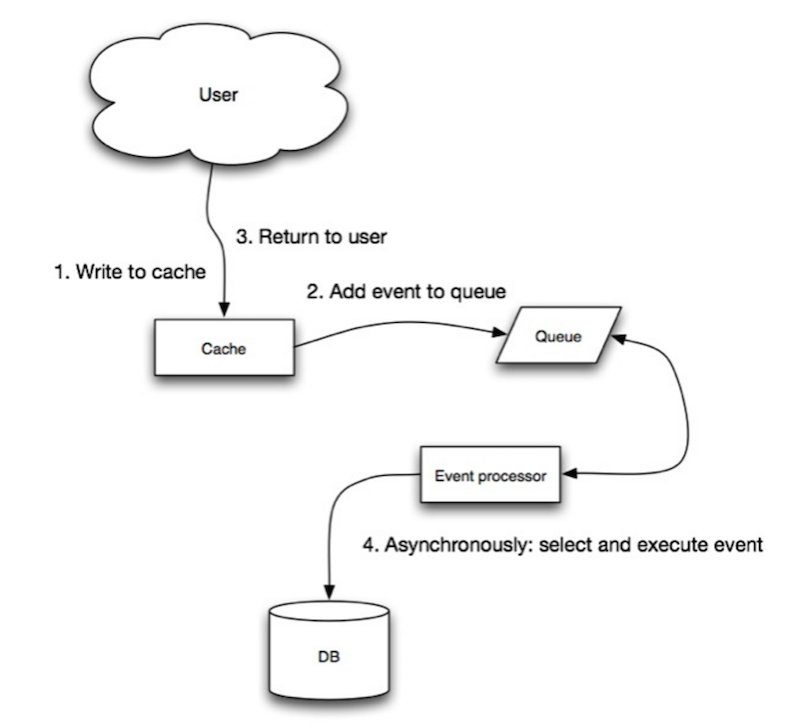
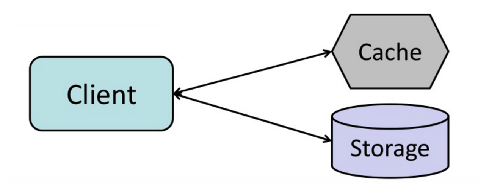
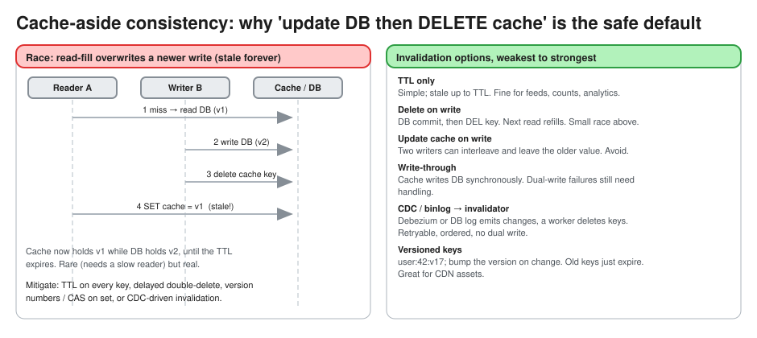
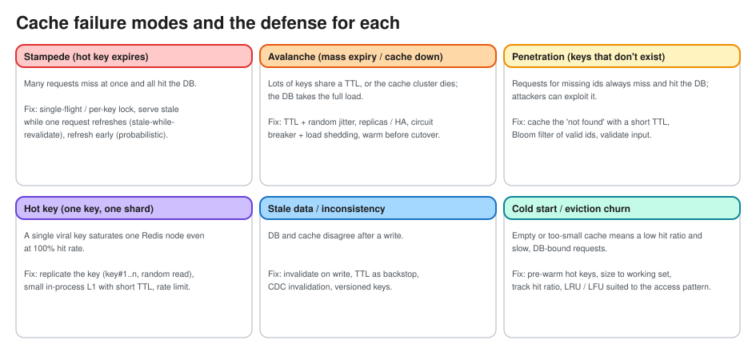

# Caching

> **TL;DR** — A cache keeps the result of expensive work (a DB read, a computation, a remote call) in a faster, closer
> place so repeat requests are cheap. Reading a profile from Postgres might take ~10-50 ms while Redis returns it in ~1 ms,
> and an in-process map in microseconds. Caching is the standard answer to **read-heavy load, expensive queries, high DB CPU
> and tight latency budgets**, but it buys speed with **staleness, extra failure modes and operational complexity**. In an
> interview: *quantify the bottleneck → decide what to cache and the key → pick a pattern (default **cache-aside + Redis**) →
> set eviction + TTL → address invalidation, stampede, hot keys and cache failure.* See also [Redis / Memcached](redis_memcached.md),
> [CDN](cdn.md), [Distributed Cache (problem)](../problems/distributed_cache.md) and [Consistent Hashing](consistent_hashing.md).

## 1. Basics
- A cache is a temporary, usually in-memory store for frequently accessed or expensive-to-compute data. It works because of
  **locality of reference**: data used recently or often is likely to be used again.
- Caches exist at every layer, and the closer to the user, the faster and the harder to keep fresh.
- Memory is faster than disk, and a cache avoids the network hop, the query planning and the disk I/O of the source of truth.
- Caching is a **trade-off**: lower latency and database load ↔ possible stale reads, memory cost, invalidation logic and new failure modes.

**Rough latency anchors** (order of magnitude, see [Back-of-envelope](back_of_envelope_estimation.md)): in-process memory ≈ 0.1 µs-1 µs,
Redis in the same AZ ≈ 0.5-1 ms, indexed DB read ≈ 5-50 ms, cross-continent request ≈ 150-300 ms, CDN edge ≈ 20-40 ms.

## 2. When to bring up caching (and when not to)
Don't say "add a cache" by reflex. Name the problem and put numbers on it:

| Trigger | Example to say out loud |
|---|---|
| **Read-heavy workload** | "10M DAU × 20 reads = 200M reads/day (~2.3k/s avg, ~10k/s peak). Even indexed, that's 20-50 ms each. A cache serves most of them in ~1 ms." |
| **Expensive query / computation** | "The personalized feed joins posts, follows and likes and takes 200 ms. Cache the computed result for 60 s." |
| **High DB CPU** | "The DB sits at 80% CPU serving the same hot reads; a cache absorbs 70-90% of them." |
| **Latency SLO** | "We need p99 < 10 ms and the DB gives 30-50 ms." |
| **Rate-limited or costly dependency** | "Third-party API with quotas or per-call cost: cache its responses." |

**Don't cache (or be careful) when**: data changes on every read or is write-heavy, access has no locality (every key read once),
correctness requires the latest value (balances, inventory at checkout, authz revocation), the dataset is tiny and the DB is already fast,
or you can't tolerate the operational risk. Caches are an *optimization*, so the system must still be correct, if slower, without them.

## 3. Where to cache


### External cache (Redis / Memcached): the default
- A standalone service shared by all app servers over the network. Supports TTL and eviction (LRU/LFU), scales out by sharding.
- **In interviews, start here** for any high-traffic read path, then layer other caches only if the problem calls for them.
- See [Redis / Memcached](redis_memcached.md) for data structures, persistence and clustering.

### CDN (edge cache)
- Geographically distributed servers cache content near users. A request goes to the nearest edge; on a miss the CDN fetches from the
  **origin**, stores it and returns it. (A CDN is effectively a **read-through** cache.)
- Origin in Virginia → user in India costs ~250-300 ms per request; a nearby edge is ~20-40 ms.
- Modern CDNs (Cloudflare, Fastly, Akamai, CloudFront) can also cache public API responses and HTML and run edge logic, but the safest, highest-impact
  reason to introduce one in an interview is **static media at scale** (images, video, JS/CSS). See [CDN](cdn.md).
- Invalidate with **versioned/fingerprinted URLs** (`app.3f9c1.js`), cache-busting, or explicit purge; use long TTLs for immutable assets.
- Small systems can start with a separate static subdomain served by Nginx and cut over to a CDN later.

### Client-side cache
- The user's device: browser HTTP cache, `localStorage`, service workers, mobile app storage (e.g. a fitness app keeping a run offline and syncing later).
- Also **client libraries**: a Redis cluster client caches the slot → node map so it routes directly instead of asking the cluster every time.
- You have little backend control, so staleness and invalidation are harder. Control it with HTTP headers (see §10).

### In-process (application-server) cache
- A map inside the app process (Guava/Caffeine, `functools.lru_cache`, a `ConcurrentHashMap`). No network hop, so the fastest option.
- Good for **small, hot, rarely-changing** data: config values, feature flags, small reference datasets, hot keys, rate-limit counters, precomputed values.
- Limits: each instance has its **own copy**, so values diverge and invalidation on one node isn't seen by others; memory is shared with the app; cold on every deploy/restart; hit ratio drops as you add instances (a load balancer spreads the same key across nodes).
- Use short TTLs and pub/sub or versioning to invalidate. In an interview, mention it **only as an optimization layer after the external cache**, not as a replacement.
- Multi-level (L1 in-process + L2 Redis) is common for hot keys.

### Distributed vs. global caches (classic framing)
- **Distributed cache**: the cache is sharded across many nodes (via [consistent hashing](consistent_hashing.md)); capacity grows by adding nodes. Drawback: losing a node loses that shard's data (remapped misses), so use replicas.
- **Global cache**: one logical cache all request nodes share. Two forms: *the cache handles a miss* (most apps) or *the request node handles the miss* (when hot data is a large share of a static set and the app knows eviction/hot spots better).

### Database-level caches
- Databases already cache: buffer pool / page cache, query plan cache, materialized views. Tune these before adding infrastructure. Result caching inside the DB is limited, so an application cache is still common.

## 4. Cache architectures (read/write patterns)
Pick by consistency need and read/write mix. **Default to cache-aside.**

| Pattern | Reads | Writes | Best for | Main drawback |
|---|---|---|---|---|
| **Cache-aside (lazy loading)** | App checks cache, on miss reads DB and fills cache | App writes DB, then **invalidates** key | Most read-heavy apps (**the default**) | Miss latency; stale window; app owns the logic |
| **Read-through** | Cache fetches from DB on miss | n/a | Library/provider-managed loading, CDNs | Needs special cache layer; cache model = DB model |
| **Write-through** | Often paired with read-through | App writes to cache, cache **synchronously** writes DB | Reads must be fresh; writes can be a bit slower | Slower writes; cache pollution; dual-write failures |
| **Write-behind (write-back)** | Reads from cache | Write to cache only; **async batch flush** to DB | Very high write throughput, tolerant of loss (metrics, counters) | Data loss if cache dies before flush; complexity |
| **Write-around** | Cache-aside style | Write DB directly, skip cache | Write-once/read-rarely data (logs, chat history) | First read after write misses |

### Cache-aside
- The most common approach. The cache sits beside the DB and the **application** talks to both.


```python
def get_user(user_id):
    key = f"user:{user_id}"
    cached = cache.get(key)
    if cached is not None:
        return json.loads(cached)
    user = db.query("SELECT * FROM users WHERE id = %s", (user_id,))
    if user is not None:
        cache.set(key, json.dumps(user), ex=600 + random.randint(0, 60))   # TTL + jitter
    return user

def update_user(user_id, fields):
    db.execute("UPDATE users SET ... WHERE id = %s", (user_id,))         # 1. write source of truth
    cache.delete(f"user:{user_id}")                                       # 2. invalidate (don't update)
```
- **Pros**: cache holds only what's requested; resilient to cache failure (fall back to DB); cache model can differ from the DB model (denormalized, serialized).
- **Cons**: extra latency on a miss (cache check + DB + fill); stale window; duplicated logic across services; cold-start misses.
- Prefer **delete-on-write** over update-on-write: two concurrent writers can otherwise leave the older value in the cache (see §6).

### Read-through
- The cache is an in-line smart proxy: the app never talks to the DB. On a miss the **cache** loads from the DB, stores and returns it.

- vs cache-aside: the loading logic lives in the library/provider; the cached data model **must match** the DB's.
- Pros: centralized logic, simpler apps. Cons: needs a capable cache/library, still can be stale. Rare for app-level Redis; common for CDNs.

### Write-through
- Writes go to the cache, which **synchronously** writes the DB before acknowledging. Paired with read-through you get fresh reads without explicit invalidation.

- Needs a cache layer that supports it (Redis doesn't natively; use a library/framework). Example: **DynamoDB Accelerator (DAX)** is a read-through/write-through cache for DynamoDB. See [DynamoDB](dynamodb.md).
- **Still has the dual-write problem**: the cache write may succeed and the DB write fail (or vice versa) → inconsistency, so you need retries, ordering or accept it.
- Pros: fresh reads, robust to restarts. Cons: slower writes, caches data that may never be read (mitigate with TTL).

### Write-behind (write-back)
- Writes hit only the cache; a background process batches and flushes to the DB asynchronously.

- Pros: very low write latency, coalesces many writes into few, reduces DB cost. Cons: **data loss if the cache fails before flushing**, ordering/retry complexity, DB lags the cache.
- Use for analytics/metrics, counters and view counts where occasional loss is acceptable; pair with a durable queue/log if not.

### Write-around
- Writes go straight to the DB, bypassing the cache; only data that is read ends up cached.

- Good for write-once/read-rarely data (real-time logs, chat messages). Con: a read right after a write misses.

## 5. Eviction policies and TTL
A full cache must decide what to drop. TTL is separate: it is **expiration**, not eviction.

| Policy | Evicts | Notes |
|---|---|---|
| **LRU** | Least recently used | Safest default; hash map + doubly linked list for O(1). Weak against one-off scans that flush hot data |
| **LFU** | Least frequently used | Great for consistently popular keys (trending, top playlists); needs counters/decay; Redis uses an approximate LFU |
| **FIFO** | Oldest inserted | Ignores usage; rarely used beyond simple caches |
| **TTL** | Expired entries | Not a policy alone; combine with LRU/LFU. Essential for freshness (tokens, API responses) |
| Random | A random key | Cheap; surprisingly decent; Redis offers `allkeys-random` |
| LIFO / MRU | Newest / most recent | Niche (e.g. cyclic scans), mostly of academic interest |
| **TinyLFU / W-TinyLFU** | Admission by estimated frequency | Used by Caffeine; high hit ratio with a [Count-Min sketch](count_min_sketch.md) |

- **Redis** `maxmemory-policy`: `noeviction`, `allkeys-lru`, `allkeys-lfu`, `volatile-lru/lfu/ttl/random` (only keys with a TTL). Redis uses *approximate* LRU by sampling.
- Memcached uses a slab allocator with per-slab LRU.
- Be explicit in an interview: *"LRU eviction, 10-minute TTL on profiles, invalidate on write."*
- **TTL choice**: balance staleness vs hit ratio. Add **jitter** (±10-20%) to avoid synchronized expiry. Different data classes get different TTLs.
- Avoid unbounded keys/values: cap sizes, avoid giant objects and giant collections in one key.

## 6. Cache invalidation and consistency
"There are only two hard things in computer science: cache invalidation and naming things." The cache is a copy; copies drift.
There is **no perfect solution**: choose by how fresh the data must be.



- **TTL only**: simplest, stale up to the TTL (fine for feeds, metrics, counts).
- **Invalidate on write**: commit to the DB, then delete the key; the next read repopulates it. Delete **after** the DB commit, and retry deletion on failure (queue it) so a dropped delete doesn't leave stale data forever.
- **Why delete, not set**: updating the cache on write lets two writers interleave and cache the older value; deleting is idempotent.
- **The read-fill race**: reader A misses and reads v1; writer B updates the DB and deletes the key; A then sets v1. The cache now has stale data until TTL. Mitigations: TTL as a backstop, delayed double-delete, version numbers/compare-and-set on fill, leases (a miss gets a token only the latest filler can use, as in Facebook's memcache paper), or CDC.
- **CDC-driven invalidation**: tail the DB log (binlog/WAL via Debezium) and have a worker delete or refresh keys. It decouples app code from invalidation, is ordered and retryable, and avoids the dual-write problem (see [Idempotency](idempotency.md)).
- **Versioned keys / namespaces**: `user:42:v17` or `feed:{version}`: bump a version instead of deleting many keys (also how CDNs invalidate assets).
- **Events/pub-sub** to invalidate in-process caches across instances.
- **Strong consistency** (read-your-writes) needs routing the user's reads to the source of truth after a write, short TTLs, or write-through. See [Consistency](consistency.md).
- **Accept eventual consistency** where the business allows (feeds, view counts); never for money or inventory decisions made from stale reads.

## 7. Common caching problems



### Cache stampede / thundering herd
- A hot key expires and thousands of concurrent requests miss and hit the DB at once, causing a spike and possible cascade.
- **Request coalescing / single-flight**: only one request rebuilds the value while others wait on its result (per-key mutex or `SET key lock NX PX`); **the most effective fix**.
- **Serve stale while revalidating**: keep an extra "soft" expiry; return the old value while one worker refreshes in the background.
- **Probabilistic early expiration** (XFetch): refresh slightly before TTL with probability rising as expiry nears.
- **Cache warming / refresh-ahead**: refresh popular keys proactively (only helps for TTL-based expiry, not write-invalidated keys).
- **Jittered TTLs** to stop many keys expiring together.

```python
def get_with_singleflight(key, loader, ttl):
    v = cache.get(key)
    if v is not None:
        return v
    if cache.set(f"lock:{key}", "1", nx=True, ex=5):         # I won the right to rebuild
        try:
            v = loader()
            cache.set(key, v, ex=ttl + random.randint(0, ttl // 10))
            return v
        finally:
            cache.delete(f"lock:{key}")
    time.sleep(0.05)                                          # others back off briefly, then retry the cache
    return cache.get(key) or loader_with_timeout(loader)
```

### Cache avalanche
- Many keys expire together, or the whole cache fails/restarts, and the DB takes everything. **Fix**: TTL jitter, replicas + HA for the cache, **circuit breakers / load shedding / rate limiting** in front of the DB, graceful degradation (serve stale or partial), gradual cache warm-up.

### Cache penetration (queries for keys that don't exist)
- A missing id is never cached, so every request reaches the DB (accidental or malicious). **Fix**: cache negative results (`null` with a short TTL), a [Bloom filter](bloom_filter.md) of valid keys in front, input validation, rate limiting.

### Hot keys
- One key (a celebrity profile, a viral item) receives vastly more traffic than others and saturates a single shard even though the hit rate is high.
- **Fix**: replicate the value across several keys/nodes (`user:taylor#0..N`, read a random one); add a short-TTL **in-process** L1; rate limit abusive patterns; split counters.
- Detect with per-key QPS metrics (e.g. Redis `--hotkeys`, client-side sampling).

### Big keys
- Huge values or giant lists/hashes cause latency spikes, slow replication and uneven memory. Split them and paginate.

### Cache failure / dependency
- If Redis is down, requests fall back to the DB, which may collapse (avalanche). Use **replicas + automatic failover**, **circuit breakers**, **timeouts** (never wait forever on the cache), bulkheads, and a small in-process fallback. Decide in advance whether to **fail open** (hit the DB, shed excess load) or **fail closed**.
- Be careful with **cache as a primary store**: it is an optimization; if data exists only in the cache it's a database, not a cache.

### Other pitfalls
- Caching **errors or empty results** by mistake; caching **per-user data under a shared key** (data leak); caching personalized or sensitive data on a CDN (respect `Cache-Control: private`).
- **Serialization cost/version skew** between app deployments; schema changes that make old cached objects unreadable (version your keys).
- Using the cache for **coordination** (locks, counters) without understanding failure semantics, so see [Distributed Locking](distributed_locking.md).

## 8. Scaling and operating a cache
- **Sharding**: hash-partition keys across nodes using [consistent hashing](consistent_hashing.md) (or Redis Cluster's 16,384 hash slots) so adding nodes only remaps a fraction of keys. Multi-key operations must stay in one slot (hash tags).
- **Replication & HA**: primary/replica with failover (Redis Sentinel/Cluster). Replicas also serve reads (with replication lag).
- **Persistence** (Redis RDB/AOF): useful for faster warm restarts, but a cache must not depend on it for correctness.
- **Memory sizing**: size to the **working set** (hot data), not the whole dataset; leave headroom for fragmentation and replication buffers.
- **Hit ratio is the key metric**: `hits / (hits + misses)`; target depends on workload (90%+ is common for hot read paths). Also watch evictions, memory, latency percentiles, key-space size, hot keys and DB load behind it.
- **Back-of-envelope**: peak read QPS × (1 − hit ratio) = DB load. At 100k QPS and 95% hit, the DB sees 5k QPS. A 99% → 95% drop is a **5× DB load increase**.
- **Key design**: namespaced, predictable keys (`user:123:profile`, `feed:global:v3`); include tenant/locale/version where relevant; keep them short.
- **Serialization**: JSON (readable), Protobuf/MessagePack (compact/fast); consider compression for large values.
- **Rollouts**: pre-warm before cutover, canary new cache layers, and protect the DB with rate limits during warm-up.

## 9. Redis vs Memcached (quick take)
| | Redis | Memcached |
|---|---|---|
| Data types | Strings, hashes, lists, sets, sorted sets, streams, bitmaps, HLL, geo | Strings/bytes only |
| Persistence / replication | Yes (RDB/AOF, replicas, Cluster) | No built-in |
| Eviction | Multiple (LRU/LFU/TTL, approximate) | LRU per slab |
| Threading | Mostly single-threaded command execution (I/O threads in newer versions) | Multi-threaded |
| Use | Default; rich structures, rate limiting, leaderboards, locks, pub/sub | Simple, very high-throughput key-value cache |

## 10. HTTP / CDN caching essentials
- `Cache-Control: max-age=…, s-maxage=…` (browser vs shared caches), `public` vs `private`, `no-store` (never cache), `no-cache` (revalidate before use), `immutable`.
- **Validators**: `ETag` / `If-None-Match` and `Last-Modified` / `If-Modified-Since` give cheap `304 Not Modified` revalidation.
- `stale-while-revalidate` / `stale-if-error` let caches serve stale content while refreshing or when the origin fails.
- `Vary` (e.g. `Accept-Encoding`, `Accept-Language`) controls cache-key variants; careless `Vary` fragments the cache.
- Prefer **fingerprinted URLs + long max-age** for static assets and short TTL/revalidation for HTML and APIs.

## 11. How to talk about caching in an interview
1. **Identify the bottleneck** with numbers: "Profile reads hit Postgres 500/s at 30 ms each at peak."
2. **Decide what to cache and the key**: read often, change rarely, expensive to compute (`user:123:profile`, `trending:posts:global`).
3. **Choose the pattern**: "Cache-aside on Redis; CDN for images; a small in-process cache only for feature flags / the hottest keys."
4. **Eviction + TTL**: "LRU, 10-minute TTL with jitter on profiles, invalidate on update."
5. **Address the downsides**: invalidation (delete on write + TTL backstop), Redis failure (fall back to DB with circuit breakers, replicas), stampede (single-flight / early refresh), hot keys (replicate/local L1), penetration (negative caching / Bloom filter).

Don't enumerate every problem; pick the two or three that actually threaten *this* design and give a concrete mitigation for each.

## 12. Interview follow-ups
- *"What if the cache goes down?"* Fall back to the DB with timeouts and a circuit breaker, shed load, keep replicas for HA, and a small in-process layer for the hottest data.
- *"How do you keep cache and DB consistent?"* Write DB then delete key (retry deletes), TTL as safety net, CDC for reliable invalidation; accept eventual consistency where possible, or route reads-after-writes to the primary.
- *"A celebrity's profile is melting one Redis node."* Hot key: replicate across keys/nodes, local cache with short TTL, rate limit.
- *"Cache and DB at 100k QPS; what hit ratio do you need?"* Compute the DB budget: DB QPS = total × (1 − hit ratio).
- *"LRU vs LFU?"* LRU for recency-skewed workloads; LFU for stable popular items; TinyLFU gets both; scans hurt LRU.
- *"How would you implement an LRU cache?"* Hash map + doubly linked list, O(1) get/put (a classic coding question).
- *"Write-through or cache-aside?"* Cache-aside by default (simple, resilient); write-through when reads must be fresh and you have a cache layer that supports it, noting the dual-write problem.
- *"How do you cache personalized data?"* Key by user (and any variant dimension), shorter TTLs, never share across users, keep it off shared CDNs.
- *"Design a distributed cache."* See [Distributed Cache](../problems/distributed_cache.md): sharding with consistent hashing, replication, eviction, hot keys, client routing.

# References
* [Hello Interview: Caching (System Design in a Hurry)](https://www.hellointerview.com/learn/system-design/core-concepts/caching)
* [Scaling Memcache at Facebook (NSDI '13)](https://www.usenix.org/system/files/conference/nsdi13/nsdi13-final170_update.pdf), leases, stampede protection, invalidation at scale
* [Optimal Probabilistic Cache Stampede Prevention (XFetch)](https://cseweb.ucsd.edu/~avattani/papers/cache_stampede.pdf)
* [Redis eviction docs](https://redis.io/docs/latest/develop/reference/eviction/)
* [MDN: HTTP caching](https://developer.mozilla.org/en-US/docs/Web/HTTP/Caching)
* [grokking-the-system-design-interview](https://www.educative.io/courses/grokking-the-system-design-interview/3j6NnJrpp5p)
* https://codeahoy.com/2017/08/11/caching-strategies-and-how-to-choose-the-right-one/
* [System Design Interview - An Insider's Guide book (Volume 1)](https://amzn.to/3ggPKAG)
* [Introduction to architecting systems](https://lethain.com/introduction-to-architecting-systems-for-scale/)
* https://blog.bytebytego.com/p/top-caching-strategies
* https://blog.bytebytego.com/p/a-crash-course-in-caching-part-1
* https://blog.bytebytego.com/p/a-crash-course-in-caching-part-2
* https://blog.bytebytego.com/p/a-crash-course-in-caching-final-part
* https://docs.google.com/presentation/d/1wP-sBwASFTnrlA63VrdeHdBrTqaSyRupafpYHh_5TJY/edit#slide=id.g12646c8f079_0_92
* https://medium.com/must-know-computer-science/system-design-caching-acbd1b02ca01
