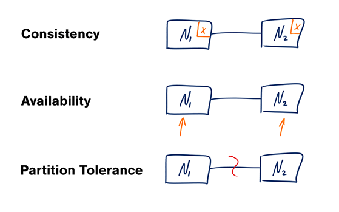
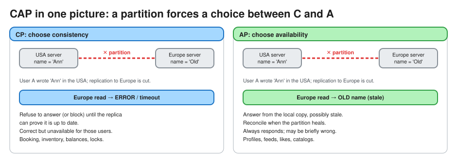
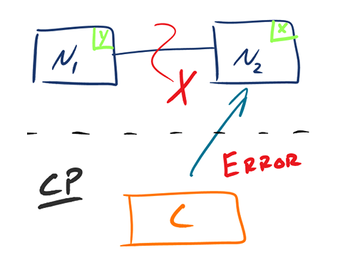
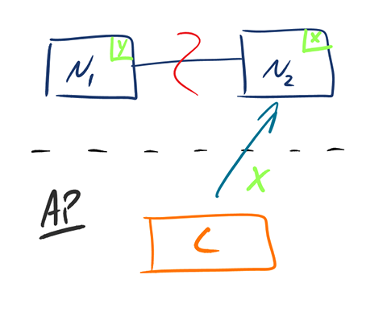
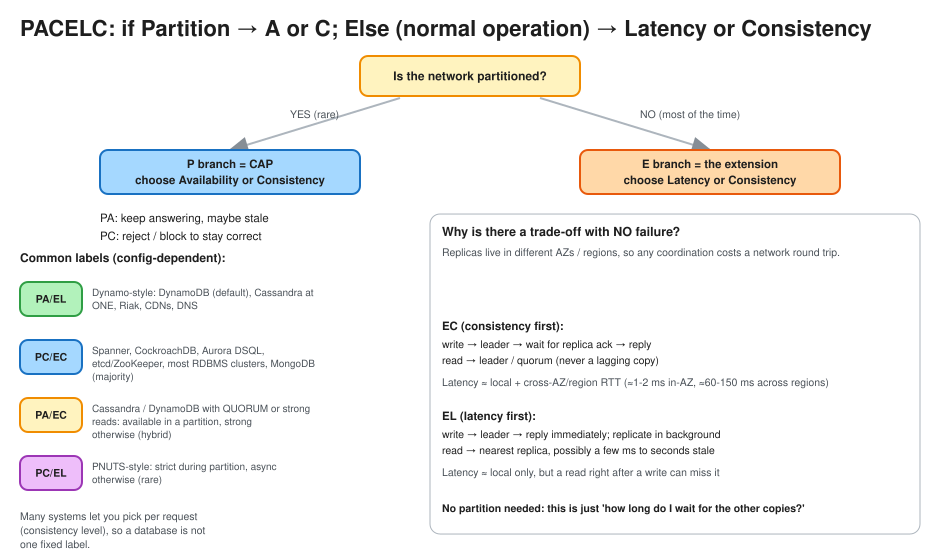

# CAP Theorem and PACELC

> **TL;DR** — **CAP**: when a network **partition** happens, a replicated system must choose between **Consistency** (every read
> sees the latest write, or errors) and **Availability** (every request to a working node gets an answer, possibly stale).
> Partitions are unavoidable, so CAP is really *"C or A **during a partition**"*. **PACELC** completes the picture: *if* there is a
> **P**artition choose **A** or **C**, **E**lse (normal operation, the 99.9% case) choose **L**atency or **C**onsistency. The "Else"
> half is the one you live with every day: keeping replicas strongly consistent means *waiting for other nodes*, which costs latency,
> even when nothing is broken. In an interview, decide per feature: *"Would it be catastrophic if users briefly saw stale data?"*
> Related: [Consistency Models](consistency.md) · [Availability](availability.md) · [Replication](data_replication.md) · [Quorum](quorum.md).

## 1. CAP in a nutshell

The three properties (informal, interview-level definitions):
- **Consistency (C)**: every read returns the **most recent write or an error** (this is *linearizability*; see [Consistency](consistency.md)).
- **Availability (A)**: **every request to a non-failing node gets a non-error response**, though not necessarily with the latest data.
- **Partition tolerance (P)**: the system keeps operating despite **dropped or delayed messages between nodes** (a network partition: nodes are up but can't talk).

> ⚠️ **"Consistency" in CAP is not the "C" in ACID.** ACID-C means *invariants/constraints hold after a transaction*
> ([Transactions](transactions.md)); CAP-C means *all clients see one up-to-date copy* (linearizability). Don't mix them.

### The one-line takeaway
- Real networks **will** partition (and a very slow link or a long GC pause looks the same), so **P is not optional** for a distributed system.
- Therefore the real choice is: **when a partition happens, do you give up Consistency or Availability?**
- "Pick any two of C, A, P" is a misleading slogan. A **"CA" distributed system doesn't exist**: a single-node database is trivially "CA" because there is nothing to partition.
- The trade-off is **only forced during a partition**. With a healthy network you can have both C and A; what you still pay is **latency** (that is PACELC, next).

### Example: a partition between USA and Europe

A user in the USA updates their display name; it replicates to Europe. The link between regions breaks. A user in Europe asks for the profile:
- **Option A (choose consistency, CP)**: return an error or block, because we can't prove the Europe copy is current.
- **Option B (choose availability, AP)**: return the old name. Here B is clearly better: a stale name beats no name.

For a **seat booking**, the answer flips: showing seat 6A as free to Europe while the USA already sold it would double-book, so you'd rather return an error.

### CP vs AP behavior
| | **CP** (consistency over availability) | **AP** (availability over consistency) |
|---|---|---|
| During a partition | Reject or block requests it can't serve correctly (minority side stops) | Keep serving and accepting writes on both sides |
| After healing | Nothing to reconcile | Must **reconcile divergent copies** (LWW, version vectors, CRDTs) |
| Good for | Money, inventory, bookings, locks, leader election, trading | Social feeds, profiles, catalogs, reviews, shopping carts, DNS |
| Typical tech | Spanner, etcd/ZooKeeper, HBase/Bigtable, relational clusters with sync replication | Cassandra, DynamoDB (default), Riak, CouchDB, DNS, CDNs |

## 2. PACELC: what CAP leaves out
CAP only talks about the rare moment of a partition. **PACELC** (Daniel Abadi, 2012) adds the question you face the rest of the time:

> **If** there is a **P**artition, choose between **A**vailability and **C**onsistency; **E**lse (no partition), choose between **L**atency and **C**onsistency.

### Why is there a trade-off when nothing is broken?
Replicas live on different machines, usually in different AZs or regions. A **consistent** read or write needs the replicas to agree, and agreement needs **network round trips**:

| Choice (no partition) | What the system does | Cost | Benefit |
|---|---|---|---|
| **EC**: favor consistency | Write goes to the leader and **waits for replica acknowledgements** (sync replication, majority quorum, consensus); reads go to the **leader or a quorum**, never a lagging copy | **Higher latency**: ≈ local time + the slowest required replica's round trip (≈1-2 ms across AZs, tens to ~150 ms across regions) | Reads always see the latest write |
| **EL**: favor latency | Write is acknowledged **after the local write**; replication happens **in the background**; reads hit the **nearest replica** | **Stale reads possible**; a read right after a write can miss it; lost writes if the leader dies before replicating | Lowest latency, highest throughput |

Same data, same healthy network: the only difference is **how long you are willing to wait for the other copies**. That is why PACELC is the more *useful* theorem day to day: you pay the latency-versus-consistency cost on **every** request, while a partition is an occasional event.

### Reading the label
A system is described by two letters for each branch: **P?/E?**
- **PA/EL**: during a partition stay **A**vailable; otherwise favor **L**atency. Everything is "fast and eventually consistent" (Dynamo-style: DynamoDB with default reads, Cassandra at `ONE`, Riak, DNS, CDNs).
- **PC/EC**: during a partition stay **C**onsistent (sacrifice availability); otherwise also favor **C**onsistency (accept higher latency). The "always correct" family (Spanner, CockroachDB, Aurora DSQL, etcd/ZooKeeper, synchronous relational clusters, MongoDB with majority concerns).
- **PA/EC**: available under partition, but consistent (slower) when healthy. A hybrid, e.g. Cassandra/DynamoDB when you use quorum / strongly consistent reads for normal operation.
- **PC/EL**: strict under partition, fast otherwise. Rare (Yahoo PNUTS is the classic example).

Examples to say out loud:
- **DynamoDB**: **PA/EL by default** (eventually consistent reads are the fast, cheap default); you can opt into **strongly consistent reads** per request (EC, at higher latency/cost, and unavailable if the leader replica can't be reached). Multi-Region strong consistency (global tables MRSC) is the PC/EC end.
- **Cassandra**: **PA/EL** with `ONE`/`LOCAL_ONE`; moves toward **EC** as you raise the consistency level (`LOCAL_QUORUM`, `QUORUM`, `ALL`). See [Quorum](quorum.md).
- **Spanner**: **PC/EC**. Pays commit-wait and cross-replica round trips for external consistency. (Google argues it is "effectively CA" in practice thanks to private networks and very high availability, but by the theorem it is CP.)
- **MongoDB**: configurable. With `w:"majority"` + majority reads it behaves **PC/EC**; with `w:1` and secondary reads it drifts toward **PA/EL**.
- **Classic primary + async read replicas** (Postgres/MySQL): writes are consistent on the primary (EC for those), replica reads are **EL** (stale by replication lag).

> Labels depend on **configuration**. Most modern databases let you pick the point on the dial **per request**, so say *"X is PA/EL by default but tunable toward EC."*

### Worked mini-example: the same write under EC and EL
Two replicas in US-East and EU-West, round trip ≈ 80 ms.
- **EC**: client writes in US-East → leader waits for EU-West ack → replies after **~85 ms**. A read from EU-West immediately after is **guaranteed fresh**.
- **EL**: leader replies after **~5 ms**, replicates in the background. A read from EU-West within the next ~80 ms **may return the old value**.
You bought ~80 ms of latency to remove that stale window. Whether that's worth it is a **product** decision (see §3).

### Why it matters in interviews
- It shows you understand that the consistency decision is **not only about failures**. It shapes normal-case latency, cost and throughput.
- It gives you precise language: *"For the feed I'll go PA/EL: reads from the nearest replica, ~ms staleness is fine. For payments I'll go PC/EC and accept the extra latency."*
- It links to tunable consistency: `W + R > N` ([Quorum](quorum.md)) is literally the EC dial.

## 3. How to choose consistency vs availability
Ask: **"Would it be catastrophic if users briefly saw inconsistent data?"** If yes → consistency (and pay the latency/availability). If no → availability and lower latency.

| Choose **consistency** when… | Choose **availability** when… |
|---|---|
| Double-booking a seat or oversell inventory (1 toothbrush left) | A profile picture or display name is a few minutes old |
| Financial systems and order books where stale data → wrong trades | A movie description or restaurant hours are briefly outdated |
| Uniqueness (usernames), locks, leader election | Feeds, likes/view counts, recommendations, reviews |

### Mixed requirements inside one system (senior-level answer)
Most real systems need **both**, per feature:
- **Ticketmaster**: booking a seat → **strong consistency** (no double-booking); browsing event details → **availability** (slightly stale is fine). See [Ticketmaster](../problems/ticketmaster.md).
- **Tinder**: matching → consistency (both users should see the match immediately); viewing profiles → availability.
- **E-commerce**: checkout/inventory/payment → consistency; catalog/search/reviews → availability.

Template: *"I'll prioritize consistency for **X** but optimize for availability and latency for **Y**."*

## 4. CAP in a system design interview
Discuss CAP **early**, as part of non-functional requirements: *"Does every read need to see the most recent write?"* If yes → consistency; if no → availability.

**If you prioritize consistency**, your design may include:
- Strongly consistent stores: a relational database with one leader and sync/semi-sync standby, **Spanner / CockroachDB / [Aurora DSQL](aurora_dsql.md)**, DynamoDB strongly consistent reads, consensus-backed stores ([Consensus](consensus.md)).
- **Transactions** across stores (2PC, sagas): more latency and complexity ([Distributed Transactions](distributed_transactions.md)).
- A **single node** (or single shard) for the strongly consistent data to avoid propagation; limits scale ([Sharding](data_partitioning.md)).
- Reads routed to the leader or a quorum; fencing for failover.

**If you prioritize availability**, your design may include:
- Multiple **replicas with asynchronous replication**, reads from any replica (accept staleness) ([Replication](data_replication.md)).
- **CDC** to propagate changes asynchronously to replicas, caches, search indexes ([Caching](caching.md)).
- AP stores: Cassandra, DynamoDB, Riak, and clustered caches (Redis).
- Conflict resolution for concurrent writes (LWW, CRDTs, merges) and idempotent, retryable writes.

Most modern distributed databases are **configurable** both ways; the skill is choosing per use case, not naming a "CP database".

## 5. The rest of the consistency/availability toolbox (see the dedicated notes)
To keep this page focused on CAP/PACELC, the following live in their own notes:
- **Consistency levels** (weak, eventual, causal, read-your-writes, monotonic reads, strong/linearizable, plus how to resolve conflicts): **[Consistency Models & Patterns](consistency.md)**.
- **Availability patterns** (eliminating SPOFs, failover active-passive/active-active, replication, load balancing, caching, graceful degradation, multi-region, the "nines"): **[Availability](availability.md)**.
- Related building blocks: [Quorum](quorum.md) (the EC dial), [Replication](data_replication.md), [Consensus](consensus.md), [Heartbeats & failure detection](heartbeats.md), [Monitoring](monitoring.md).

## 6. Common misconceptions
- *"Pick two of three."* P isn't optional; the choice is C vs A **only when partitioned**.
- *"CAP says my database can never be consistent and available."* Only **during a partition**; otherwise you can have both (and pay latency, see PACELC).
- *"AP means no consistency."* AP systems are typically **eventually consistent** and converge after healing; many offer stronger options per request.
- *"CP means always down."* A CP system stays available to the **majority side** of a partition and for clients that can reach it; it refuses only what it can't do correctly.
- *"ACID = CP and BASE = AP."* ACID-C ≠ CAP-C; a relational database can be run with async replicas (EL reads) and a NoSQL database can offer strong reads.
- *"Availability = uptime."* In CAP it means **every non-failing node responds**; operational availability ([Availability](availability.md)) is a different, probabilistic measure.
- *"Latency is not part of CAP."* Right, which is exactly why PACELC exists: a very slow response is practically "unavailable".

## 7. Interview follow-ups
- *"Is your system CP or AP?"* "By feature: payments/booking are CP (PC/EC); feeds and profiles are AP (PA/EL)."
- *"What happens during a partition in your design?"* Which side keeps serving writes? How do you reconcile? Where do requests fail and what does the user see?
- *"What does PACELC add?"* The trade-off in normal operation: waiting for replica acks (consistency) vs replying locally (latency).
- *"How do you get strong consistency in Cassandra/DynamoDB?"* `QUORUM` reads/writes with `W + R > N`, or strongly consistent reads; pay latency; understand sloppy-quorum caveats ([Quorum](quorum.md)).
- *"Why is Spanner CP and how does it still feel highly available?"* Paxos groups + TrueTime; majority side keeps serving; Google's network makes partitions rare.
- *"Can you have strong consistency across regions?"* Yes: synchronous quorum/consensus across regions (Spanner, DSQL, DynamoDB MRSC), at cross-region write latency.
- *"How do you pick between latency and consistency for a read path?"* From the staleness the product tolerates and the latency SLO; use read-your-writes sessions as a middle ground ([Consistency](consistency.md)).

# References
* [Brewer's CAP Theorem (Gilbert & Lynch proof, 2002)](https://users.ece.cmu.edu/~adrian/731-sp04/readings/GL-cap.pdf)
* [Consistency Tradeoffs in Modern Distributed Database System Design (Abadi, PACELC, 2012)](https://www.cs.umd.edu/~abadi/papers/abadi-pacelc.pdf)
* [CAP Twelve Years Later: How the "Rules" Have Changed (Brewer)](https://www.infoq.com/articles/cap-twelve-years-later-how-the-rules-have-changed/)
* [Hello Interview: CAP Theorem](https://www.hellointerview.com/learn/system-design/core-concepts/cap-theorem)
* [Jepsen: consistency models](https://jepsen.io/consistency)
* [Dynamo: Amazon's Highly Available Key-value Store](https://www.allthingsdistributed.com/files/amazon-dynamo-sosp2007.pdf)
* Videos
  
  
* [CAP theorem revisited](https://robertgreiner.com/cap-theorem-revisited/)
* [grokking-the-system-design-interview](https://www.educative.io/courses/grokking-the-system-design-interview/RMkqx1Egxqz)
* https://medium.com/must-know-computer-science/system-design-cap-problem-13997ed7524c
* https://www.geeksforgeeks.org/pacelc-theorem/
* https://github.com/karanpratapsingh/system-design/blob/main/README.md#pacelc-theorem
