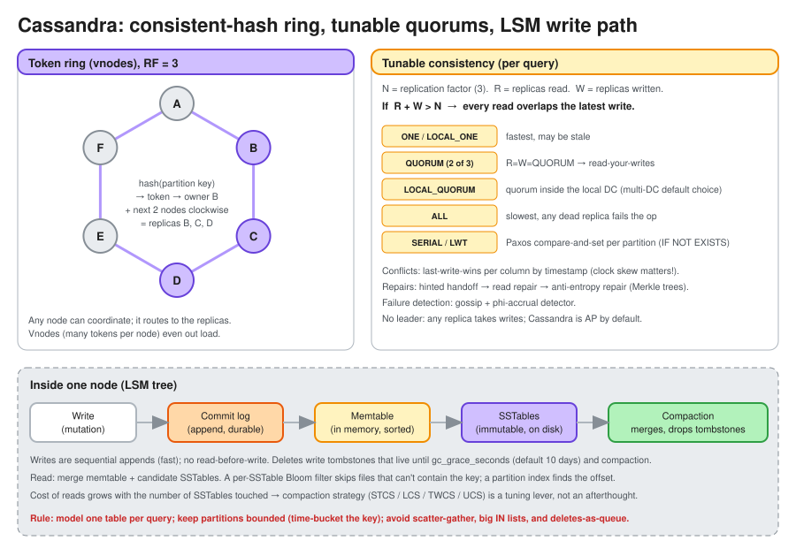

# Cassandra

> **TL;DR** — Apache Cassandra is a **masterless, partitioned, replicated wide-column store** built for massive write
> throughput and always-on availability across data centers. Rows are placed on a **consistent-hash ring** by
> **partition key**, replicated to **RF** nodes, and ordered inside the partition by **clustering keys**. Consistency
> is **tunable per query** (ONE … QUORUM … ALL) and conflicts resolve by **last-write-wins**. Writes are sequential
> appends into an **LSM tree** (commit log → memtable → SSTables → compaction). You model **one table per query**,
> keep partitions bounded, and give up joins, flexible queries and (until Accord lands) general transactions.
> Great for chat/message history, activity feeds, IoT/time-series and other write-heavy, key-addressable data.
> Compare with [DynamoDB](dynamodb.md) (managed, same lineage), [MongoDB](mongodb.md) and [SQL vs NoSQL](database_sql_vs_nosql.md).



## Data model
* **Keyspace** (like a database; holds replication settings) → **table** → **partition** → **rows** → columns.
* **Primary key = partition key + clustering columns**:
  `PRIMARY KEY ((conversation_id, bucket), message_id)` → partition key is `(conversation_id, bucket)`, rows inside are
  sorted by `message_id`. The partition key decides *where* data lives; clustering keys decide *order inside*.
* Rows in a partition may have different non-null columns (sparse, hence "wide-column"). **Static columns** are shared
  by all rows in a partition. Collections (list/set/map) and UDTs exist but should stay small.
* Every cell has a **write timestamp** (microseconds); **TTL** can expire cells.
* **CQL** looks like SQL but only supports queries that the key structure can serve: you must provide the full partition key
  and may restrict clustering columns in order. No joins; limited `GROUP BY`; aggregates are scatter-gather and slow.

## Partitioning and replication
* A **partitioner** (Murmur3) hashes the partition key to a **token**; the ring is divided into token ranges owned by
  nodes via **vnodes** (many small ranges per node; default 16 tokens per node in 4.0+). Vnodes balance load, let
  bigger machines own more, and make adding/removing nodes stream from many peers. See [Consistent Hashing](consistent_hashing.md).
* **Replication factor (RF)** copies of each range live on the next distinct nodes clockwise.
  * `SimpleStrategy`: ring walk, single DC (dev only).
  * `NetworkTopologyStrategy`: per-DC RF (e.g. `{dc1: 3, dc2: 3}`), rack-aware placement so replicas land in different racks/AZs. Use this in production.
* **Any node can be the coordinator**: the driver (token-aware routing) sends a request to a replica which coordinates,
  fans out to replicas and returns once enough respond.
* **Scaling out**: add nodes; they take over token ranges and stream data. No resharding project, no downtime.

## Tunable consistency
With replication factor **N**, reading **R** replicas and writing **W** replicas, `R + W > N` guarantees a read overlaps the
latest acknowledged write. See [Quorum](quorum.md) and [Consistency](consistency.md).

| Level | Meaning | Use |
|---|---|---|
| `ONE` / `LOCAL_ONE` | One replica responds | Lowest latency, may be stale |
| `QUORUM` | ⌊N/2⌋+1 replicas across all DCs | Strong-ish within one DC; costly across WAN |
| `LOCAL_QUORUM` | Quorum in the coordinator's DC | **Default for multi-DC** |
| `EACH_QUORUM` | Quorum in every DC | Rare, strict, slow |
| `ALL` | Every replica | Any failure breaks the op, so avoid |
| `SERIAL` / `LOCAL_SERIAL` | Paxos read of committed state | For LWT |

* **Cassandra is AP by default**: during a partition, with a sufficiently low consistency level, both sides keep serving.
  With `LOCAL_QUORUM` reads+writes you get read-your-writes within a DC.
* **Conflict resolution** is **last-write-wins per cell** by timestamp. Clock skew can silently drop the "newer" write, so
  keep clocks synced (NTP/chrony) and avoid concurrent updates to the same cell.
* **Lightweight transactions (LWT)**: `INSERT … IF NOT EXISTS`, `UPDATE … IF col = x` use Paxos for **linearizable
  compare-and-set on one partition**. About 4 round trips, so reserve for rare coordination (unique usernames, claims).
* **Batches**: *logged* batches give atomicity (eventually all or nothing) across partitions but **no isolation** and add
  coordinator load; use them to keep denormalized tables in sync, not for bulk loading. **Counters** are not idempotent
  under retries.
* **Accord (CEP-15)** adds general-purpose, strictly serializable, multi-partition transactions. It is in the **6.0 line
  (alpha as of mid-2026)**; **5.0.x remains the production line**, so do not assume Cassandra has multi-key ACID in an
  interview unless you say it's the new work.

## Write path and read path (LSM)
**Write**: append to the **commit log** (durable, sequential) and update the in-memory **memtable**; acknowledge. When
the memtable fills it is flushed to an immutable, sorted **SSTable** on disk. No read-before-write, no in-place update,
which is why writes are so fast. Background **compaction** merges SSTables, discards overwritten data and expired **tombstones**.

**Read**: check memtable, then for each candidate SSTable use its **Bloom filter** ([Bloom Filters](bloom_filter.md)) to skip
files that can't have the key, a partition index/summary to find the offset, and merge versions by timestamp (newest wins).
Row/key caches and OS page cache help. Read cost grows with the number of SSTables touched.

Compare with B-tree engines in [Database Indexes](database_indexing.md).

**Compaction strategies**: `STCS` (size-tiered; write-optimized, space amplification), `LCS` (leveled; read-optimized,
more write amplification), `TWCS` (time-window; time-series with TTL, drops whole files), `UCS` (unified, 5.0+).
Choosing one is a first-class design decision.

**Deletes and tombstones**: a delete writes a tombstone that must survive `gc_grace_seconds` (default 10 days) so
every replica learns about it. Many tombstones in a read path (queues, frequent deletes/TTLs, null inserts) make reads
slow or fail (`tombstone_failure_threshold`). **Never model a queue in Cassandra.**

## Anti-entropy: how replicas converge
1. **Hinted handoff**: if a replica is down, the coordinator stores a hint and replays it later (bounded by `max_hint_window`, default 3 h).
2. **Read repair**: when replicas disagree on a read, the coordinator writes the newest value back.
3. **Full/incremental repair** (`nodetool repair`, **Merkle trees**): periodically reconcile all replicas; must run at least once within `gc_grace_seconds` to avoid resurrecting deleted data. In 6.0, repair is being automated.

## Gossip, membership and failure detection
Nodes **gossip** about state (up/down, tokens, schema, load) with a few random peers about once per second; seed nodes
help bootstrap. A **phi-accrual failure detector** turns heartbeat inter-arrival times into a suspicion level instead of a
fixed timeout. See [Gossip Protocol](gossip_protocol.md) and [Heartbeats](heartbeats.md). Schema and topology in 6.0 move to
a Raft-like **transactional cluster metadata** service (CEP-21).

## Data modeling (query-first)
1. List queries ("last 50 messages in a channel", "events for sensor X in a day").
2. One **table per query**; duplicate data freely; keep tables in sync in the application (or batches / CDC).
3. **Partition key**: bounded size (aim for tens of MB, ≲ ~100 MB, and not unbounded rows) and good spread. Add a
   **time bucket** to the key for append-only data: `((channel_id, bucket), message_id DESC)`. (Discord famously
   buckets messages by ~10-day windows per channel.)
4. **Clustering keys**: define sort order and range-scan ability; `CLUSTERING ORDER BY (message_id DESC)` makes "latest N" a sequential read.
5. Avoid **hot partitions** (celebrity channel, "today's" bucket for all users); add a shard suffix or finer bucket.
6. Avoid **scatter-gather** (`ALLOW FILTERING`, big `IN` lists, queries without the partition key).

```sql
CREATE TABLE messages_by_channel (
  channel_id bigint, bucket int, message_id bigint, author_id bigint, body text,
  PRIMARY KEY ((channel_id, bucket), message_id)
) WITH CLUSTERING ORDER BY (message_id DESC);
-- latest 50:
SELECT * FROM messages_by_channel WHERE channel_id = ? AND bucket = ? LIMIT 50;
```

**Secondary access**: **SAI** (storage-attached indexes, 5.0+) work best *within* a partition-restricted query; global
index queries fan out. **Materialized views** denormalize automatically but have a history of correctness/operational
issues (treat with caution). **Vector search** arrived in 5.0 (SAI-based). For full-text/geo/facets, feed
[Elasticsearch](database_types.md) via CDC.

## Operating it (what interviewers probe)
* **Multi-DC**: asynchronous cross-DC replication, `LOCAL_QUORUM` per DC; a DC outage doesn't stop the others.
* **Capacity**: write-optimized; read latency depends on compaction, SSTable count, disk and cache. JVM GC pauses and
  heap sizing are classic tuning topics (ScyllaDB, a C++ rewrite, avoids the JVM).
* **Failure**: replace dead nodes by streaming data; run repairs; monitor pending compactions, tombstones, dropped mutations and hints.
* **Upgrades** are rolling; schema changes are cheap (add columns) but partition-key changes mean a new table + backfill.

## When to use it in an interview
**Good fit**: chat/message history ([Chat System](../problems/chat_system.md)), activity logs and feeds, IoT and
metrics ingestion, user-event stores, shopping carts and session-like data at huge scale, any write-heavy workload with
known key-based queries and multi-region availability needs.

**Poor fit**: strongly consistent multi-row transactions (ledgers, inventory), ad-hoc queries/aggregations/joins, small
datasets (use Postgres), queue/delete-heavy patterns, workloads needing frequent updates to the same row with
concurrent writers.

| | Cassandra | DynamoDB | HBase / Bigtable | MongoDB |
|---|---|---|---|---|
| Architecture | Masterless ring, tunable quorum | Managed, leader per partition | Master + region servers on HDFS/GFS-like storage | Replica sets + shards |
| Consistency | Tunable, LWW | Strong or eventual reads, txns | Strong per row | Tunable (write/read concern) |
| Ops | You run it (or managed) | None | Heavy (HBase) / managed (Bigtable) | Self or Atlas |
| Best at | Multi-DC writes, huge scale | Serverless key-value | Big scans, time-series | Flexible documents |

## Pitfalls checklist
* Unbounded/hot partitions; no time bucket on append-only data; huge rows or collections.
* Tombstone storms (deletes, TTL churn, nulls); queue-like usage; forgetting `gc_grace_seconds` vs repair cadence.
* `ALLOW FILTERING`, `IN` with many keys, aggregate queries, or secondary indexes on high-cardinality/skewed columns.
* Assuming `QUORUM` = ACID; concurrent writers + LWW + clock skew; using LWT in hot paths.
* Logged batches across many partitions; counters retried non-idempotently.
* Skipping repairs; wrong compaction strategy; undersized heap; mixing too many tables (memory per table).
* Modeling like a relational schema (normalized tables), then needing joins.

## Interview follow-ups
* *"How does Cassandra decide where data lives?"* Hash the partition key to a token on the ring; owner = the node
  with that token range; replicas = the next RF distinct nodes (rack/DC aware). Clustering key orders rows inside.
* *"Why are writes fast?"* Sequential commit-log append + memtable; flush to immutable SSTables; no read-modify-write.
* *"How do you get strong consistency?"* `R + W > N` (e.g. `LOCAL_QUORUM` both ways); linearizable single-partition
  CAS with LWT; no general multi-partition ACID (yet).
* *"Node down for hours, then returns?"* Hints (≤ 3 h) replay; beyond that repair/anti-entropy and read repair reconcile.
* *"Model a chat app."* Partition `((channel_id, bucket))`, cluster by `message_id` (Snowflake) DESC; another table
  by `(user_id)` for inbox/last read; presence in Redis. Paginate by message id.
* *"Model a ticket-queue/leaderboard/top-K?"* Cassandra isn't ideal for counters/ranking; use Redis/DynamoDB/SQL and keep Cassandra for the event log.
* *"Cassandra vs a relational DB?"* Choose Cassandra when write volume, multi-DC availability, or linear scale dominate and the queries are known; otherwise Postgres.

# References
* [Apache Cassandra documentation](https://cassandra.apache.org/doc/latest/)
* [Cassandra: A Decentralized Structured Storage System (Lakshman, Malik)](https://www.cs.cornell.edu/projects/ladis2009/papers/lakshman-ladis2009.pdf)
* [Dynamo: Amazon's Highly Available Key-value Store](https://www.allthingsdistributed.com/files/amazon-dynamo-sosp2007.pdf) and [Bigtable](https://static.googleusercontent.com/media/research.google.com/en//archive/bigtable-osdi06.pdf) (the two ancestors)
* [How Discord Stores Trillions of Messages](https://discord.com/blog/how-discord-stores-trillions-of-messages)
* [CEP-15: General Purpose Transactions (Accord)](https://cwiki.apache.org/confluence/spaces/CASSANDRA/pages/188744725/CEP-15+General+Purpose+Transactions)
* [Hello Interview: Cassandra deep dive](https://www.hellointerview.com/learn/system-design/deep-dives/cassandra)
