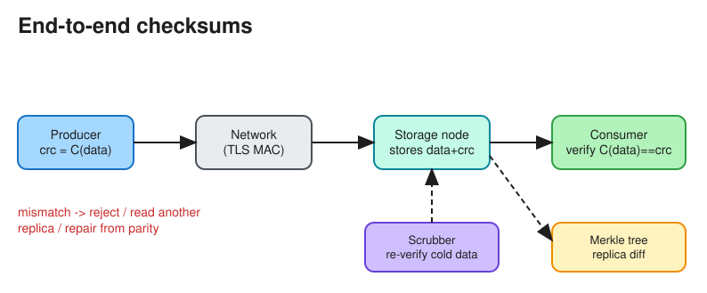

# Checksums

> **TL;DR** — A checksum is a small fixed-size value computed from data so you can **detect corruption**
> (bit flips on disk, in memory, or on the network) by recomputing and comparing it. Use fast non-cryptographic
> codes (CRC32C, xxHash) for accidental errors; use cryptographic hashes (SHA-256) when you need tamper
> resistance or content addressing; use HMAC or signatures when you need authenticity. Verify
> **end-to-end**, not just per hop.

## Choosing an algorithm
| Algorithm | Size | Speed | Detects | Use |
|---|---|---|---|---|
| Parity / simple sum | 1 bit – 16 bits | Fastest | Some single-bit errors | Legacy |
| **CRC32 / CRC32C** | 32 bits | Very fast (hardware instructions) | Burst errors, accidental corruption | Ethernet, Kafka record batches, ext4/Btrfs metadata, gRPC/GCS |
| Adler-32 | 32 bits | Very fast | Weaker than CRC | zlib |
| **xxHash / MurmurHash** | 64–128 bits | Extremely fast | Accidental changes (not adversarial) | Dedup pre-checks, hash tables, RocksDB |
| MD5 / SHA-1 | 128 / 160 bits | Fast | Accidental only; **broken** for adversaries | Legacy ETags (S3 single-part ETag is MD5) |
| **SHA-256** | 256 bits | Slower | Tampering (collision-resistant) | Content addressing (Git object IDs are moving to SHA-256), Docker image digests, blockchains |
| **HMAC-SHA256** | 256 bits | Slower | Tampering **plus** proves the sender holds the key | Webhook signatures, API request signing (AWS SigV4) |

## Where checksums appear in system design
* **Storage**: each block or chunk stores its checksum, verified on every read. Background **scrubbing**
  re-reads cold data to catch bit rot before the replicas also fail. Examples: HDFS (CRC per 512 bytes), GFS,
  ZFS, Ceph.
* **Network**: TCP has a weak 16-bit checksum, and TLS adds a strong MAC. Application-level checksums still
  catch corruption in buffers, NICs or proxies.
* **Uploads**: the client sends `Content-MD5` or `x-amz-checksum-crc32c`, and the server rejects mismatches.
  Multipart uploads checksum each part.
* **Replication / anti-entropy**: **Merkle trees** (a hash of hashes) let two replicas find differing ranges by
  comparing O(log n) hashes instead of all the data (Cassandra repair, DynamoDB, Git, blockchains).
* **Deduplication**: identical content gives an identical strong hash, so store it once (Dropbox chunks,
  backup systems).
* **Message integrity**: Kafka CRCs every record batch. Webhooks carry an `X-Signature: HMAC(secret, body)`
  header.

## End-to-end principle
A checksum verified only on the network hop misses corruption that happens in memory or on disk *after* the
check. Compute the checksum where the data is produced, store it next to the data, and verify it where the
data is consumed.

## Interview follow-ups
* *"How do replicas detect they've diverged?"* Build a Merkle tree per key range and compare roots; recurse into
  the subtrees that differ; stream only the differing keys.
* *"Is MD5 OK?"* For accidental corruption, yes (still common as ETags). For anything an attacker could
  influence (dedup, content addressing, integrity), no; use SHA-256.

# References
* https://newsletter.ashishps.com/p/what-are-checksums
* https://en.wikipedia.org/wiki/Merkle_tree
* https://docs.aws.amazon.com/AmazonS3/latest/userguide/checking-object-integrity.html
* [The Google File System](https://static.googleusercontent.com/media/research.google.com/en//archive/gfs-sosp2003.pdf)
