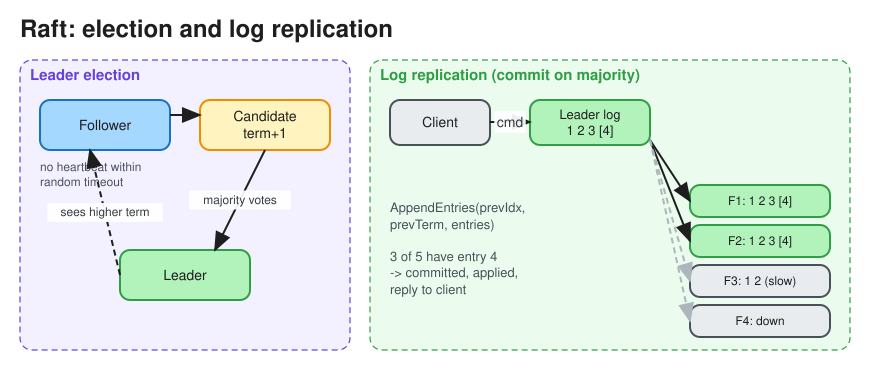

# Consensus (Raft, Paxos)

> **TL;DR** — Consensus lets a group of nodes **agree on a single value or an ordered log** despite crashes and
> message delays, as long as a **majority (quorum)** is alive: 2f+1 nodes tolerate f failures. It is the
> foundation for leader election, replicated state machines, distributed locks, and linearizable metadata
> (etcd, ZooKeeper, Spanner, CockroachDB, Kafka KRaft). **Raft** is the one to explain in interviews: leader
> election with terms, log replication, and commit on majority ack.

## Properties
* **Agreement**: all correct nodes decide the same value.
* **Validity**: the decided value was proposed by some node.
* **Termination**: every correct node eventually decides. The FLP result says this is impossible to guarantee
  in a fully asynchronous system with even one faulty process, so real protocols use **timeouts** (partial
  synchrony) to stay live.
* **Safety is never violated** (no two leaders in the same term, no committed entry lost) even when liveness
  temporarily is.

## Atomic commit vs consensus
| | Atomic commit (2PC) | Consensus (Raft/Paxos) |
|---|---|---|
| Goal | All participants commit **or** all abort a transaction | Agree on one value or log entry |
| Votes | **Every** participant must vote yes | A **majority** is enough |
| Coordinator failure | Participants block (in doubt) | A new leader is elected; progress continues |
| Use | Cross-shard or cross-DB transactions | Replication, leader election, metadata |

Spanner and CockroachDB combine them: **2PC across shards, where each shard is itself a Raft/Paxos group**, so
the "coordinator" never disappears. See [Distributed Transactions](distributed_transactions.md).

## Raft in 5 bullets

1. **Roles**: Leader, Follower, Candidate. Time is divided into **terms** (monotonic numbers); at most one
   leader per term.
2. **Election**: a follower that hears no heartbeat within a *randomized* election timeout (e.g. 150–300 ms)
   becomes a candidate, increments the term, votes for itself and requests votes. It wins with a majority.
   Voters only vote for candidates whose log is **at least as up to date** as their own, so committed entries
   are never lost.
3. **Log replication**: clients send commands to the leader, which appends to its log and sends
   `AppendEntries` to followers. Once a **majority** has the entry, it is **committed** and applied to the
   state machine, and the client gets its answer.
4. **Consistency check**: each `AppendEntries` carries the previous entry's (index, term). Followers reject on
   mismatch, and the leader backs up and overwrites the divergent suffix.
5. **Membership changes** use joint consensus or single-server changes. **Snapshots** compact the log.

## Paxos (in one paragraph)
Roles are proposers, acceptors and learners. **Phase 1 (prepare/promise)**: a proposer picks ballot n; acceptors
promise to ignore ballots below n and report any value already accepted. **Phase 2 (accept/accepted)**: the
proposer asks acceptors to accept a value (the highest previously accepted value, or its own); a majority of
accepts means the value is chosen. **Multi-Paxos** elects a stable leader to skip phase 1 for later log slots,
which in practice looks a lot like Raft. Paxos is notoriously hard to implement; Raft was designed to be
understandable.

## Other algorithms you might be asked about
| Algorithm | Fault model | Where |
|---|---|---|
| **ZAB** | Crash faults | ZooKeeper |
| **Viewstamped Replication** | Crash faults | Academic; precursor of Raft |
| **PBFT / Tendermint / HotStuff** | **Byzantine** faults (malicious nodes); needs 3f+1 nodes | Blockchains, Diem |
| **Proof of Work / Stake** | Byzantine, open membership | Bitcoin, Ethereum |
| Gossip ([Gossip Protocol](gossip_protocol.md)) | Not consensus; eventual dissemination | Cassandra membership |

## Practical numbers and pitfalls
* Use 3 nodes (tolerates 1 failure) or 5 (tolerates 2). An even count adds no fault tolerance.
* Every write costs at least one round trip to a majority, so cross-region consensus groups pay WAN latency.
  Place a majority close together, or use leader leases plus follower reads.
* Leader-only reads without care can be stale (the old leader doesn't yet know it was deposed). Use
  **ReadIndex** or leader leases for linearizable reads.

## Interview follow-ups
* *"Why do you need a majority?"* Any two majorities overlap in at least one node, so a new leader always
  knows about every committed entry.
* *"Network partition with 5 nodes split 3/2?"* The side with 3 can elect a leader and keep going. The side with
  2 can't commit; a stale leader there stops accepting writes once it can't reach a majority.

# References
* https://raft.github.io/ (paper + interactive visualization)
* http://thesecretlivesofdata.com/raft/
* [Paxos: The Part-Time Parliament](https://lamport.azurewebsites.net/pubs/lamport-paxos.pdf)
* https://lamport.azurewebsites.net/pubs/paxos-simple.pdf
* https://medium.com/@sourabhatta1819/consensus-in-distributed-system-ac79f8ba2b8c
* Designing Data-Intensive Applications, Chapter 9: Consistency and Consensus
