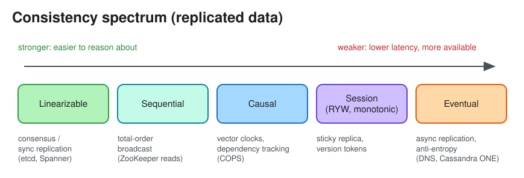

# Consistency Models & Patterns

> **TL;DR** — A consistency model is a contract: *after a write, what can a read return?* From strongest to
> weakest: **linearizable**, **sequential**, **causal**, **session guarantees** (read-your-writes, monotonic
> reads), and **eventual**. Stronger models are easier to program against but cost latency and availability
> under partitions ([CAP / PACELC](cap_theorem.md)). Choose per feature, not per system.

> "Consistency" means different things in different places: in **ACID** it means "invariants hold" (see
> [Transactions](transactions.md)); in **CAP** it means *linearizability*. This page is about replicated-data
> consistency.

## The spectrum

| Model | Guarantee | Cost / how it's built | Examples |
|---|---|---|---|
| **Linearizable (strong)** | Every op appears to take effect atomically at one instant between its start and end; all clients see the same order, matching real time | Single leader + synchronous replication, or consensus (Raft/Paxos); cross-region latency on every write | etcd, ZooKeeper writes, Spanner (TrueTime), DynamoDB strongly consistent reads (single region) |
| **Sequential** | All clients see the same order of ops, but not necessarily real-time order | Total-order broadcast | ZooKeeper reads (by default; `sync` for linearizable) |
| **Causal** | Ops that are causally related (A happened-before B) are seen in that order by everyone; concurrent ops may differ | Vector clocks or dependency tracking; available under partition | COPS, MongoDB causal sessions |
| **Read-your-writes** | A client always sees its own writes | Route the user to the leader for a while after writing, or track the write's version / LSN | Profile updates, posting a comment |
| **Monotonic reads** | A client never sees time go backwards | Stick the client to one replica, or read at ≥ last seen version | Paginating a feed |
| **Monotonic writes / consistent prefix** | A client's writes are applied in order; readers never see an answer before its question | Per-partition ordering | Chat messages |
| **Eventual** | If writes stop, all replicas converge *eventually*; no bound on staleness | Async replication, anti-entropy, read repair | DNS, Cassandra `ONE`, S3 listing (historically), CDN caches |

## Weak vs eventual vs strong (the classic primer framing)
* **Weak**: after a write, reads may or may not see it. Best effort (VoIP, live video, multiplayer game state).
* **Eventual**: reads will see it *eventually* (typically milliseconds). Email, DNS, social likes counters.
* **Strong**: reads see it immediately. Bank balances, inventory decrements, uniqueness constraints (usernames),
  leader election, locks.

## Tunable consistency (Dynamo-style quorums)
With **N** replicas, write to **W**, read from **R**:
* `W + R > N` → read and write sets overlap, so a read sees the latest acknowledged write (with caveats: sloppy
  quorums, concurrent writes). See [Quorum](quorum.md).
* `W = N, R = 1` → fast reads, slow and fragile writes. `W = 1, R = N` → the opposite.
* Cassandra: `QUORUM`/`LOCAL_QUORUM`/`ONE`/`ALL` per query. DynamoDB: eventually consistent (default) vs
  strongly consistent reads.

## Resolving conflicts under weak consistency
* **Last-writer-wins (LWW)** by timestamp: simple, but silently drops concurrent writes and depends on clock skew.
* **Version vectors / vector clocks**: detect concurrency, then return siblings to the app to merge (Riak,
  original Dynamo shopping cart).
* **CRDTs**: data types that merge automatically and deterministically (G-Counter, PN-Counter, OR-Set, RGA for
  text). Used for counters, presence, collaborative editing.
* **Application-specific merge**: e.g. union of cart items, "max" for a high score.

## How to pick (interview heuristic)
| Data | Model | Why |
|---|---|---|
| Money, inventory, seat booking, unique usernames | Strong (single leader / consensus / transactions) | Anomalies cost money or break invariants |
| User's own profile/settings | Read-your-writes | User must see their change; others can lag |
| Feeds, likes, view counts, recommendations | Eventual | Staleness is invisible; availability and latency matter more |
| Chat within a conversation | Causal / per-partition ordering | Replies must follow messages |
| Collaborative docs | Causal + CRDT/OT convergence | Concurrent edits must merge |

## Interview follow-ups
* *"User updates their profile picture but still sees the old one."* That is a read-your-writes violation from a
  lagging replica or a stale cache. Fix it by reading from the leader for N seconds after a write, by sending the
  write version with the request, or by invalidating the cache on write (and busting the CDN URL with a version).
* *"Is eventual consistency 'no consistency'?"* No. It guarantees convergence. Measure **replication lag**
  (p99) and expose it as a staleness bound.
* *"Linearizable vs serializable?"* Linearizability is about *single objects* and real-time order (a
  replication property). Serializability is about *transactions over many objects* being equivalent to some
  serial order (an isolation property). **Strict serializability** = both (Spanner).

# References
* https://systemdesign.one/consistency-patterns/
* https://jepsen.io/consistency
* https://github.com/donnemartin/system-design-primer#consistency-patterns
* Designing Data-Intensive Applications, Chapters 5 and 9
* https://www.allthingsdistributed.com/2008/12/eventually_consistent.html
