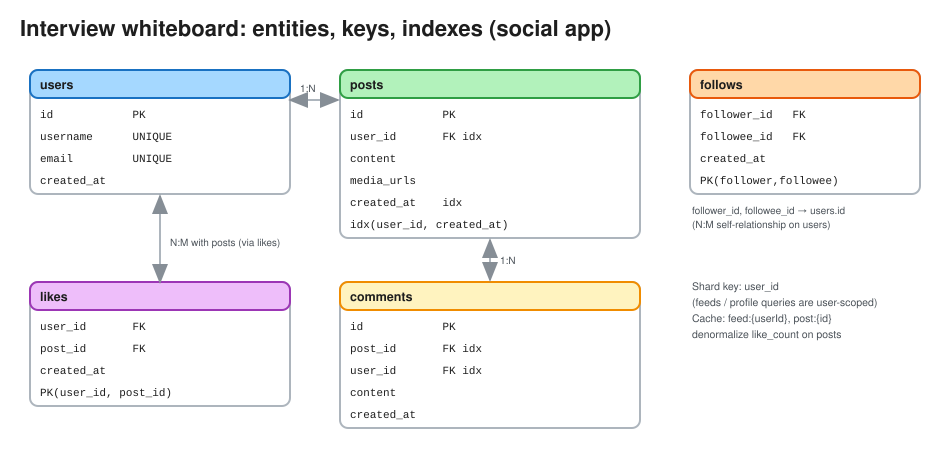
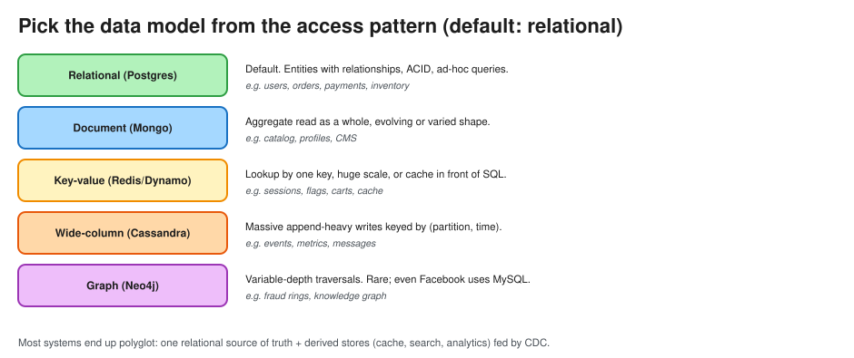

# Data Modeling

> **TL;DR** — Data modeling is deciding **what entities exist, how they're identified and how they relate**, then choosing
> keys, indexes and (de)normalization so the main queries are fast and correctness is preserved. In a system design interview the
> bar is far lower than a data-engineering modeling round: identify **core entities early** (they map ~1:1 to tables/collections),
> then during high-level design sketch a **clear, working schema** with keys, relationships, indexes and a note on partitioning.
> Default to **relational (Postgres)**; start **normalized**, denormalize only for a measured need (or put a denormalized
> **cache** in front); and tie every choice to **data volume, access patterns and consistency requirements**.
> Related: [Types of Databases](database_types.md), [SQL vs NoSQL](database_sql_vs_nosql.md), [Indexes](database_indexing.md),
> [Sharding](data_partitioning.md), [Caching](caching.md), [API Design](api_design.md).

## 1. Where modeling shows up in the interview framework
1. **Requirements**: list the **core entities** (nouns): users, posts, comments, likes, follows.
2. **API design**: each endpoint implies a query ("get a user's posts", "like a post"): these are your **access patterns**.
3. **High-level design**: next to the database box, write the schema: fields per entity, **PK/FK**, **indexes**, and a **shard key** if needed.
4. **Deep dives**: justify denormalization, consistency, growth (partitioning, archival).

Keep the schema grounded in the domain (tweets, follows), not abstract "entities and relationships". Don't try to normalize everything or draw a perfect ER diagram; make it **clear, functional and aligned with the requirements**.



## 2. Choose the database model first
Most of the time the right answer is **relational**. Resist exotic choices; if you have no strong opinion, say **PostgreSQL**.



| Model | Shape | Consider when | Modeling impact | Examples |
|---|---|---|---|---|
| **Relational** | Tables, rows, FKs, ACID, joins | Default; entities with relationships; strong consistency (payments, inventory) | Normalize, add indexes; watch multi-table join cost at scale | Postgres, MySQL |
| **Document** | JSON documents | Schema genuinely evolves, deeply nested aggregates, varied record shapes | Embed related data; denormalize; updates touch whole documents | MongoDB, Firestore |
| **Key-value** | `key → value` | Cache, sessions, flags, simple lookups, extreme throughput | Flat, duplicate data per access pattern; no joins | Redis, DynamoDB, Memcached |
| **Wide-column** | Partition key + clustering columns | Huge append-heavy writes, time-series, telemetry | Design per query; duplicate tables; time is first-class | Cassandra, HBase |
| **Graph** | Nodes + edges | Variable-depth traversal (fraud rings, knowledge graphs) | Model relationships as edges | Neo4j, Neptune |

Caveats worth saying aloud:
- **Relational scales further than people think**: read replicas, partitioning/sharding, pooling and caching; Facebook and Airbnb run on relational foundations (see [Postgres & MySQL](postgres_mysql.md)).
- **Document DBs**: interview problems rarely have "evolving schemas", which removes the main reason to pick one. Choose it only if the requirements say so.
- **"KV instead of SQL"** is usually "**KV *and* SQL**": SQL as source of truth, Redis in front for hot data.
- **Graph DBs** are a common interview mistake: sound sophisticated, add operational cost; even social networks model the core graph in MySQL/other stores (Meta's TAO is a graph API over sharded MySQL). Details in [Types of Databases](database_types.md).
- **Polyglot persistence** is fine, but keep **one source of truth** and derive others via CDC/outbox; avoid dual writes.

## 3. Start from requirements: three forces
Every schema choice is a tool to satisfy these:
1. **Data volume**: how much, how fast it grows? Decides whether it fits one node, needs partitioning/sharding, or separate stores per domain.
2. **Access patterns** *(most important)*: what queries does each endpoint need? "Recent posts by followed users" → denormalized feed or a carefully indexed query; "aggregate by day" → analytics-shaped tables.
3. **Consistency requirements**: payments need ACID in one database; a like count can be eventually consistent and live elsewhere.

Say it in the interview: *"Feeds must load fast and likes can be eventually consistent, so I'll denormalize `like_count` onto posts."* Reasoning beats memorized patterns.

## 4. Entities, keys and relationships
- **Entities** → tables/collections. Each needs a **primary key**.
- Prefer **system-generated surrogate IDs** (`user_id`, `post_id`) over business values (email), which change. Common ID choices: auto-increment (simple, leaks volume, sharding-hostile), **UUIDv4** (random: poor index locality in B-trees), **UUIDv7 / ULID / Snowflake** (time-ordered, index-friendly, distributed; see [Unique ID generator](../problems/unique_id_generator.md)).
- **Relationships**:
  - **1:N**: a user has many posts → `posts.user_id` FK.
  - **N:M**: users like posts → a **join table** (`likes(user_id, post_id)` with a composite PK); also the pattern for `follows`.
  - **1:1**: rare; often a sign two tables should be merged (or a rarely-used/large column split out).
- **Foreign keys** prevent orphans (a post pointing at a missing user) but cost validation on each write and don't span shards; at very large scale some teams enforce integrity in the application. Mentioning the trade-off shows depth.
- **Constraints** (`NOT NULL`, `UNIQUE`, `CHECK`, exclusion) enforce correctness in the database; they add a little write overhead and are your best defense against races (unique idempotency keys, no double bookings).
- Also decide: **soft delete** (`deleted_at`) vs hard delete (retention/GDPR), **timestamps** (store UTC), **enums** vs lookup tables, **money as integers/decimals** (never floats), **optimistic version column** for concurrent updates.

```sql
users(id PK, username UNIQUE, email UNIQUE, created_at)
posts(id PK, user_id FK→users.id, content, media_urls, created_at)
comments(id PK, post_id FK→posts.id, user_id FK→users.id, content, created_at)
likes(user_id FK, post_id FK, created_at, PRIMARY KEY (user_id, post_id))
follows(follower_id FK, followee_id FK, created_at, PRIMARY KEY (follower_id, followee_id))
```

## 5. Indexing for access patterns
- Indexes make lookups avoid full scans; **tie each to an endpoint**: *"`GET /users/{id}/posts` needs `idx(posts.user_id, created_at)`."*
- Typical: FK columns, `created_at` for recency, **composite** indexes in query order (equality columns first, then range/sort), **unique** indexes for constraints, partial/covering indexes for hot paths.
- A composite `(user_id, created_at DESC)` serves "a user's recent posts" in one range scan and also covers `user_id`-only lookups (leftmost prefix).
- Indexes cost write latency and memory; don't index everything. For B-tree vs LSM, covering, partial and the rest, see [Database Indexes](database_indexing.md).
- **Pagination**: prefer **keyset/cursor** (`WHERE (created_at, id) < (:c, :i) ORDER BY … LIMIT n`) over `OFFSET` at depth.

## 6. Normalization vs denormalization
- **Normalization**: each fact lives in exactly one place (user data only in `users`). Prevents update anomalies; costs joins.
- **Denormalization**: duplicate data (e.g. `username` copied onto each post) to avoid joins; speeds reads but if the source changes, **every copy must be updated**, and a missed one is inconsistent data, usually harder to fix than the performance problem you were solving.

**Interview default**: start with a clean, normalized model and denormalize **only when a measured read path demands it**. Legitimate cases:
- analytics/reporting tables aggregating rarely changing data;
- event logs / audit trails that must snapshot values **at the time of the event** (the price at purchase time);
- read-optimized stores (search indexes, materialized views) where speed beats strict consistency;
- counters like `like_count`/`comment_count` (maintained transactionally, or asynchronously).

**Better trick**: keep the **source of truth normalized** and put a **denormalized cache/materialized view** in front. Your cache can hold pre-joined, pre-aggregated representations (`feed:{userId}`) without compromising the clean model ([Caching](caching.md)).

## 7. Modeling patterns for non-relational stores
- **Query-first (DynamoDB/Cassandra)**: list queries, then design tables/keys per query; duplicate data across tables; partition key = how you look it up, sort/clustering key = how you order/range it. Examples in [DynamoDB](dynamodb.md) and [Cassandra](cassandra.md).
- **Embed vs reference (documents)**: embed bounded, read-together data; reference unbounded or shared data. See [MongoDB](mongodb.md).
- **Time-series**: key by `(entity, time bucket)` so one partition holds a bounded window; TTL for retention.
- **Hierarchies / trees**: adjacency list + recursive CTE, materialized path, closure table.
- **Many-to-many at scale**: store the edge in **both directions** (`follower→followee` and `followee→follower`) when you need both queries.
- **Soft schema evolution**: add nullable columns, `schemaVersion`, expand → backfill → contract migrations.

## 8. Scaling and sharding the model
- When data outgrows one machine, **shard by the primary access pattern**: mostly "posts by user" → shard by `user_id`, so a user's posts sit on one shard.
- **Avoid cross-shard queries**: if the timeline needs posts from many followees and you sharded by `user_id`, you must query many shards and merge. Precompute feeds (fan-out on write), cache, or denormalize.
- **Time-range sharding is usually an anti-pattern for write-heavy tables**: every current write hits the newest shard (hot shard). It suits archival/analytics where writes are spread.
- The shard key is **often permanent** and shapes every query: choose it deliberately. See [Sharding](data_partitioning.md).
- Also plan **archival/retention** (partition by month and drop), **hot vs cold** storage tiers, and read replicas/caches for hot reads.

## 9. Worked mini-examples (what to write on the whiteboard)
| System | Entities & keys | Indexes / access | Notes |
|---|---|---|---|
| **URL shortener** | `urls(short_code PK, long_url, user_id, created_at, expires_at)` | PK lookup by `short_code` | KV or SQL; cache hot codes; shard by `short_code` hash ([URL shortener](../problems/url_shortener.md)) |
| **Chat** | `messages(conversation_id, message_id, sender_id, body, ts)` | PK `(conversation_id, message_id)` time-ordered | Wide-column/KV; shard by `conversation_id` ([Chat](../problems/chat_system.md)) |
| **E-commerce** | `orders(id PK, user_id, status, total)`, `order_items(order_id, sku, qty, unit_price)`, `inventory(sku, qty)` | `orders(user_id, created_at)` | Price snapshot on items; ACID for stock; unique idempotency key ([Idempotency](idempotency.md)) |
| **Ticketing / booking** | `seats(event_id, seat_id, status)`, `bookings(...)` | `(event_id, status)` | Unique/conditional update or exclusion constraint to prevent double-booking ([Ticketmaster](../problems/ticketmaster.md)) |
| **Social feed** | `users`, `posts`, `follows`, `likes` | `posts(user_id, created_at)`, `follows(followee_id)` | Fan-out feeds in cache/KV; denormalize counts ([Newsfeed](../problems/newsfeed_system.md)) |

## 10. Pitfalls checklist
- Reaching for document/graph/exotic stores without a requirement that demands them.
- Using business data (email) as the primary key; random UUIDv4 PKs on large B-tree tables; floats for money.
- Premature denormalization (duplicated data with no update plan); or the opposite, many-join queries on the hot path at scale.
- Missing indexes for endpoint queries, or indexing every column; composite index in the wrong column order.
- Unbounded rows/arrays (unbounded comments embedded in a post); hot rows (one global counter row).
- Sharding by a timestamp/boolean/low-cardinality key; schemas that force cross-shard joins for common queries.
- No constraints, so races produce duplicates; foreign keys assumed across shards.
- Forgetting soft-delete/retention, auditability and schema-migration strategy.

## 11. Interview checklist (use in order)
1. Pick the **database type** (default relational / Postgres) and say why.
2. For each entity list the **columns** needed by the functional requirements.
3. Specify **PK and FK** per relationship (join table for N:M).
4. Decide **indexes** from the API endpoints.
5. Decide whether to **denormalize** (or add a cache) for a measured read path.
6. Decide whether you need to **shard**; if so choose the shard key from the primary access pattern.
7. Call out **consistency** needs and any invariants enforced by constraints/transactions.

## 12. Interview follow-ups
- *"Why SQL here?"* Relational data with relationships and consistency needs; ACID; flexible queries; scales via replicas, caching and sharding.
- *"Normalize or denormalize?"* Normalized source of truth; denormalize read paths (or cache) once measured, and state how copies stay in sync.
- *"How do you model likes/follows?"* Join table with composite PK, index on both directions, a denormalized counter updated transactionally or asynchronously.
- *"How would the schema change if we shard?"* Choose the shard key from the main access pattern; keep related rows together; drop cross-shard FKs; global IDs.
- *"How do you evolve the schema without downtime?"* Expand → backfill → contract; online DDL; versioned documents.
- *"How do you store prices/orders so history stays correct?"* Snapshot price on the order line; immutable events/audit log.
- *"Where would NoSQL be better?"* Massive write volume by key (Cassandra/DynamoDB), flexible aggregates (Mongo), or a cache/session layer (Redis).

# References
* [Hello Interview: Data Modeling](https://www.hellointerview.com/learn/system-design/core-concepts/data-modeling)
* Designing Data-Intensive Applications, Chapters 2 and 3 (data models, storage)
* [Use The Index, Luke](https://use-the-index-luke.com/)
* [Building with Patterns (MongoDB)](https://www.mongodb.com/blog/post/building-with-patterns-a-summary)
* [Single-table design / data modeling (DynamoDB docs)](https://docs.aws.amazon.com/amazondynamodb/latest/developerguide/data-modeling-nosql.html)
