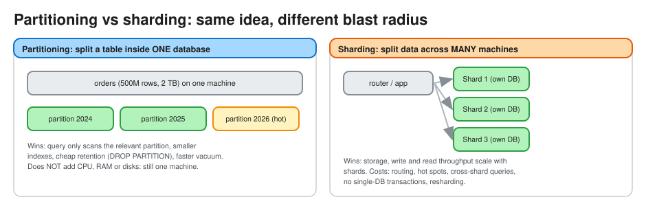
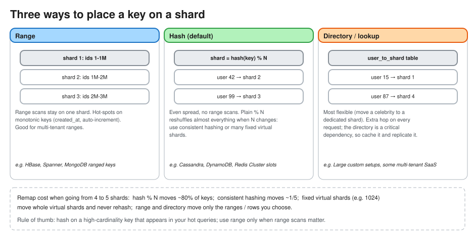
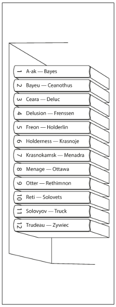
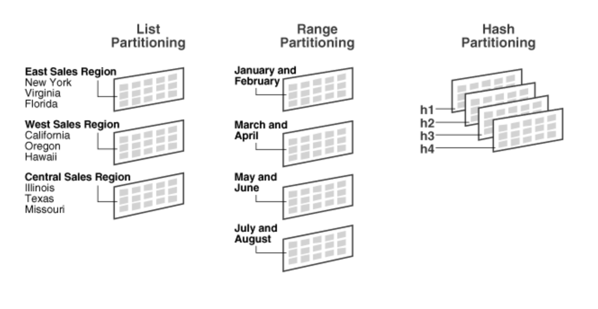
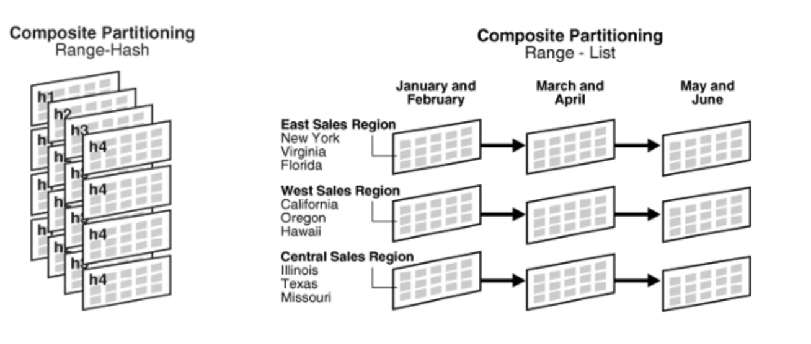
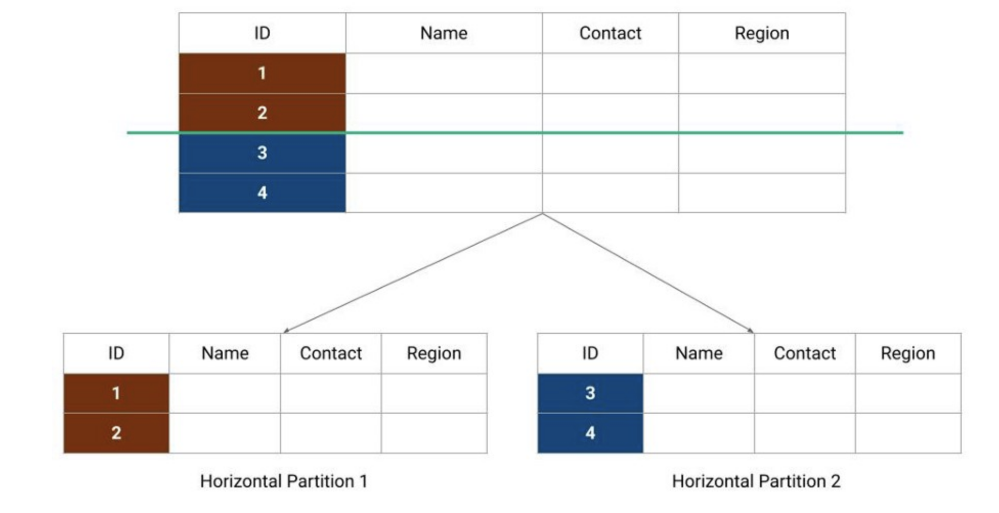
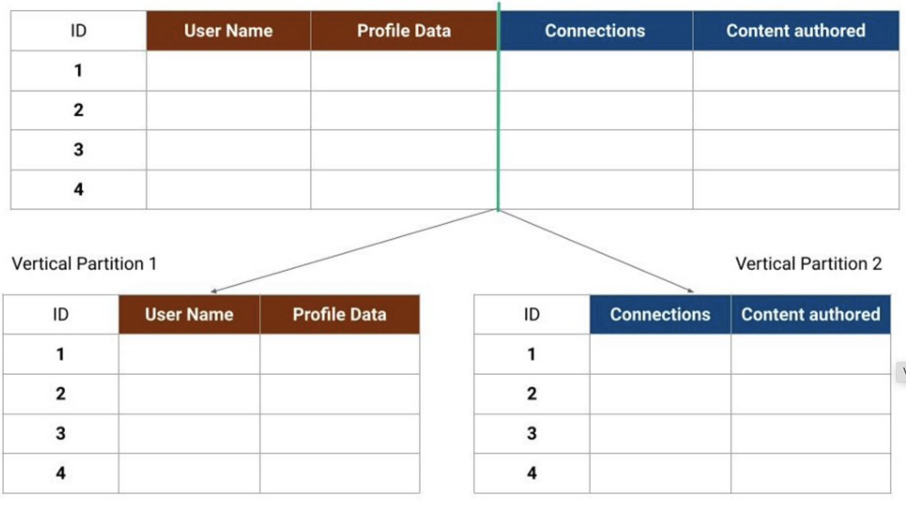
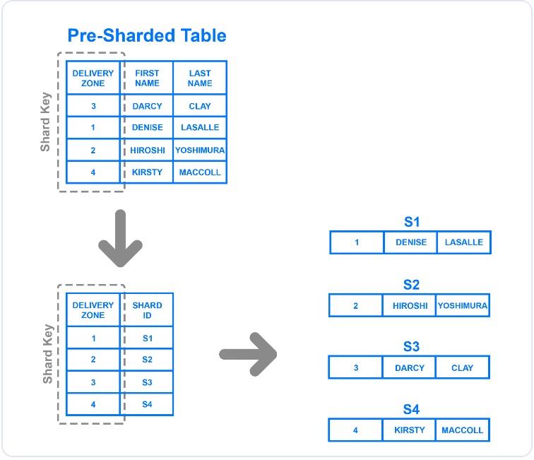
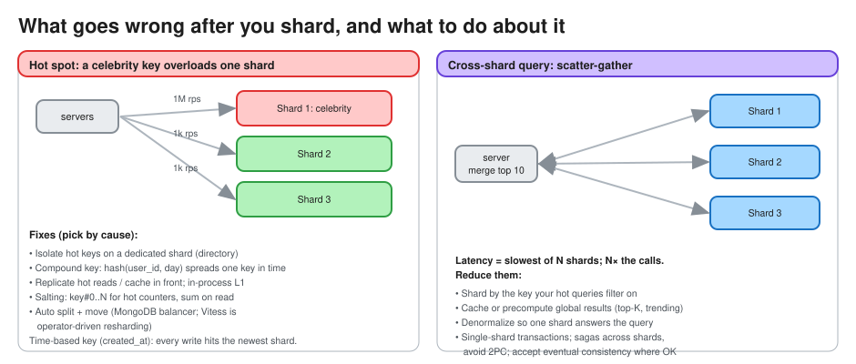
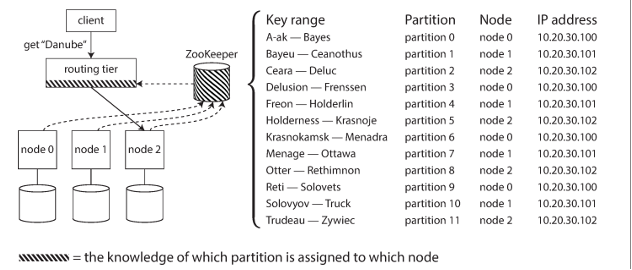

# Data Partitioning & Sharding

> **TL;DR** — **Partitioning** splits data into smaller pieces; **sharding** is horizontal partitioning **across machines**, so
> storage, write throughput and read throughput scale out. You must make two linked decisions: **what to shard by** (the
> *shard key*: high cardinality, evenly distributed, present in your hot queries) and **how to place it** (hash by default;
> range when range scans matter; directory when you need flexibility). Sharding then costs you **hot spots, cross-shard queries,
> no single-database transactions and resharding pain**, so *don't shard until you've proven one database can't cope* (try
> indexes, caching, read replicas, bigger hardware and table partitioning first). Most modern databases (Cassandra, DynamoDB,
> MongoDB, Vitess, Citus, Spanner, CockroachDB) do the mechanics for you; in an interview you need to choose the key and
> explain the trade-offs. Related: [Consistent Hashing](consistent_hashing.md), [Replication](data_replication.md),
> [Distributed Transactions](distributed_transactions.md), [Database Indexes](database_indexing.md), [Caching](caching.md).

## 1. Partitioning vs sharding


- **Partitioning** (in the narrow sense): split a big table into smaller pieces **inside one database instance** (e.g. one partition per month).
  A query for last month's orders scans one partition instead of 500M rows; indexes shrink; vacuum/rebuild/retention (`DROP PARTITION`) get cheap.
  It adds no CPU, memory or disks.
- **Sharding**: horizontal partitioning **across many machines**; each shard is an independent database with its own CPU, RAM, storage
  and connection pool. Capacity and throughput grow with shard count.
- People use the words loosely. Be explicit about whether data lives on **one machine or many**.
- Two shapes of split: **horizontal** (rows: same columns, different rows per partition) and **vertical** (columns, or whole tables/features
  moved to their own databases: a "functional split"; cheap and low impact, but each part still scales vertically).

### The scaling ladder: don't shard first
1. Fix queries and indexes; remove N+1; cache hot reads ([Caching](caching.md)).
2. Scale up (bigger instance, more RAM/IOPS). Managed relational databases go to tens of TB on one node.
3. Read replicas for read-heavy load ([Replication](data_replication.md)).
4. Partition large tables inside the database; archive cold data.
5. Functional split (vertical): separate services/databases by domain.
6. **Shard** (or move to a natively distributed database).

The most common interview mistake is **sharding before proving it's necessary**. Do the math first:

| Limit hit | Say something like |
|---|---|
| **Storage** | "500M users × 5 KB = 2.5 TB; one Postgres node holds that, but at 10× growth we need to shard." |
| **Write throughput** | "50k writes/s at peak exceeds one primary; replicas don't help writes, so we shard." |
| **Read throughput** | "Even with replicas and a cache, 100M DAU × several queries needs reads spread across shards." |

Pattern: **identify the bottleneck → show one database can't do it → propose sharding**. Use [back-of-envelope numbers](back_of_envelope_estimation.md).

## 2. Choosing a shard key
The shard key decides which shard owns a row. It is **expensive to change**, so get it right.

A good shard key has:
- **High cardinality**: many distinct values. A boolean caps you at two shards.
- **Even distribution** of data **and traffic**: `country` fails if 90% of users are in one country.
- **Alignment with queries**: your most common queries should touch **one shard** (`WHERE user_id = ?`).
- **Stability**: values that don't change (moving a row between shards on update is painful).
- **Not monotonic** (for write-heavy tables): timestamps and auto-increment IDs funnel all new writes to the newest shard.

| 🟢 Good | Why |
|---|---|
| `user_id` for a user-centric app | High cardinality, even, profile/feed/orders queries are user-scoped |
| `order_id` for an orders table | High cardinality, lookups by order |
| `tenant_id` (+ `user_id`) for B2B SaaS | Tenant isolation; compound to avoid one huge tenant dominating |
| `conversation_id` for chat | All messages of a thread live together ([chat system](../problems/chat_system.md)) |

| 🔴 Bad | Why |
|---|---|
| `is_premium` (boolean) | Two values, two shards, skewed |
| `created_at` on a growing table | Newest shard takes all writes |
| `country` | Few values, heavy skew |
| A key not used in hot queries | Every query scatter-gathers across all shards |

Pick the key from **access patterns first** (derive them from your APIs), not from the entity list. Co-locate data that is queried or
transacted together (a user's profile, orders and balances on the same shard) so most operations are single-shard.

## 3. Sharding strategies (how to place a key)


| Strategy | Placement | Strengths | Weaknesses |
|---|---|---|---|
| **Range** | Contiguous key ranges → shards | Efficient range scans; simple; good for multi-tenant ranges | Hot spots on monotonic keys; ranges must be chosen/rebalanced |
| **Hash** *(default)* | `hash(key) mod N`, or hash space split into ranges/tokens | Even spread; fewer hot spots | No range scans on the key; modulo reshuffles on resize (use consistent hashing or fixed virtual shards) |
| **Directory (lookup)** | Mapping table/service key → shard | Maximum flexibility (isolate a celebrity, rebalance by editing a row) | Extra lookup per request; the directory is a critical dependency/SPOF, so cache + replicate it |

- Hash-based is what an interviewer assumes unless you say otherwise. Directory-based is rarely the right interview answer because it invites follow-ups about the lookup service's availability and latency.
- **Hash + range hybrid** (compound keys): `(tenant_id, hash(user_id))`, or Cassandra's `(partition key, clustering key)`: even spread across partitions, ordered scans within one.

### More partitioning schemes (database-level)
The same ideas appear as table-partitioning options in Postgres/MySQL/Oracle:

#### Range partitioning
```sql
PARTITION BY RANGE (store_id) (
  PARTITION p0 VALUES LESS THAN (6),
  PARTITION p1 VALUES LESS THAN (11),
  PARTITION p2 VALUES LESS THAN (16),
  PARTITION p3 VALUES LESS THAN (21));
```

- Pros: simple; great for range queries and **time-based retention** (drop an old partition instantly). Cons: unbalanced if data is skewed; timestamp ranges create write hot spots.

#### Hash (key) partitioning
```sql
CREATE TABLE employees (id INT NOT NULL, hired DATE NOT NULL, store_id INT)
PARTITION BY HASH(store_id) PARTITIONS 4;
```
- Pros: even distribution, fewer hot spots. Cons: no range queries on the key; changing the partition count rehashes data; a very active key is still hot (celebrity problem).
- Cassandra and DynamoDB hash the partition key. See [consistent hashing](consistent_hashing.md).

#### List partitioning
```sql
PARTITION BY LIST(store_id) (
  PARTITION pNorth VALUES IN (3, 5, 6, 9, 17),
  PARTITION pEast  VALUES IN (1, 2, 10, 11, 19, 20));
```
- Pros: natural for categorical/regional data (data residency). Cons: skew if categories are uneven.



#### Round-robin
- Row *i* goes to partition `i mod n`. Perfectly even writes, but no locality, so reads must hit every partition. Used for bulk loading and some analytics engines.

#### Composite partitioning
- Combine schemes (range then hash, list then range, …) to balance load and support multiple query types: e.g. partition by month (range) and sub-partition by `user_id` hash.

- Pros: tune for several query shapes. Cons: operational complexity.

#### Horizontal, vertical and directory pictures




## 4. Secondary indexes on partitioned data
Queries by something other than the shard key need an index. Two designs ([Indexes](database_indexing.md)):

| | **Local index (by document)** | **Global index (by term)** |
|---|---|---|
| Where | Each shard indexes only its own rows | The index itself is partitioned by the indexed value |
| Writes | **Fast**: one shard | **Slow**: update the data shard *and* index shard(s); may need a distributed transaction or async update |
| Reads | **Slow**: scatter-gather every shard | **Fast**: one index shard (then fetch rows) |
| Consistency | Immediate | Often **eventually consistent** (e.g. DynamoDB GSI) |

Choose local indexes for write-heavy systems and queries that include the shard key; global for read-heavy lookups by another attribute. Alternatively, keep a **separate lookup table** (`email → user_id`) sharded by that attribute, which is the manual global index.

## 5. Problems after you shard


### Hot spots and load imbalance
- Even with a good key, some keys are inherently busy: the **celebrity problem** (a famous user's shard takes 1000× traffic) or the **time-based** key (all writes hit the newest shard). Hashing doesn't fix a hot *key*.
- **Detect**: per-shard QPS, CPU, p99 latency, storage; per-key sampling.
- **Fixes**: isolate hot keys on dedicated shards (directory); **compound/salted keys** (`hash(user_id, day)` or `key#0..N` for hot counters, summed on read); cache and replicate hot reads, an in-process L1; rate limit; **automatic split + move** (MongoDB's balancer splits/migrates chunks; Vitess supports **operator-driven** online resharding, not automatic).
- See [Caching: hot keys](caching.md#hot-keys).

### Cross-shard operations (scatter-gather)
- A query not aligned with the shard key must hit **all N shards**, wait for the slowest and merge: **N× the calls and the tail latency of the slowest shard**.
- **Reduce them**: cache or precompute global results (trending, top-K, leaderboards) with background jobs; **denormalize** so one shard can answer; accept rare scatter-gather (an admin dashboard); design the key around the hot query.
- **Joins** across shards are expensive; co-locate joined entities on the same shard key or denormalize. If your *common* path needs scatter-gather, rethink the key.

### Consistency and transactions
- A transaction spanning shards is no longer a single-database transaction.
- **Best**: design so each transaction is **single-shard** (a user's account, balance and history on one shard).
- **Two-phase commit (2PC)** gives atomicity but is slow and blocks if the coordinator or a shard fails; most systems avoid it ([Distributed Transactions](distributed_transactions.md)).
- **Sagas**: a sequence of local transactions with **compensating actions** (debit A on shard 1 → credit B on shard 2 → if that fails, refund A). Eventually consistent, needs idempotent steps ([Idempotency](idempotency.md)).
- **Accept eventual consistency** for denormalized counters and feeds. If you constantly need distributed transactions, the shard key or boundaries are probably wrong. Distributed SQL such as [Aurora DSQL](aurora_dsql.md), Spanner or CockroachDB hides this at a latency cost.

### Referential integrity
- Foreign keys can't span shards. Enforce in the application, use co-location, and run cleanup jobs for dangling references.

### Rebalancing and resharding
Changing shard count or boundaries moves data and is operationally risky. Strategies:

| Strategy | How | Notes |
|---|---|---|
| **Fixed number of partitions** | Create many more partitions than nodes (e.g. 1024); move **whole partitions** between nodes when nodes join/leave | Simple; never rehash keys; pick a good number up front (Elasticsearch, Kafka, Couchbase, Riak) |
| **Fixed partitions per node / consistent hashing with vnodes** | Each node owns a fixed count of token ranges; new nodes steal slices | Even, incremental (Cassandra) |
| **Dynamic splitting** | Split a partition when it grows/gets hot; merge when small | Adapts automatically; risk of needless rebalancing and extra load (HBase, MongoDB, DynamoDB) |
| **Manual / directory** | Operator updates the mapping | Full control, more toil |

- Avoid `hash(key) % N` if N changes: **almost every key moves**. Use [consistent hashing](consistent_hashing.md) or fixed virtual shards.
- Resharding recipe: **dual-write or CDC-copy → verify → cut reads → cut writes → drop old**; throttle to protect production; keep the old layout until verified.
- Automatic rebalancing is convenient but can cause **thrashing** during failures; many systems keep a human in the loop.

## 6. Request routing (how does a client find the shard?)

1. **Any node** (random) → the node forwards to the owner (gossip-based membership; Cassandra coordinator). See [Gossip](gossip_protocol.md).
2. **Routing tier / proxy** that knows the map (mongos, Vitess `vtgate`, Twemproxy): centralizes logic; a stateless, scalable hop.
3. **Smart client** with the partition map cached (Redis Cluster clients, DynamoDB SDK): lowest latency; clients must handle map changes (`MOVED` redirects).
- The shard map lives in a coordination service ([ZooKeeper](zookeeper.md), etcd) or a metadata cluster (MongoDB config servers). It must be highly available and cached.

## 7. Sharding in modern databases
You rarely build sharding by hand.

| System | How it shards |
|---|---|
| **Cassandra** | Murmur3 partitioner + virtual nodes on a consistent-hash ring ([Cassandra](cassandra.md)) |
| **DynamoDB** | Hashes the partition key to internal partitions; splits/merges automatically; not a user-visible ring ([DynamoDB](dynamodb.md)) |
| **MongoDB** | Range-based **chunks** on the shard key (ranged or hashed); a balancer splits and migrates them; `mongos` routes ([MongoDB](mongodb.md)) |
| **Redis Cluster** | 16,384 hash slots mapped to nodes; smart clients |
| **Vitess / Citus** | Sharding layers over MySQL / Postgres: routing, cross-shard queries, online resharding ([Postgres & MySQL](postgres_mysql.md)) |
| **Spanner / CockroachDB / TiDB / Aurora DSQL** | Distributed SQL with automatic range/tablet splitting and distributed transactions ([Aurora DSQL](aurora_dsql.md)) |

In an interview it's enough to say: *"DynamoDB with `user_id` as the partition key"* or *"Vitess sharded by `user_id`, with operator-driven online resharding."*

## 8. What to say in an interview
1. **Establish need**: the bottleneck, the numbers, why replicas/cache/bigger box aren't enough.
2. **Propose the shard key from access patterns**: "Queries are user-scoped, so `user_id`."
3. **Choose placement**: "Hash-based with consistent hashing / 64 fixed virtual shards to start."
4. **Call out trade-offs**: global queries are expensive → cache/precompute; hot users → isolate/salt/replicate; cross-shard writes → single-shard design or sagas.
5. **Growth plan**: "Start with 64 logical shards on fewer machines; add machines and move whole shards."

## 9. Pitfalls checklist
- Sharding too early; sharding without a shard key that matches the hot queries; boolean/low-cardinality/skewed keys.
- Monotonic keys (timestamps, auto-increment) on write-heavy tables; ignoring the celebrity key.
- `hash % N` with changing N; no plan for resharding; resharding without dual-write/verify.
- Common queries that scatter-gather; cross-shard joins; relying on 2PC for hot paths.
- Global secondary indexes treated as strongly consistent; unique constraints that span shards (needs a global uniqueness mechanism).
- Non-sharded global ID generation that collides across shards (use [unique ID generators](../problems/unique_id_generator.md)).
- Forgetting operational realities: per-shard backups, schema migrations across N shards, monitoring per-shard skew.

## 10. Summary
- **Key ranges** for range queries; **hashes** for even distribution; **directory** for flexibility.
- **Local indexes** favor writes; **global indexes** favor reads.
- **Fixed virtual partitions** are simplest to reason about; **dynamic splitting** adapts but can thrash.
- Shard key = the access pattern; keep each transaction on one shard.

## 11. Interview follow-ups
- *"How do you pick a shard key?"* High cardinality, even, stable, present in hot queries; avoid monotonic and low-cardinality keys.
- *"What if one user is 1000× busier?"* Isolate on a dedicated shard, salt/compound the key, replicate reads, cache, rate limit.
- *"How do you add a shard?"* Consistent hashing or fixed virtual shards (move whole shards); CDC-copy, verify, cut over; throttle.
- *"How do you do a query by email when sharded by user_id?"* A global secondary index or a lookup table `email → user_id` (eventually consistent) or scatter-gather if rare.
- *"How do you transfer money between users on different shards?"* Avoid by design; else saga with idempotent compensations, or distributed SQL.
- *"Sharding vs replication?"* Replication copies the **same** data for availability and read scale; sharding splits **different** data for capacity and write scale; production systems use both (each shard is replicated).
- *"Partitioning vs sharding?"* Same technique at different scope: within one database vs across machines.

# References
* Designing Data-Intensive Applications, Chapter 6 (Partitioning)
* [Hello Interview: Sharding](https://www.hellointerview.com/learn/system-design/core-concepts/sharding)
* [grokking-the-system-design-interview](https://www.educative.io/courses/grokking-the-system-design-interview/mEN8lJXV1LA)
* [MongoDB Sharding docs](https://www.mongodb.com/docs/manual/sharding/), [Vitess docs](https://vitess.io/docs/), [Citus docs](https://docs.citusdata.com/)
* [MySQL partitioning](https://dev.mysql.com/doc/mysql-partitioning-excerpt/5.7/en/partitioning.html), [PostgreSQL table partitioning](https://www.postgresql.org/docs/current/ddl-partitioning.html)
* https://medium.com/must-know-computer-science/system-design-sharding-data-partitioning-b7201596aafa
* https://docs.google.com/presentation/d/1ZNVDn4Uwcje1yYPz40C5mkJWBazkQ5W1XhSyhZTbRE0/edit
