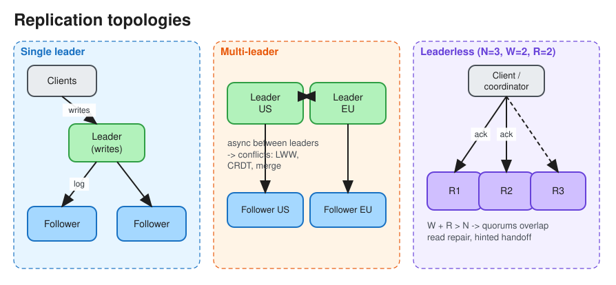

# Replication (and Data Redundancy)

> **TL;DR** — Replication keeps copies of the same data on multiple nodes for **availability**, **durability**,
> **read scaling**, and **lower latency** (data closer to users). Three topologies: **single-leader** (simple,
> one write path), **multi-leader** (writes in many regions, needs conflict resolution), **leaderless**
> (Dynamo-style quorums). **Synchronous** replication means no data loss but slower writes that are blocked by
> slow replicas; **asynchronous** means fast writes but replication lag and possible loss on failover.

## Redundancy vs replication
* **Redundancy**: duplicate *components* (servers, disks, power, network paths) so there is no single point of
  failure. A standby can be passive.
* **Replication**: actively *keep data copies in sync* across those redundant nodes. Redundancy is the goal;
  replication is one mechanism (others: RAID, erasure coding, backups).
* **Erasure coding** (e.g. Reed–Solomon 6+3): store data plus parity fragments. Roughly 1.5x storage overhead
  instead of 3x for triple replication, at the cost of CPU and repair traffic. Used by S3, HDFS EC, and Azure
  Storage for cold data.

## Synchronous vs asynchronous
| | Synchronous | Asynchronous | Semi-synchronous |
|---|---|---|---|
| Ack to client after | All (or the chosen) replicas persist | Leader persists | Leader + ≥1 replica |
| Data loss on leader failure | None | Writes not yet replicated are lost | None if that replica is promoted |
| Write latency | Bounded by the slowest replica | Lowest | Moderate |
| Typical | Consensus groups (Raft), Spanner | MySQL/Postgres default read replicas | MySQL semi-sync, Postgres `synchronous_standby_names` |

## Leader–follower (master–slave / active–passive)
* All writes go to the leader, which streams its log (WAL, binlog, logical log) to followers. Reads can go to
  followers.
* **Failover**: detect the dead leader (timeout), elect a new one (most up-to-date replica, or consensus),
  repoint clients. Risks: lost async writes, **split-brain** (two leaders: use fencing), and choosing the
  timeout (too short causes flapping, too long means more downtime).
* **Replication-lag anomalies** and their fixes:
  * *Read-your-writes*: read your own data from the leader, or wait until the replica has reached your write's
    LSN.
  * *Monotonic reads*: pin a user to one replica.
  * *Consistent prefix*: keep causally related writes in the same partition.
  See [Consistency](consistency.md).
* Used by: PostgreSQL, MySQL, MongoDB replica sets, Redis, Kafka (per partition).

## Multi-leader (master–master / active–active)
* Each region or datacenter has a leader that accepts writes; leaders replicate to each other asynchronously.
* Pros: local write latency in every region, tolerates region outages. Also covers offline clients (mobile, a
  calendar app) and collaborative editing.
* **Conflicts are inevitable**. Ways to handle them:
  * *Avoidance*: route all writes for a record to its "home" region.
  * *Last-writer-wins (LWW)*: simple but loses data.
  * *Merge*: CRDTs, or application-defined merge (union of sets).
  * *Record and resolve later*: keep the conflicting versions (siblings) and surface them to the user or app.
* Topologies: all-to-all (most robust), star, ring (a single node failure breaks it).
* Used by: DynamoDB Global Tables, Cosmos DB, CouchDB, MySQL Group Replication (multi-primary).

## Leaderless (Dynamo-style)
* The client (or a coordinator node) writes to **N** replicas and waits for **W** acks; reads from **R**
  replicas and picks the newest version. `W + R > N` gives overlapping quorums. See [Quorum](quorum.md).
* Convergence mechanisms:
  * **Read repair**: fix stale replicas during reads.
  * **Hinted handoff**: a neighbour temporarily stores writes for a down node.
  * **Anti-entropy**: background Merkle-tree comparison between replicas.
* Concurrent writes are detected with **version vectors**.
* Used by: Cassandra, ScyllaDB, Riak, the original Dynamo.

## Choosing a replication strategy
| Need | Choose |
|---|---|
| Strong consistency, simple ops, read scaling | Single leader (+ sync or semi-sync standby) |
| Low-latency writes in many regions, can tolerate merges | Multi-leader |
| Very high write availability, partition tolerance, tunable consistency | Leaderless |
| Linearizable metadata (locks, config, leader election) | Consensus group: Raft/Paxos ([Consensus](consensus.md)) |

## How changes are shipped
* **Statement-based**: replay SQL. Non-deterministic functions (`NOW()`, `RAND()`) break it.
* **Physical / WAL shipping**: byte-level page changes. Fast, but tied to the exact engine version.
* **Logical (row-based)**: row-level change events. Version-independent, and it powers **CDC** (Debezium →
  Kafka), which feeds caches, search indexes and warehouses.

## Interview follow-ups
* *"Replica lag is 30 s, and users see stale data after posting."* Read-your-writes routing, monitoring lag,
  removing lagging replicas from the read pool, and investigating long-running transactions or under-provisioned
  replicas.
* *"How many replicas?"* Typically 3 (survives one failure, still has quorum), spread across 3 AZs. Use 5 for
  consensus groups that must survive 2 failures.

# References
* https://blog.bytebytego.com/p/how-to-choose-a-replication-strategy
* https://medium.com/must-know-computer-science/system-design-redundancy-and-replication-e9946aa335ba
* https://www.egnyte.com/guides/governance/data-redundancy
* Designing Data-Intensive Applications, Chapter 5: Replication
