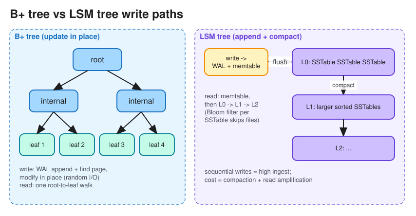

# Database Indexes (and B-Tree vs LSM-Tree)

> **TL;DR** — An index is an extra data structure that trades **write cost + storage** for **fast reads**.
> **B+ trees** (most relational DBs) give O(log n) point and range lookups with in-place updates.
> **LSM trees** (Cassandra, RocksDB, Bigtable) turn writes into sequential appends (memtable → SSTables) and
> pay with compaction and slower reads. Know composite index column order (leftmost prefix), covering
> indexes, and when an index *won't* be used.

## Index types
| Index | Structure | Good for | Not good for |
|---|---|---|---|
| **B+ tree** | Balanced tree; leaves hold sorted keys linked as a list | `=`, `<`, `>`, `BETWEEN`, `ORDER BY`, prefix `LIKE 'abc%'` | Very high write rates (random page writes) |
| **Hash** | Hash table | Exact match `=` in O(1) | Ranges, sorting |
| **LSM tree** | In-memory memtable + immutable sorted SSTables on disk | Write-heavy workloads | Read amplification, compaction spikes |
| **Inverted** | term → posting list of doc IDs | Full-text search (Elasticsearch, Postgres GIN) | Point updates are costly |
| **Bitmap** | Bit vector per distinct value | Low-cardinality columns in analytics (gender, status) | High-cardinality, OLTP writes |
| **Geospatial** | R-tree, geohash, quadtree, S2/H3 | "Within radius", "nearest k" | |
| **Vector (ANN)** | HNSW graph, IVF | Similarity search on embeddings | Exact answers |

## Clustered vs non-clustered (secondary)
* **Clustered / primary**: the table rows *are* stored in index order (InnoDB primary key). There is only one.
  Range scans on the PK are very fast.
* **Secondary**: a separate structure pointing to the row (InnoDB stores the PK value, so a lookup is
  *index → PK → row*).
* **Covering index**: contains all the columns a query needs, so the table is never touched ("index-only scan").
  `CREATE INDEX ON orders (user_id, created_at) INCLUDE (status, total);`

## Composite indexes: the leftmost-prefix rule
Index on `(country, city, age)`:
* Can use it: `WHERE country=?`, `WHERE country=? AND city=?`, `WHERE country=? AND city=? AND age>?`.
* Cannot use it efficiently: `WHERE city=?`, `WHERE age=?` (no leftmost column).
* Put **equality** columns first and the **range** column last. More selective columns first is a common
  heuristic, but match the column order to your queries.

## When indexes don't help
* Functions on the column (`WHERE LOWER(email)=?`): use an expression index.
* Leading wildcard `LIKE '%abc'`: use a trigram or full-text index.
* Low selectivity (`WHERE is_active=true` matching 90% of rows): the planner picks a full scan.
* Implicit type casts, `OR` across different columns (sometimes), and stale statistics.

## B-tree vs LSM-tree

| | B+ tree | LSM tree |
|---|---|---|
| Write path | Find the page, update it in place (+ WAL) | Append to WAL + memtable; flush sorted SSTable; background **compaction** |
| Write amplification | Moderate (page rewrites) | Can be high (compaction rewrites data repeatedly) |
| Read path | One tree traversal | Memtable, then several SSTables (use **Bloom filters** to skip files) |
| Space | Fragmentation within pages | Better compression; temporary duplicates until compaction |
| Predictability | Stable latency | Compaction can cause latency spikes |
| Used by | PostgreSQL, MySQL InnoDB, SQL Server, Oracle | Cassandra, ScyllaDB, RocksDB, LevelDB, HBase, Bigtable |

Compaction strategies: **size-tiered** (write-optimized, more space) vs **leveled** (read-optimized,
more write amplification). Deletes are written as **tombstones** and removed during compaction.

## Cost of indexes
* Every insert or update must maintain every index, so heavy indexing slows writes.
* Indexes take memory: hot index pages should fit in the buffer pool or page cache.
* In distributed DBs a **global secondary index** is partitioned by the indexed value (reads go to one place,
  writes touch another partition asynchronously). A **local index** lives with each partition (cheap writes,
  scatter-gather reads). See [Data Partitioning](data_partitioning.md).

## Interview follow-ups
* *"Query is slow, what do you do?"* `EXPLAIN ANALYZE`, check the plan (seq scan vs index scan), add or adjust a
  composite or covering index, check selectivity and stats, avoid `SELECT *`, consider pagination by cursor.
* *"Why does Cassandra write so fast?"* Sequential WAL append plus an in-memory memtable, no read before write,
  and immutable SSTables merged in the background.

# References
* https://newsletter.ashishps.com/p/a-detailed-guide-on-database-indexes
* https://use-the-index-luke.com/
* Designing Data-Intensive Applications, Chapter 3: Storage and Retrieval
* [The Log-Structured Merge-Tree (LSM-Tree)](https://www.cs.umb.edu/~poneil/lsmtree.pdf)
