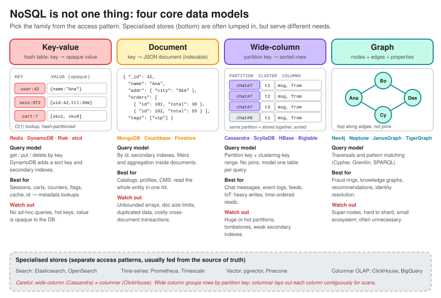
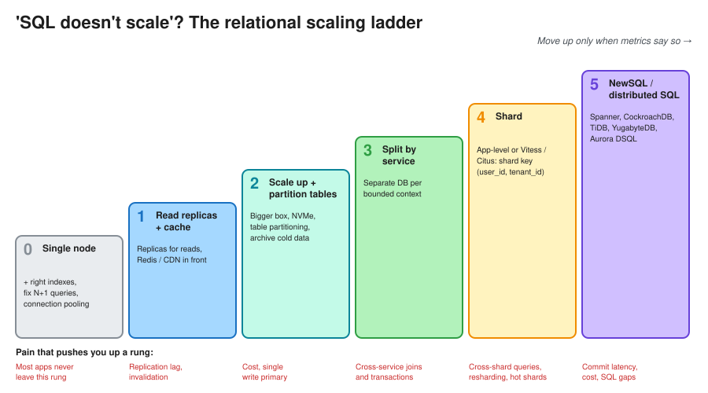
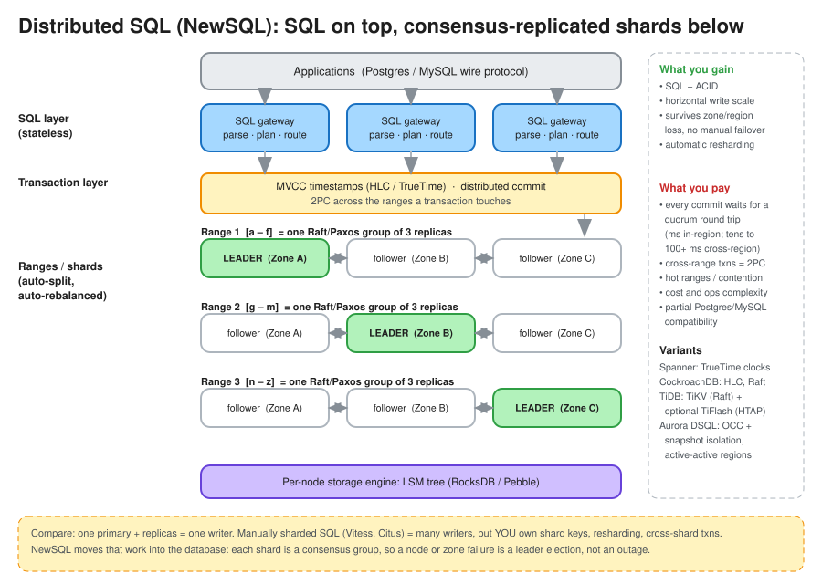

# SQL vs NoSQL (and NewSQL)

> **TL;DR** — "SQL vs NoSQL" is really three separate choices: the **data model** (tables vs
> key-value/document/wide-column/graph), the **guarantees** (ACID transactions vs weaker, per-item or
> per-partition ones), and the **scaling shape** (one write primary vs partitioned writes). Modern systems blur all
> three: Postgres stores JSON and scales with replicas, shards and extensions; DynamoDB and MongoDB offer ACID
> transactions; **NewSQL / distributed SQL** (Spanner, CockroachDB, TiDB, Aurora DSQL) gives SQL + ACID + horizontal
> scale at the price of commit latency. **Default to Postgres**, and justify leaving it with concrete access patterns,
> numbers and consistency needs, never with "NoSQL scales". For the catalog of store types see
> [Types of Databases](database_types.md).

## What the question is really asking
Interviewers don't want a winner. They want to see you:
1. Derive **access patterns** and **scale numbers** first (QPS, data size, read/write ratio, latency, consistency).
2. Choose a store for each piece of data and **name the trade-off** you accept.
3. Know the modern reality (NoSQL has transactions; SQL scales further than people think).

## Definitions
**Relational (SQL)**: data in tables with a declared schema; rows relate via keys; queried with declarative SQL;
the engine plans joins and enforces constraints (PK/FK/unique/check) and ACID transactions.
Examples: PostgreSQL, MySQL/MariaDB, Oracle, SQL Server, SQLite.

**NoSQL**: an umbrella for non-relational stores that trade some relational features for a different data model,
scaling model or latency profile. It is *not* one thing; there are four core families plus specialised stores.

| Family | Abstraction | Examples |
|---|---|---|
| Key-value | hash table | Redis, DynamoDB, Riak |
| Document | key → JSON document | MongoDB, Couchbase, Firestore |
| Wide-column | partition key → sorted rows (nested map) | Cassandra, ScyllaDB, HBase, Bigtable |
| Graph | nodes + edges + properties | Neo4j, Neptune, JanusGraph |

Details, pitfalls and a "same data in five models" diagram are in [Types of Databases](database_types.md).

**Deep dives:** [PostgreSQL & MySQL](postgres_mysql.md) · [DynamoDB](dynamodb.md) · [Cassandra](cassandra.md) · [MongoDB](mongodb.md) · [Aurora DSQL (distributed SQL)](aurora_dsql.md).

## Head-to-head
| Attribute | Relational (SQL) | NoSQL |
|---|---|---|
| Data model | Normalized tables, relations, joins | Key-value / document / wide-column / graph |
| Schema | Declared up front; enforced by the DB; changed via migrations | Flexible; the schema lives in application code ("schema-on-read") |
| Queries | Ad-hoc SQL, joins, aggregates, window functions; planner optimizes | Designed per access pattern; limited or no joins; ad-hoc queries are weak |
| Modeling approach | Model the *data* (normalize), then query anyway you like | Model the *queries* (denormalize, one table/collection per access pattern) |
| Transactions | Multi-row, multi-table ACID by default | Varies: per-item only; or limited multi-item (DynamoDB up to 100 items; MongoDB multi-document; Cassandra lightweight transactions per partition) |
| Consistency | Strong on the primary; replicas lag | Often tunable (quorums) or eventual by default |
| Write scaling | One primary per shard; scale up, then shard (extra work) | Built-in partitioning; add nodes |
| Read scaling | Read replicas, caches | Replicas, partition fan-out |
| Availability | Failover to replica (seconds to minutes) | Often leaderless or multi-leader, no failover step |
| Typical storage engine | B-tree (Postgres, InnoDB) | LSM-tree (Cassandra, RocksDB, Bigtable) or B-tree (MongoDB WiredTiger default) |
| Ops maturity | Decades of tooling, drivers, BI, ORMs | Varies by product; vendor-specific skills |

## ACID, BASE and CAP, and the confusion to avoid
**ACID** (per transaction): **A**tomicity (all or nothing), **C**onsistency (the transaction moves the DB between
states that satisfy its invariants/constraints), **I**solation (concurrent transactions don't see each other's
partial work, to a degree set by the isolation level), **D**urability (committed data survives crashes).

**BASE** (a looser, mostly marketing-era description): **B**asically **A**vailable, **S**oft state, **E**ventual
consistency: the system keeps answering during failures and replicas converge over time.

Interview traps:
* **The "C" in ACID is not the "C" in CAP.** ACID-C is application-level invariants (e.g. balance ≥ 0). CAP-C is
  **linearizability** across replicas. A single-node Postgres says nothing about CAP; a Raft-replicated NewSQL
  database is both ACID and CP.
* **ACID isolation is a spectrum.** The default in Postgres is *Read Committed*; in MySQL InnoDB it is *Repeatable
  Read*. Neither is *Serializable*, so write skew and lost updates are still possible without locks or retries. See
  [Transactions](transactions.md).
* **"NoSQL = BASE, SQL = ACID" is outdated.** DynamoDB has `TransactWriteItems`, MongoDB has multi-document ACID
  transactions, Spanner is a globally ACID *and* horizontally scaled system. Conversely, a SQL replica read is
  eventually consistent.
* CAP is only about behavior **during a partition**; the day-to-day trade-off is **latency vs consistency**
  (PACELC). See [CAP & PACELC](cap_theorem.md) and [Consistency](consistency.md).

## Myths that cost points
| Myth | Reality |
|---|---|
| "NoSQL scales, SQL doesn't." | One tuned Postgres/MySQL node serves very large workloads; the real ceiling is the single **write** primary. There's a ladder of fixes below it, then sharding and NewSQL. |
| "NoSQL has no schema." | The schema moves into application code. You still have one; you just lose DB-enforced validation and gain painful, implicit migrations. |
| "NoSQL has no transactions." | Varies by product (see above), but they're narrower: bounded size, same partition/region, extra cost. |
| "Joins don't scale." | Joins on indexed keys within a node are cheap. Cross-shard joins are what hurt, in any system. |
| "SQL can't store JSON." | Postgres `jsonb` + GIN indexes handles semi-structured data well. |
| "NoSQL is cheaper." | Often the opposite for query flexibility: you pay in duplicated data, extra tables per query, and application code. |
| "NoSQL is less secure." | Security depends on configuration (auth, TLS, encryption at rest, network isolation), not data model. |
| "Eventual consistency = broken." | It's fine for feeds, counters, carts, view counts; it's wrong for balances and inventory. Decide per data item. |
| "Aurora is NewSQL." | Aurora (classic) separates compute and storage but still has a **single writer**. Aurora DSQL is the distributed SQL product. |

## Data modeling
### Relational: model the data, normalize, then denormalize on evidence
* **Normalize** (3NF) so each fact lives once: no update anomalies, small rows, constraints enforce integrity.
* **Denormalize selectively** (duplicate a column, store a precomputed aggregate or a materialized view) only when a
  measured read is too slow, and own the sync logic (trigger, job, or CDC).
* Index for the queries you run: composite indexes follow the leftmost-prefix rule. See [Indexes](database_indexing.md).
* **Online schema changes** (expand → backfill → contract) avoid downtime: add the new nullable column, dual-read,
  backfill in batches, switch reads, then drop the old column.

| Pattern | Use case | Pros | Cons |
|---|---|---|---|
| **Normalized (3NF)** | OLTP: orders, users, payments | Integrity, small writes, no duplication | Joins on read-heavy paths |
| **Denormalized** | Read-heavy, hot paths | Fewer joins, faster reads | Duplicate data can drift; more write work |
| **Star schema** | Warehouses / OLAP: a central fact table + dimension tables | Simple, fast aggregates | Redundant dimension data |
| **Snowflake schema** | Star with normalized dimensions | Less redundancy | More joins, harder queries |
| **Hierarchies in SQL** | Org charts, categories, comments | Adjacency list + recursive CTE; materialized path / `ltree`; closure table | Each trades write cost vs query speed |

### NoSQL: model the queries
* List every query first; design **one table/collection per access pattern** (even if data duplicates).
* **MongoDB / document**: *embed* data that's read together and bounded (address in user); *reference* when
  unbounded or shared (an order's items might embed, a product's reviews should reference). Avoid unbounded arrays.
* **Cassandra / wide-column**: choose the **partition key** (what you always filter on, and enough cardinality to
  spread load) and **clustering key** (sort order inside the partition). Keep partitions bounded (e.g. add a time
  bucket: `(conversation_id, month)`).
* **DynamoDB**: partition key + optional sort key; add **GSIs** for other access patterns (eventually consistent,
  priced separately). **Single-table design** puts several entity types in one table to fetch related items in one
  query. It's fast but rigid and hard to read, so use it when the access patterns are stable and known.
* **Hot partitions** are the classic NoSQL failure: one key (celebrity, "today", a tenant) receives disproportionate
  traffic. Fix with higher-cardinality keys, write sharding (`key#0..N`), caching, or splitting hot tenants. See
  [Partitioning](data_partitioning.md).

## Scaling relational: the ladder

Rough order-of-magnitude anchors (verify for the actual hardware, schema and workload; these are only to make you
state numbers instead of adjectives):
* A single well-provisioned Postgres/MySQL node comfortably holds **low-TB** of data and serves
  **tens of thousands of simple reads/sec and thousands to low tens of thousands of writes/sec**.
* Read-heavy systems scale far with **replicas + cache**, because most traffic is reads.
* You need to shard when a single **write primary**, storage size, or operational window (backup/restore, migrations)
  becomes the limit. Not before.

Shard-key advice: choose what you filter on most (`user_id`, `tenant_id`), avoid hot keys and monotonic keys, keep
related data on one shard (so transactions stay local), and plan resharding (consistent hashing / directory or
logical shards that can be moved). See [Partitioning](data_partitioning.md) and [Consistent Hashing](consistent_hashing.md).

How NoSQL scales is by design: data is partitioned by key across nodes (consistent hashing, hash-slot ranges)
and replicated ([Replication](data_replication.md), [Quorum](quorum.md)), so adding nodes adds write throughput, but
every query must route by partition key.

## NewSQL / distributed SQL
**Idea:** keep SQL, ACID and strong consistency, but build the storage layer like a NoSQL system. Data is split into
**ranges/shards**; each range is a replicated **consensus group** (Raft or Paxos); a **distributed transaction
layer** (2PC across ranges, MVCC timestamps) provides ACID across shards; a stateless **SQL layer** plans queries.
The term "NewSQL" dates to ~2011, and the broader label today is **distributed SQL**.

| System | Notes |
|---|---|
| **Google Spanner** | The original. Paxos groups per split, 2PC across groups, **TrueTime** clocks give external consistency (strict serializability). Also Cloud Spanner on GCP. |
| **CockroachDB** | Postgres-compatible, Raft per range, hybrid logical clocks, serializable isolation by default. |
| **TiDB** | MySQL-compatible; TiKV (Raft) storage; optional **TiFlash** columnar replicas for HTAP. |
| **YugabyteDB** | Postgres-compatible query layer on a Raft-replicated DocDB store. |
| **Amazon Aurora DSQL** ([deep dive](aurora_dsql.md)) | Serverless, active-active across regions with a witness region, Postgres-compatible subset, **optimistic concurrency control with snapshot isolation**, so the application must **retry** on commit conflicts. GA since May 2025. |
| Vitess / Citus | *Not quite NewSQL*: sharding layers over MySQL/Postgres. You still pick shard keys and cross-shard transactions are limited. |

**What you gain**
* SQL + ACID with horizontal **write** scaling and automatic shard splitting/rebalancing.
* Replication via consensus means a node/zone failure is a leader election: no manual failover, no lost
  acknowledged writes.
* Multi-region options: survive a region failure with strongly consistent reads and writes.

**What you pay**
* **Commit latency:** a write waits for a replica quorum. In one region that's milliseconds; spread across regions it
  is tens to 100+ ms. Spanner/Cockroach let you pin data (geo-partitioning, leaseholders) near users to reduce it.
* **Cross-shard transactions** cost 2PC; keep hot transactions inside one range where you can.
* **Hot ranges / contention:** sequential keys and hot rows still serialize on one leader; under OCC (DSQL) hot rows
  produce **abort/retry storms**.
* **Cost and operations** (or a managed-service bill), and **SQL compatibility gaps** (extensions, some DDL, triggers,
  long transactions); test your ORM and queries.
* **Clock dependence:** Spanner needs TrueTime hardware; CockroachDB assumes bounded clock skew.

**When to say it in an interview**
* Global financial ledger, multi-region inventory/booking where you can't accept split-brain or stale reads.
* A relational workload that has outgrown one write primary and you want to avoid hand-built sharding.
* Not for a typical single-region app: Postgres + replicas + cache is simpler and cheaper.

| | Single primary + replicas | Manual sharding (Vitess/Citus/app) | NewSQL |
|---|---|---|---|
| Write scale | One writer | Many writers | Many writers |
| Cross-shard ACID | n/a | Mostly your problem | Built in (2PC + consensus) |
| Failover | Promote replica (seconds–minutes, possible loss if async) | Per-shard failover | Automatic, no acknowledged-write loss |
| Resharding | n/a | Manual, risky | Automatic |
| Multi-region writes | Hard (active-passive) | Hard | Supported (at a latency cost) |
| Complexity / cost | Lowest | Medium (you own it) | Highest, or buy managed |

## How to choose: an interview playbook
1. **State requirements and numbers**: reads vs writes, peak QPS, data size/growth, latency SLO, consistency needs,
   regions, query flexibility.
2. **Default to Postgres** unless a number or pattern says otherwise. "Single node + replicas handles X QPS and
   Y TB, which covers our estimate."
3. **Pick per data item**, not per system: money/inventory → relational; carts/sessions → KV; messages → wide-column;
   search → search engine; analytics → OLAP; blobs → object store.
4. **Name the trigger to change** ("if writes exceed N/s or we go multi-region, I'd move this table to X").
5. **Keep one source of truth** and derive the rest with CDC ([polyglot persistence](database_types.md#polyglot-persistence-one-source-of-truth-many-derived-stores)).

| Prefer relational when… | Prefer NoSQL when… |
|---|---|
| Invariants and multi-row transactions matter (money, inventory, bookings) | Access is by key and you need massive, simple, partitioned throughput |
| Access patterns are unknown or changing; ad-hoc queries/BI | Access patterns are fixed and known up front |
| Data is relational and joined often | Entities are read/written whole (documents) or are huge time-ordered logs |
| You want the DB to enforce constraints | Schema varies a lot, or you need very low-latency/multi-region AP behavior |
| Scale fits one primary + replicas (more than most think) | Write throughput must scale linearly without app-level sharding |

## Pitfalls checklist
**Relational**
* Missing/wrong indexes, N+1 queries, `SELECT *`, unbounded `OFFSET` pagination (use keyset pagination).
* Long transactions holding locks; connection storms (use a pooler such as PgBouncer).
* Assuming replicas are up to date (read-your-writes bugs); assuming the default isolation prevents write skew.
* Hot rows (counters, "inventory = 1") serializing writes; use sharded counters or queue-based serialization.
* Big migrations that lock tables; no online schema-change plan.
* Sharding too early, or with a poor shard key.

**NoSQL**
* Modeling before knowing the queries, then needing a new access pattern (and a table rebuild).
* Hot/unbounded partitions; tombstone buildup (Cassandra deletes/TTLs); large documents/items (DynamoDB item limit 400 KB,
  MongoDB 16 MB).
* Relying on eventual consistency where a read-after-write is required; stale GSI reads.
* Using multi-document transactions or scans as the main path; expecting joins.
* Duplicated data drifting out of sync with no reconciliation job.
* Vendor lock-in and query-language differences.

**NewSQL**
* Ignoring commit latency and cost; assuming full Postgres/MySQL compatibility; hot ranges; OCC retry storms.

## Real-world examples
* **Uber** moved its fulfillment platform from a NoSQL design to a MySQL-based store: [blog](https://www.uber.com/blog/fulfillment-platform-rearchitecture/).
* **Stack Overflow** ran a very large traffic volume on a small number of vertically scaled SQL Servers: [talk](https://www.slideshare.net/InfoQ/scaling-stack-overflow-keeping-it-vertical-by-obsessing-over-performance).
* **Netflix** uses Cassandra and other NoSQL for availability-first workloads: [blog](https://netflixtechblog.com/nosql-at-netflix-e937b660b4c).
* **Gojek** migrated a write-heavy workload from PostgreSQL to Cassandra: [blog](https://www.gojek.io/blog/database-optimisation-on-cassandra).
* **Wordnik** moved from MySQL to MongoDB for its API workload: [post](http://highscalability.com/blog/2011/2/15/wordnik-10-million-api-requests-a-day-on-mongodb-and-scala.html).

## Interview follow-ups
* *"SQL or NoSQL for this system?"* "Relational by default. Money and inventory are invariants, so Postgres. Carts
  and sessions are key-value, messages could go to Cassandra if write volume demands it. Here are the numbers that
  would make me change."
* *"Doesn't SQL not scale?"* Walk the ladder: indexes, replicas + cache, scale up, partition tables, split by
  service, shard, then NewSQL. The real limit is the single write primary.
* *"How would you shard a relational database?"* Shard key (`user_id`/`tenant_id`), keep related data together,
  avoid cross-shard transactions (sagas if needed), a lookup service or consistent hashing, plan resharding.
* *"What does eventual consistency mean for the user?"* Stale reads for a window, so use it for feeds/counters and
  route read-your-writes (or critical reads) to the primary, a quorum read, or a session-pinned replica.
* *"What is NewSQL / distributed SQL and when would you use it?"* SQL + ACID on top of consensus-replicated shards;
  use it for multi-region strongly consistent data or when you've outgrown one primary. The cost is commit latency
  (quorum round trip) and money.
* *"Why not Aurora for multi-region writes?"* Classic Aurora has one writer (Global Database is active-passive).
  Aurora DSQL is the active-active one, with OCC and a Postgres subset.
* *"DynamoDB vs Cassandra?"* DynamoDB: managed, fixed ops burden, transactions, on-demand scaling, vendor lock-in.
  Cassandra: self-managed (or via a managed offering), tunable consistency, portable across clouds, more tuning.
* *"Document store or Postgres `jsonb`?"* `jsonb` if the rest of the data is relational and scale fits one primary;
  MongoDB if the whole domain is document-shaped and you want built-in sharding.
* *"How do you handle a hot key?"* Cache it, shard the key (`key#n`), batch/aggregate writes, or split the tenant.

# References
* [grokking-the-system-design-interview](https://www.educative.io/courses/grokking-the-system-design-interview/YQlK1mDPgpK)
* [system-design-primer](https://github.com/donnemartin/system-design-primer#database)
* [NodeFlair: SQL vs NoSQL in system design interviews](https://www.nodeflair.com/blog/sql-vs-nosql-databases-system-design-interview)
* https://blog.bytebytego.com/p/understanding-database-types
* https://www.codekarle.com/system-design/Database-system-design.html
* Designing Data-Intensive Applications, Chapters 2, 3, 5, 6, 7 and 9
* [Spanner: Google's Globally-Distributed Database](https://static.googleusercontent.com/media/research.google.com/en//archive/spanner-osdi2012.pdf)
* [Amazon Aurora DSQL is now generally available (AWS)](https://aws.amazon.com/about-aws/whats-new/2025/05/amazon-aurora-dsql-generally-available)
* [Concurrency control in Amazon Aurora DSQL (AWS Database Blog)](https://aws.amazon.com/blogs/database/concurrency-control-in-amazon-aurora-dsql)
