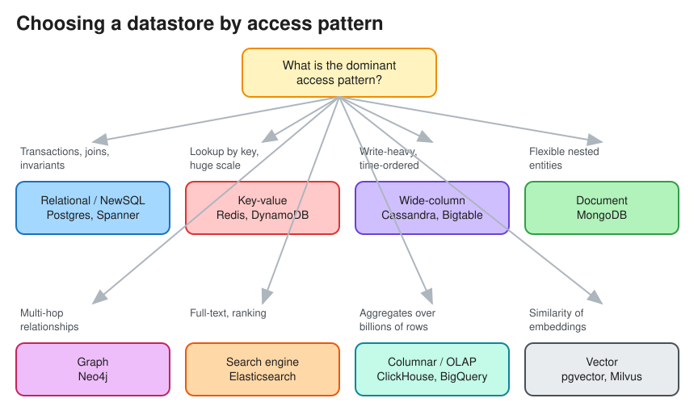

# Types of Databases

> **TL;DR** — Pick a datastore from its **access pattern**, not from fashion. Relational for transactions,
> joins and integrity; key-value for O(1) lookups at huge scale; wide-column for write-heavy partitioned data;
> document for flexible, nested entities; graph for relationship traversal; search engines for full-text and
> faceting; time-series for metrics; vector for similarity search; object storage for blobs. Most systems use
> several (**polyglot persistence**). See also [SQL vs NoSQL](database_sql_vs_nosql.md).

## Cheat sheet
| Type | Data model | Strengths | Weaknesses | Examples | Typical use in interviews |
|---|---|---|---|---|---|
| **Relational (RDBMS)** | Tables, rows, schema, SQL | ACID transactions, joins, constraints, mature tooling | Horizontal write scaling is hard (needs sharding) | PostgreSQL, MySQL, Oracle | Payments, orders, inventory, users, bookings |
| **NewSQL / distributed SQL** | SQL over a sharded, replicated KV + consensus | SQL + ACID + horizontal scale | Higher write latency (consensus), cost | Spanner, CockroachDB, TiDB, YugabyteDB, Aurora DSQL | Global ledgers, multi-region strongly consistent data |
| **Key-value** | `key → value` (opaque blob) | Very fast, simple, scales linearly | No queries beyond key lookups | Redis, Memcached, DynamoDB, RocksDB (embedded) | Cache, sessions, rate-limit counters, URL shortener mappings |
| **Wide-column** | Partition key → sorted rows of columns | Massive write throughput, linear scale, tunable consistency | Query-driven modeling only, no joins, limited secondary indexes | Cassandra, ScyllaDB, HBase, Bigtable | Chat messages, activity feeds, IoT, time-ordered events |
| **Document** | JSON/BSON documents | Flexible schema, nested data, secondary indexes | Weak cross-document joins and transactions (improving) | MongoDB, Couchbase, Firestore | Catalogs, CMS, user profiles |
| **Graph** | Nodes + edges + properties | Multi-hop traversals (friends-of-friends) | Hard to shard, niche query languages | Neo4j, Amazon Neptune, JanusGraph | Social graphs, fraud rings, recommendations |
| **Search engine** | Inverted index over documents | Full-text, relevance ranking, facets, fuzzy match | Not a source of truth; near-real-time (refresh lag) | Elasticsearch, OpenSearch, Solr | Product search, log search, autocomplete |
| **Time-series** | `(series, timestamp) → value` | High ingest, compression, downsampling, retention | Narrow query model | Prometheus, InfluxDB, TimescaleDB, M3 | Metrics, monitoring, IoT sensors |
| **Columnar / OLAP** | Column-oriented storage | Fast scans and aggregations over billions of rows | Slow point updates | ClickHouse, Druid, Pinot, BigQuery, Snowflake, Redshift | Analytics dashboards, ad-click aggregation |
| **Vector** | Embeddings + ANN index (HNSW, IVF) | Semantic similarity search | Approximate, memory-heavy | pgvector, Pinecone, Milvus, Weaviate | RAG, recommendations, image search |
| **Object / blob storage** | Key → immutable object + metadata | Cheap, durable (11 nines), unlimited | High latency, no in-place updates | S3, GCS, Azure Blob | Images, videos, backups, data lake. See [Blob Storage](blob_storage.md) |
| **Ledger** | Append-only, cryptographically verifiable | Immutable audit trail | Narrow use | QLDB (deprecated), immudb | Audit logs, financial ledgers |

## Decision questions to ask aloud
1. **Do I need multi-row/multi-entity transactions or strong invariants?** Use relational or NewSQL.
2. **Is the access pattern simple lookups by key at huge scale?** Use key-value.
3. **Write-heavy, time-ordered, partitionable by a natural key?** Use wide-column.
4. **Do I need free-text search or ranking?** Use a search engine, fed by CDC from the source of truth.
5. **Analytical aggregates over big data?** Use columnar/OLAP or a warehouse, not your OLTP DB.
6. **Large binary files?** Use object storage, keeping only metadata and the URL in the DB.

## OLTP vs OLAP
| | OLTP | OLAP |
|---|---|---|
| Queries | Many small reads/writes by key | Few huge scans and aggregations |
| Storage | Row-oriented | Column-oriented (compression, vectorized execution) |
| Users | Application end users | Analysts, dashboards, ML |
| Data flow | Source of truth | Fed by ETL/ELT or CDC from OLTP |

## Interview follow-ups
* *"Why not one DB for everything?"* Different access patterns need different storage layouts (B-tree vs
  LSM-tree vs inverted index vs columnar). Use one source of truth plus derived stores kept in sync through
  CDC or events.
* *"Postgres or Cassandra for chat messages?"* Cassandra/ScyllaDB: partition by `conversation_id`, cluster by
  `message_id` (time-sortable), write-heavy, simple range reads. Postgres works fine up to moderate scale.

# References
* https://newsletter.ashishps.com/p/15-types-of-databases
* https://github.com/donnemartin/system-design-primer#database
* https://blog.bytebytego.com/p/understanding-database-types
* Designing Data-Intensive Applications, Chapters 2 and 3
