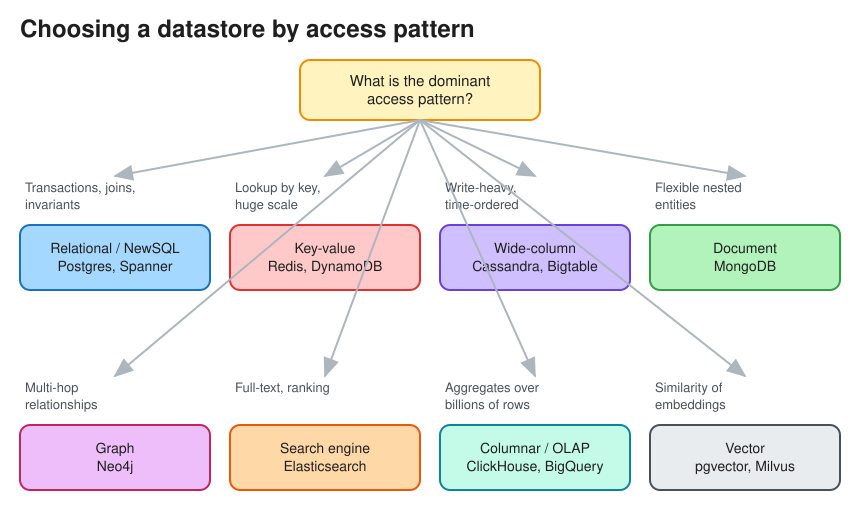
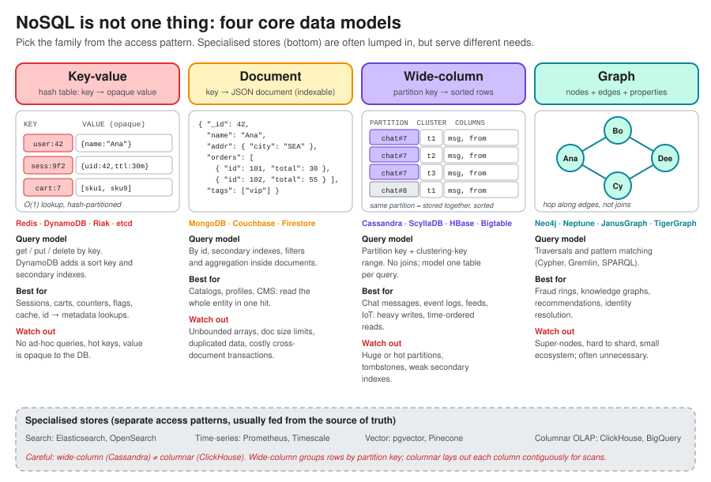
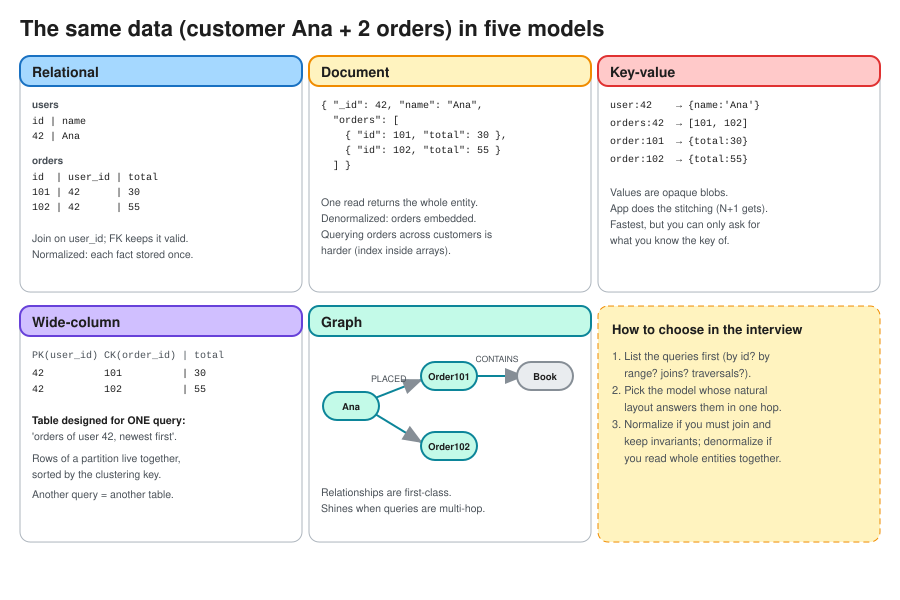
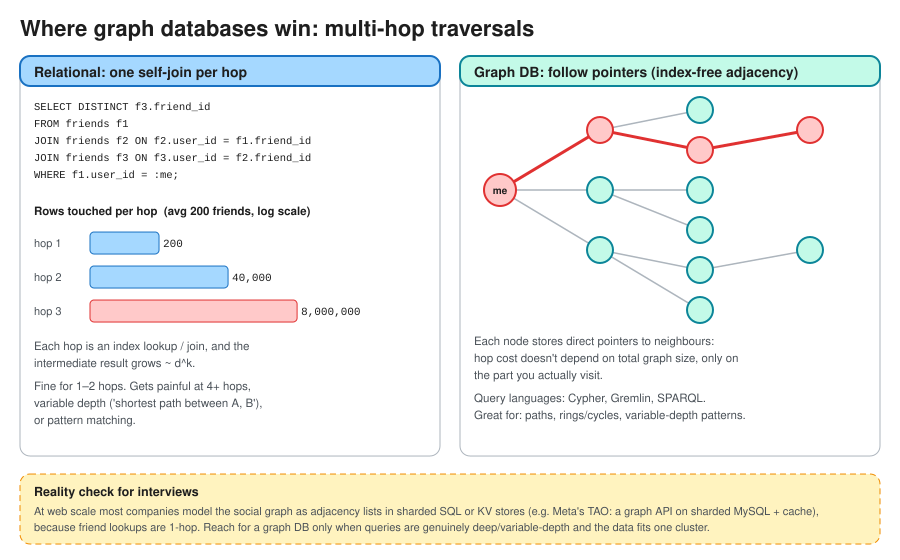
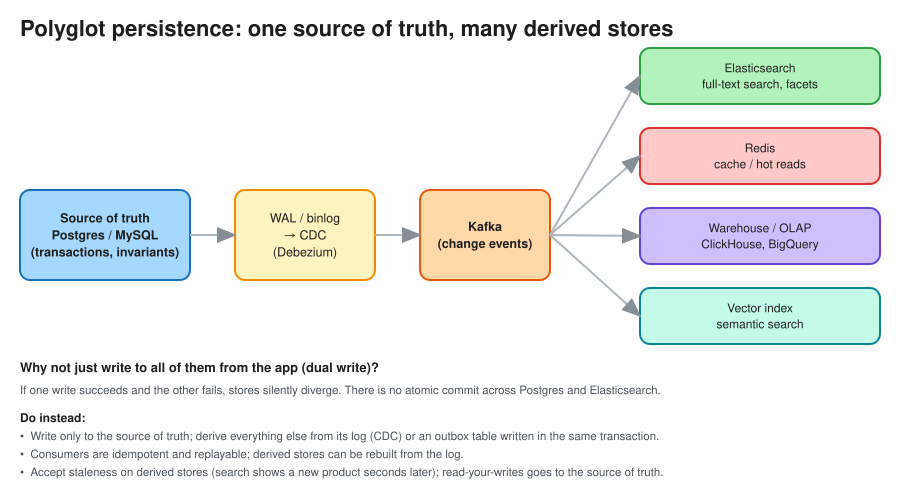

# Types of Databases

> **TL;DR** — Pick a datastore from its **access pattern**, not from fashion. **Default to a relational database
> (Postgres)** and deviate only when you can name the access pattern or scale it cannot serve: key-value for O(1)
> lookups at huge scale, wide-column for write-heavy partitioned data, document for whole-entity reads, graph for
> deep relationship traversal (rare), search engines for full-text, time-series for metrics, columnar/OLAP for
> analytics, vector for similarity, object storage for blobs. Real systems use several (**polyglot persistence**)
> with **one source of truth** and derived stores fed by CDC. For the relational-vs-NoSQL debate, ACID/BASE,
> data modeling and NewSQL, see [SQL vs NoSQL](database_sql_vs_nosql.md).

## How this note and "SQL vs NoSQL" fit together
* **This note** = the *catalog*: what kinds of stores exist, when to pick each, and the traps of each.
* [SQL vs NoSQL](database_sql_vs_nosql.md) = the *debate and the depth*: guarantees, modeling, scaling a relational
  DB, distributed SQL (NewSQL), and how to defend your choice.
* They are kept separate on purpose: an interviewer asks "which database would you use?" (this note) and then
  "why not the other one?" (that note).

**Deep dives:** [PostgreSQL & MySQL](postgres_mysql.md) · [DynamoDB](dynamodb.md) · [Cassandra](cassandra.md) · [MongoDB](mongodb.md) · [Aurora DSQL (distributed SQL)](aurora_dsql.md).

## The map

## Cheat sheet
| Type | Data model | Strengths | Weaknesses | Examples | Typical use in interviews |
|---|---|---|---|---|---|
| **Relational (RDBMS)** | Tables, rows, schema, SQL | ACID transactions, joins, constraints, flexible ad-hoc queries, mature tooling | Single write primary; scaling writes needs sharding | PostgreSQL, MySQL, Oracle, SQL Server | Payments, orders, inventory, users, bookings. **The default.** |
| **NewSQL / distributed SQL** | SQL over sharded, consensus-replicated key ranges | SQL + ACID + horizontal write scale + multi-region | Commit latency (quorum round trips), cost, SQL gaps | Spanner, CockroachDB, TiDB, YugabyteDB, Aurora DSQL | Global ledgers, multi-region strongly consistent data |
| **Key-value** | `key → value` (opaque blob) | Very fast, simple, scales linearly | No queries beyond key (and sort key) lookups | Redis, Memcached, DynamoDB, etcd, RocksDB (embedded) | Cache, sessions, carts, rate-limit counters, URL mappings |
| **Wide-column** | Partition key → sorted rows of columns | Massive write throughput, linear scale, tunable consistency | Query-driven modeling, no joins, weak secondary indexes | Cassandra, ScyllaDB, HBase, Bigtable | Chat messages, activity feeds, IoT, time-ordered events |
| **Document** | JSON/BSON documents | Flexible schema, nested data, secondary indexes, whole-entity reads | Cross-document joins and transactions are weak/costly | MongoDB, Couchbase, Firestore, DocumentDB | Catalogs, CMS, user profiles |
| **Graph** | Nodes + edges + properties | Multi-hop and variable-depth traversals, path/pattern queries | Hard to shard, niche languages, small ecosystem | Neo4j, Amazon Neptune, JanusGraph, TigerGraph | Fraud rings, knowledge graphs, recommendations |
| **Search engine** | Inverted index over documents | Full-text, relevance ranking, facets, fuzzy match | Not a source of truth; near-real-time (refresh lag) | Elasticsearch, OpenSearch, Solr | Product search, log search, autocomplete |
| **Time-series** | `(series, timestamp) → value` | High ingest, compression, downsampling, retention | Narrow query model; high-cardinality labels hurt | Prometheus, InfluxDB, TimescaleDB, M3 | Metrics, monitoring, IoT sensors |
| **Columnar / OLAP** | Column-oriented storage | Fast scans and aggregations over billions of rows | Slow point updates and single-row writes | ClickHouse, Druid, Pinot, BigQuery, Snowflake, Redshift | Analytics dashboards, ad-click aggregation |
| **Vector** | Embeddings + ANN index (HNSW, IVF) | Semantic similarity search | Approximate results, memory-heavy | pgvector, Pinecone, Milvus, Weaviate | RAG, recommendations, image search |
| **Object / blob storage** | Key → immutable object + metadata | Cheap, durable (11 nines), practically unlimited | High latency, no in-place updates | S3, GCS, Azure Blob | Images, videos, backups, data lake. See [Blob Storage](blob_storage.md) |
| **Ledger** | Append-only, cryptographically verifiable | Immutable audit trail | Narrow use | immudb (QLDB is deprecated) | Audit logs, financial ledgers |

> **Wide-column ≠ columnar.** Cassandra/Bigtable keep rows grouped by partition key (an OLTP-style store). ClickHouse,
> Parquet and BigQuery store each *column* contiguously (an analytics layout). Mixing these up is a common slip.
> See [File Formats](file_formats.md).

## One entity, five models
Seeing the same data in each model makes the trade-offs concrete: relational normalizes and joins, document embeds,
key-value stitches in the app, wide-column designs a table per query, graph stores relationships as first-class.

## When to pick it, and the traps
| Type | Pick it when | Interview pitfalls |
|---|---|---|
| **Relational** | Invariants, multi-row transactions, ad-hoc queries, you don't yet know all access patterns | Saying "it doesn't scale" (see the [scaling ladder](database_sql_vs_nosql.md#scaling-relational-the-ladder)); N+1 queries; missing indexes; unbounded joins |
| **NewSQL** | Relational + ACID but one write primary is not enough, or you need multi-region active-active with strong consistency | Reaching for it by default; ignoring commit latency (a quorum round trip per commit) and cost |
| **Key-value** | Access is only by key; need single-digit-ms at huge scale | Hot keys; "I'll just query by value later"; unbounded values; treating a cache as a source of truth |
| **Wide-column** | Heavy writes, known read queries, natural partition key + clustering order (time, message id) | Unbounded or hot partitions (e.g. `partition = date` for all traffic); tombstones from deletes/TTL; expecting joins or flexible secondary indexes; modeling before knowing queries |
| **Document** | Entities read/written as a whole, schema varies per entity | Unbounded arrays inside a document, 16 MB document cap (MongoDB), duplicated data drifting out of sync, assuming multi-document transactions are cheap |
| **Graph** | Queries are multi-hop / variable-depth / path-finding and the graph is the product | Using it for 1-hop "friends of X" (a table or KV lookup does that); super-nodes (celebrity with 50M edges); data too big for one cluster |
| **Search** | Full-text, relevance, facets, geo search | Treating it as the primary store; dual-writing instead of CDC; reindex/mapping changes that need a rebuild |
| **Time-series** | Append-mostly `(metric, time)` data with retention and downsampling | High-cardinality labels (user_id as a label) exploding storage |
| **Columnar / OLAP** | Aggregations over huge datasets, dashboards | Using it for OLTP point updates; real-time freshness assumptions on a batch-loaded warehouse |
| **Vector** | Semantic similarity, RAG | Treating ANN results as exact; forgetting to re-embed after a model change; filtering plus ANN performance |
| **Object storage** | Large immutable blobs | Storing blobs in the DB; chatty small-object access patterns; assuming read-after-write for listings on older systems |

## Where do graph databases actually fit?
Graph databases are the most often name-dropped and least often needed store in interviews.

**Use a graph database when** the questions are about *structure*, not just *neighbors*:
* **Fraud / AML rings**: "find accounts sharing devices, cards or addresses within 4 hops of a known bad actor".
* **Knowledge graphs and entity resolution**: "which records across systems are the same customer?"
* **Recommendations** based on multi-hop paths ("people who bought what your friends' friends bought").
* **Network, IT and supply-chain topology**: impact analysis ("what breaks if this switch dies?"), shortest path.
* **Identity and permission graphs** with deep nesting (groups in groups in groups).

**Don't, when:**
* The query is 1 or 2 hops ("my followers", "friends who liked this"). An adjacency list in a table or KV store
  (`follows(user_id, followee_id)` indexed both ways) is simpler and shards cleanly.
* You need web-scale sharding. Graph partitioning is hard (a good cut of a social graph doesn't exist), so large
  companies build graph APIs on sharded stores (Meta's TAO sits on sharded MySQL plus a cache).
* You mainly need aggregates or full-text search.

**How to say it in an interview:** "A follow graph is mostly 1-hop lookups, so I'll keep an adjacency list in a
sharded table and precompute/fan-out feeds. If we add a fraud product that needs variable-depth ring detection, I'd
put that subset into a graph store fed from CDC."

## Decision questions to ask aloud
1. **Do I need multi-row/multi-entity transactions or strong invariants?** Relational (NewSQL if one primary is not enough).
2. **Is the access pattern simple lookups by key at huge scale?** Key-value.
3. **Write-heavy, time-ordered, partitionable by a natural key?** Wide-column.
4. **Do I read and write whole nested entities with varying shape?** Document (or Postgres `jsonb`).
5. **Do I need free-text search or ranking?** A search engine, fed by CDC from the source of truth.
6. **Analytical aggregates over big data?** Columnar/OLAP or a warehouse, not your OLTP DB.
7. **Deep, variable-depth relationship queries?** Graph (check that it's really not 1–2 hops first).
8. **Large binary files?** Object storage; keep only metadata and the URL in the DB.
9. **Similarity over embeddings?** Vector index (`pgvector` is often enough to start).

**Default stance:** start with Postgres and say what *specific* access pattern or scale limit makes you leave it.
Say the numbers (QPS, data size, read/write ratio, latency target, consistency need) before naming the store.

## Polyglot persistence: one source of truth, many derived stores

* Pick **one system of record** per piece of data. Everything else (search index, cache, warehouse, vector index)
  is *derived* and can be rebuilt.
* Feed derived stores from the source's log (CDC / outbox → Kafka). Avoid **dual writes**: there is no atomic
  commit across Postgres and Elasticsearch, so a crash between the two writes leaves them silently diverged.
* Derived stores are **eventually consistent**; route read-your-writes to the source of truth.
* Cost of polyglot: more systems to run, more failure modes, more skills. Don't add a store for one query that the
  existing one can serve acceptably.

## OLTP vs OLAP
| | OLTP | OLAP |
|---|---|---|
| Queries | Many small reads/writes by key | Few huge scans and aggregations |
| Storage | Row-oriented | Column-oriented (compression, vectorized execution) |
| Users | Application end users | Analysts, dashboards, ML |
| Data flow | Source of truth | Fed by ETL/ELT or CDC from OLTP |
| Latency goal | ms | seconds, over billions of rows |

HTAP systems (TiDB + TiFlash, SingleStore, AlloyDB) try to serve both from one engine by keeping a row copy and a
columnar copy of the same data. Use it to avoid a pipeline for modest analytics, not to replace a warehouse.

## Which store do the problems in this repo use?
| Problem | Typical choice | Why |
|---|---|---|
| [URL Shortener](../problems/url_shortener.md) | Key-value (DynamoDB / Redis cache) or Postgres | Lookup by short code; trivial data model; read-heavy |
| [Chat System](../problems/chat_system.md) | Cassandra/ScyllaDB/DynamoDB (messages), Redis (presence) | Partition by `conversation_id`, cluster by message id; write-heavy |
| [News Feed](../problems/newsfeed_system.md) | Sharded SQL/KV (posts, follow edges), Redis (feed timelines) | 1-hop edges + precomputed timelines, no graph DB needed |
| [Ticketmaster](../problems/ticketmaster.md) | Postgres (seat state) + Redis (hold TTL/lock) + Elasticsearch (event search) | Contended inventory needs transactions |
| [Hotel Reservation](../problems/hotel_reservation_system.md) | Relational with unique/exclusion constraints | Double-booking prevention is an invariant |
| [Payment System](../problems/payment_gateway.md) / [Ledger](../problems/distributed_ledger.md) | Relational (or NewSQL), append-only double-entry tables | ACID, audit, idempotency keys |
| [Shopping Cart](../problems/shopping_cart.md) | Key-value (DynamoDB/Redis) | Access by user/cart id; high availability matters |
| [Ad-Click Aggregation](../problems/ad_click_aggregration.md) | Kafka + Flink → OLAP (ClickHouse/Druid/Pinot); raw events in object storage | Aggregations over huge append-only data |
| [Typeahead](../problems/typehead_suggestion.md) | Trie/in-memory + Redis, or search engine | Prefix lookups, ranking |
| [Proximity Service](../problems/proximity_service.md) | Postgres + PostGIS, or geohash in Redis/Elasticsearch | Geospatial index |
| [Web Crawler](../problems/web_crawler.md) | Object storage (pages), KV/wide-column (URL frontier metadata) | Huge volume, simple lookups |
| [Metrics / Monitoring](../problems/distributed_metrics.md) | Time-series DB | Append-mostly, retention, downsampling |

## Interview follow-ups
* *"Why not one DB for everything?"* Different access patterns need different storage layouts (B-tree vs
  LSM-tree vs inverted index vs columnar). Use one source of truth plus derived stores kept in sync through CDC or
  events, and don't add a store you can't justify.
* *"Postgres or Cassandra for chat messages?"* Cassandra/ScyllaDB: partition by `conversation_id`, cluster by
  `message_id` (time-sortable), write-heavy, simple range reads. Postgres works fine up to moderate scale and is the
  better answer if you want one less system early on. Say both and the trigger for switching.
* *"Your cache and DB disagree. Which is right?"* The source of truth. The cache is derived and needs a TTL and an
  invalidation or update strategy. See [Caching](caching.md).
* *"How do you keep Elasticsearch in sync?"* CDC or an outbox from the primary into Kafka, idempotent indexing by
  document id, and a rebuild path. Not dual writes.
* *"When would you pick a graph database?"* Variable-depth traversal, path finding or ring detection, with data that
  fits one cluster. Not for 1–2 hop social lookups.
* *"Where does MongoDB beat Postgres?"* Rarely on features today (Postgres has `jsonb` and GIN indexes). It wins on
  operational horizontal sharding built-in and when the whole product is document-shaped.
* *"How do you store a tree/hierarchy?"* In SQL: adjacency list with recursive CTEs, materialized path / `ltree`, or
  closure table. In a document DB: embed small trees, reference big ones.

# References
* https://newsletter.ashishps.com/p/15-types-of-databases
* https://github.com/donnemartin/system-design-primer#database
* https://blog.bytebytego.com/p/understanding-database-types
* Designing Data-Intensive Applications, Chapters 2 and 3
* [TAO: Facebook's Distributed Data Store for the Social Graph](https://www.usenix.org/conference/atc13/technical-sessions/presentation/bronson)
