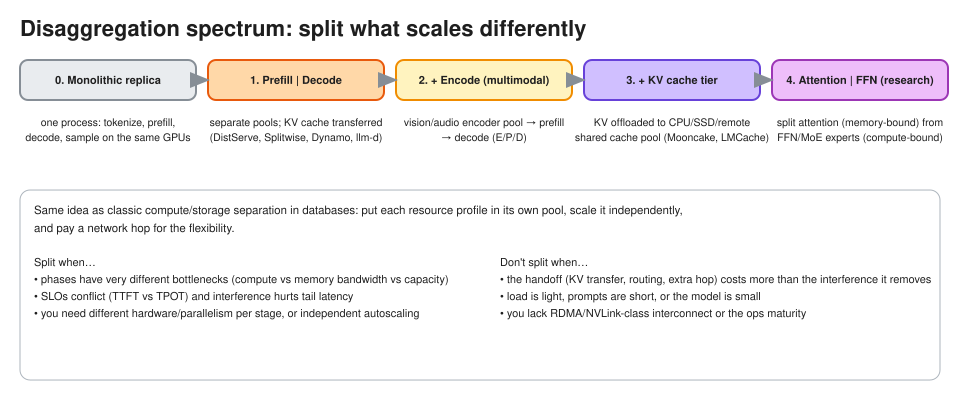

# Disaggregated Serving

> **TL;DR** — **Disaggregation** means splitting a system into **separate resource pools by workload profile** (compute-heavy, memory-heavy, capacity-heavy, I/O-heavy), connected by a fast network, so each pool
> can use **different hardware, parallelism, and scaling policy**. It is the same idea as database **compute/storage separation** ([Aurora DSQL](aurora_dsql.md), [Postgres & MySQL](postgres_mysql.md)) applied to model serving.
> In LLM serving it appears as **prefill | decode** ([deep dive](prefill_decode_disaggregation.md)), **encode | prefill | decode** for multimodal, **KV-cache tiers**, and (research) **attention | FFN/MoE**. The recurring trade-off:
> *flexibility and efficiency* vs *network hop, coordination, and operational complexity*. Split only when the interference or mismatch you remove exceeds the handoff cost.



## Why disaggregate
| Driver | Explanation |
|---|---|
| **Different bottlenecks** | Prefill = compute-bound; decode = memory-bandwidth-bound; KV cache = capacity-bound. One GPU config can't be optimal for all. |
| **Conflicting SLOs** | Time-to-first-token vs inter-token latency; batching that helps one hurts the other (interference). |
| **Independent scaling** | Traffic mix shifts (long prompts vs long outputs); scale each pool on its own signal ([Scalability](scalability.md)). |
| **Hardware heterogeneity** | Put each stage on the cost/power-optimal GPU or accelerator. |
| **Resource pooling** | Share a large KV/prefix cache or encoder pool across many model replicas. |
| **Failure isolation** | A bad stage can be drained/restarted without taking down the whole replica. |

## Forms of disaggregation in LLM serving
1. **Prefill | Decode (P/D)**: separate pools; KV cache transferred after prefill. Most mature form ([details](prefill_decode_disaggregation.md)).
2. **Encode | Prefill | Decode (E/P/D)**: for multimodal models, the vision/audio **encoder** (compute-heavy, bursty, produces embeddings) runs as its own pool and feeds prefill; avoids encoder work stalling text generation and allows encoder-specific batching/caching of embeddings.
3. **KV-cache tiering / pooling**: offload KV from HBM to CPU DRAM, local SSD, or a **remote shared cache** (Mooncake store, LMCache) to extend context capacity and reuse prefixes across requests/replicas; adds lookup/transfer latency and cache-aware routing ([Caching](caching.md), [Consistent hashing](consistent_hashing.md)).
4. **Attention | FFN (A/F) disaggregation** (research-stage, notably for large MoE): attention (memory-bound, KV-heavy) and FFN/expert layers (compute-bound) on different devices with micro-batch pipelining; needs very high bandwidth/low latency fabric.
5. **Model/stage pipelines**: router → small draft model (speculative decoding) → large verifier; tokenizer/detokenizer and sampling offloaded to CPU workers.
6. **Control/data plane split**: scheduler/router (CPU) vs execution engines (GPU); metadata vs tensors.

## The same pattern elsewhere in system design
| Domain | Disaggregated pieces | Why |
|---|---|---|
| **Databases** | Compute nodes vs shared storage/log service (Aurora, Snowflake, Neon, DSQL) | Scale and bill separately; fast failover; elastic reads ([Aurora DSQL](aurora_dsql.md)) |
| **Streaming** | Brokers vs tiered object storage (Kafka tiered storage, Pulsar BookKeeper) | Cheap retention, fast broker recovery ([Kafka](kafka.md)) |
| **Search** | Search nodes vs object-store segments | Elastic capacity ([Elasticsearch](elasticsearch.md)) |
| **Big data** | Spark/Trino compute vs S3 data lake | Independent scaling ([Spark](spark.md)) |
| **Cache** | App-embedded cache vs distributed cache tier | Capacity and sharing ([Caching](caching.md)) |
| **Web** | Edge/CDN vs origin | Latency, offload ([CDN](cdn.md)) |
General rule: **disaggregate along the axis where resource profiles diverge**, then re-aggregate logically through routing and caching.

## Design considerations
- **Interconnect is the budget**: NVLink/NVSwitch (intra-node, ~hundreds of GB/s), RDMA over InfiniBand/RoCE (cross-node, ~25-50 GB/s per NIC class), GPUDirect; plain TCP rarely suffices for tensors. Topology-aware placement (keep paired stages close).
- **Handoff protocol**: transfer engines (NIXL, NCCL, custom RDMA), layer-wise streaming/pipelining to overlap with compute, block-granular KV movement, timeouts and fallbacks.
- **Routing and scheduling**: cache-/prefix-aware routing, queue-aware admission, per-pool SLO targets, preemption policies ([Load balancing](load_balancing.md), [Backpressure](backpressure_load_shedding.md)).
- **Autoscaling**: scale on **queue delay and SLO attainment** per pool (not just GPU utilization); GPU cold starts (model load of 10s-100s of GB) need warm pools and fast weight loading ([Scaling](scalability.md)).
- **Reliability**: partial failures across stages, retries must be idempotent (prefill is; mid-decode isn't), degraded mode that falls back to colocated serving ([Resilience](resilience_patterns.md), [Availability](availability.md)).
- **Observability**: per-stage queue time, batch size, transfer time/bytes, KV occupancy/hit rate, TTFT/TPOT percentiles, goodput; request-level tracing across pools ([Monitoring](monitoring.md)).
- **Cost model**: GPU-hours saved vs extra networking, idle headroom per pool, and engineering/ops overhead.

## Decision guide
```
Need strict TTFT *and* TPOT, long prompts, big model, fast fabric, high load?  → P/D disaggregation
Mostly short prompts / small model / low load?                                  → colocated + chunked prefill
Multimodal with heavy encoders or bursty image/audio input?                     → consider E/P/D
Huge repeated contexts (agents, RAG, multi-turn)?                               → add KV/prefix cache tier + cache-aware routing
Giant MoE at very large scale?                                                  → expert parallelism; A/F split is experimental
```

## Pitfalls
- Splitting before measuring interference; ignoring transfer cost; static pool ratios; treating GPU utilization as the autoscaling signal; no fallback path; forgetting cold-start time; over-engineering for small deployments.

## Interview follow-ups
- *"What is disaggregated serving?"* Splitting stages with different resource profiles into separately scaled pools linked by a fast network; in LLMs mainly prefill vs decode.
- *"What do you give up?"* A network hop per request, more components and failure modes, scheduling complexity.
- *"Where else have you seen this?"* Compute/storage separation in databases, Kafka tiered storage, lakehouse engines on object storage.
- *"How would you decide?"* Measure interference and goodput on a colocated baseline with chunked prefill; model transfer cost; pilot on long-prompt traffic.

# References
* [DistServe (OSDI '24)](https://arxiv.org/abs/2401.09670), [Splitwise (ISCA '24)](https://arxiv.org/abs/2311.18677), [Mooncake](https://arxiv.org/abs/2407.00079)
* [NVIDIA Dynamo](https://github.com/ai-dynamo/dynamo), [llm-d](https://github.com/llm-d/llm-d), [vLLM disaggregated prefill](https://docs.vllm.ai/en/latest/features/disagg_prefill.html), [llm-d architecture](https://llm-d.ai/docs/architecture/architecture)
* Related: [LLM inference basics](llm_inference_basics.md), [Parallelism](llm_parallelism.md), [Serving platform](llm_serving_platform.md)
* [Snowflake: The Snowflake Elastic Data Warehouse (compute/storage separation)](https://dl.acm.org/doi/10.1145/2882903.2903741)
