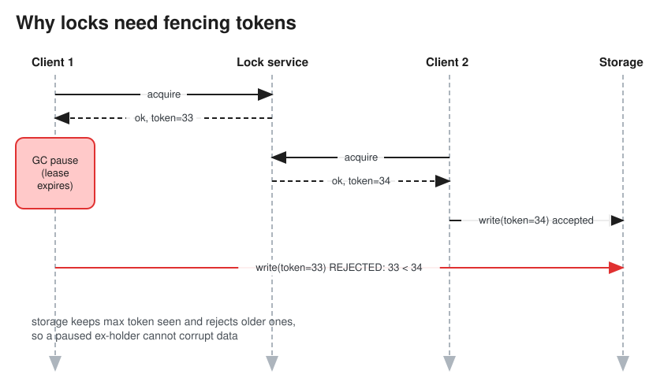

# Distributed Locking

> **TL;DR** — A distributed lock gives one process exclusive access to a resource across machines. Every
> lock needs a **TTL/lease** (so a crashed holder doesn't block forever), and since a holder can pause (GC,
> network) past its lease, **correctness requires fencing tokens** checked by the resource itself. Use
> **Redis `SET NX PX`** when the lock is only an *efficiency* optimization (avoid duplicate work). Use
> **etcd/ZooKeeper (consensus)** plus fencing when it protects *correctness*. Often a conditional write in the
> database is better than any lock.

## Why it's hard

1. Client 1 acquires the lock (lease 10 s), then hits a 15 s GC pause.
2. The lease expires; Client 2 acquires the lock and writes.
3. Client 1 wakes up, still believing it holds the lock, and writes, corrupting data.

**Fencing token** fix: each acquisition returns a monotonically increasing number (33, then 34). The storage
service remembers the highest token it has seen and **rejects writes with a lower token**, so Client 1's write
with 33 fails after Client 2 wrote with 34.

## Implementations
| Approach | How | Safety | Notes |
|---|---|---|---|
| **DB row lock / conditional write** | `SELECT ... FOR UPDATE`, or `UPDATE jobs SET owner=? WHERE id=? AND owner IS NULL` | Strong (DB transactions) | Simplest when the resource lives in the same DB |
| **Redis single instance** | `SET lock:res <uuid> NX PX 30000`; release with a Lua script that checks the uuid before `DEL` | Not safe on failover (async replication can lose the lock) | Fine for efficiency locks (dedupe cron jobs, cache stampede) |
| **Redlock** | Acquire on a majority of N independent Redis masters within the validity time | Debated: relies on bounded clock drift and pauses; no fencing token | Kleppmann vs antirez debate (see refs) |
| **ZooKeeper** | Ephemeral sequential znode; lowest sequence holds the lock; others watch their predecessor | Strong (consensus); sequence or zxid = fencing token | Session expiry releases the lock |
| **etcd** | Lease + `txn` compare-create on a key; `concurrency.Mutex` | Strong (Raft); key revision = fencing token | Used heavily in Kubernetes |
| **DynamoDB lock client / Chubby** | Conditional put with a lease + heartbeat | Strong | Chubby is Google's lock service (paper) |

## Design checklist
* **Lease TTL plus renewal** (heartbeat) while working; stop working if renewal fails.
* **Unique owner ID** (UUID) so only the owner can release; releases must be atomic (Lua script or
  compare-and-delete).
* **Fencing tokens** for correctness-critical resources.
* Reentrancy, fairness (FIFO queue of waiters), and timeouts on acquire.
* Avoid locks if you can: use **idempotency**, **optimistic concurrency** (version columns), **single-writer
  partitioning** (route all writes for key K to one consumer through a Kafka partition), or unique constraints.

## Common use cases
* Only one instance of a cron job or scheduler runs at a time (leader election is a long-lived lock).
* Seat or inventory hold during checkout (often better as a DB conditional update with an expiry column).
* Cache stampede protection: one request recomputes the expired key while others wait or serve stale data.
* Exclusive ownership of a shard or partition by a worker.

## Interview follow-ups
* *"Is Redis good enough for locking?"* For efficiency (a duplicate is merely wasteful), yes. For correctness
  (a duplicate corrupts data or double-charges), use a consensus-backed lock **and** fencing, or a DB-level
  conditional write.
* *"How do you design a distributed lock service?"* A Raft group storing locks with leases, client sessions
  kept alive by heartbeats, a fencing token per grant (the log index), watches for waiters, and a client
  library handling renewal.

# References
* https://martin.kleppmann.com/2016/02/08/how-to-do-distributed-locking.html
* http://antirez.com/news/101
* https://redis.io/docs/latest/develop/use/patterns/distributed-locks/
* [The Chubby lock service for loosely-coupled distributed systems](https://static.googleusercontent.com/media/research.google.com/en//archive/chubby-osdi06.pdf)
* https://zookeeper.apache.org/doc/current/recipes.html#sc_recipes_Locks
