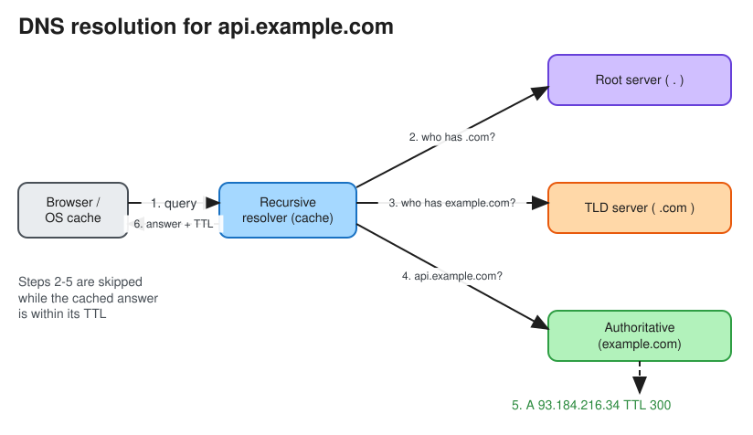

# Domain Name System (DNS)

> **TL;DR** — DNS is the internet's distributed, hierarchical, heavily cached phone book: it maps names
> (`api.example.com`) to records (IPs, aliases, mail servers). A **recursive resolver** walks
> **root → TLD → authoritative** servers and caches each answer for its **TTL**. In system design, DNS is
> also a traffic-steering tool (geo/latency routing, weighted failover), but caching makes changes slow to
> propagate.

## How a lookup works

1. Browser cache, then OS cache (`/etc/hosts`, stub resolver).
2. The **recursive resolver** (ISP, 8.8.8.8, 1.1.1.1) checks its cache. On a miss:
3. It asks a **root server** (13 logical roots, anycast to hundreds of sites): "who handles `.com`?"
4. It asks the **TLD server** (`.com`): "who is authoritative for `example.com`?"
5. It asks the **authoritative server** (e.g. Route 53): "what is `api.example.com`?" and gets the record plus a
   TTL.
6. The resolver caches the answer and returns it; later lookups skip steps 3–5 until the TTL expires.

* **Recursive query**: client → resolver ("give me the final answer").
* **Iterative query**: resolver → root/TLD/authoritative ("tell me who to ask next").
* Transport: UDP port 53 (falls back to TCP for large responses and zone transfers). Privacy: DoH
  (DNS over HTTPS) and DoT (DNS over TLS).

## Record types
| Record | Purpose | Example |
|---|---|---|
| **A** / **AAAA** | Name → IPv4 / IPv6 | `api.example.com → 93.184.216.34` |
| **CNAME** | Alias to another name (not allowed at the zone apex) | `www → example.cdn.net` |
| **ALIAS / ANAME** | Provider-specific apex alias | `example.com → lb-123.elb.amazonaws.com` |
| **MX** | Mail servers with priority | `10 mail.example.com` |
| **NS** | Delegates a zone to name servers | `example.com NS ns1.provider.net` |
| **TXT** | Arbitrary text: SPF, DKIM, domain verification | `v=spf1 include:_spf.google.com` |
| **SRV** | Service host + port (used for service discovery) | `_sip._tcp 10 60 5060 sip.example.com` |
| **SOA** | Zone metadata (serial, refresh, negative-cache TTL) | |
| **PTR** | Reverse DNS: IP → name | `34.216.184.93.in-addr.arpa` |
| **CAA** | Which CAs may issue certificates | |

## Zones and caching
* A **zone** is an administratively delegated part of the namespace (e.g. `example.com`, with `eu.example.com`
  delegated separately).
* **TTL trade-off**: a long TTL means fewer queries and faster lookups, but slow failover. A short TTL (30–60 s)
  means faster changes but more resolver load. Some resolvers and clients (JVM, older browsers) ignore TTLs, so
  plan for stragglers.
* **Negative caching**: NXDOMAIN answers are cached too (SOA minimum TTL).
* Before a migration, lower the TTL well in advance, then make the change, then raise it again.

## DNS as a load balancing and routing layer
* **Round-robin**: multiple A records; no health awareness, and client caching skews the distribution.
* **Weighted**: send 10% to the canary.
* **Latency-based / geo-DNS**: answer with the closest region (Route 53, NS1, Cloudflare).
* **Failover**: health-checked primary/secondary records.
* **Anycast**: the same IP announced from many locations, and BGP routes to the nearest one. Used by root
  servers, CDNs and public resolvers. It is a network-layer technique, not DNS itself, but often paired with it.
* Limits: coarse (it maps the resolver's location, not the user's; EDNS Client Subnet helps), slow to react
  (TTL caching), and has no view of server load. That's why DNS usually picks a *region* and an
  [L4/L7 load balancer](load_balancing.md) picks the *server*.

## Reliability and security
* DNS is a classic **hidden SPOF** (the 2016 Dyn DDoS outage). Use two DNS providers or a provider with anycast
  and a high SLA.
* **DNS spoofing / cache poisoning**: mitigated by **DNSSEC** (signed records) and source-port randomization.
* **Dangling CNAME** to a deprovisioned cloud resource enables subdomain takeover; audit your records.

## Interview follow-ups
* *"Users still hit the old IP after failover."* TTL caching, clients that ignore TTLs, or long-lived
  connections. Mitigate with a low TTL, an anycast VIP in front, and connection draining.
* *"How does a CDN use DNS?"* Your `www` CNAMEs to the CDN hostname; the CDN's authoritative DNS (or anycast)
  returns the nearest edge PoP. See [CDN](cdn.md).

# References
* https://github.com/karanpratapsingh/system-design/blob/main/README.md#domain-name-system-dns
* https://blog.bytebytego.com/p/a-crash-course-in-dns-domain-name
* https://www.cloudflare.com/learning/dns/what-is-dns/
* https://howdns.works/
