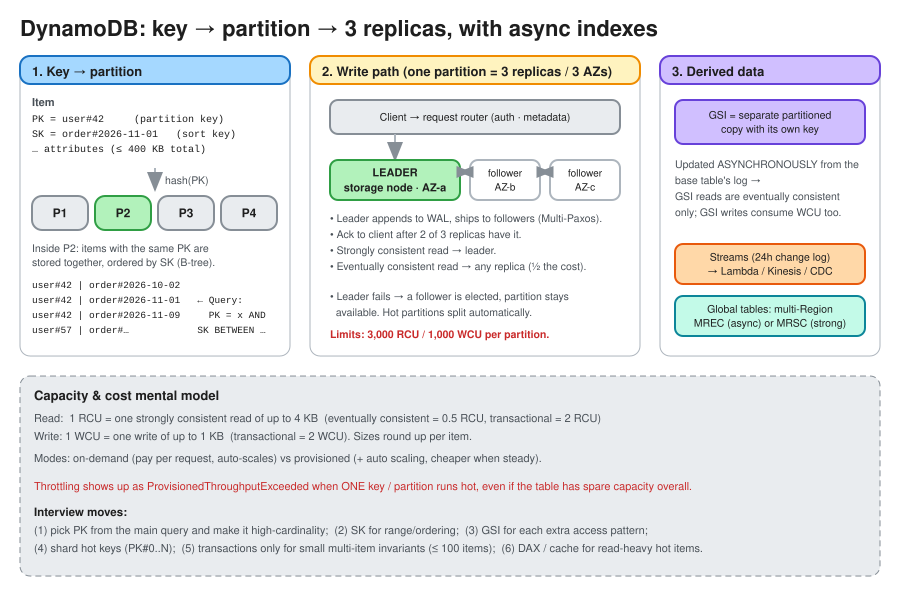
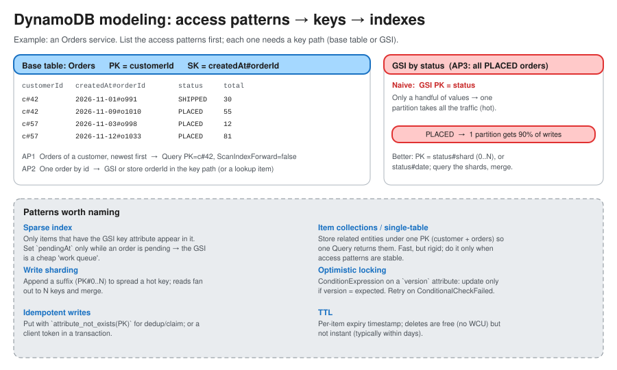

# DynamoDB

> **TL;DR** — DynamoDB is AWS's fully managed, **partitioned key-value / wide-item store** with single-digit-ms
> latency at practically any scale. Items are located by **hash(partition key)**; a **sort key** orders items inside a
> partition; every partition is a **3-replica Multi-Paxos group across 3 AZs**. You get on-demand scaling,
> conditional writes, **ACID transactions (≤ 100 items)**, async **GSIs**, Streams, TTL and **global tables**
> (eventual *or*, since 2025, strongly consistent across Regions). The price is rigid, **query-first modeling**: no
> joins, no ad-hoc queries, hot-partition limits and AWS lock-in. Pick it when access patterns are known and
> high availability + predictable latency matter more than query flexibility.
> See [SQL vs NoSQL](database_sql_vs_nosql.md) and [Types of Databases](database_types.md) for where it sits.

## Data model
* **Table → items → attributes.** Items are like rows but schemaless, except for the key attributes. Max item size is
  **400 KB** (all attributes + names). Types: scalars, sets, lists, maps (nested documents).
* **Primary key** is either a **partition key (PK)** alone, or **PK + sort key (SK)**.
  * `GetItem` / `PutItem` need the full primary key.
  * `Query` needs the PK (equality) and optionally an SK condition (`=`, `<`, `BETWEEN`, `begins_with`).
  * The set of items sharing one PK is an **item collection**, stored together and ordered by SK.
* Choose a **high-cardinality PK** that matches your main query and spreads traffic. Prefer unique, roughly
  time-sortable ids (UUIDv7, ULID, Snowflake) for SK or IDs rather than raw timestamps alone. See
  [Unique ID Generator](../problems/unique_id_generator.md).

## How it works inside
* **Request routers** authenticate, apply admission control/throttling, look up the partition map in a metadata
  service and forward to the right **storage node**.
* **Partitions**: the key space is hash-partitioned. A partition is split automatically when it grows too large
  (on the order of 10 GB) or gets too much throughput. Each partition is served by **three replicas in three AZs**
  (not configurable); one is the **leader** (elected via Multi-Paxos). Writes go to the leader's write-ahead log,
  are replicated, and acknowledged once a **majority (2 of 3)** has them. Storage per replica is a B-tree plus the log.
* **Per-partition ceilings**: about **3,000 RCU and 1,000 WCU** (roughly 12 MB/s read, 1 MB/s write). A table
  with spare capacity can still throttle if one key is hot ("hot partition"). *Adaptive capacity* and splitting
  soften, but do not remove, this.
* **Derived data** (GSIs, Streams, global-table replication) is fed asynchronously by **log propagators** that
  read the partition's replicated log.

Why this design matters in an interview: it is [consistent hashing / hash partitioning](data_partitioning.md) +
[leader-based replication](data_replication.md) + [consensus per partition](consensus.md), with the metadata and
admission control done for you.

## Reads, writes and consistency
| | Behavior | Cost |
|---|---|---|
| Eventually consistent read (default) | Any replica; may be stale by a few ms | 0.5 RCU per 4 KB |
| Strongly consistent read | Leader; reflects all acknowledged writes | 1 RCU per 4 KB |
| Transactional read/write | Serializable ACID across up to **100 items** (≤ 4 MB), cross-table, same Region | 2× |
| GSI read | **Eventually consistent only** | separate index throughput |

* **Conditional writes** (`ConditionExpression`): the building block for optimistic locking
  (`version = :expected`), dedup/claims (`attribute_not_exists(PK)`), counters with bounds, and "claim this seat only
  if it's `AVAILABLE`". Failure returns `ConditionalCheckFailed`; retry or surface it.
* **Atomic counters** via `ADD`/`SET x = x + :n`: cheap but not idempotent on retry; use a client token or a
  conditional write if exactly-once matters. Hot counters need sharding (`counter#0..N`).
* **Transactions** (`TransactWriteItems` with an optional client request token for idempotency) give you
  all-or-nothing updates, for example moving money between two accounts or creating an order + decrementing inventory. Keep them
  small and on contended items only; they cost double and don't span Regions (except in MRSC global tables).
* **Batch** operations (`BatchGetItem`, `BatchWriteItem`) are *not* transactional; handle unprocessed items and retry.
* **Pagination**: a `Query`/`Scan` returns up to **1 MB** per page plus a `LastEvaluatedKey`. A
  `FilterExpression` is applied *after* reading, so you pay RCU for filtered-out data.

## Secondary indexes
| | GSI (global) | LSI (local) |
|---|---|---|
| Key | Any PK/SK (can differ from the table) | Same PK, different SK |
| Created | Anytime | **Only at table creation** |
| Consistency | Eventually consistent only | Strong or eventual |
| Throughput | Own provisioned/on-demand capacity | Shares the table's |
| Size limit | None | **10 GB per PK value** (item collection) |
| Max per table | 20 (default quota) | 5 |

* GSI updates are **asynchronous**; if the GSI is under-provisioned, **back-pressure throttles base-table writes**.
* **Sparse index**: items lacking the index key are omitted. Great for "pending work" queues or rare flags.
* **Projection** (`KEYS_ONLY`, `INCLUDE`, `ALL`) controls what is copied; big projections cost write throughput and storage.
* Don't give a GSI a low-cardinality PK (e.g. `status`): you've built a hot partition. Use `status#shard` or `status#date`.

## Data modeling playbook
1. **List access patterns** (queries, writes, consistency, volume). Each must map to a `GetItem`/`Query` on the base
   table or a GSI.
2. Choose PK/SK so the hottest pattern is a single-partition `Query`. Encode types in keys
   (`PK = USER#42`, `SK = ORDER#2026-11-01#o991`) to colocate related entities (**single-table design**).
3. Add **GSIs** for the remaining patterns; use **GSI overloading** (generic `GSI1PK/GSI1SK`) when several entity
   types share one table. Use **adjacency lists** for many-to-many relationships.
4. **Denormalize** deliberately and keep copies in sync (transactions, Streams → Lambda).
5. **Large values**: store blobs in S3 and keep the key in DynamoDB (400 KB item cap). See [Blob Storage](blob_storage.md).
6. **Time-series**: bucket the PK by time (`device#7#2026-11-15`) so partitions stay bounded; use TTL for retention.
7. **Hot keys**: write-shard (`PK#0..N`), cache (DAX/Redis), or batch increments before writing.

Single-table design trade-off: fewer round trips and cheaper, but harder to read, evolve and analyze; it
suits stable, well-known access patterns. Multiple tables are fine when patterns are few or change often.

## Capacity, cost and scaling
* **Capacity modes**: *on-demand* (pay per request, scales automatically, great for spiky or unknown traffic) vs
  *provisioned* (+ auto scaling, cheaper at steady high load). Reserved capacity discounts exist.
* **Units**: 1 RCU = one strongly consistent 4 KB read per second (half for eventual, double for transactional);
  1 WCU = one 1 KB write per second. Sizes round **up per item**: a 5 KB strongly consistent read costs 2 RCU and a
  1.1 KB write costs 2 WCU, so keep hot items just under the unit boundary.
* **Back-of-envelope**: peak write QPS × ceil(item KB) = WCU needed; WCU ÷ 1,000 ≈ minimum partitions. A service
  doing 50k writes/s of 1 KB items needs ≥ ~50 well-spread partitions' worth of WCU, so key distribution
  matters more than the table total. High-volume writes are DynamoDB's main cost driver.
* **Cost levers**: smaller items (short attribute names, compressed blobs), eventual reads, avoiding scans and
  GSIs you don't need, TTL deletes (free), Standard-IA table class for cold data, on-demand vs provisioned choice.

## Global tables, durability and add-ons
* **Global tables** replicate a table across Regions (multi-active: write in any Region).
  * **MREC** (default): asynchronous, typically ~1 s, **last-writer-wins** conflict resolution; RPO > 0 on a Regional failure.
  * **MRSC** (GA **June 2025**): strongly consistent across Regions with **zero RPO**, using a **witness** Region (or a
    third replica Region); chosen at creation and cannot be changed later; restricted to certain Region sets.
* **Backups / PITR**: continuous backups with point-in-time restore for 35 days; export to S3.
* **Streams**: ordered per-item change log for 24 hours → Lambda / Kinesis. Powers CDC, search-index updates, the
  [outbox pattern](idempotency.md) and cache invalidation.
* **TTL**: per-item expiry timestamp; deletion is free but not instant (can lag by hours or days), so filter expired items on read if it matters.
* **DAX**: managed write-through in-memory cache (microsecond reads) for eventually consistent reads. It does not help strongly
  consistent reads, and direct writes to the table bypass it (stale entries until TTL). See [Caching](caching.md).
* **Security**: IAM (fine-grained, down to item/attribute via condition keys), KMS encryption at rest, VPC endpoints.

## When to use it in an interview
**Good fit**: shopping carts, sessions, user/profile lookup, URL shortener mappings, leaderboards (with care), IoT
and event ingestion, rate-limit counters, idempotency-key tables, order/state-machine records
(conditional updates), feature flags, anything needing *very* high availability and elastic scale with simple access.

**Poor fit**: ad-hoc/relational queries, joins and reporting, heavy secondary-index querying (use [Elasticsearch](database_types.md)
or SQL), OLAP, items > 400 KB, very hot single keys without sharding, unbounded transaction needs, or teams that can't
accept AWS lock-in. Ask whether a managed AWS service is acceptable; if not, [Cassandra](cassandra.md) or
[MongoDB](mongodb.md) are the portable alternatives.

| Pick … | When |
|---|---|
| **DynamoDB** | AWS shop, known access patterns, minimal ops, spiky traffic, transactions on small item sets |
| **Cassandra** | Portable/multi-cloud, very high write volume, you accept running it, tunable consistency |
| **Postgres** | Relational needs, flexible queries, scale fits one primary + replicas |
| **Aurora DSQL** | Need SQL + multi-region strong consistency ([deep dive](aurora_dsql.md)) |

## Pitfalls checklist
* `Scan` in a request path; filter expressions treated as free; unbounded `Query` loops.
* Low-cardinality or monotonic keys → hot partition and throttling despite spare table capacity.
* GSI as strongly consistent (it isn't); GSI back-pressure surprising you; a GSI with a hot key.
* Forgetting the 1 MB page limit, the 400 KB item limit, or transaction limits (100 items / 4 MB, same Region).
* Treating atomic counters as idempotent under retries; ignoring `ConditionalCheckFailed` as an error instead of a signal.
* Using TTL for correctness-critical expiry; assuming Streams retain data beyond 24 hours.
* Underestimating cost of high write volume, large items and GSIs (each GSI write is another write).
* Model changes after launch: a new access pattern may require a new GSI plus a backfill, or a table redesign.

## Interview follow-ups
* *"How does DynamoDB scale writes?"* Hash-partitioned by PK, partitions split automatically; each partition is
  capped (~1,000 WCU), so scale comes from many well-distributed keys.
* *"What happens when a partition leader dies?"* The remaining replicas elect a new leader (Multi-Paxos), no data
  loss for acknowledged writes (2-of-3 quorum), typically seconds of disruption for that partition.
* *"Strong vs eventual reads?"* Strong goes to the leader (2× cost, not available on GSIs, higher latency/less
  available in a partition); eventual can go to any replica.
* *"Implement a seat-hold with DynamoDB."* Item `EVENT#e1 / SEAT#A12` with `status`, `holdUntil`;
  `UpdateItem` with `ConditionExpression: status = AVAILABLE OR holdUntil < :now`. See [Ticketmaster](../problems/ticketmaster.md).
* *"How would you build a leaderboard / top-K?"* Score items per user + a GSI keyed by a leaderboard bucket (sorted by score),
  or keep the ranking in Redis sorted sets and DynamoDB as the source of truth.
* *"Multi-Region?"* MREC for low-latency local writes where LWW is acceptable; MRSC where you need zero RPO and
  strongly consistent reads, at higher write latency. See [Consistency](consistency.md).
* *"DynamoDB vs Cassandra?"* Same Dynamo lineage; DynamoDB is managed with transactions, on-demand scaling and IAM
  integration; Cassandra gives you tunable quorum, portability and no per-request pricing, but you operate it.

# References
* [Amazon DynamoDB: A Scalable, Predictably Performant, and Fully Managed NoSQL Database Service (USENIX ATC '22)](https://www.usenix.org/conference/atc22/presentation/elhemali)
* [Dynamo: Amazon's Highly Available Key-value Store](https://www.allthingsdistributed.com/files/amazon-dynamo-sosp2007.pdf) (the *ancestor*, which is a different system)
* [How DynamoDB global tables work (AWS docs)](https://docs.aws.amazon.com/amazondynamodb/latest/developerguide/V2globaltables_HowItWorks.html)
* [Global tables with multi-Region strong consistency are GA (AWS, Jun 2025)](https://aws.amazon.com/about-aws/whats-new/2025/06/amazon-dynamo-db-global-tables-multi-region-strong-consistency-generally-available)
* [Hello Interview: DynamoDB deep dive](https://www.hellointerview.com/learn/system-design/deep-dives/dynamodb)
* The DynamoDB Book (Alex DeBrie) for single-table patterns
