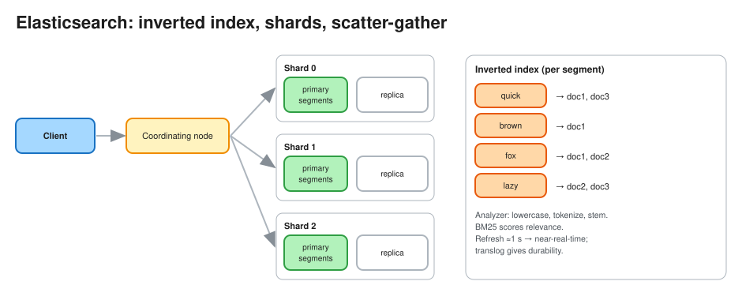

# Elasticsearch (Search Engines)

> **TL;DR** — Elasticsearch (and OpenSearch/Solr) is a distributed **search engine** built on Apache Lucene: documents are tokenized into an **inverted index**, split across **shards**
> (with replicas), and queried by **scatter-gather** with relevance scoring (BM25). It's near-real-time (about 1 s refresh), great at full-text, filters, aggregations and faceting,
> and increasingly vector (kNN) search. It is **not a system of record**: keep the source of truth in a database and feed Elasticsearch via **CDC/queue**.
> Reach for it when SQL `LIKE '%x%'` won't do. Related: [Database indexes](database_indexing.md), [Sharding](data_partitioning.md), [Distributed Search](../problems/distributed_search.md), [Typeahead](../problems/typehead_suggestion.md).



## Core ideas
- **Inverted index**: map each *term* → list of documents (postings) containing it, plus positions/frequencies. Query terms look up postings and intersect/union them. Contrast with a B-tree, which finds rows by key, not by words inside text ([Indexes](database_indexing.md)).
- **Analysis**: text → tokens via an **analyzer** (character filters → tokenizer → token filters: lowercase, stop words, stemming, synonyms, n-grams). The same analyzer should be used at index and query time.
- **Relevance**: **BM25** (TF-IDF family) ranks by term frequency, rarity and field length; boost fields, use function scores or learning-to-rank.
- **Segments**: Lucene writes immutable segments; a **refresh** (default ~1 s) makes new docs searchable; background **merges** combine segments (LSM-like, see [WAL & LSM](wal_lsm.md)). A **translog** provides durability between flushes.
- **Mappings**: field types (`text` analyzed vs `keyword` exact, numbers, dates, geo, `dense_vector`). Dynamic mapping is convenient but risky (mapping explosion).
- **Doc values** (columnar) power sorting and aggregations; `_source` stores the original JSON.

## Cluster architecture
- An **index** is split into **primary shards** (fixed at creation) each with **replicas** for HA and read throughput. Documents route to a shard by `hash(_id or routing key) % num_primary_shards`, which is why primary-shard count can't simply change ([Consistent hashing](consistent_hashing.md) vs fixed shards).
- **Search**: the coordinating node broadcasts to one copy of every shard (**scatter**), each returns top-k, then it merges (**gather**) and fetches documents. Latency = slowest shard; more shards ≠ always faster.
- **Roles**: master-eligible nodes (cluster state, elections via a Raft-like quorum), data nodes (hot/warm/cold tiers), ingest, coordinating.
- **Writes**: route to the primary, replicate to replicas, ack; a write is searchable only after the next refresh.
- **Lifecycle**: time-based indices (`logs-2026.11.15`) with ILM (rollover, shrink, delete) for logs/metrics.

## Typical architecture
```
App → Postgres/DynamoDB (source of truth)
          └─ CDC / outbox → Kafka → indexer → Elasticsearch ← search API
```
- Async indexing gives **eventual consistency** between DB and search; design the UI for it (read-your-write via DB, or short delay).
- Always keep a **reindex path** (replay from the DB/log) for mapping changes and disasters. Use index aliases for zero-downtime reindexing.

## When to use / not use
| Use | Don't use |
|---|---|
| Full-text search, autocomplete, fuzzy/typo tolerance, facets and filters, log/observability analytics, geo + text, hybrid keyword+vector search | Primary storage, strong consistency, multi-document transactions, heavy joins, frequent in-place updates of large documents, tiny datasets (Postgres full-text may suffice) |

Postgres `tsvector` + GIN is a good first step; move to Elasticsearch when relevance tuning, scale, facets or multilingual analyzers outgrow it.

## Scaling and performance
- Shard size roughly 10-50 GB; avoid oversharding (each shard has overhead) and hot shards (routing by tenant can skew).
- **Deep pagination** (`from + size` large) is expensive: use `search_after` or point-in-time + cursor; avoid >10k offsets.
- Denormalize (no joins; nested/parent-child are costly). Filters (cached bitsets) are cheaper than scored queries; prefer `filter` context.
- Bulk-index in batches; raise `refresh_interval` during large loads; mind heap size (~half of RAM, ≤ ~30 GB) and the OS page cache.
- Typeahead: edge n-grams or completion suggester; cache hot prefixes ([Caching](caching.md)).

## Pitfalls
- Using it as the primary store or assuming read-after-write; split-brain risk with too few master-eligible nodes (use 3).
- Unbounded fields/mappings, wildcard/regex queries on large text, huge aggregations on high-cardinality fields, giant result windows.
- Wrong analyzer at query vs index time (no results); changing a mapping requires reindex.
- Unbalanced shards, no replicas, no snapshot/restore plan.

## Interview follow-ups
- *"How does search stay in sync with the DB?"* CDC/outbox → queue → idempotent indexer; periodic reconciliation; reindex job.
- *"Why is Elasticsearch fast at text search?"* Inverted index + immutable segments + filter caches + parallel shard execution.
- *"How do you handle a hot tenant?"* Custom routing / dedicated index; shard sizing; rate limits.
- *"Autocomplete at scale?"* Prefix/edge n-gram index, popularity-weighted, cache, debounce on client ([Typeahead](../problems/typehead_suggestion.md)).
- *"Relevance vs recency?"* Function-score with decay; combine BM25 with signals; learning-to-rank for mature systems.

# References
* [Elasticsearch: The Definitive Guide / reference docs](https://www.elastic.co/guide/en/elasticsearch/reference/current/index.html)
* [Lucene internals overview](https://lucene.apache.org/core/documentation.html)
* [Hello Interview: Elasticsearch deep dive](https://www.hellointerview.com/learn/system-design/deep-dives/elasticsearch)
