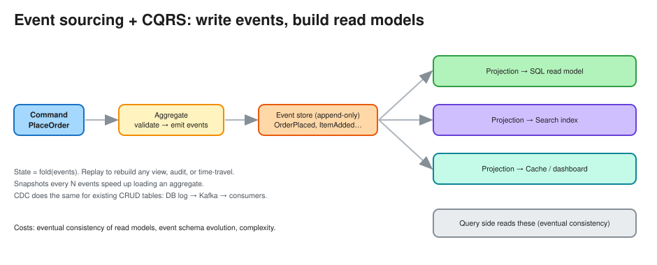

# Event Sourcing, CQRS & Change Data Capture

> **TL;DR** — Three related ideas about treating **change as data**. **Event sourcing**: store an append-only sequence of immutable **events** as the source of truth; current state = fold(events), with
> snapshots for speed. **CQRS**: separate the **write model** (commands, validates invariants) from one or more **read models** (denormalized views built from events) so each scales and is shaped independently.
> **CDC**: stream committed DB changes (from the WAL/binlog) to other systems without dual writes. Combined: commands → event log → projections (search, cache, analytics, feeds). Costs: eventual consistency,
> schema evolution, operational complexity. Use selectively. See [WAL](wal_lsm.md), [Reliable messaging](reliable_messaging.md), [Kafka](kafka.md), [Data modeling](data_modeling.md).



## Event sourcing
- **Events** are facts in past tense (`OrderPlaced`, `ItemAdded`, `PaymentCaptured`), immutable, ordered per aggregate (stream), with `aggregate_id`, `seq`, `timestamp`, payload, metadata.
- **Append with optimistic concurrency**: `expected_version` check prevents conflicting writers ([Contention](contention.md)).
- **Rebuild state** by replaying; **snapshots** every N events cap replay cost.
- **Benefits**: full audit trail, time travel/debugging, derive new views later by replaying history, natural integration events, ledgers ([Digital wallet](../problems/digital_wallet.md), [Distributed ledger](../problems/distributed_ledger.md)).
- **Costs**: querying current state needs projections; **event schema evolution** (upcasting, versioning); GDPR deletion (crypto-shredding, tombstones); eventual consistency for reads; learning curve.
- **Not required for** most CRUD apps; an audit table or CDC often suffices.

## CQRS
- **Command side**: validates against the write model/aggregate; emits events or writes normalized state.
- **Query side**: denormalized read models (Elasticsearch, Redis, wide-column, materialized views) optimized for specific queries; updated asynchronously by consumers ([Scaling reads](scaling_reads.md), [Elasticsearch](elasticsearch.md)).
- **Benefits**: independent scaling and storage choice; fast reads; clear responsibilities.
- **Consistency**: read model lags writes → **read-your-writes** tricks (return the new state from the command, version tokens, read from write store for the author, UI optimistic update) ([Consistency](consistency.md)).
- **CQRS ≠ event sourcing**: you can do CQRS with a normal DB + CDC, or event sourcing without separate read stores.

## Change Data Capture (CDC)
- **Log-based CDC** (Debezium on Postgres WAL / MySQL binlog / Mongo oplog; DynamoDB Streams; Spanner change streams): low latency, preserves commit order, no app changes, captures deletes.
- **Alternatives**: trigger-based (overhead), timestamp polling (misses deletes, ordering issues), dual writes (unsafe: [Reliable messaging](reliable_messaging.md)).
- **Uses**: cache invalidation/refresh, search index sync, data warehouse/lake ingestion, replicating to other services, outbox relay, audit, **strangler-fig migrations**.
- **Operational concerns**: initial **snapshot + streaming** handoff, schema changes, replication slot retention (WAL growth), ordering within a key, at-least-once → idempotent sinks, backfills, PII in streams.

## Putting it together
```
Client ─command─▶ Write service ─(tx)─▶ DB / event store ─CDC/outbox─▶ Kafka topic(s)
                                                              ├─▶ Projection → Elasticsearch (search)
                                                              ├─▶ Projection → Redis (hot reads)
                                                              ├─▶ Stream job → OLAP (analytics)
                                                              └─▶ Other services (integration events)
Client ─query─▶ Read service ─▶ read model
```

## Projections (read-model builders)
- Idempotent consumers keyed by `(aggregate_id, seq)`; track the last applied offset; **rebuildable** by replaying from the start (new schema = new projection) ([Delivery semantics](delivery_semantics.md)).
- Handle **out-of-order/duplicate** events via sequence checks; **poison events** go to DLQ.
- **Lag monitoring** is the SLO for read freshness.

## When to use
| Situation | Choice |
|---|---|
| Plain CRUD, one DB | Neither; keep it simple |
| Need audit/history or temporal queries | Event sourcing (or audit log + CDC) |
| Read and write shapes differ wildly / need search + cache | CQRS via CDC |
| Sync DB → search/warehouse/cache | CDC |
| Financial ledger / complex domain invariants with history | Event sourcing |
| Multi-service integration | Outbox/CDC + events ([Sagas](multi_step_processes.md)) |

## Pitfalls
- Event sourcing everywhere (complexity tax); events that are CRUD diffs rather than domain facts; changing past events (never; add compensating events); unversioned schemas; huge aggregates with long streams and no snapshots; assuming read models are instantly consistent; CDC replication slot filling disks.

## Interview follow-ups
- *"How do you keep Elasticsearch in sync with Postgres?"* CDC (Debezium) → Kafka → idempotent indexer; accept lag; reindex by replay.
- *"How do you fix a bug in a projection?"* Fix code, rebuild from the event log.
- *"How does the user see their own write immediately?"* Return the result from the command, read-your-writes via version token or write-store read.
- *"Event sourcing downsides?"* Schema evolution, eventual consistency, query complexity, deletion/compliance.

# References
* [Martin Fowler: Event Sourcing](https://martinfowler.com/eaaDev/EventSourcing.html), [CQRS](https://martinfowler.com/bliki/CQRS.html), [Debezium docs](https://debezium.io/documentation/)
* [Microsoft: Event Sourcing pattern](https://learn.microsoft.com/azure/architecture/patterns/event-sourcing) · Designing Data-Intensive Applications, Chapter 11
