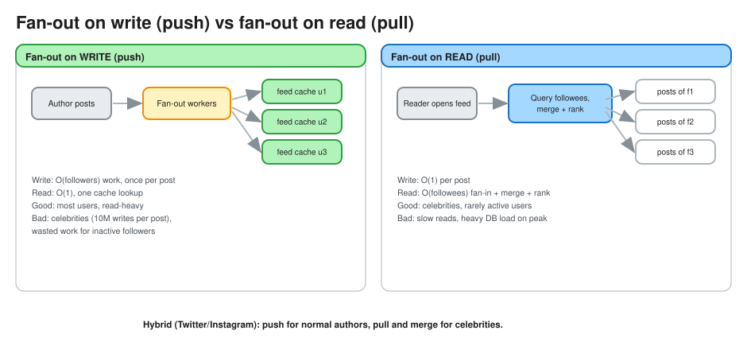

# Fan-out on Write vs Fan-out on Read

> **TL;DR** — When one event must reach many consumers (a post to followers' feeds, a message to a group), either **push at write time** (fan-out on write: precompute each follower's feed;
> reads are O(1), writes are O(followers)) or **pull at read time** (fan-out on read: store once, assemble on request; writes are O(1), reads are O(following)). Push wins for read-heavy, low-fan-out
> users; pull wins for celebrities and rarely-read data. Real systems use a **hybrid**: push for normal authors, pull-and-merge for celebrities. See [Newsfeed](../problems/newsfeed_system.md), [Hot keys](hot_keys.md), [Scaling reads](scaling_reads.md).

## Comparison
| | Fan-out on write (push) | Fan-out on read (pull) |
|---|---|---|
| Write cost | O(followers) writes per post | O(1) |
| Read cost | O(1): read your precomputed feed | O(following): query + merge N authors |
| Read latency | Very low | Higher, variable |
| Storage | High (copy of each item id per follower) | Low |
| Freshness | Near-real-time after fan-out completes | Always fresh |
| Wasted work | Fans out to inactive users | None |
| Celebrity (10M followers) | **Write storm**, delays, hot keys | Fine on write; read must merge |
| Best for | Read-heavy, typical users | Celebrities, low-read data |

## Hybrid (what Twitter/Instagram-like systems do)
1. On post, **push** to followers' feed caches unless the author is above a follower threshold (e.g. >100k-1M).
2. For celebrities, store the post once; at read time, **merge** the user's precomputed feed with recent posts from the celebrities they follow.
3. Fan out only to **active** users (recently seen); inactive users' feeds are rebuilt on demand.
4. Feed store: per-user list of **post ids** (Redis sorted set / Cassandra), capped (e.g. last 800); hydrate post bodies from a post cache/store.
5. Fan-out runs **asynchronously** via a queue/Kafka with partitioned workers ([Kafka](kafka.md), [Async](asynchronism.md)); idempotent writes (`ZADD` is idempotent for same member/score).

## Other fan-out uses
- **Chat groups**: push to online members' connections, store once, per-member inbox pointers ([Chat](../problems/chat_system.md)).
- **Notifications**: broadcast to topics via pub/sub; per-user delivery queues ([Notification system](../problems/notification_system.md)).
- **Timelines/inboxes (email)**: write-time delivery to each recipient mailbox.
- **Pub/Sub**: topic with many subscriptions (SNS→SQS fan-out) ([SQS](sqs.md)).

## Design details
- **Ordering and ranking**: store `(timestamp or score, post_id)`; ranking can happen at read time on top of candidate lists.
- **Deletes/edits**: with push, removing a post means touching all copies; store ids and check tombstones at hydrate time.
- **Follow/unfollow**: backfill recent posts into the follower's feed (push) or just change the query set (pull).
- **Backpressure**: fan-out queue depth and lag are key SLOs; prioritize active users ([Backpressure](backpressure_load_shedding.md)).
- **Failure**: retries must be idempotent; partial fan-out is OK (feeds are eventually complete) as long as reads can fall back to pull.

## Pitfalls
- Pushing to millions of followers synchronously; storing full post bodies in every feed; fan-out to dormant accounts; forgetting celebrity read amplification; no cap on feed length.

## Interview follow-ups
- *"How do you handle a user with 50M followers?"* Don't push; mark as celebrity; pull and merge at read time, cache celebrity timelines heavily.
- *"What if a user follows 1,000 celebrities?"* Limit merge set, cache merged results, use per-celebrity recent-post caches.
- *"How fresh must the feed be?"* Define a SLA (seconds); async fan-out lag is the budget.

# References
* [Hello Interview: Scaling reads / fan-out](https://www.hellointerview.com/learn/system-design/patterns/scaling-reads) · Alex Xu, System Design Interview Vol. 1: News Feed · [Newsfeed](../problems/newsfeed_system.md)
