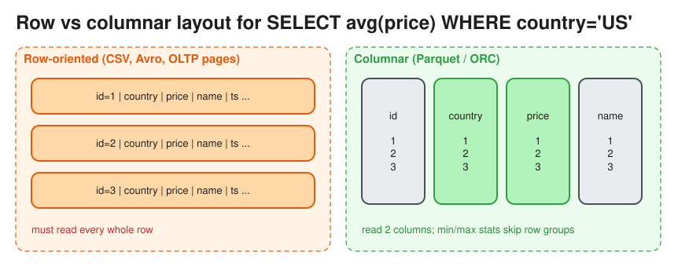

# Data File Formats: Row vs Columnar (Parquet, ORC, Avro)

> **TL;DR** — **Row formats** (CSV, JSON, Avro) store a record's fields together, which suits writing and
> reading whole records (OLTP, streaming, Kafka messages). **Columnar formats** (Parquet, ORC) store each
> column together, which suits analytics: read only the needed columns, compress very well, and skip data
> using min/max statistics. Rule of thumb: **Avro on the wire / in Kafka, Parquet in the data lake.**

## Comparison
| | CSV / JSON | Avro | Parquet | ORC |
|---|---|---|---|---|
| Layout | Row, text | Row, binary | **Columnar**, binary | **Columnar**, binary |
| Schema | None / implicit | Embedded (JSON schema), **schema evolution** | Embedded in footer | Embedded |
| Compression | Poor | Good | **Excellent** (dictionary, RLE, bit-packing + Snappy/ZSTD) | Excellent |
| Splittable for parallel reads | CSV yes, JSON lines yes | Yes | Yes (row groups) | Yes (stripes) |
| Best for | Interchange, debugging | Kafka messages, write-heavy pipelines, RPC | Analytics on Spark, Trino, Athena, BigQuery, Snowflake | Hive / Hadoop ecosystem |

## How Parquet is organised
* **File → row groups** (~128 MB) **→ column chunks → pages**, plus a **footer** with the schema and per-chunk
  statistics (min, max, null count).
* **Projection pushdown**: `SELECT price` reads only the `price` column chunks.
* **Predicate pushdown**: `WHERE date = '2026-11-01'` skips row groups whose min/max exclude the value (optional
  Bloom filters too).
* **Encoding**: dictionary encoding for low-cardinality strings, run-length encoding, delta encoding for sorted
  timestamps. Similar values stored next to each other compress 5–10x better than row formats.
* Nested data is supported (Dremel repetition and definition levels).

## Table formats on top of files (the "lakehouse")
Plain Parquet files on S3 lack transactions, updates and schema management. **Table formats** add a metadata
layer:
* **Apache Iceberg**, **Delta Lake**, **Apache Hudi**: ACID commits, time travel, schema evolution, hidden
  partitioning, upserts and deletes (merge-on-read or copy-on-write), compaction of small files.

## Practical guidance
* Partition by a low-cardinality, frequently filtered column (`dt=2026-11-07/`), not by `user_id`, which
  produces millions of tiny files.
* Avoid the **small files problem**: target 128 MB–1 GB files; compact them periodically.
* Sort within files by commonly filtered columns to make min/max skipping effective.
* Use a **schema registry** (Confluent) with Avro or Protobuf in Kafka for compatibility checks (backward,
  forward, full).

## Interview follow-ups
* *"Why are analytics queries on Parquet 10–100x faster than on CSV?"* They read fewer bytes (column
  projection), skip row groups (statistics), get better compression (less I/O), and run with vectorized
  execution.
* *"Store raw events from Kafka for later reprocessing?"* Land them as Avro or JSON for fidelity, then compact
  into partitioned Parquet (in an Iceberg table) for querying.

# References
* https://parquet.apache.org/docs/file-format/
* https://avro.apache.org/docs/
* https://iceberg.apache.org/docs/latest/
* Designing Data-Intensive Applications, Chapter 3: Column-Oriented Storage, and Chapter 4: Encoding
