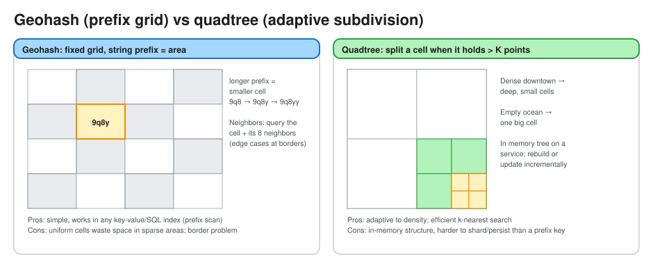

# Geospatial Indexing: Geohash & Quadtree

> **TL;DR** — To answer "what's near me?" you can't scan every row. **Geohash** encodes a lat/lng into a **base-32 string** where a **shared prefix means a shared area**, so a normal B-tree/prefix
> index finds nearby points; query the target cell **plus its 8 neighbors**. A **quadtree** recursively splits space into 4 quadrants when a cell holds too many points, adapting to density,
> and lives in memory. Both approximate 2-D proximity with 1-D structures. Production uses ([S2/H3](s2_h3.md), PostGIS, Elasticsearch geo) build on the same ideas. Used in
> [Proximity Service](../problems/proximity_service.md), [Nearby Friends](../problems/nearby_friends.md), [Uber](../problems/uber.md).

## The problem
`SELECT * FROM places WHERE lat BETWEEN … AND lng BETWEEN …` uses at most one B-tree range well; the other dimension is filtered afterwards, so it scans a lot. We need an index that **maps 2-D
neighborhoods to contiguous keys**.

## Geohash
- Interleave bits of longitude and latitude (repeatedly bisect the range) and encode every 5 bits as a base-32 character: e.g. `9q8yy` is a cell in San Francisco.
- **Longer prefix = smaller cell**. Approximate cell sizes: 4 chars ≈ 39 km × 20 km, 5 ≈ 4.9 × 4.9 km, 6 ≈ 1.2 km × 0.6 km, 7 ≈ 150 m × 150 m, 8 ≈ 38 m × 19 m.
- **Query**: choose precision by search radius → compute the user's cell → fetch that cell and its **8 neighbors** (prefix scan `LIKE '9q8y%'` in SQL, key range in KV stores, or a `geohash` column index) → compute exact distances and filter/sort.
- **Why neighbors**: points near a cell border can be in an adjacent cell that does **not** share a prefix (boundary problem). Cells near the Equator/Prime Meridian can have very different prefixes though adjacent.
- **Pros**: trivial to implement, works with any ordered index, easy to shard by prefix, great for caching by cell.
- **Cons**: fixed grid ignores density (downtown has millions, ocean none); cell distortion toward the poles; boundary handling; non-square cells.

## Quadtree
- Start with one node covering the world; when a node has **more than K points** (e.g. 100), split it into 4 children (NW, NE, SW, SE). Leaves hold points (or ids).
- **Insert/search** descend by quadrant; **range/kNN search**: visit the leaf containing the query and nearby nodes whose boxes intersect the radius.
- **Pros**: adapts to density (deep in cities, shallow in deserts); efficient nearest-neighbor; supports moving points with updates.
- **Cons**: typically an **in-memory** structure on a service, so you rebuild/replicate it; hard to shard cleanly; rebalancing on heavy updates; persistence needs a snapshot or a store.
- Variants: **R-tree** (bounding rectangles; PostGIS GiST, SQLite R*Tree), **k-d tree**, **geohash-trie hybrids**.

## Geohash vs quadtree
| | Geohash | Quadtree |
|---|---|---|
| Representation | String/number key on a fixed grid | Tree, adaptive cells |
| Storage | Any DB index (Redis, Cassandra, SQL, DynamoDB) | Memory (or serialized) |
| Density | Uniform | Adaptive |
| Update cost | Cheap (change a key) | Move between nodes, maybe split/merge |
| Sharding | Natural by prefix | Harder |
| Best for | Simple proximity at scale, caching, KV stores | Dense, skewed data, in-memory k-NN, game/map servers |

## Design guidance (Yelp / nearby friends / Uber)
1. **Static places (Yelp)**: precompute geohash (e.g. precision 5-7) per business, index it (Postgres B-tree, Elasticsearch, or a KV store), query cell + neighbors, then rank/filter by exact distance, category, rating. Reads ≫ writes → cache by `(geohash, filters)`.
2. **Moving entities (drivers, friends)**: high write rate; keep **latest location** in Redis (`GEOADD`/`GEOSEARCH` uses geohash in a sorted set) or an in-memory grid keyed by cell; publish updates to subscribers of cells ([Nearby Friends](../problems/nearby_friends.md)). Expire stale locations with TTL.
3. **Dense-area hotspots**: use finer precision where dense (multi-level), or a quadtree; shard by cell with replication of hot cells ([Hot keys](hot_keys.md)).
4. **Radius search**: pick precision ≥ radius, fetch 9 cells, then compute **haversine** distance and filter.

## Pitfalls
- Forgetting neighbors; mixing precision and radius; using Euclidean distance on degrees; not handling the antimeridian/poles.
- Hot cells (stadium, city center) overloading one shard; stale moving-object locations; writing every GPS ping to a durable DB (batch/downsample).

## Interview follow-ups
- *"Why not just index lat and lng separately?"* Two 1-D indexes can't express 2-D proximity efficiently; geohash/quadtree/R-tree/S2 collapse it into one index.
- *"How do you find the 10 nearest drivers?"* Expand cells outward ring by ring until ≥ 10 candidates, compute exact distances, take top 10.
- *"How do you handle a very dense city?"* Adaptive cells (quadtree/S2 levels) or higher precision with sharded hot cells.
- *"Geohash vs S2/H3?"* S2/H3 give more uniform cells and better neighbor math ([S2 & H3](s2_h3.md)).

# References
* [Geohash (Wikipedia)](https://en.wikipedia.org/wiki/Geohash), [Redis GEO commands](https://redis.io/docs/latest/commands/geosearch/)
* Alex Xu, System Design Interview Vol. 2: Proximity Service · [Proximity Service](../problems/proximity_service.md)
