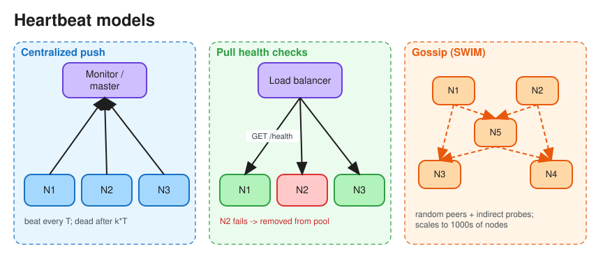

# Heartbeats & Failure Detection

> **TL;DR** — A heartbeat is a periodic "I'm alive" signal. If none arrives within a **timeout**, the node is
> *suspected* dead. In an asynchronous network you can't distinguish a dead node from a slow one, so every
> failure detector trades **detection speed** against **false positives**. Pair failure detection with
> **leases + fencing** so a node wrongly declared dead can't do damage.

## Push vs pull
| | Push (node → monitor) | Pull (monitor → node health check) |
|---|---|---|
| How | Each node sends a heartbeat every *T* | Monitor polls `/health` every *T* |
| Pros | Scales with the number of nodes; works behind NAT | Monitor controls the rate; tests the actual serving path |
| Cons | Monitor must track the last-seen time for all nodes | Monitor load grows with the fleet; monitor is a SPOF unless replicated |
| Examples | HDFS DataNode → NameNode, Kafka consumer → group coordinator, ZooKeeper sessions | Load balancer health checks, Kubernetes liveness/readiness probes |

## Topologies
* **Centralized**: all nodes report to a master (HDFS NameNode, Kafka controller). Simple, but the master is a
  bottleneck and a SPOF.
* **All-to-all**: O(n²) messages; only fine for small clusters.
* **Gossip-based**: each node heartbeats a few random peers and spreads membership state (SWIM protocol,
  Cassandra, Consul Serf). Scales to thousands of nodes. See [Gossip Protocol](gossip_protocol.md).

## Choosing timeouts
* Typical: heartbeat interval T, declare dead after `k × T` missed (e.g. T = 1–3 s, k = 3–5).
* **Too short**: GC pauses, network blips or CPU starvation cause false failovers, flapping, rebalancing storms,
  and split-brain risk.
* **Too long**: slow detection, longer outage, longer stale routing.
* **Phi accrual detector** (Cassandra, Akka): instead of a binary yes/no, compute a suspicion level φ from the
  observed distribution of heartbeat inter-arrival times, and act when φ crosses a threshold (e.g. 8). It adapts
  to network conditions automatically.
* **SWIM**: probe a random member; if there's no ack, ask k other members to probe it *indirectly* before
  suspecting. This lowers false positives caused by one bad link.

## Liveness vs readiness (Kubernetes)
* **Liveness probe**: "is the process stuck?" If it fails, the container is restarted. Keep it cheap and
  dependency-free.
* **Readiness probe**: "can it serve traffic now?" If it fails, the pod is removed from Service endpoints.
  It may check critical dependencies, but beware cascading removal when a shared dependency blips.
* **Startup probe**: gives slow-starting apps time before liveness checks begin.

## Making false positives safe
* **Leases**: a node holds a role (leader, lock owner) only while its lease is valid and stops acting when the
  lease expires, even if it is still running.
* **Fencing tokens**: a monotonically increasing number issued with each lease. Storage rejects writes carrying
  an older token. See [Distributed Locking](distributed_locking.md).
* **STONITH** ("shoot the other node in the head"): forcibly power off the old primary before promoting a new
  one.

## Interview follow-ups
* *"How does the chat service know a user went offline?"* The client heartbeats over its WebSocket every
  ~30 s; the presence service marks the user offline after ~2 missed beats (TTL key in Redis); presence changes
  fan out to friends in batches.
* *"How does the job scheduler detect a dead worker?"* Workers heartbeat while holding a job lease; when the
  lease expires the job is re-queued, and the job must be idempotent because the "dead" worker may finish too.

# References
* https://newsletter.ashishps.com/p/heartbeats-in-distributed-systems
* https://martinfowler.com/articles/patterns-of-distributed-systems/heartbeat.html
* https://www.cs.cornell.edu/projects/Quicksilver/public_pdfs/SWIM.pdf
* https://kubernetes.io/docs/concepts/configuration/liveness-readiness-startup-probes/
