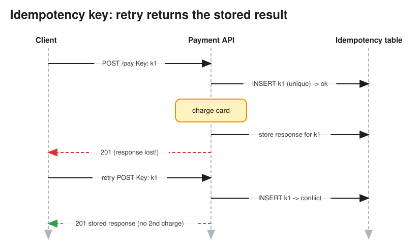

# Idempotency

> **TL;DR** — An operation is idempotent if doing it **once or N times has the same effect**. Networks force
> retries (timeouts are ambiguous: did the server process it or not?), and queues redeliver, so every
> side-effecting API and consumer must be safe to repeat. Standard technique: the client sends an
> **idempotency key**, and the server stores `key → result` atomically with the side effect, returning the
> saved result on repeats.

## Why it matters


* The client sends `POST /payments`, the server charges the card, and the response is lost. The client retries.
  Without idempotency, the customer is charged twice.
* At-least-once delivery (Kafka, SQS) means consumers *will* see duplicates.
* Exactly-once delivery across systems isn't achievable, but exactly-once **effect** is: at-least-once delivery
  plus idempotent processing.

## HTTP verbs
| Verb | Idempotent? | Note |
|---|---|---|
| GET, HEAD, OPTIONS | Yes (and safe: no side effects) | |
| PUT | Yes | Replaces the resource with the same state |
| DELETE | Yes | The second call may return 404, but the effect is the same |
| POST | **No** | Make it idempotent with an `Idempotency-Key` header |
| PATCH | Depends | `set status=shipped` is; `increment qty` is not |

## Implementing an idempotency key (server side)
```text
1. Client generates key = UUIDv4 per logical operation (reused on retries).
2. Server: INSERT INTO idempotency(key, user_id, request_hash, status='IN_PROGRESS')
           -- unique constraint on (user_id, key)
   - insert fails, row COMPLETED     -> return stored response
   - insert fails, row IN_PROGRESS   -> 409 / retry later (a concurrent duplicate is in flight)
   - request_hash differs            -> 422 (same key reused for a different payload)
3. Perform the side effect AND store the response in the SAME transaction
   (or make the downstream call idempotent with the same key, e.g. Stripe).
4. Expire keys after a window (24 h-7 days).
```

## Other idempotency techniques
* **Natural keys / unique constraints**: `UNIQUE(order_id)` on the payments table; insert-if-not-exists.
* **Conditional writes**: `UPDATE ... WHERE version = ?`, DynamoDB `ConditionExpression`, S3 `If-None-Match`.
* **Set state instead of applying deltas**: `status = 'PAID'` rather than `balance -= 10`. Where deltas are
  needed, record each delta with a unique transaction ID (ledger entries) and dedupe on it.
* **Consumer dedupe table**: store processed `message_id`s (with a TTL) in the same transaction as the business
  write.
* **Kafka idempotent producer** (`enable.idempotence=true`): the broker dedupes by producer ID + sequence
  number per partition.

## Pitfalls
* Generating the key on the *server* defeats the purpose; the client must keep the same key across retries.
* Checking the dedupe table and doing the work in two separate non-atomic steps leaves a race window.
* Side effects outside your DB (emails, third-party APIs) need their own idempotency (pass the key downstream)
  or an outbox.
* Retries need **exponential backoff with jitter**. See [Resilience Patterns](resilience_patterns.md).

## Interview follow-ups
* *"Payment service: how do you prevent double charges?"* Client idempotency key → idempotency table with a
  unique constraint → call the payment provider with the same idempotency key → store the result → return the
  stored result on retry. Reconcile with the provider's records daily. See
  [Payment System](../problems/payment_gateway.md).
* *"Consumer processes a message, writes to the DB, crashes before committing the offset."* On redelivery, the
  dedupe on `message_id` (in the same DB transaction) skips it.

# References
* https://blog.dreamfactory.com/what-is-idempotency/
* https://stripe.com/blog/idempotency
* https://docs.stripe.com/api/idempotent_requests
* https://aws.amazon.com/builders-library/making-retries-safe-with-idempotent-APIs/
