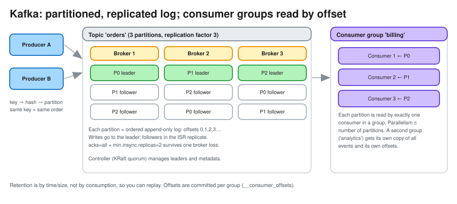

# Apache Kafka

> **TL;DR** — Kafka is a **distributed, partitioned, replicated commit log**. Producers append records to **topic partitions**; each record gets an **offset**; **consumer groups**
> read at their own pace by tracking offsets. Data is **retained** (time/size/compaction), so consumers can **replay**. Ordering is guaranteed **per partition** (so choose the key
> well); throughput scales by adding partitions; durability comes from **replication + acks=all + min.insync.replicas**. Use it for event streaming, CDC, log aggregation,
> decoupling services, and stream processing. Compare with a work queue in [Kafka vs SQS](kafka_vs_sqs.md); see also [Asynchronism](asynchronism.md) and [Distributed Message Queue](../problems/distributed_message_queue.md).

## Core concepts
- **Topic**: named stream, split into **partitions** (the unit of parallelism and ordering). **Record** = key, value, headers, timestamp.
- **Partitioning**: producer picks the partition by `hash(key) % partitions` (same key → same partition → ordered). No key → sticky/round-robin.
- **Offset**: sequential id per partition. **Consumer groups**: each partition is consumed by exactly one member of a group; many groups can read the same topic independently.
- **Brokers** store partitions as **segment files** on disk (sequential I/O, page cache, zero-copy `sendfile`), which is why throughput is high even on disks.
- **Replication**: each partition has a **leader** and followers; the **ISR** (in-sync replicas) are those caught up. Producers write to the leader; on failure a new leader is chosen from the ISR.
- **Metadata/control plane**: modern Kafka uses **KRaft** (Raft-based controller quorum) and no longer needs ZooKeeper (ZooKeeper mode was removed in Kafka 4.0). See [Consensus](consensus.md).
- **Retention**: delete after N days/size, or **log compaction** (keep the latest value per key: changelog/state topics).

## Delivery guarantees and producer settings
| Setting | Effect |
|---|---|
| `acks=0/1/all` | 0: fire-and-forget; 1: leader wrote; **all**: all ISR replicas have it |
| `min.insync.replicas` | With `acks=all`, writes fail if ISR < N (e.g. RF=3, min ISR=2 survives one broker loss) |
| `enable.idempotence=true` | Producer id + sequence numbers → no duplicates from retries within a partition |
| Transactions | Atomic writes across partitions + consumer offsets (**exactly-once within Kafka**: read-process-write) |
| `retries`, `delivery.timeout.ms`, `linger.ms`, `batch.size`, `compression.type` | Reliability and throughput tuning (batching + compression boost throughput) |

- **Consumer side**: at-least-once is the default (commit offset *after* processing). Committing before processing = at-most-once. Exactly-once *effects* outside Kafka need idempotent writes or transactional sinks ([Delivery semantics](delivery_semantics.md), [Idempotency](idempotency.md)).
- **Rebalances** (members join/leave) pause consumption; use cooperative/static membership, keep processing fast, handle `max.poll.interval.ms`.
- **Ordering caveat**: with retries and `max.in.flight > 1` ordering can break unless idempotence is on.

## Scaling and sizing
- Throughput scales with partitions × brokers; parallelism of a group ≤ number of partitions. Over-partitioning costs memory, file handles, longer recovery/rebalance.
- A single partition handles on the order of tens of MB/s; a cluster handles millions of messages/s. Estimate: `partitions ≈ max(target throughput / per-partition throughput, max consumers)`.
- **Hot partitions** from skewed keys: salt keys, composite keys, or custom partitioner. Changing partition count later **breaks key→partition mapping** (ordering across the change).
- Storage = throughput × retention × replication factor. Tiered storage (offloading old segments to object storage) is available in newer versions.
- Multi-region: MirrorMaker 2 / Cluster Linking (async); stretch clusters need low latency between sites.

## Failure handling
- **Producer retries** + idempotence handle transient errors; unclean leader election off (`unclean.leader.election.enable=false`) to avoid data loss.
- **Poison messages**: a record that always fails blocks a partition → bounded retries then a **dead-letter topic** (Kafka has no built-in DLQ; consumers implement it). Retry topics with backoff for transient failures.
- **Consumer lag** (end offset − committed offset) is the main health metric; alert on growth. See [Monitoring](monitoring.md).
- Broker loss: followers promote; clients refresh metadata. Rack-aware replica placement across AZs.

## Ecosystem
- **Kafka Connect** (source/sink connectors, Debezium for CDC), **Kafka Streams / ksqlDB** (stream processing), **Schema Registry** (Avro/Protobuf/JSON Schema, compatibility rules), **Flink/Spark** consumers ([Flink](flink.md), [Stream vs Batch](bp_sp.md)).
- Managed: Confluent Cloud, AWS MSK, Aiven, Redpanda (Kafka-API compatible), Azure Event Hubs (Kafka endpoint).

## When to use / not use
| Use | Avoid |
|---|---|
| High-throughput event streams, CDC, audit/event log, stream processing, fan-out to multiple independent consumers, replay needed | Simple task queue with per-message ack, delays, priorities, DLQ built-in (SQS/RabbitMQ), request/response, tiny scale where ops cost isn't justified |

## Pitfalls
- Wrong key → hot partitions or lost ordering; too few partitions (can't scale consumers) or too many.
- Auto-commit offsets + slow processing → duplicates or loss; unbounded retries blocking a partition.
- Large messages (default ~1 MB limit): store payload in blob storage and send a reference ([Blob Storage](blob_storage.md)).
- Treating Kafka as a database for random lookups; forgetting schema evolution/compat; unclear retention.
- Dual write (DB + Kafka) without outbox/CDC → inconsistency ([Reliable messaging](reliable_messaging.md)).

## Interview follow-ups
- *"How does Kafka get high throughput?"* Sequential disk I/O, batching, compression, page cache + zero-copy, partition parallelism.
- *"How do you guarantee ordering?"* Per partition; same key → same partition; one consumer per partition in a group.
- *"What if a consumer crashes mid-processing?"* Offset not committed → another consumer re-reads → duplicates → idempotent processing.
- *"Exactly-once?"* Idempotent producer + transactions inside Kafka; end-to-end needs idempotent sinks or the outbox/inbox pattern.
- *"How do you reprocess history?"* Reset consumer-group offsets or start a new group; retention must cover the window.
- *"Kafka vs RabbitMQ/SQS?"* Log with replay and partitioned ordering vs broker-managed queues with per-message acks ([Kafka vs SQS](kafka_vs_sqs.md)).

# References
* [Kafka documentation](https://kafka.apache.org/documentation/), [Kafka: The Definitive Guide](https://www.confluent.io/resources/kafka-the-definitive-guide-v2/)
* [The Log: What every software engineer should know (Jay Kreps)](https://engineering.linkedin.com/distributed-systems/log-what-every-software-engineer-should-know-about-real-time-datas-unifying)
* [Hello Interview: Kafka deep dive](https://www.hellointerview.com/learn/system-design/deep-dives/kafka)
