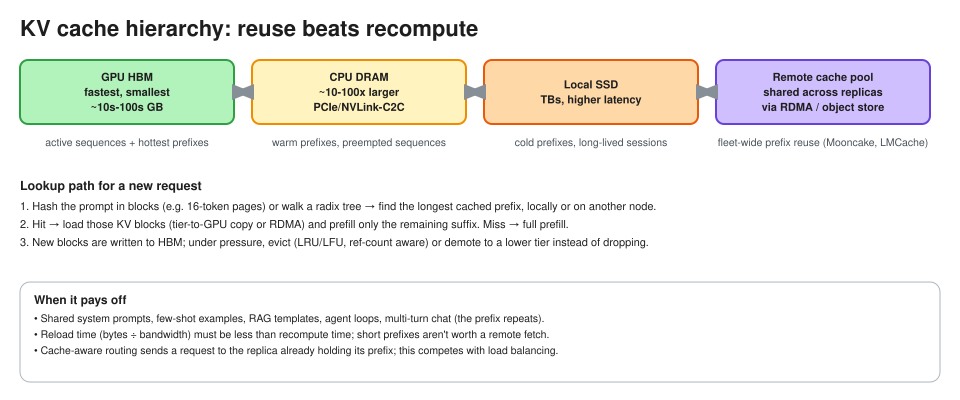

# KV Cache, Prefix Caching & Cache-Aware Routing

> **TL;DR** — The **KV cache** stores each token's attention keys/values so decode doesn't recompute the past. It is the main consumer of GPU memory beyond weights and therefore the limiter of **concurrency and context length**.
> **PagedAttention** manages it in fixed-size **blocks** (no fragmentation, copy-on-write sharing). **Prefix caching** (hash blocks or a **radix tree**, as in SGLang's RadixAttention) lets requests that share a prompt prefix reuse KV instead of recomputing prefill.
> **Tiering** (GPU → CPU → SSD → remote pool, e.g. Mooncake, LMCache) extends capacity, and **cache-aware routing** sends requests to the replica that already holds their prefix. The cache is a distributed-systems problem: placement, eviction, consistency of hashes, and routing vs load balance.
> See [LLM inference basics](llm_inference_basics.md), [Caching](caching.md), [Prefill/decode disaggregation](prefill_decode_disaggregation.md), [Consistent hashing](consistent_hashing.md).

## KV cache fundamentals
- Per token, per layer, store K and V vectors (for each KV head). Size per token ≈ `2 × layers × kv_heads × head_dim × bytes`; total = size per token × tokens in flight. A single long conversation can use GBs.
- **Why it exists**: without it, each decode step would recompute attention inputs for the entire history (quadratic work). With it, a step computes only the new token's K/V and attends over the cache.
- **Reducing size**: GQA/MQA/MLA (fewer KV heads or latent compression), KV quantization (FP8/INT8/INT4), sliding-window or sparse attention, eviction of low-importance tokens (lossy), shorter contexts.
- **Memory budget**: after weights and activations, the rest of HBM is the KV pool; `blocks × block_size` = maximum tokens in flight.

## PagedAttention (vLLM)
- Problem: pre-allocating contiguous max-length KV per request wastes memory (fragmentation, over-reservation) and limits batch size.
- Solution: split KV into **fixed-size blocks** (e.g. 16 tokens) mapped through a per-sequence **block table** (like OS page tables). Blocks are allocated **on demand**, non-contiguous, and can be **shared** across sequences with **reference counting and copy-on-write** (parallel sampling, beam search, shared prefixes).
- The vLLM paper reports 2-4× throughput improvement at similar latency versus prior systems such as FasterTransformer and Orca, attributed to near-zero KV waste and sharing.

## Prefix caching
| Approach | How | Notes |
|---|---|---|
| **Block-hash cache** (vLLM automatic prefix caching) | Hash each full block's tokens (chained with the parent hash); a hit means the block's KV already exists | Granularity = block size; simple and fast lookups |
| **Radix tree** (SGLang RadixAttention) | Prompts stored in a trie of token sequences; longest-prefix match, LRU eviction of leaves | Natural for tree-shaped reuse (chat turns, few-shot, agent branches) |
| **Explicit prompt caching** (API products) | Client marks cacheable prefix; provider stores and bills reads at a discount | Needs stable, byte-identical prefixes |

**What makes prefixes reusable**: identical system prompt, tool definitions and few-shot examples *at the start*; append new content at the end; avoid injecting timestamps/IDs early in the prompt; keep message ordering stable. Reuse also depends on the same model, tokenizer, and (often) the same adapter/LoRA and sampling-independent KV.

**Eviction**: LRU/LFU with **ref-count awareness** (never evict blocks in use), prefer evicting leaves/oldest; protect system-prompt prefixes; size limits per tenant to avoid pollution.

## Tiered and shared KV stores
- **Offload** cold blocks from HBM to **CPU DRAM**, **local SSD**, or a **remote cache pool** over RDMA; reload when a prefix hits. Mooncake describes a disaggregated KV cache built from underused CPU, DRAM and SSD of the GPU cluster, with a KV-centric scheduler; LMCache provides a KV connector layer used with vLLM and others.
- **Break-even**: reload time (bytes ÷ bandwidth, plus queueing) must beat recompute time. Long prefixes on fast links win; short prefixes or slow storage don't.
- **Prefill→decode transfer** in disaggregated serving is the same machinery used as a one-time hand-off ([Prefill/decode disaggregation](prefill_decode_disaggregation.md)).
- **Consistency**: KV blocks are content-addressed and immutable, so there are no write conflicts; the hard parts are **index consistency** (who has which prefix), **staleness** after model/adapter/tokenizer upgrades (version the key), and **security isolation** between tenants (see below).

## Cache-aware routing
- A request's best replica is the one holding its longest prefix, but sending everything there creates **hot replicas** ([Hot keys](hot_keys.md)). Routers score `cache_overlap` vs `load` (queue depth, KV occupancy) and may replicate popular prefixes.
- Implementations: NVIDIA Dynamo's Smart Router tracks KV locations in a radix tree and scores overlap against load; llm-d's Endpoint Picker provides prefix-cache-aware routing on Kubernetes via the Gateway API Inference Extension.
- Cheaper approximations: **consistent hashing on the prompt prefix** (or session id) to give affinity without a global index ([Consistent hashing](consistent_hashing.md)); sticky sessions for multi-turn chat.
- Router needs near-real-time cache state (events from engines) or accepts approximate/stale hints and tolerates misses.

## Security and multi-tenancy
Shared prefix caches can leak information through **timing side channels** (a fast response reveals another tenant's prompt prefix). Mitigate by **tenant-scoped cache keys/salts**, disabling cross-tenant sharing for sensitive data, and not sharing across trust boundaries. Also redact PII before caching and apply retention limits for persisted KV.

## Design checklist
1. Compute KV bytes/token and the memory budget → max concurrent tokens.
2. Decide block size, eviction policy, per-tenant quotas.
3. Structure prompts for prefix stability; measure **hit rate** and **tokens saved**.
4. Add tiers only if hit rates and reload bandwidth justify them.
5. Route with cache-awareness balanced by load; version cache keys by model/adapter.
6. Monitor KV occupancy, evictions, hit rate, reload latency, TTFT by hit/miss.

## Pitfalls
- Dynamic content early in the prompt (kills reuse); caching across tenants without isolation; routing purely by affinity (hot spots); not versioning keys after model changes; offloading short prefixes across slow links; ignoring that cached prefixes still cost decode and attention reads.

## Interview follow-ups
- *"What is the KV cache and why does it limit concurrency?"* It stores past K/V per token; memory grows with tokens × sequences, bounding batch size.
- *"How does prefix caching cut TTFT and cost?"* Skips prefill for matched prefixes; only the suffix is computed.
- *"How would you scale a prefix cache across replicas?"* Cache-aware routing plus a shared/tiered KV pool; balance with load.
- *"What can go wrong with shared caches?"* Hot replicas, staleness across model versions, cross-tenant timing leaks.

# References
* [Efficient Memory Management for LLM Serving with PagedAttention (SOSP '23)](https://arxiv.org/abs/2309.06180)
* [SGLang: Efficient Execution of Structured Language Model Programs (RadixAttention)](https://arxiv.org/abs/2312.07104)
* [Mooncake: A KVCache-centric Disaggregated Architecture for LLM Serving](https://arxiv.org/abs/2407.00079)
* [Introducing NVIDIA Dynamo (Smart Router, KV Cache Manager)](https://developer.nvidia.com/blog/introducing-nvidia-dynamo-a-low-latency-distributed-inference-framework-for-scaling-reasoning-ai-models/)
* [llm-d architecture](https://llm-d.ai/docs/architecture/architecture), [vLLM docs](https://docs.vllm.ai/)
