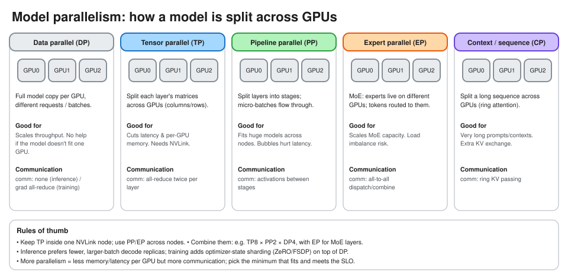

# Parallelism for LLM Serving (TP, PP, DP, EP, CP)

> **TL;DR** — A large model doesn't fit one GPU, and one GPU may be too slow. Split it: **tensor parallelism (TP)** shards each layer's matrices (lowest latency, needs NVLink), **pipeline parallelism (PP)** places consecutive layers on different GPUs/nodes
> (fits huge models, adds bubbles), **data parallelism (DP)** replicates the model to serve more requests, **expert parallelism (EP)** places MoE experts on different GPUs (all-to-all routing), and **context/sequence parallelism (CP)** splits very long sequences.
> Production deployments **combine** them (e.g. TP8 within a node × PP across nodes × DP replicas, plus EP for MoE) and may use **different layouts for prefill and decode** ([Disaggregation](prefill_decode_disaggregation.md)).
> The design rule: use the *least* parallelism that fits memory and meets the latency SLO, because every split adds communication. See [LLM inference basics](llm_inference_basics.md), [Distributed training](distributed_training.md), [Scalability](scalability.md).

## The strategies
| Strategy | What is split | Communication | Best for | Watch out |
|---|---|---|---|---|
| **Data (DP)** | Nothing: full model replica per GPU/group | None across replicas at inference | Throughput scaling, availability | Memory: each replica holds all weights |
| **Tensor (TP)** | Each layer's weight matrices (column/row split; attention heads split) | **All-reduce** after attention and MLP, every layer | Lower per-request latency, fitting a model in a node | Needs NVLink/NVSwitch; efficiency drops past one node; small GEMMs at high TP |
| **Pipeline (PP)** | Layer ranges into stages | Activations between stages (point-to-point) | Fitting very large models across nodes | Pipeline **bubbles** hurt single-request latency; micro-batching and uniform iterations help |
| **Expert (EP)** | MoE experts across GPUs | **All-to-all** dispatch/combine of tokens per MoE layer | MoE models (DeepSeek-V3: 671B total, 37B active per token) | Load imbalance (hot experts), all-to-all latency |
| **Context / sequence (CP)** | The sequence dimension (ring attention) | KV blocks passed around a ring | Very long prompts (prefill) | Extra communication, complexity |

Megatron-LM introduced the simple intra-layer tensor-parallel approach for transformers; later work studied how to compose tensor, pipeline and data parallelism to scale to thousands of GPUs (Megatron-LM scaling paper, 1T parameters on 3072 GPUs), now the basis for most 3D-parallel layouts.

## Choosing a layout (inference)
1. **Fit**: weights (after quantization) + KV budget must fit the group's HBM. 70B FP16 ≈ 140 GB → at least 2×80 GB GPUs, usually TP4-8 for KV headroom.
2. **Latency**: raise TP within a node to cut per-token time (more aggregate memory bandwidth and compute), until communication dominates.
3. **Cross-node**: use PP (or EP for MoE) across nodes; avoid TP across slow links.
4. **Throughput/availability**: replicate with DP; each replica is an independent failure domain and autoscaling unit.
5. **MoE**: combine EP with TP/DP for attention; balance experts (replicate hot experts, capacity factors); large EP groups need fast fabrics.
6. **Prefill vs decode**: prefill (compute-bound, latency-sensitive) often prefers higher TP; decode (bandwidth-bound, throughput-oriented) often prefers more replicas and larger batches or EP. Disaggregated serving lets each phase use its own layout; NVIDIA's reported Llama-70B example used a different TP/DP split for context vs generation workers than the colocated baseline ([Case study](prefill_decode_disaggregation.md#case-study-nvidia-dynamo)).

## Communication costs (mental model)
- **TP**: ~2 all-reduces per layer per forward pass → latency-sensitive, needs hundreds of GB/s (NVLink). Cross-node TP over InfiniBand is usually inefficient.
- **PP**: one activation transfer per stage boundary; low bandwidth but serial dependency → bubbles when batch is small.
- **EP**: all-to-all with variable load; depends on router balance and network topology.
- **DP**: no per-token communication at inference; weights loaded per replica.
- Overlap communication with compute where possible (async collectives, micro-batching); use topology-aware placement ([Scalability](scalability.md)).

## Operational concerns
- **Failure domain**: a TP/PP group fails as a unit; one GPU loss takes down the whole group → fast restart, spare capacity, health checks, and replica-level redundancy ([Availability](availability.md), [Resilience](resilience_patterns.md)).
- **Cold start**: loading hundreds of GB of weights takes minutes → keep warm pools, use fast weight loading, shard weights per rank ([Autoscaling](llm_serving_platform.md)).
- **Heterogeneity**: mixing GPU types inside a TP group wastes the faster ones; place by group.
- **Scheduling**: gang-schedule all ranks (e.g. LeaderWorkerSet on Kubernetes for multi-node replicas, as used by llm-d).
- **Observability**: per-rank utilization, all-reduce time, straggler detection, expert load histograms.

## Pitfalls
- TP spanning nodes over a slow network; PP with too few micro-batches (bubbles); ignoring expert imbalance; oversized TP on small models (communication > compute); forgetting that one failed rank kills the group; treating DP replicas as free when weights dominate memory.

## Interview follow-ups
- *"The model doesn't fit one GPU. What do you do?"* Quantize if acceptable, then TP within a node; PP across nodes if still too large; EP for MoE.
- *"TP vs PP?"* TP cuts latency but needs fast links; PP scales size across nodes but adds bubbles.
- *"How do you scale throughput?"* Add DP replicas behind a router; scale on queue delay.
- *"Why can prefill and decode want different parallelism?"* Compute-bound vs memory-bound phases; disaggregation allows per-phase layouts.

# References
* [Megatron-LM: Training Multi-Billion Parameter Language Models Using Model Parallelism](https://arxiv.org/abs/1909.08053)
* [Efficient Large-Scale Language Model Training on GPU Clusters Using Megatron-LM](https://arxiv.org/abs/2104.04473)
* [DeepSeek-V3 Technical Report](https://arxiv.org/abs/2412.19437)
* [DistServe: Disaggregating Prefill and Decoding (OSDI '24)](https://arxiv.org/abs/2401.09670)
* [llm-d architecture (multi-node replicas, wide expert parallelism)](https://llm-d.ai/docs/architecture/architecture)
