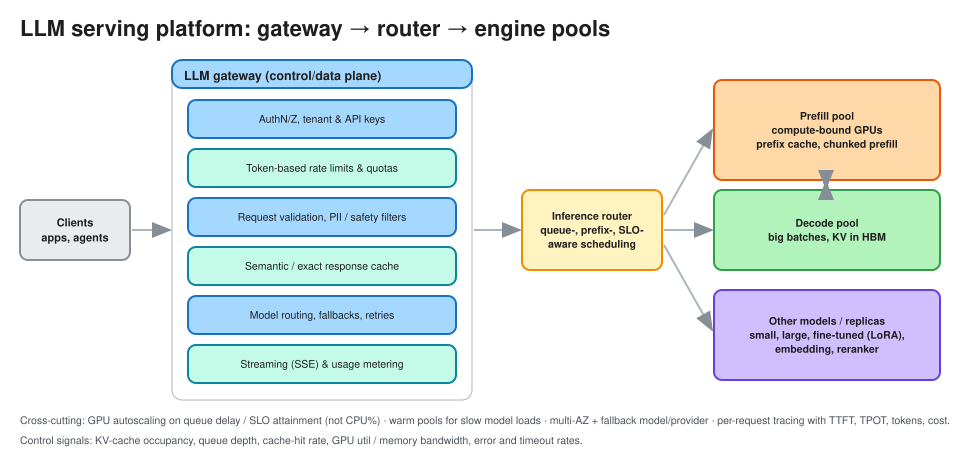

# LLM Serving Platform: Gateway, Routing, Rate Limiting & Autoscaling

> **TL;DR** — Around the inference engines you need a **platform**: an **LLM gateway** (auth, token-based rate limits and quotas, safety filters, response caching, model routing, fallbacks, streaming, metering), an **inference router** (queue-, prefix- and SLO-aware placement onto prefill/decode/other pools), and **autoscaling** driven by queue delay and SLO attainment, not CPU.
> GPUs are scarce and slow to start, so capacity planning, warm pools, multi-model/LoRA multiplexing and graceful degradation matter more than in ordinary stateless services.
> See [LLM inference basics](llm_inference_basics.md), [KV cache & routing](kv_cache_prefix_caching.md), [Prefill/decode disaggregation](prefill_decode_disaggregation.md), [Backpressure](backpressure_load_shedding.md), [Resilience](resilience_patterns.md).

## Gateway responsibilities
| Concern | Design notes |
|---|---|
| **AuthN/Z, tenancy** | API keys/OAuth, per-tenant model access, budgets; isolate caches and logs per tenant |
| **Rate limiting & quotas** | Limit by **tokens** (input + estimated output) and concurrency, not just requests; token-bucket per tenant/key/model; reserve then reconcile with actual usage ([Rate limiter](../problems/rate_limiter.md)) |
| **Admission & priority** | Priority classes (interactive vs batch), queue limits, reject early with 429/503 + `Retry-After` ([Backpressure](backpressure_load_shedding.md)) |
| **Safety/PII** | Input and output moderation, redaction, prompt-injection checks; adds latency, so run in parallel where possible |
| **Response caching** | Exact-match cache for deterministic requests; **semantic cache** (embedding similarity) can cut cost but risks wrong hits, so use high thresholds, tenant scoping and TTLs |
| **Routing & fallback** | Pick model by task/cost (small model first, escalate on low confidence), region, health; fall back to another model/provider on errors or timeouts |
| **Streaming** | SSE/WebSocket; handle client disconnects (cancel generation), mid-stream failures (no safe transparent retry after tokens were sent), proxy buffering ([Real-time updates](realtime_updates.md)) |
| **Metering & observability** | Per-request tokens in/out, TTFT, TPOT, cost, cache hit; traces across gateway → router → engine |
| **Idempotency** | Idempotency keys for retried non-streaming calls to avoid double billing ([Delivery semantics](delivery_semantics.md)) |

## Inference router
- **Inputs**: queue depth and oldest-request age per replica, KV-cache occupancy, **prefix-cache overlap**, model/adapter loaded, replica role (prefill/decode/unified), health.
- **Policy**: choose the replica maximizing cache reuse subject to load; send long prompts to prefill-optimized capacity; keep sticky routing for multi-turn sessions; shed or downgrade under overload ([Hot keys](hot_keys.md), [Consistent hashing](consistent_hashing.md)).
- **Implementations**: NVIDIA Dynamo's Smart Router and Planner; llm-d's Endpoint Picker using the Kubernetes Gateway API Inference Extension; vLLM production-stack and similar routers.
- **Multi-LoRA / multi-model**: one base model with many adapters loaded on demand (adapter-aware routing and eviction) vs dedicated replicas per model; trade utilization against cold-load latency and isolation.

## Autoscaling GPUs
- **Signals**: queue delay / time-in-queue, requests waiting, KV-cache utilization, TTFT/TPOT SLO attainment, tokens/s per replica. **CPU or even GPU utilization is a poor signal** (a GPU can be "100% utilized" yet badly overloaded or half-idle between memory-bound steps).
- **Slow scale-out**: pulling images and loading tens-hundreds of GB of weights takes minutes; mitigate with **warm pools**, pre-pulled images, weight caching on local NVMe / shared fast storage, sharded loading, and scaling ahead using forecasts.
- **Disaggregated pools** scale prefill and decode independently (Dynamo's Planner adjusts the ratio from load and SLOs) ([Disaggregation](prefill_decode_disaggregation.md)).
- **Scale-in**: drain gracefully (stop new requests, let streams finish, hand off or recompute KV), avoid thrash with cooldowns, keep minimum replicas for latency and availability.
- **Capacity & cost**: reserved/committed GPUs for baseline, spot/preemptible for batch, queue-and-defer for non-urgent work, separate batch API with relaxed SLOs ([Long-running tasks](long_running_tasks.md)).

## Reliability
- A TP/PP group fails as a unit; keep **N+1 replicas**, health-check with real generation probes, auto-replace unhealthy GPUs, and expect hardware faults ([Parallelism](llm_parallelism.md)).
- **Timeouts and retries**: bound total deadline; retry only before first token (or when idempotent); use hedging cautiously because it doubles GPU load.
- **Multi-region**: route by data residency and capacity; replicate model weights, not KV ([Multi-region](multi_region.md)).
- **Graceful degradation**: smaller model, shorter max tokens, disable expensive features (long context, reasoning effort) under pressure.
- **Rollouts**: canary new model versions/quantizations with shadow traffic and quality evals; version prefix-cache keys ([KV cache](kv_cache_prefix_caching.md)).

## Design checklist
1. Define SLOs (TTFT, TPOT, availability) per tier and model.
2. Token-aware limits, quotas, priorities; cancellation on disconnect.
3. Router with load + cache awareness and role-aware pools.
4. Autoscale on queue delay/SLO; warm pools; drain on scale-in.
5. Fallback chains, deadlines, idempotency; safe streaming failure behavior.
6. Observability: tokens, TTFT/TPOT percentiles, cache hit, GPU memory/bandwidth, cost per tenant.

## Pitfalls
- Request-count rate limits (one 100k-token request equals thousands of small ones); autoscaling on CPU; ignoring cold-start time; semantic cache returning another user's or a subtly different answer; retrying mid-stream; no cancellation so abandoned requests burn GPU; one noisy tenant starving others; no version key on caches after model updates.

## Interview follow-ups
- *"Design an LLM API for many tenants."* Gateway with token quotas and priorities, router to replica pools, autoscaling on queue delay, fallbacks and metering.
- *"How do you scale GPUs?"* Queue/SLO signals, warm pools, independent prefill/decode scaling, graceful drain.
- *"Is semantic caching safe?"* Only with strict thresholds, scoping and TTLs; it trades correctness risk for cost.
- *"What if a model replica dies mid-stream?"* Client sees an error or must resume; retry from scratch only if the application tolerates it (partial output is not idempotent).

# References
* [Introducing NVIDIA Dynamo (Planner, Smart Router)](https://developer.nvidia.com/blog/introducing-nvidia-dynamo-a-low-latency-distributed-inference-framework-for-scaling-reasoning-ai-models/)
* [llm-d architecture](https://llm-d.ai/docs/architecture/architecture)
* [Gateway API Inference Extension](https://gateway-api-inference-extension.sigs.k8s.io/)
* [vLLM documentation](https://docs.vllm.ai/)
