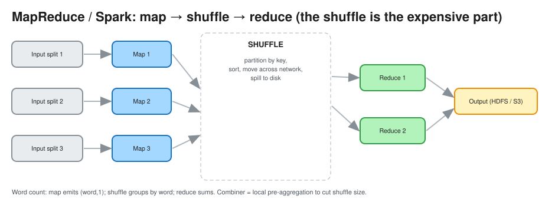

# MapReduce

> **TL;DR** — MapReduce (Google, 2004; Hadoop) is a programming model and runtime for **batch processing of huge datasets on commodity clusters**: split input into chunks, run a
> **map** function on each in parallel, **shuffle** intermediate key/value pairs so all values for a key meet, then **reduce**. The framework handles scheduling, data locality (run code where the
> data is in HDFS/GFS), and **fault tolerance by re-running failed tasks**. It's disk-heavy and high-latency, so Spark has largely replaced it, but its ideas (shuffle, partitioning, idempotent
> tasks, locality) underlie every batch system. See [Spark](spark.md), [Batch vs Stream](bp_sp.md), [GFS/HDFS](../problems/file_storage_gfs_hdfs.md).

## Programming model
- **Map**: `(k1, v1) → list(k2, v2)`; **Reduce**: `(k2, list(v2)) → list(v3)`. Example **word count**: map emits `(word, 1)`; reduce sums.
- **Combiner**: a local reduce on each mapper's output (when the reduce is associative/commutative) to shrink shuffle data.
- **Partitioner**: decides which reducer gets a key (`hash(key) % R`); skewed keys create **stragglers/hot reducers** (fix with salting, combiners, sampling-based range partitioning).
- **Joins**: reduce-side join (shuffle both datasets by join key), map-side/broadcast join (small table in memory), sort-merge for large sorted inputs.
- Typical jobs: log analysis, inverted index building, PageRank iterations, ETL, sorting (TeraSort), dedup.

## Execution
1. Input in a distributed file system, split into blocks (e.g. 128 MB) → one **map task** each, scheduled **near the data** (locality).
2. Mappers write sorted, partitioned output to **local disk**.
3. **Shuffle**: reducers fetch their partitions from every mapper over the network, merge-sort.
4. Reducers write output to the distributed file system (HDFS/S3), usually replicated.
- **Master/JobTracker (YARN ResourceManager + ApplicationMaster)** tracks tasks and worker heartbeats ([Heartbeats](heartbeats.md)).

## Fault tolerance and performance
- Failed task → **re-execute** (tasks are deterministic and side-effect-free, so idempotent). Failed worker → reschedule its map outputs (they were on its local disk).
- **Speculative execution**: launch backup copies of slow tasks (stragglers) and take the first to finish.
- Costs: every stage **materializes to disk**; multi-stage pipelines (Hive/Pig → chains of jobs) pay repeated disk and shuffle costs. That's why iterative workloads (ML, graphs) are slow.

## MapReduce vs Spark vs Flink
| | MapReduce | [Spark](spark.md) | [Flink](flink.md) |
|---|---|---|---|
| Model | Map + reduce, one stage per job | DAG of transformations, lazy | Dataflow, streaming-first |
| Intermediate data | Disk between every job | Memory with spill; lineage-based recovery | Pipelined; checkpointed state |
| Latency | Minutes+ | Seconds to minutes | Milliseconds to seconds |
| Best for | Very large, simple, one-pass batch | Batch, iterative, SQL, ML, micro-batch streaming | True streaming, event time, stateful |

## When to mention it
- Explaining how **inverted indexes, large sorts, or log aggregations** are computed at scale; "the shuffle is the expensive part"; designing a **batch pipeline** (e.g. ad click aggregation's batch/lambda path, [Web crawler](../problems/web_crawler.md) indexing).
- Today: say "Spark (or Flink) on S3/HDFS", and mention MapReduce for the concepts.

## Pitfalls
- Data skew (one hot key → one slow reducer), too many small files (overhead per task/NameNode memory), non-idempotent side effects in tasks, shuffle of unnecessarily wide records.

## Interview follow-ups
- *"How does it tolerate failures?"* Deterministic tasks re-executed; outputs written atomically; stragglers via speculative execution.
- *"How would you count the top-K words across 1 TB?"* Map: local counts (combiner) → shuffle by word → reduce sums → second pass/heap for top-K; or approximate with [Count-Min Sketch](count_min_sketch.md).
- *"Why is shuffle expensive?"* Network all-to-all, serialization, disk spills, sort.

# References
* [MapReduce: Simplified Data Processing on Large Clusters (Dean & Ghemawat, 2004)](https://static.googleusercontent.com/media/research.google.com/en//archive/mapreduce-osdi04.pdf)
* Designing Data-Intensive Applications, Chapter 10 (Batch Processing)
