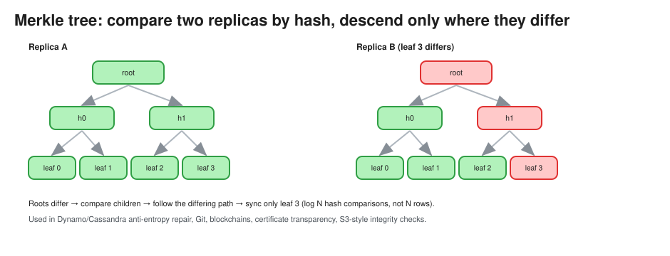

# Merkle Trees (Hash Trees)

> **TL;DR** — A **Merkle tree** is a tree of hashes: each leaf is the hash of a data block, each parent is the hash of its children, and the **root hash** summarizes the whole dataset. Two parties can
> compare roots: equal ⇒ identical data; different ⇒ descend into mismatching subtrees to find **exactly which blocks differ** in `O(log N)` hash comparisons, transferring only the differences. Used for
> **anti-entropy repair** in Dynamo-style stores (Cassandra, Riak), **Git** objects, **blockchains**, certificate transparency, and integrity verification of large files/downloads. See [Replication](data_replication.md),
> [Cassandra](cassandra.md), [Checksums](checksums.md).

## The problem
Replicas of a large dataset drift (missed writes, failed hints, bit rot). Comparing every row across the network is too expensive; comparing a single checksum only says "different", not "where".

## How it works
1. Partition the key range into blocks (e.g. fixed ranges of the hash ring). **Leaf** = `hash(block contents)`.
2. **Parent** = `hash(left_child || right_child)`; repeat to the **root**.
3. **Compare** replicas: exchange root hashes. If equal → done. Else exchange child hashes level by level, following only mismatching branches until reaching differing leaves.
4. **Repair**: stream only the differing blocks/rows; last-write-wins or version resolution picks the winner.

- **Cost**: build is O(N) hashing (done in the background or incrementally); comparison is O(k log N) for k differing leaves, with tiny network traffic.
- **Update**: changing a block only rehashes its **path to the root** (O(log N)), enabling incremental maintenance.

## Where it's used
| System | Use |
|---|---|
| **Cassandra / ScyllaDB** | `nodetool repair` builds Merkle trees per token range and compares replicas (anti-entropy) |
| **Dynamo / Riak** | Replica synchronization in the background, complementing read repair and hinted handoff ([Quorum](quorum.md)) |
| **Git** | Commits/trees/blobs are content-addressed hashes forming a Merkle DAG; detects changes cheaply |
| **Bitcoin / Ethereum** | Block headers contain a Merkle root of transactions; **Merkle proofs** let light clients verify inclusion with `O(log N)` hashes |
| **Certificate Transparency** | Append-only Merkle log with inclusion and consistency proofs |
| **IPFS, ZFS, Btrfs, S3-like object integrity, BitTorrent (v2)** | Content addressing and block-level integrity |
| **rsync-like sync, file dedup** | Detect differing chunks |

## Merkle proofs
To prove a leaf belongs to a tree with known root, provide the **sibling hashes along the path** (`log₂ N` hashes). The verifier recomputes up to the root and compares. This gives **tamper-evidence**
without trusting the storage provider.

## Trade-offs
| Pros | Cons |
|---|---|
| Tiny comparison traffic; locates diffs quickly | Building trees for big ranges costs CPU/IO (Cassandra repair is heavy); trees can go stale as data changes |
| Incremental updates along one path | Granularity: a leaf covers a range, so a single differing row streams the whole leaf range ("overstreaming") |
| Tamper-evident, verifiable inclusion proofs | Needs a deterministic canonical serialization and a collision-resistant hash (SHA-256) |

## Design guidance
- Choose **leaf granularity** (depth) to balance tree size vs overstreaming; Cassandra caps tree depth, so large ranges are coarse (subrange/incremental repair mitigates).
- Make the hash **deterministic** (sorted keys, canonical encoding, include tombstones/timestamps) or replicas disagree falsely.
- **Run repair regularly** (within `gc_grace_seconds` in Cassandra) so deleted data isn't resurrected ([Cassandra](cassandra.md)).
- Use Merkle trees **alongside** hinted handoff and read repair: those fix most divergence quickly, Merkle repair catches the rest.

## Pitfalls
- Confusing with a plain checksum of the whole file (no localization); hashing non-canonical data; repair too rarely; ignoring cost on huge replicas; assuming it fixes conflicts (it finds differences; resolution is separate).

## Interview follow-ups
- *"How do two replicas find which keys differ without sending all keys?"* Exchange Merkle roots, recurse into differing subtrees, sync only differing ranges.
- *"How does Git detect changes quickly?"* Content-addressed tree objects: unchanged subtree ⇒ same hash ⇒ skip.
- *"How can a light client verify a transaction?"* Merkle proof against the block's Merkle root.
- *"Why isn't anti-entropy enough alone?"* It's periodic and heavy; read repair/hinted handoff provide fast convergence ([Gossip](gossip_protocol.md), [Replication](data_replication.md)).

# References
* [Merkle tree (Wikipedia)](https://en.wikipedia.org/wiki/Merkle_tree), [Dynamo paper §4.7 anti-entropy](https://www.allthingsdistributed.com/files/amazon-dynamo-sosp2007.pdf)
* [Cassandra repair docs](https://cassandra.apache.org/doc/latest/cassandra/operating/repair.html)
