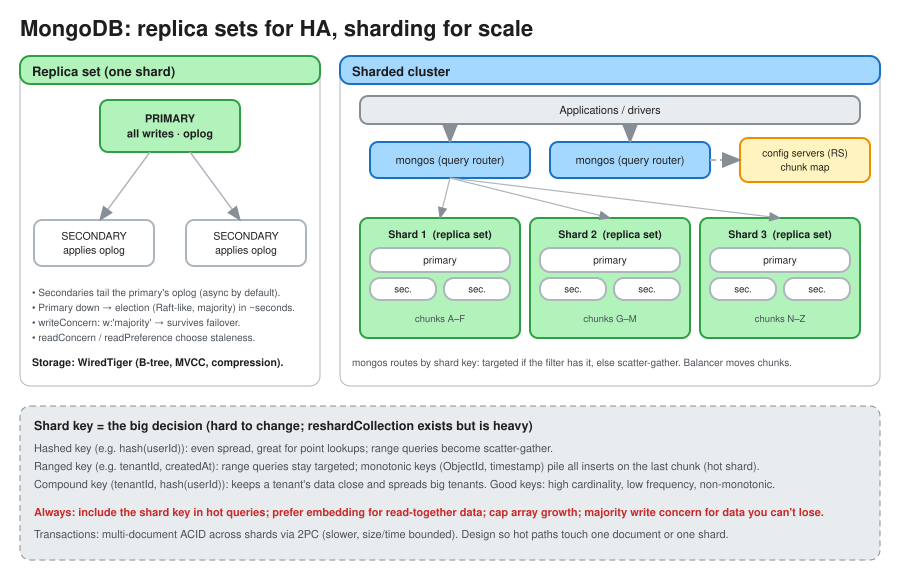

# MongoDB

> **TL;DR** — MongoDB is a **document database**: BSON/JSON documents in collections, flexible schema, rich secondary
> indexes and an aggregation pipeline. High availability comes from **replica sets** (one primary + secondaries, oplog
> replication, automatic elections); horizontal scale comes from **sharding** (a **shard key** splits a collection into
> chunks spread across replica-set shards, routed by `mongos`). Consistency is tunable per operation via **write concern,
> read concern and read preference**, and **multi-document ACID transactions** exist (replica sets since 4.0, sharded
> clusters since 4.2) but are not the intended hot path. The design rule is *model for how the application reads*:
> **embed** what is read together, **reference** what is unbounded or shared, and pick the shard key carefully because it is
> hard to change. Compare with [Postgres `jsonb`](postgres_mysql.md), [DynamoDB](dynamodb.md) and [Cassandra](cassandra.md).

## Data model
* **Database → collection → document.** Documents are **BSON** (binary JSON, with types such as `ObjectId`, `Date`,
  `Decimal128`); max size **16 MB**; every document has a unique `_id` (default `ObjectId`: time-prefixed, so roughly monotonic).
* Documents in a collection can differ; you can still enforce structure with **schema validation** (`$jsonSchema`)
  to get write-time checks without a rigid migration process. The schema effectively lives in the application plus validators.
* Nested objects and arrays let you store an aggregate (order + line items) in one document, so one read returns the whole
  entity and a single-document write is atomic (document-level atomicity, always).

## Schema design: embed vs reference
| Embed when… | Reference (store an id) when… |
|---|---|
| Data is read together and bounded (address, preferences, 10 recent comments) | The child set is **unbounded** or grows without limit (all comments, all events) |
| Child has no independent lifecycle | The child is shared by many parents or queried on its own |
| You want one atomic write | You need to update the child independently and frequently |
| One-to-few relationships | One-to-many / many-to-many at scale |

**Named patterns worth knowing** (from MongoDB's "Building with Patterns"):
* **Subset**: keep the hot slice (latest 10 reviews) in the parent, the rest in another collection.
* **Bucket**: group time-series or events into one document per time window (and device), cutting document and index count.
* **Extended reference**: copy a few frequently read fields of a referenced document (author name) into the referrer to avoid a join.
* **Computed**: precompute aggregates (counts, totals) on write or by job.
* **Outlier**: handle the one celebrity with 10M followers differently (overflow documents).
* **Polymorphic**: different shapes in one collection, distinguished by a `type` field.
* **Schema versioning**: a `schemaVersion` field so old and new documents coexist during migrations.

**Rule of thumb**: model around the **most frequent queries**, keep documents bounded (watch the 16 MB cap and unbounded arrays), and accept some duplication.

## Indexes and querying
* Storage is B-tree-based ([Indexes](database_indexing.md)). Types: single-field, **compound** (follow **ESR**: *Equality, Sort, Range* key order),
  **multikey** (indexes array elements), **text**, **2dsphere** (geospatial), **hashed**, **TTL** (auto-expire), **partial**, **sparse**,
  **unique**, **wildcard**, plus **Atlas Search / Vector Search** for full-text and embeddings.
* A **covered query** is answered entirely from an index. Use `explain("executionStats")` to check scanned vs returned documents.
* **Aggregation pipeline** (`$match → $group → $sort → $lookup …`) handles transformations and analytics. `$lookup` is a
  left outer join but costs more than relational joins and is awkward across shards; heavy use is a signal to reconsider the model.
* **Change streams** expose ordered change events (built on the oplog) for CDC, cache invalidation and downstream sync.
* Every index costs write throughput and memory; the working set (hot data + indexes) should fit in RAM.

## Storage engine (WiredTiger)
* Default engine: **B-tree** storage with **document-level concurrency control** and **MVCC** snapshots (readers don't block writers).
* A **journal** (write-ahead log) plus periodic **checkpoints** (about every 60 s) give crash durability; data is **compressed** (snappy, zstd).
* The cache takes roughly half of RAM by default; the OS page cache holds the rest. Under-provisioned RAM → page faults → latency spikes.

## Replication: replica sets
* A **replica set** has one **primary** (all writes) and secondaries that apply its **oplog** (a capped, idempotent log
  of operations). Typically 3 data-bearing members across AZs (avoid arbiters; they hurt durability).
* **Elections**: if the primary is unreachable beyond the election timeout (~10 s default), the members run a Raft-like
  election; a majority is required, so use an odd number of voting members. See [Consensus](consensus.md).
* Replication is asynchronous unless you ask otherwise. **Write concern** controls acknowledgment:

| Write concern | Behavior |
|---|---|
| `w:1` | Primary only. Fast; **may roll back** if the primary fails before replicating |
| `w:"majority"` | Majority of voting members have it; **survives failover** (default in modern versions) |
| `j:true` | Journaled to disk before ack |

* **Read concern**: `local` (may see data that later rolls back), `majority` (only majority-committed), `snapshot` (for
  transactions), `linearizable` (single-doc, slow). **Read preference**: `primary` (default), `secondary`, `nearest`, etc.;
  secondary reads can be stale. **Causal consistency** sessions give read-your-writes/monotonic reads across members.
* Combine `w:"majority"` + `readConcern:"majority"` (or `linearizable`) for strong guarantees; relax them for throughput. See [Replication](data_replication.md).

## Sharding
* **Components**: **shards** (each a replica set), **`mongos`** routers (stateless; apps connect here), and **config servers**
  (a replica set holding cluster metadata and the chunk map).
* A **shard key** (one or several fields) partitions a collection into **chunks** (default max ~128 MB); the **balancer** migrates chunks to even out shards.
* **Hashed shard key**: hash(field) spreads load evenly (good for point lookups, bad for range scans, which become scatter-gather).
  **Ranged shard key**: contiguous ranges keep range queries targeted but risk hotspots when the key is monotonic (`ObjectId`, timestamps).
  **Zone sharding** pins ranges of keys to specific shards/regions (data residency, locality).
* **Good shard key**: high cardinality, low frequency per value, **non-monotonic**, and **present in your hot queries** so `mongos`
  can **target** one shard instead of scatter-gathering. A compound key such as `(tenantId, hashed userId)` is common.
* Changing the key: `refineShardKey` can add suffix fields; `reshardCollection` (5.0+) rewrites the collection online but is heavy. Treat the choice as nearly permanent.
* **Jumbo chunks** (a single key value too hot or large to split) and **hot shards** are the usual failure modes.
* Don't shard early: a single replica set handles a lot. Shard when working set, write throughput or storage exceed one primary. See [Partitioning](data_partitioning.md).

## Transactions
* Single-document operations are atomic. **Multi-document ACID transactions** use **snapshot isolation**, work on replica sets (4.0)
  and across shards (4.2, via a 2PC-style protocol), and have limits (default **60 s** lifetime, oplog size per transaction) and higher latency.
* Design so common operations touch **one document** (embedding enables that); reserve transactions for genuinely cross-document invariants.
* Retry transient errors (`TransientTransactionError`, `UnknownTransactionCommitResult`) with the driver's callback API. See [Transactions](transactions.md).

## When to use it in an interview
**Good fit**: product catalogs, content/CMS, user profiles and settings, event/metadata stores with evolving shape, mobile/web
backends where an entity maps to a document, rapid iteration on schema, geospatial and moderate full-text needs (Atlas).

**Poor fit**: heavy cross-entity transactions and joins (finance, inventory), strict relational integrity, extreme write
throughput with simple key access (DynamoDB/Cassandra), analytics-heavy workloads (columnar/warehouse).

| | MongoDB | Postgres (`jsonb`) | DynamoDB | Cassandra |
|---|---|---|---|---|
| Model | Documents, rich queries | Relational + JSON | Items by key, limited queries | Wide-column by key |
| Scaling writes | Native sharding (key matters) | Replicas; shard via Citus/Vitess | Automatic | Automatic |
| Transactions | Multi-doc ACID (costly) | Full ACID | ≤ 100 items | LWT / (Accord soon) |
| Joins | `$lookup` (limited) | Full SQL | None | None |
| Ops | Self/Atlas | Self/managed | None | Self/managed |

Honest answer: if most of your data is relational and fits one primary, Postgres `jsonb` is simpler. MongoDB earns its place
when the domain is genuinely document-shaped or you want built-in horizontal sharding with rich queries.

## Pitfalls checklist
* Unbounded arrays / growing documents (16 MB cap, rewrite cost, index bloat); embedding what should be referenced.
* Monotonic or low-cardinality shard keys; shard keys missing from hot queries (scatter-gather); sharding too early or too late.
* `w:1` with automatic failover (acknowledged writes lost on rollback); reading from secondaries expecting fresh data.
* Missing or wrong compound indexes (collection scans); too many indexes; index larger than RAM.
* Treating `$lookup` as a free join; heavy multi-document transactions on hot paths; long transactions.
* Relying on schema-less flexibility without validators or versioning, so documents drift and the app breaks.
* Using an arbiter to save cost; an even number of voters; replica members in one AZ.

## Interview follow-ups
* *"What happens when the primary fails?"* Secondaries detect missed heartbeats, a majority elects a new primary in seconds;
  with `w:"majority"` no acknowledged write is lost; with `w:1` un-replicated writes may roll back.
* *"How do you choose a shard key?"* Start from the hot queries; require high cardinality, even distribution, non-monotonic
  values and presence in queries. Hashed for even writes, ranged/compound for locality. Mention that it's very hard to change.
* *"Embed or reference?"* Embed bounded, read-together data; reference unbounded or shared data; use subset/extended-reference to balance.
* *"Does MongoDB support transactions?"* Yes (snapshot isolation, across shards via 2PC); but design to minimize them.
* *"MongoDB vs Postgres?"* Documents + built-in sharding vs relational integrity, joins and a mature extension ecosystem; both do JSON.
* *"How do you keep a search index / cache in sync?"* Change streams → consumer (or CDC), idempotent updates, rebuild path.
* *"Time-series data?"* Use native time-series collections (bucketed under the hood) or the bucket pattern, with TTL for retention.

# References
* [MongoDB Manual](https://www.mongodb.com/docs/manual/), especially [Sharding](https://www.mongodb.com/docs/manual/sharding/), [Replication](https://www.mongodb.com/docs/manual/replication/) and [Transactions](https://www.mongodb.com/docs/manual/core/transactions/)
* [Building with Patterns: A Summary (MongoDB blog)](https://www.mongodb.com/blog/post/building-with-patterns-a-summary)
* [Data Modeling in MongoDB](https://www.mongodb.com/docs/manual/data-modeling/)
* Designing Data-Intensive Applications, Ch. 2 (document model), 5 (replication), 6 (partitioning)
