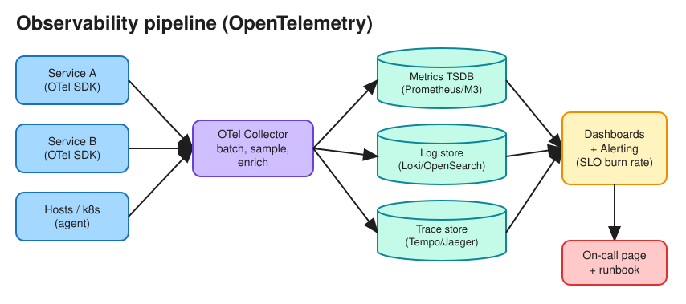

# Monitoring & Observability

> **TL;DR** — **Monitoring** tells you *that* something is wrong (known unknowns: dashboards and alerts).
> **Observability** lets you ask *why* (unknown unknowns), using three signal types: **metrics**
> (cheap aggregates), **logs** (detailed events), and **traces** (one request's path across services). Alert on
> **symptoms users feel** (SLO burn rate), not on every cause.

## The three pillars
| Signal | What | Cost / cardinality | Tools |
|---|---|---|---|
| **Metrics** | Numeric time series with labels (`http_requests_total{route="/pay",code="500"}`) | Cheap to store and query; **high-cardinality labels (user_id) explode cost** | Prometheus, Datadog, CloudWatch, M3, VictoriaMetrics |
| **Logs** | Timestamped events, ideally **structured** (JSON) with `trace_id` | Expensive at volume; sample or tier them | ELK/OpenSearch, Loki, Splunk |
| **Traces** | A tree of **spans** for one request across services | Sampled (head-based or tail-based) | OpenTelemetry, Jaeger, Zipkin, Tempo |

**OpenTelemetry (OTel)** is the vendor-neutral standard: one SDK emits all three signals, and an OTel Collector
routes them to any backend.

## What to measure
* **Golden signals** (Google SRE): **Latency**, **Traffic**, **Errors**, **Saturation**.
* **RED** (for request-driven services): **Rate**, **Errors**, **Duration**.
* **USE** (for resources such as CPU, disk, NIC, pools): **Utilization**, **Saturation**, **Errors**.
* Business KPIs: orders/min, sign-ups, payment success rate. These often catch what infrastructure metrics miss.

Metric types: **counter** (only goes up), **gauge** (goes up and down), **histogram** (bucketed distribution,
from which you compute p99). You can't average percentiles across hosts; aggregate histograms or sketches
(t-digest, HDR) instead.

## Pull vs push collection
| | Pull (Prometheus scrapes `/metrics`) | Push (agent → collector) |
|---|---|---|
| Pros | Knows when a target is down (scrape fails); easy to debug | Works for short-lived jobs and behind NAT/firewalls |
| Cons | Needs service discovery; short jobs need a Pushgateway | A silent service may be dead or just idle |

## Alerting
* Alert on **SLO burn rate** (e.g. "at the current error rate, the 30-day error budget will be gone in 2 days"),
  using multi-window rules (fast burn → page, slow burn → ticket).
* Every page must be **actionable** and link to a runbook. Noisy alerts get ignored.
* Use severity routing (PagerDuty or Opsgenie for pages; chat or tickets for warnings) and dedup and grouping
  (Alertmanager).
* Add **synthetic probes** (black-box checks from outside) on top of internal (white-box) metrics.

## Distributed tracing in practice
* Generate a `trace_id` at the edge and propagate it in headers (W3C `traceparent`) through every hop,
  including message queues.
* Each service creates spans with timing and attributes; the backend assembles the tree.
* **Tail-based sampling** keeps all slow or error traces and a small percentage of normal ones.
* Put `trace_id` in every log line so you can jump from a trace to its logs.

## Interview follow-ups
* *"Design a metrics system."* See [Metrics Monitoring & Alerting](../problems/distributed_metrics.md):
  agents → Kafka → stream aggregation → time-series DB (with downsampling and retention tiers) → query layer →
  alert evaluator.
* *"Why not just use logs for everything?"* Cost and query speed. Metrics are pre-aggregated, so they are
  cheap and fast, while logs scale with traffic.
* *"How do you debug a p99 latency spike?"* Start from the dashboard (which route and which host), then look at
  exemplar traces that show the slow span, then that span's logs, then check deploy and config changes in the
  window.

# References
* https://sre.google/sre-book/monitoring-distributed-systems/
* https://sre.google/workbook/alerting-on-slos/
* https://opentelemetry.io/docs/concepts/signals/
* https://www.brendangregg.com/usemethod.html
