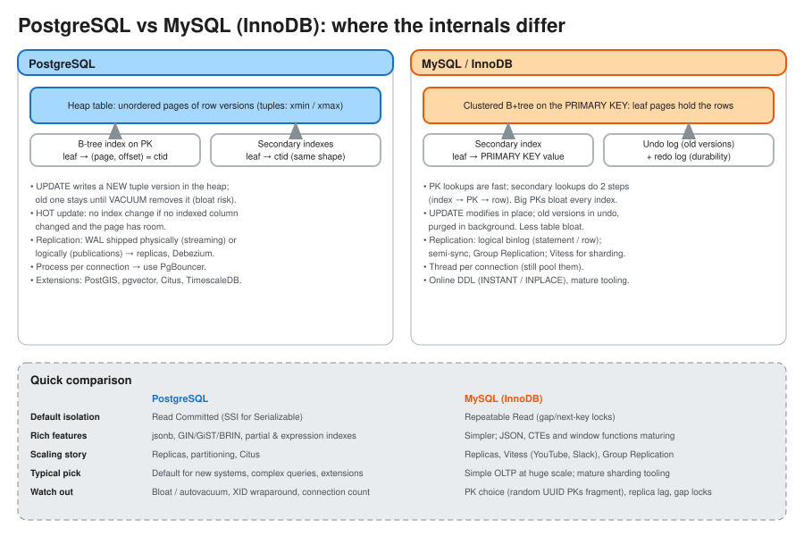

# PostgreSQL & MySQL (relational databases in depth)

> **TL;DR** — PostgreSQL and MySQL (InnoDB) are the two relational defaults. Both give ACID transactions, B-tree
> indexes, MVCC, WAL/redo logging, replicas and SQL. They differ in **storage layout** (Postgres: heap + separate
> indexes + vacuum; InnoDB: clustered primary-key B+tree + undo log), **isolation implementation** (snapshots + SSI vs
> next-key locks), **features** (Postgres has richer types/indexes/extensions) and **scaling tooling** (Vitess for MySQL,
> Citus for Postgres). In an interview, say "**Postgres by default**", know *why* it handles your numbers, and know the
> levers that scale it: **indexes → replicas + cache → pooling → partitioning → sharding → distributed SQL**.
> See [SQL vs NoSQL](database_sql_vs_nosql.md) for the debate and the scaling ladder, and [Transactions](transactions.md) for isolation.

## What you get from a relational database
* **Schema + constraints** (PK, FK, unique, check, exclusion) enforce invariants in the database.
* **Joins and a cost-based planner** (`EXPLAIN ANALYZE`): nested-loop, hash and merge joins; index and bitmap scans.
* **ACID transactions** with MVCC: readers don't block writers; writers block only conflicting writers.
* **Rich secondary indexing** and online-ish schema evolution.
* **Mature ecosystem**: drivers, ORMs, BI, backups, managed services (RDS, Aurora, Cloud SQL, AlloyDB, Azure DB).

## Storage engine essentials
| | PostgreSQL | MySQL / InnoDB |
|---|---|---|
| Table layout | **Heap** of 8 KB pages; rows (tuples) unordered; PK index is a normal secondary index | **Clustered B+tree on the PK**: rows live in the PK index leaves (16 KB pages) |
| Secondary index leaf | Pointer to heap tuple (`ctid`) | The **primary key value** → second lookup into the clustered index |
| Old row versions | Kept **in the heap** with `xmin/xmax`; reclaimed by **VACUUM / autovacuum** | Kept in the **undo log**; purged by a background thread |
| Updates | Write a new tuple (HOT update avoids index writes if no indexed column changed) | In-place modify + undo record |
| Durability | **WAL** (write-ahead log), checkpoints | **Redo log**, doublewrite buffer, plus **binlog** for replication |
| Typical pain | Table/index **bloat**, autovacuum tuning, **transaction-ID wraparound** | Large/random PKs fragment every secondary index; replica lag on big transactions |
| Connections | Process per connection → use a **pooler** (PgBouncer) | Thread per connection; still pool (ProxySQL) |

**Why this matters**: InnoDB's clustered index makes PK range scans and PK lookups very fast and favors small, ordered PKs
(auto-increment, UUIDv7/ULID over random UUIDv4). Postgres' heap makes secondary and PK indexes symmetric and enables
index-only scans (visibility map), but updates create dead tuples that need vacuuming. Uber's well-known 2016 post
"Why Uber Engineering Switched from Postgres to MySQL" cites write amplification, physical replication and upgrade pain at their
scale; it is a good story about *workload-specific* trade-offs, not a universal verdict.

## Indexing that interviewers expect
* **B-tree** (default) for equality/range/order; **composite** indexes follow the **leftmost-prefix rule**; order columns
  equality → range. See [Database Indexes](database_indexing.md).
* **Covering index** (Postgres `INCLUDE`; MySQL via secondary + PK) lets the query avoid the table.
* **Partial index** (Postgres): `CREATE UNIQUE INDEX ON orders(user_id) WHERE status='ACTIVE'`: uniqueness only among active rows.
* **Expression index** (`lower(email)`), **GIN** (`jsonb`, arrays, full-text), **GiST** (geometry, ranges, exclusion), **BRIN**
  (huge append-ordered tables like time series), **hash**. PostGIS and pgvector bring geospatial and vector search.
* Indexes aren't free: every write updates every index; too many slows writes and bloats memory. `EXPLAIN` before adding.
* **Keyset pagination** (`WHERE (created_at, id) < (:c, :i) ORDER BY … LIMIT n`) beats `OFFSET` at depth.

## Isolation, locking and concurrency
* Defaults: Postgres **Read Committed**, MySQL InnoDB **Repeatable Read**. Neither is Serializable, so write skew and lost
  updates remain possible. Postgres' `SERIALIZABLE` uses **SSI** (detects dangerous dependency cycles; clients must retry on
  serialization failure). InnoDB uses **next-key/gap locks** to prevent phantoms.
* **Row locks**: `SELECT … FOR UPDATE` (exclusive), `FOR SHARE`, `NOWAIT`, **`SKIP LOCKED`** (the standard trick for a job queue or
  "claim the next ready row" without blocking other workers).
* **Optimistic concurrency**: `UPDATE … SET …, version = version + 1 WHERE id = ? AND version = ?` and check rows affected.
* **Advisory locks** (Postgres `pg_advisory_lock`) provide app-level mutexes; see [Distributed Locking](distributed_locking.md) for caveats.
* **Deadlocks** happen; keep lock order consistent, transactions short, and retry.
* **Constraints as concurrency control**: unique keys prevent duplicates (idempotency keys, double-booking), and Postgres
  **exclusion constraints** (`EXCLUDE USING gist (room WITH =, during WITH &&)`) forbid overlapping time ranges. See [Hotel Reservation](../problems/hotel_reservation_system.md) and [Idempotency](idempotency.md).
* **Upserts**: `INSERT … ON CONFLICT DO UPDATE` (Postgres) / `ON DUPLICATE KEY UPDATE` (MySQL).

## Replication, HA and failover
| | PostgreSQL | MySQL |
|---|---|---|
| Physical | **Streaming replication** of WAL (async, or sync via `synchronous_commit` / `synchronous_standby_names`) | No WAL-shipping equivalent: replication is binlog-based (the Clone plugin seeds new replicas) |
| Logical | **Logical replication** (publications/subscriptions), logical decoding for CDC (Debezium) | **Binlog** (row/statement), the basis of most replication and CDC |
| Consistent HA | Patroni/repmgr + etcd/Consul; cloud managed failover | Semi-sync, **Group Replication / InnoDB Cluster**, Orchestrator |
| Sharding tools | **Citus** (extension), app-level | **Vitess** (YouTube, Slack, others), app-level |

* **Replica lag** is the root of read-your-writes bugs: route a user's reads to the primary (or a sufficiently caught-up replica) after
  a write, or use session/LSN/GTID waits. See [Replication](data_replication.md) and [Consistency](consistency.md).
* **Failover**: promote a replica, fence the old primary (avoid split-brain, see [Consensus](consensus.md)); async replication can lose the last transactions, sync replication trades latency for zero loss.
* **Managed services** hide most of this: RDS Multi-AZ (sync standby), Aurora (shared storage, single writer, fast failover). Aurora DSQL is a
  different, distributed design ([deep dive](aurora_dsql.md)).

## Scaling playbook (what to say, in order)
1. **Fix queries**: indexes, remove N+1, `EXPLAIN`, batch writes, right data types.
2. **Connection pooling** (PgBouncer/ProxySQL); keep transactions short.
3. **Read replicas + caching** ([Caching](caching.md)); most workloads are read-heavy.
4. **Scale up** (CPU, RAM so the working set fits, NVMe; provisioned IOPS) and tune (shared buffers / buffer pool, WAL).
5. **Partition large tables** (declarative partitioning by time/tenant) for pruning, cheap retention (`DROP PARTITION`), smaller indexes.
6. **Archive/cold storage** old data; move analytics to a warehouse/OLAP ([OLTP vs OLAP](database_types.md#oltp-vs-olap)).
7. **Functional split** by service/bounded context.
8. **Shard** (Citus/Vitess/app level) with a shard key like `tenant_id`/`user_id`: see [Partitioning](data_partitioning.md).
9. **Distributed SQL** (Spanner, CockroachDB, TiDB, Aurora DSQL) when one write primary or one Region can't do the job.

**Order-of-magnitude anchors** (verify for your hardware/workload): a well-provisioned single node comfortably handles
low-TB data and tens of thousands of simple reads/s, thousands to low tens of thousands of writes/s.

## Schema changes and operations
* Postgres: `ADD COLUMN` with a constant default is fast on modern versions; `CREATE INDEX CONCURRENTLY` avoids blocking writes; avoid long `ALTER` locks; use `lock_timeout`.
* MySQL: online DDL (`ALGORITHM=INSTANT/INPLACE`), tools like gh-ost / pt-online-schema-change for big tables.
* **Expand → backfill → contract**: add nullable column, dual-write, backfill in batches, switch reads, drop the old one.
* Backups: base backup + WAL/binlog archive gives **point-in-time recovery**; test restores. Monitor replication lag, bloat/autovacuum,
  long-running transactions, lock waits, connection count, cache hit ratio.

## Patterns you can build with just Postgres/MySQL
| Need | Pattern |
|---|---|
| Idempotent API / dedup | Unique constraint on an idempotency key; insert-then-process |
| Job queue | `SELECT … FOR UPDATE SKIP LOCKED` on a `jobs` table (modest scale) |
| Outbox | Write business row + outbox row in one transaction; CDC/poller publishes to Kafka |
| Inventory / double-booking | Row lock or conditional `UPDATE … WHERE stock >= :n`; exclusion constraint for time ranges |
| Counters | Atomic `UPDATE … SET n = n + 1`; shard hot counters across rows or batch via cache |
| Hierarchies | Adjacency list + recursive CTE; materialized path / `ltree` |
| Full-text / JSON / geo / vector | `tsvector`+GIN, `jsonb`+GIN, PostGIS, pgvector (until scale demands a specialist store) |
| Multi-tenant | `tenant_id` in every key (+ row-level security); shard by tenant later |

## Postgres or MySQL?
| Choose | When |
|---|---|
| **PostgreSQL** | New systems by default; complex queries; rich types (`jsonb`, arrays, ranges), extensions (PostGIS, pgvector, Timescale, Citus), strong standards compliance |
| **MySQL** | Simple, very high-volume OLTP with ordered PKs; need Vitess-style mature sharding; existing MySQL expertise and tooling (many large web companies) |

If your interviewer doesn't care, say Postgres. If asked for a difference, talk about heap vs clustered index, MVCC/vacuum vs undo, and extension ecosystem vs sharding tooling.

## Pitfalls checklist
* Missing indexes / unselective indexes; `SELECT *`; N+1 queries; `OFFSET` pagination; implicit casts that defeat indexes.
* Long transactions (blocking vacuum, holding locks); idle-in-transaction connections; connection storms without a pooler.
* Autovacuum starvation, bloat, XID wraparound (Postgres); random UUIDv4 PKs (InnoDB) or enormous PKs duplicating into every index.
* Assuming Read Committed/Repeatable Read prevents write skew; not retrying on serialization failures/deadlocks.
* Trusting replicas for fresh reads; async replication data loss on failover; no fencing.
* Hot rows (global counters, a single "inventory" row); big batch updates that lock tables or flood replication.
* Sharding too early, or with a shard key that creates hot shards or cross-shard joins.

## Interview follow-ups
* *"How would you scale Postgres to 100k QPS?"* Reads: replicas + cache. Writes: batching, partitioning, bigger hardware, then shard by user/tenant.
* *"Why is the primary key so important in MySQL?"* Clustered index: rows are stored in PK order, and every secondary index stores the PK, so size and randomness matter.
* *"What's MVCC?"* Each transaction sees a snapshot; writes create new versions; old versions are cleaned by vacuum (Postgres) or purge (InnoDB).
* *"How do you avoid double-booking?"* Unique/exclusion constraint or `SELECT FOR UPDATE`/conditional update, in one transaction; return a conflict error and retry or reject.
* *"How do you build a reliable queue in SQL?"* `SKIP LOCKED` workers, visibility timeout/lease column, attempts counter, dead-letter state. Switch to Kafka/SQS when throughput or fan-out outgrows it.
* *"Sync or async replication?"* Async for latency/availability (risk losing the tail), sync/semi-sync for zero-loss on failover (higher write latency, availability coupling).
* *"When leave Postgres?"* When a single write primary, a Region, or a query shape (full-text, graph, OLAP, ms-latency key-value) outgrows it; name the number.

# References
* [PostgreSQL documentation: MVCC, WAL, indexes](https://www.postgresql.org/docs/current/mvcc.html)
* [MySQL InnoDB multi-versioning and locking](https://dev.mysql.com/doc/refman/8.0/en/innodb-multi-versioning.html)
* [Use The Index, Luke](https://use-the-index-luke.com/)
* [Why Uber Engineering Switched from Postgres to MySQL (2016)](https://www.uber.com/blog/postgres-to-mysql-migration/)
* Designing Data-Intensive Applications, Chapters 3, 5, 6, 7
