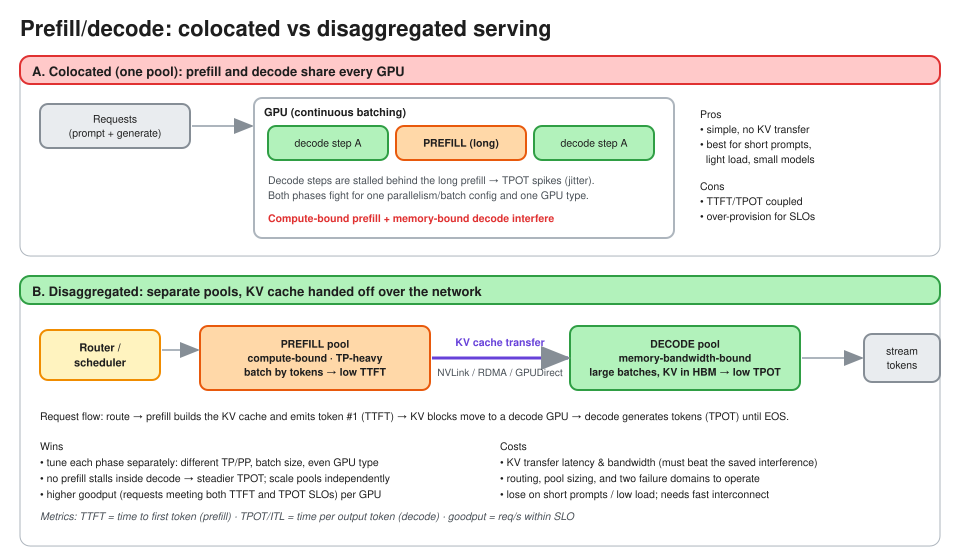

# Prefill/Decode Disaggregated Serving (LLM Inference)

> **TL;DR** — LLM inference has two phases with opposite bottlenecks: **prefill** processes the whole prompt in one parallel pass (**compute-bound**, determines **TTFT**), and **decode** generates one
> token at a time reusing the **KV cache** (**memory-bandwidth-bound**, determines **TPOT**). Running both on the same GPUs makes them **interfere** (a long prefill stalls everyone's decode steps) and forces one
> parallelism/batch configuration on both. **Prefill/decode (P/D) disaggregation** runs them on **separate GPU pools** and **transfers the KV cache** from prefill to decode over a fast interconnect, so each pool is tuned and
> scaled independently and both SLOs are met with fewer GPUs. It pays off for **long prompts, strict latency SLOs, high load**; it loses for short prompts, light load, or slow interconnects. General concept:
> [Disaggregated serving](disaggregated_serving.md). Related: [Caching](caching.md), [Load balancing](load_balancing.md), [Backpressure](backpressure_load_shedding.md), [Hot keys](hot_keys.md).



## Background: what an LLM request does
1. **Prefill**: all prompt tokens (`N` of them) go through the model in parallel, producing the **KV cache** (per layer, per token: keys and values) and the **first output token**. Arithmetic intensity is high → **compute-bound**, scales ~with prompt length (attention cost grows ~quadratically).
2. **Decode**: autoregressive loop; each step feeds one new token, **reads the entire model weights + KV cache** from HBM, writes one more KV entry, and samples the next token. Arithmetic intensity is low → **memory-bandwidth-bound**; larger **batches** amortize the weight reads, so decode wants *many concurrent sequences*.
3. **KV cache memory**: roughly `2 × layers × kv_heads × head_dim × bytes × tokens` per sequence (e.g. tens to hundreds of KB per token for large models; GBs per long sequence). It's the main capacity limiter for decode batch size. **PagedAttention** (vLLM) allocates it in blocks to avoid fragmentation.

| Metric | Meaning | Driven by |
|---|---|---|
| **TTFT** | Time to first token | Queueing + prefill (prompt length, prefill batch) |
| **TPOT / ITL** | Time per output token / inter-token latency | Decode step time (batch size, KV size, memory bandwidth), interference |
| **Throughput** | Tokens/s/GPU | Batch size, utilization |
| **Goodput** | Requests/s that meet *both* TTFT and TPOT SLOs | What disaggregation actually optimizes |

## The problem with colocation
- **Prefill-decode interference**: with continuous batching, a long prompt's prefill occupies the GPU for 100s of ms-seconds, delaying every in-flight decode step → **TPOT spikes / jitter**. Conversely, decode-heavy batches slow prefills → higher TTFT.
- **Coupled configuration**: ideal tensor/pipeline parallelism, batch size and even GPU type differ per phase, but a colocated replica has one.
- **Over-provisioning**: to hit strict TTFT *and* TPOT, you add GPUs until the worst interference is tolerable, wasting capacity most of the time.
- **Mitigation without splitting**: **chunked prefill** (Sarathi-Serve) splits prompts into chunks interleaved with decodes, trading some TTFT for steadier TPOT. Often the right first step; disaggregation goes further by removing contention entirely.

## Disaggregated architecture
```
Client ─▶ Router/scheduler ─▶ Prefill worker ──(KV cache transfer)──▶ Decode worker ─▶ stream tokens
                │  pool state, queue depth, KV-cache hit/locality      ▲
                └────────────── control plane: autoscale, rebalance ───┘
```
- **Prefill pool**: optimized for TTFT; small/“token-budget” batches, parallelism tuned for latency (often higher TP), may use compute-dense GPUs. Can reuse **prefix cache** hits to skip recomputation.
- **Decode pool**: optimized for throughput under a TPOT SLO; big batches, memory-bandwidth-rich GPUs, parallelism and KV-memory management tuned for capacity (sometimes lower TP + more replicas, or expert parallelism for MoE).
- **KV transfer**: after prefill, the KV blocks (and first token) move to a chosen decode worker; transfer can be **layer-by-layer pipelined** with prefill compute to hide latency, using **NVLink/NVSwitch (intra-node), RDMA/InfiniBand/RoCE (cross-node), GPUDirect**, or via a host/CPU/remote store (NIXL, Mooncake Transfer Engine, NCCL, LMCache connectors).
- **Router**: picks prefill worker (prefix-cache locality, load) and decode worker (free KV memory, queue); handles **backpressure** and admission ([Backpressure](backpressure_load_shedding.md)). Can be **pull-based** (decode pulls KV when it has capacity) or push-based.
- **Control plane**: autoscales pool sizes by **prompt-length/output-length mix**, queue delay and SLO attainment; rebalances ratio (e.g. 1:2 prefill:decode) as traffic shifts.

## When does it win?
Break-even condition (conceptual): **KV transfer time + extra hop < interference/over-provisioning cost removed.**
| Favors disaggregation | Favors colocation (+ chunked prefill) |
|---|---|
| Long prompts (RAG, agents, code, summarization), long outputs | Short prompts, short outputs |
| Tight TTFT **and** TPOT SLOs simultaneously | Loose or one-sided SLOs |
| High, steady load (big pools to specialize) | Low/bursty load, small cluster |
| Fast interconnect (NVLink/RDMA), big models | Slow network, small models, single node |
| Heterogeneous hardware available | Homogeneous, small fleet |
| Need independent autoscaling per phase | Operational simplicity valued |
Sizing intuition: KV size ∝ prompt tokens; transfer time = KV bytes ÷ bandwidth (e.g. several GB over 200-400 Gb/s RDMA ≈ 100s of ms; over NVLink ≈ ms) → must be small relative to the prefill time it overlaps.

## Design details and trade-offs
- **Sizing the ratio**: prefill capacity ∝ input tokens/s; decode capacity ∝ concurrent sequences × KV memory. Start from measured TTFT/TPOT curves per pool; search for the split that maximizes goodput per GPU (DistServe optimizes placement and parallelism per phase).
- **Prefix caching & KV reuse**: shared system prompts / multi-turn context avoid recomputation; route requests to prefill workers holding the prefix; a **global KV cache pool** (CPU DRAM/SSD/remote, e.g. Mooncake, LMCache) extends capacity beyond HBM ([Caching](caching.md), [Consistent hashing](consistent_hashing.md) for cache-aware routing).
- **Heterogeneous GPUs**: Splitwise showed prefill on compute-rich and decode on cheaper/high-memory-bandwidth GPUs can cut cost/power; KV transfer bandwidth is the constraint.
- **Parallelism per phase**: tensor parallel reduces prefill latency; decode often prefers more replicas/larger batches; MoE models use expert parallelism with different layouts per phase.
- **Failure handling**: if a decode worker dies mid-stream, re-run prefill (or reload KV from a cache tier) and resume, or fail the request; prefill failure is cheap to retry (idempotent); keep KV transfers **time-bounded** with fallback to local decode; health checks and circuit breakers ([Resilience](resilience_patterns.md)).
- **Scheduling policy**: separate queues and admission; prioritize short prompts in prefill (SJF-like) to protect TTFT; decode scheduling to avoid KV memory exhaustion (preemption, swap, recompute).
- **Cost of the split**: extra network traffic and complexity, two pools to scale/monitor, potential decode-side head-of-line blocking if prefill outputs outpace capacity; observability must span both phases (per-request trace with TTFT, transfer time, TPOT).
- **Alternatives/complements**: chunked prefill, speculative decoding, quantization (smaller weights/KV), KV-cache compression/eviction, continuous batching, prefix caching. Disaggregation composes with all of them.

## Where it's used
Research: **DistServe** (OSDI '24), **Splitwise** (ISCA '24), **Mooncake** (Kimi; KV-centric disaggregation, FAST '25), **TetriInfer**. Systems: **vLLM** (disaggregated prefill connectors), **SGLang**, **NVIDIA Dynamo**, **llm-d** (Kubernetes-native, vLLM-based), TensorRT-LLM; large providers run P/D splits internally. Check each project's current docs for maturity and supported transports (this area changes quickly).

## Case study: NVIDIA Dynamo
Dynamo (announced March 2025 as the successor to Triton Inference Server for multi-node generative AI; open source on GitHub, `ai-dynamo/dynamo`) is a good concrete example of the architecture above. It supports TensorRT-LLM, vLLM, SGLang and PyTorch backends. Its four components map directly to the design pieces in this note:

| Dynamo component | Role | Maps to |
|---|---|---|
| **Planner** | Watches GPU capacity and latency targets; decides per request whether to disaggregate, and shifts/adds GPUs between the prefill and decode pools | Control plane: autoscaling the P:D ratio |
| **Smart Router** | Tracks where KV blocks live across the cluster (radix-tree hashing of prompts), scores cache overlap, and balances reuse against load, instead of round-robin | Prefix-cache-aware routing ([Consistent hashing](consistent_hashing.md)) |
| **Distributed KV Cache Manager** | Offloads cold KV blocks from HBM to CPU memory, local SSD or object storage at GPU, node and cluster levels | KV-cache tiering ([Disaggregated serving](disaggregated_serving.md)) |
| **NIXL** (Inference Transfer Library) | Async point-to-point transfers across HBM, DRAM, SSD and networked storage with one API over GPUDirect Storage, UCX, S3, etc. | KV transfer layer |

NVIDIA's reported results (vendor numbers, measured on their own configurations; treat as indicative, not as a benchmark you can generalize):
- Up to **30× more requests served** for DeepSeek-R1 671B on GB200 NVL72 (TensorRT-LLM, FP4, 32K input / 8K output). This figure is footnoted as *projected performance, subject to change*, and the baseline was in-flight batching on a different parallelism layout than the disaggregated setup (which used separate context and generation parallelism).
- **More than 2× throughput** for Llama 70B on Hopper GPUs (vLLM, FP8, ~3K input / 50 output): baseline TP8×DP2 vs disaggregated context TP2×DP4 and generation TP8. Note the *different parallelism per phase*, which is exactly the benefit described above.
- Smart Router: improved TTFT and end-to-end latency in their test on 2 HGX-H100 nodes with 8 vLLM replicas of DeepSeek-R1-Distill-Llama-70B and 100K real requests (avg. 4K input / 800 output); exact gains are shown only in charts.

Takeaway for interviews: the headline gains come from combining **per-phase parallelism, cache-aware routing, and KV tiering**, not from the split alone, and they are largest for long-input, reasoning-style workloads.

## Interview angle (how to talk about it)
1. State the two phases and their bottlenecks (compute-bound vs memory-bound) and the two SLOs (TTFT, TPOT).
2. Show the interference problem and mention chunked prefill as the cheaper first fix.
3. Present the split with **KV transfer** as the key cost, name interconnects, and give the break-even reasoning.
4. Discuss routing (prefix locality, load), autoscaling the P:D ratio, failure handling, and observability.
5. Tie to general patterns: right-size resources per workload ([Scaling reads/writes](scaling_reads.md)), independent scaling, backpressure.

## Pitfalls
- Disaggregating small models/short prompts (transfer cost dominates); slow or congested network; fixed P:D ratio that drifts from the workload mix; ignoring KV memory exhaustion on decode; no timeouts/fallback on transfer; measuring tokens/s instead of **goodput**; forgetting multi-turn prefix locality in routing.

## Interview follow-ups
- *"Why is decode memory-bound?"* Each step reads all weights and the KV cache to produce one token per sequence; low FLOPs per byte moved, so batch size and HBM bandwidth set speed.
- *"What does the KV transfer cost and how do you hide it?"* KV bytes ÷ link bandwidth; pipeline per layer with prefill compute, use RDMA/NVLink, compress/quantize KV, prefer co-located nodes.
- *"How do you size the pools?"* From measured prefill tokens/s and decode concurrency under SLO; autoscale on queue delay and SLO attainment.
- *"Chunked prefill vs disaggregation?"* Chunked prefill is simple and reduces interference but still shares GPUs; disaggregation removes it and allows per-phase tuning at the price of transfer and complexity.

# References
* [DistServe: Disaggregating Prefill and Decoding for Goodput-optimized LLM Serving (OSDI '24)](https://arxiv.org/abs/2401.09670)
* [Splitwise: Efficient generative LLM inference using phase splitting (ISCA '24)](https://arxiv.org/abs/2311.18677)
* [Mooncake: A KVCache-centric Disaggregated Architecture for LLM Serving](https://arxiv.org/abs/2407.00079)
* [Sarathi-Serve: chunked prefills (OSDI '24)](https://arxiv.org/abs/2403.02310), [Efficient Memory Management for LLM Serving with PagedAttention](https://arxiv.org/abs/2309.06180)
* [Introducing NVIDIA Dynamo (NVIDIA Technical Blog)](https://developer.nvidia.com/blog/introducing-nvidia-dynamo-a-low-latency-distributed-inference-framework-for-scaling-reasoning-ai-models/)
* [vLLM docs: disaggregated prefilling](https://docs.vllm.ai/), [NVIDIA Dynamo repo](https://github.com/ai-dynamo/dynamo), [llm-d](https://github.com/llm-d/llm-d)
