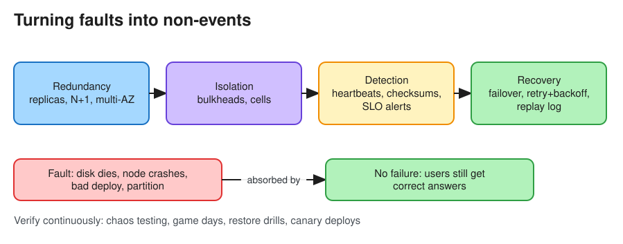

# Reliability

> **TL;DR** — Reliability is the probability that a system performs its intended function **correctly** over a
> period of time, even when things go wrong (*faults*). Design so that faults (a disk dies, a node crashes, a bad
> deploy) do not become *failures* (users get wrong answers or none). The main tools are redundancy, isolation,
> detection, and recovery.

## Fault vs failure
* **Fault**: one component deviates from its spec (a disk error, a GC pause, a dropped packet, a bug).
* **Failure**: the system *as a whole* stops providing the required service to users.
* A reliable (fault-tolerant) system stops faults from cascading into failures (DDIA, ch. 1).

| Fault type | Examples | Typical mitigation |
|---|---|---|
| Hardware | Disk, NIC, power, rack, AZ loss | Redundancy (RAID, replicas, multi-AZ), automatic replacement |
| Software | Bugs that hit every node at once, leap-second bugs, memory leaks, cascading failures | Canary deploys, bulkheads, timeouts, circuit breakers, chaos testing |
| Human | Bad config push, wrong command run | Staged rollouts, easy rollback, guardrails, good observability, blameless postmortems |
| Network | Partition, latency spike, packet reordering | Retries with idempotency, timeouts, quorum protocols |

## Reliability vs availability vs durability
| Property | Question it answers | Example metric |
|---|---|---|
| **Availability** | Does it respond? | 99.99% of requests succeed |
| **Reliability** | Does it respond *correctly*, consistently, over time? | MTBF, error rate, correctness |
| **Durability** | Once acknowledged, is the data still there later? | 99.999999999% (11 nines) object durability |

A system that returns `200 OK` with corrupted data is *available but not reliable*. Reliability implies
availability; the reverse is not true.

## Metrics
* **MTBF** (mean time between failures): higher is better.
* **MTTR** (mean time to recovery): lower is better. It is made of detect + diagnose + fix + verify.
* **MTTD** (mean time to detect): usually the largest part of MTTR, which is why monitoring matters.
* **Failure rate** λ = 1 / MTBF. For a constant rate, `R(t) = e^(−λt)` (the probability of surviving time t).

## Building blocks

1. **Redundancy**: replicate data ([Replication](data_replication.md)), run N+1 or N+2 instances, multi-AZ or
   multi-region.
2. **Isolation**: bulkheads, cell-based architecture, separate thread or connection pools per dependency, so that
   one failure has a limited *blast radius*.
3. **Detection**: [Heartbeats](heartbeats.md), health checks, [Checksums](checksums.md) for silent data corruption,
   alerting on SLOs ([Monitoring](monitoring.md)).
4. **Recovery**: automatic failover, retries with backoff, replays from a durable log, restoring from backups.
   See [Resilience Patterns](resilience_patterns.md).
5. **Correctness under retries**: [Idempotency](idempotency.md) and exactly-once *effects*.
6. **Change safety**: CI, canary releases, feature flags, automated rollback.
7. **Verification**: chaos engineering (Netflix Chaos Monkey), game days, disaster recovery drills, restore
   tests (a backup that has never been restored is not a backup).

## Cascading failures (a classic interview topic)
A cascading failure starts when one slow dependency causes callers' threads to pile up. The callers time out and
retry, the retries multiply the load, and the overloaded nodes crash, which pushes their load onto the survivors.
Defences:
* Timeouts on **every** remote call, shorter than the caller's own deadline (deadline propagation).
* Retry budgets plus exponential backoff with jitter. Never retry on overload responses (`429`, `503` with
  `Retry-After`) without backing off.
* Circuit breakers, load shedding (drop low-priority traffic first), and queue-length limits.
* Autoscaling, which helps only if the bottleneck is not shared (for example, the database).

## Interview follow-ups
* *"How do you make writes reliable?"* Use a durable acknowledgement (write to a replicated log or a quorum
  before acking), an idempotency key for client retries, and a transactional outbox for side effects.
* *"How would you detect silent data corruption?"* End-to-end checksums on write and read, background scrubbing,
  and Merkle-tree anti-entropy between replicas.
* *"What would you put in a postmortem?"* A timeline, impact, root cause plus contributing factors, what went
  well, action items with owners. Keep it blameless.

# References
* Designing Data-Intensive Applications, Chapter 1: Reliability
* https://sre.google/sre-book/addressing-cascading-failures/
* https://github.com/karanpratapsingh/system-design#availability-vs-reliability
* https://netflixtechblog.com/the-netflix-simian-army-16e57fbab116
