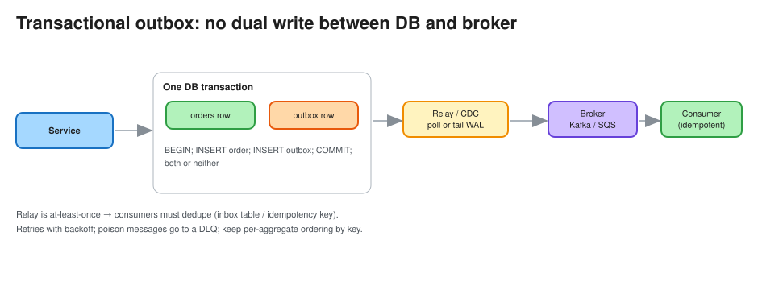

# Reliable Messaging: Outbox, Retries, DLQ & Deduplication

> **TL;DR** — The classic bug is the **dual write**: update the DB *and* publish an event, and one fails. Fix it with the **transactional outbox**: write the event to an `outbox` table in the *same* DB
> transaction as the state change, and a **relay** (poller or **CDC/Debezium**) publishes it to the broker **at-least-once**. Consumers then must be **idempotent** (inbox/dedup table), use **retries with
> backoff**, and send poison messages to a **dead-letter queue**. Result: no lost events, no phantom events, effectively-once processing. See [Delivery semantics](delivery_semantics.md), [Idempotency](idempotency.md), [Kafka](kafka.md), [SQS](sqs.md), [Event sourcing/CDC](event_sourcing_cqrs_cdc.md).



## The dual-write problem
| Order | Failure | Result |
|---|---|---|
| DB commit, then publish | Crash between | **Lost event** (state changed, nobody told) |
| Publish, then DB commit | DB fails/rolls back | **Phantom event** (announced something that didn't happen) |
| Two-phase commit across DB+broker | Unsupported / blocking | Impractical |

## Transactional outbox
1. In one local transaction: apply business change **and** `INSERT INTO outbox(id, aggregate_id, type, payload, created_at)`.
2. **Relay** reads unsent rows and publishes to Kafka/SNS/SQS, then marks them sent (or deletes):
   - **Polling publisher**: `SELECT … WHERE sent=false ORDER BY id LIMIT n FOR UPDATE SKIP LOCKED`; simple; adds DB load/latency.
   - **Log-based CDC** (Debezium reading the WAL/binlog): low latency, no polling, preserves commit order ([WAL](wal_lsm.md)).
3. Broker delivery is **at-least-once**: relay may publish twice after a crash. Use the outbox `id` as the message id/idempotency key.
4. Keep partition key = `aggregate_id` so one entity's events stay ordered ([Kafka](kafka.md)).
5. Clean up published rows (TTL/batch delete/partition drop).

**Inbox (consumer side)**: `INSERT INTO inbox(message_id)` (unique) in the same transaction as the effect; duplicates fail and are skipped. Retain ids ≥ the redelivery window.

## Retries
- **Immediate retry** for transient errors (limited), then **exponential backoff with jitter**; cap attempts and total time.
- **Delay/retry queues**: SQS delay/visibility timeout, Kafka retry topics (`retry-1m`, `retry-10m`) preserving the original key; avoids blocking the main partition ([SQS](sqs.md)).
- **Retry only idempotent operations** or guard with keys ([Idempotency](idempotency.md)).
- **Budgeted retries** to avoid retry storms against a struggling dependency ([Backpressure](backpressure_load_shedding.md)).

## Dead-letter queues (DLQ)
- After N failed attempts (or a non-retryable error such as schema/validation failure), move the message to a **DLQ** with metadata (error, attempts, original topic/partition/offset, trace id).
- **Alert on DLQ depth**; triage, fix code/data, then **redrive** (replay) into the main queue; keep DLQ retention long enough.
- **Poison pill** handling matters most for ordered streams: a stuck message blocks a partition: use per-message retry topics or skip-after-DLQ.
- Kafka has no native DLQ: implement with a producer to a `.dlq` topic (frameworks: Spring Kafka, Kafka Connect `errors.deadletterqueue`) ([Kafka](kafka.md)).

## Putting it together
```
Service A tx: [state change + outbox row] ──▶ relay/CDC ──▶ broker ──▶ consumer B
                                                              │         ├─ dedupe (inbox) → apply effect → commit offset/ack
                                                              │         └─ fail N× → retry topic → DLQ → alert/redrive
```

## Ordering, schema, and ops
- Per-key ordering via partition key; retries can reorder → include sequence/version numbers, ignore stale events.
- **Schema evolution**: versioned events, schema registry, backward-compatible changes ([API design](api_design.md)).
- **Monitoring**: outbox lag (age of oldest unsent), consumer lag, DLQ depth, redelivery rate.
- **Backfill/replay**: events are immutable; replays must be safe (idempotent consumers).
- **Alternatives**: event sourcing (the log *is* the state) ([ES/CQRS](event_sourcing_cqrs_cdc.md)); listen-to-yourself (publish first, apply from own event); sagas for multi-service flows ([Sagas](multi_step_processes.md)).

## Pitfalls
- Publishing inside the DB transaction (blocking; commit/publish mismatch); outbox table growth; relay as a single point of failure with no ordering/leader election; consumers without dedupe; infinite retry loops blocking a partition; DLQ with nobody watching; using timestamps instead of sequence numbers for ordering.

## Interview follow-ups
- *"How do you guarantee an event is published when the order is saved?"* Transactional outbox + CDC/poller, at-least-once publish, idempotent consumers.
- *"Why not just publish after commit?"* A crash in between loses the event.
- *"What if the consumer keeps failing on one message?"* Bounded retries with backoff, then DLQ + alert + redrive.
- *"Exactly-once?"* At-least-once delivery + idempotent handling ([Delivery semantics](delivery_semantics.md)).

# References
* [Microservices.io: Transactional outbox](https://microservices.io/patterns/data/transactional-outbox.html), [Debezium outbox event router](https://debezium.io/documentation/reference/stable/transformations/outbox-event-router.html)
* [Hello Interview: Reliable messaging / Kafka deep dive](https://www.hellointerview.com/learn/system-design/deep-dives/kafka) · Designing Data-Intensive Applications, Chapter 11
