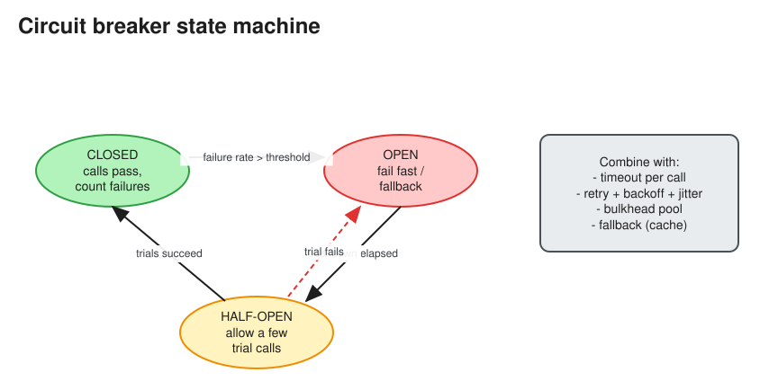

# Resilience Patterns: Timeouts, Retries, Circuit Breaker, Bulkhead

> **TL;DR** — Remote calls fail and, worse, become *slow*. Protect every call with a **timeout**, retry only
> idempotent operations with **exponential backoff + jitter** inside a **retry budget**, wrap flaky dependencies
> in a **circuit breaker** to fail fast, isolate resources with **bulkheads**, and **shed load** before
> overload turns into a cascading failure. Always define a **fallback** (cached data, default value, degraded
> feature).

## Timeouts
* Every network call needs a timeout. Without one, a hung dependency ties up threads until the caller dies.
* Set it from the dependency's latency (e.g. a bit above its p99.9) and the caller's **deadline**. Propagate
  the remaining deadline downstream (gRPC deadlines) so inner calls don't outlive the outer request.
* Separate **connect** timeouts (short) from **read** timeouts.

## Retries
* Retry only **transient** errors (timeouts, `503`, connection reset) on **idempotent** operations (see
  [Idempotency](idempotency.md)). Never retry `400`-type errors.
* **Exponential backoff + jitter**: `sleep = random(0, min(cap, base × 2^attempt))` ("full jitter"). Jitter
  prevents synchronized retry storms (the thundering herd).
* **Retry budget**: limit retries to e.g. 10% of requests per client. Retry at **one layer** only; retries at
  every layer of a 3-deep chain amplify load up to 3³ = 27x.
* Respect `Retry-After` and `429`.
* **Hedged requests**: for tail latency, send a second request to another replica if the first hasn't answered
  by the p95. Cancel the loser. Use only for idempotent reads.

## Circuit breaker


| State | Behavior | Transition |
|---|---|---|
| **Closed** | Calls pass through; failures are counted in a rolling window | Failure rate > threshold (e.g. 50% of ≥20 calls) → Open |
| **Open** | Calls **fail immediately** (or return the fallback), giving the dependency time to recover | After a cool-down (e.g. 30 s) → Half-open |
| **Half-open** | Let a few trial requests through | Trials succeed → Closed; any fails → Open |

* Benefits: fail fast (no threads waiting on a dead service), less load on the struggling dependency, automatic
  recovery.
* Libraries: Resilience4j (Java), Polly (.NET), Envoy/Istio outlier detection (mesh level). Hystrix is in
  maintenance mode.

## Bulkhead
* Partition resources so one failing dependency can't exhaust everything: **separate thread pools or connection
  pools per dependency**, per-tenant quotas, separate clusters (cells) for premium customers.
* The name comes from ship hulls: a breach floods one compartment, not the whole ship.

## Load shedding, rate limiting, backpressure
* **Rate limiting**: cap the request rate per client or API key at the edge. See
  [Rate Limiter](../problems/rate_limiter.md).
* **Load shedding**: when saturated (queue length, CPU, concurrency limit), reject low-priority requests early
  with `503` so high-priority traffic keeps working. Adaptive concurrency limits (Netflix
  `concurrency-limits`) adjust automatically.
* **Backpressure**: bounded queues and pull-based consumers make slow consumers slow down producers instead of
  running out of memory.

## Fallbacks and graceful degradation
* Serve stale data from a cache ("stale-while-revalidate"), a default (generic recommendations), or a reduced
  feature (hide the reviews widget).
* Queue the write for later (accept the order, process the payment asynchronously).
* Fail **closed** for security and money checks, fail **open** for non-critical features.

## Putting it together (one outbound call)
```text
request -> rate limiter -> bulkhead (pool for dependency X)
        -> circuit breaker (open? -> fallback)
        -> timeout(deadline remaining) -> retry w/ backoff+jitter (idempotent only, budgeted)
        -> on final failure: fallback + metric + trace
```

## Interview follow-ups
* *"The recommendation service is down. What does the home page do?"* The breaker opens, the page renders with
  a cached or popular-items fallback, and alerts fire. The page still loads.
* *"Why do retries make outages worse?"* They multiply load exactly when the dependency is overloaded. Use
  budgets, backoff with jitter, breakers, and retries at a single layer.

# References
* https://aws.amazon.com/builders-library/timeouts-retries-and-backoff-with-jitter/
* https://aws.amazon.com/blogs/architecture/exponential-backoff-and-jitter/
* https://martinfowler.com/bliki/CircuitBreaker.html
* https://learn.microsoft.com/en-us/azure/architecture/patterns/bulkhead
* https://sre.google/sre-book/handling-overload/
* https://medium.com/geekculture/design-patterns-for-microservices-circuit-breaker-pattern-276249ffab33
