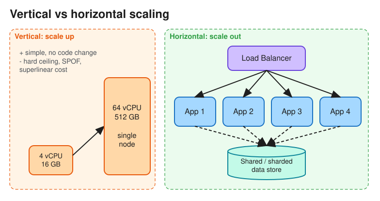

# Scalability

> **TL;DR** — Scalability is a system's ability to handle more load (users, QPS, data) by adding resources,
> while keeping performance acceptable. **Scale up** (a bigger machine) is simple but has a ceiling.
> **Scale out** (more machines) needs stateless services, partitioned data, and tolerance of partial failure.
> Always say *which* load parameter you are scaling (reads, writes, fan-out, storage) and *where* the
> bottleneck is.

## Describing load and performance
* **Load parameters**: requests/sec, read:write ratio, concurrent connections, data size, fan-out (e.g. followers
  per user).
* **Latency**: the time to serve one request. Report **percentiles** (p50, p95, p99, p99.9), not averages. Tail
  latency dominates when one user request fans out to many backend calls.
* **Throughput**: requests (or bytes) processed per unit time.
* **Little's Law**: `concurrency = throughput × latency`. At 2,000 req/s and 50 ms, about 100 requests are in
  flight. Use it to size thread pools and connection pools.
* **Performance vs scalability**: a *performance* problem means the system is slow for a single user. A
  *scalability* problem means it is fast for one user but slow under heavy load.

## Vertical vs horizontal scaling

| | Vertical (scale up) | Horizontal (scale out) |
|---|---|---|
| How | More CPU, RAM or disk on one node | More nodes behind a load balancer, or data partitions |
| Limit | Hardware ceiling; cost grows superlinearly | Practically unbounded |
| Complexity | Low: no code changes | High: distribution, consistency, partial failures |
| Failure | Single point of failure | Redundant by design |
| Downtime | Often needs a restart to resize | Add or remove nodes live |
| Good for | Relational DB primaries, early stages | Stateless web/app tiers, caches, NoSQL stores |

Interview tip: start vertical and simple, and say when you would move to horizontal (e.g. "a single Postgres
handles ~10k writes/s; beyond that we shard by user_id").

## Techniques by tier
| Tier | Techniques |
|---|---|
| Edge | [DNS](dns.md) geo-routing, [CDN](cdn.md) for static and cacheable content |
| Traffic | [Load balancers](load_balancing.md), [API gateway](api_gateway.md), rate limiting |
| Compute | **Stateless** services (sessions in Redis or JWT), autoscaling groups, containers |
| Read path | [Caching](caching.md) (cache-aside), read replicas, denormalized read models (CQRS) |
| Write path | [Sharding](data_partitioning.md), write-behind buffering, async processing via queues ([Asynchronism](asynchronism.md)) |
| Data growth | Tiered storage (hot, warm, cold), [Blob storage](blob_storage.md), TTLs, archival |
| Global | Multi-region deployments, data locality, edge compute |

## Stateless vs stateful services
* **Stateless**: any instance can serve any request, so you can scale by adding instances. Move state to an
  external store (DB, cache, object store).
* **Stateful** (websocket gateways, game servers, stream processors): needs sticky routing (consistent
  hashing), state handoff on rebalance, and checkpointing.

## Common bottlenecks to name in interviews
* A single primary database for writes leads to sharding, or to a datastore designed for horizontal writes
  (Cassandra, DynamoDB).
* Hot keys or hot partitions (a celebrity user, a flash sale item) lead to key salting, request coalescing, or
  local caches.
* Fan-out on write (news feed for a user with 100M followers) leads to a hybrid push/pull approach.
* Connection limits on the DB lead to connection pooling (PgBouncer) or a proxy layer.
* Synchronous chains (latency adds up, availability multiplies down) lead to async calls and parallel fan-out.

## Interview follow-ups
* *"How would you scale from 1k to 10M users?"* One box, then split the DB from the app, then add an LB plus
  multiple stateless app servers, then a cache and read replicas, then a CDN, then queues for async work, then
  shard the DB, then multi-region.
* *"Why are percentiles better than averages?"* Averages hide the tail. p99 describes the experience of your
  heaviest users, who are often the most valuable.

# References
* https://newsletter.ashishps.com/p/system-design-vertical-vs-horizontal-scaling
* https://lethain.com/introduction-to-architecting-systems-for-scale/
* https://github.com/donnemartin/system-design-primer#performance-vs-scalability
* Designing Data-Intensive Applications, Chapter 1: Scalability
