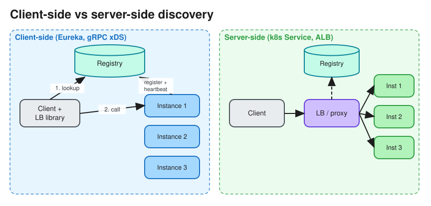

# Service Discovery & Service Mesh

> **TL;DR** — In dynamic environments (autoscaling, containers) instance IPs change constantly. **Service
> discovery** keeps a **registry** of healthy instances and lets callers find them, either **client-side**
> (the client queries the registry and load-balances itself) or **server-side** (the client calls a load
> balancer or DNS name, which resolves). A **service mesh** moves discovery, load balancing, retries, mTLS and
> telemetry into sidecar or node proxies, so application code doesn't implement them.

## Registration
* **Self-registration**: the instance registers on startup and heartbeats or renews a TTL (Eureka, Consul
  agent, etcd lease).
* **Third-party registration**: the platform registers instances for you (Kubernetes watches pods and updates
  `Endpoints` / `EndpointSlices`; AWS ECS + Cloud Map).
* Health checks remove unhealthy instances. See [Heartbeats](heartbeats.md).

## Client-side vs server-side discovery
| | Client-side | Server-side |
|---|---|---|
| Flow | Client → registry (cached) → picks an instance → calls it directly | Client → LB / DNS / proxy → instance |
| Pros | No extra hop; smart LB (least-loaded, zone-aware) | Clients stay simple and language-agnostic |
| Cons | Discovery library needed in every language | Extra hop; the LB must be HA |
| Examples | Netflix Eureka + Ribbon, gRPC xDS clients, Finagle | AWS ALB/NLB, Kubernetes `Service` (kube-proxy / ClusterIP), Consul DNS |

## DNS-based discovery
* Kubernetes: `orders.default.svc.cluster.local` resolves to a ClusterIP (virtual IP), and kube-proxy (iptables
  or IPVS) or eBPF (Cilium) forwards to a pod. Headless services return pod IPs directly (for stateful sets).
* Consul and Route 53 / Cloud Map can serve SRV and A records.
* Caveat: DNS TTL caching and client libraries that cache forever mean slow reaction to changes.
  See [DNS](dns.md).

## Service mesh
* **Data plane**: a proxy per pod (Envoy sidecar in Istio, Linkerd's micro-proxy) or per node (Istio ambient,
  Cilium) intercepts all traffic.
* **Control plane**: pushes routes, endpoints, certificates and policies to proxies (xDS APIs).
* What you get without code changes:
  * mTLS between services (identity via SPIFFE)
  * retries, timeouts and circuit breaking ([Resilience Patterns](resilience_patterns.md))
  * traffic splitting (canary 5%), locality-aware load balancing
  * uniform metrics and traces ([Monitoring](monitoring.md))
* Costs: extra latency per hop (sub-millisecond to a few ms), resource overhead, and operational complexity.
  Adopt it when you have many services and polyglot teams.

## API gateway vs service mesh
* **API gateway**: north-south traffic (external clients → services): auth, rate limiting, request shaping, API
  products. See [API Gateway](api_gateway.md).
* **Service mesh**: east-west traffic (service → service) inside the cluster. They are often used together.

## Interview follow-ups
* *"How do clients of a chat gateway find which server holds a user's WebSocket?"* That is not plain discovery.
  Keep a session registry (`user_id → gateway_id` in Redis with a TTL) or use consistent hashing on `user_id`
  over the discovered set of gateway nodes.
* *"What if the registry is down?"* Clients keep using their last known cached instance list (fail static).
  Run the registry as a replicated cluster (Consul or etcd with Raft).

# References
* https://microservices.io/patterns/client-side-discovery.html
* https://microservices.io/patterns/server-side-discovery.html
* https://kubernetes.io/docs/concepts/services-networking/service/
* https://istio.io/latest/docs/concepts/what-is-istio/
* https://www.envoyproxy.io/docs/envoy/latest/intro/what_is_envoy
